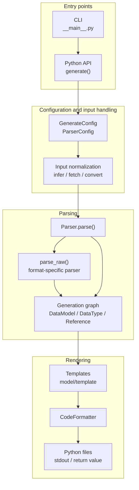
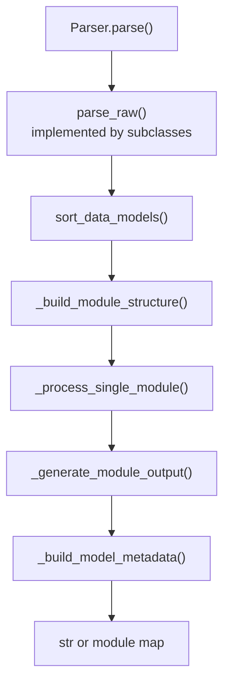
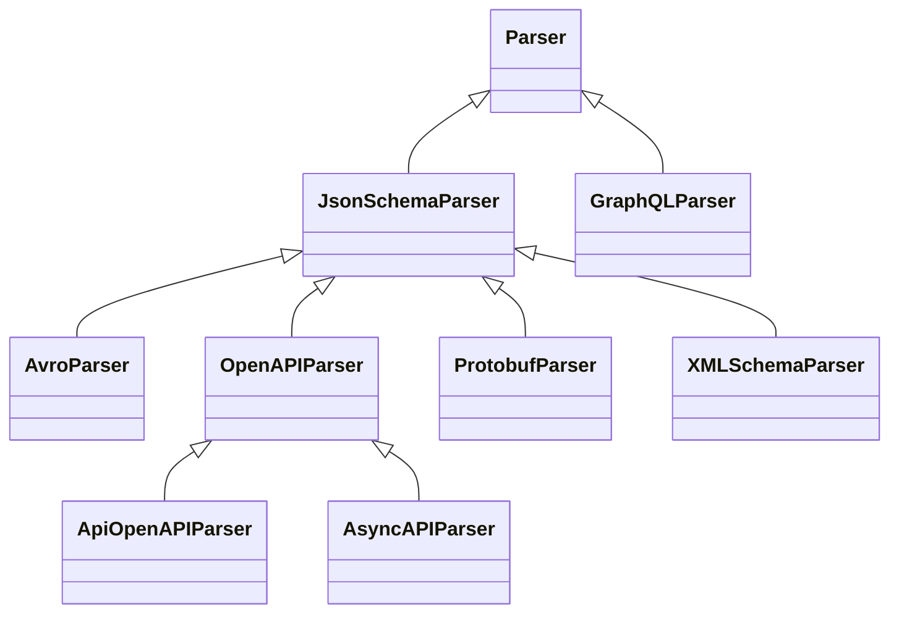
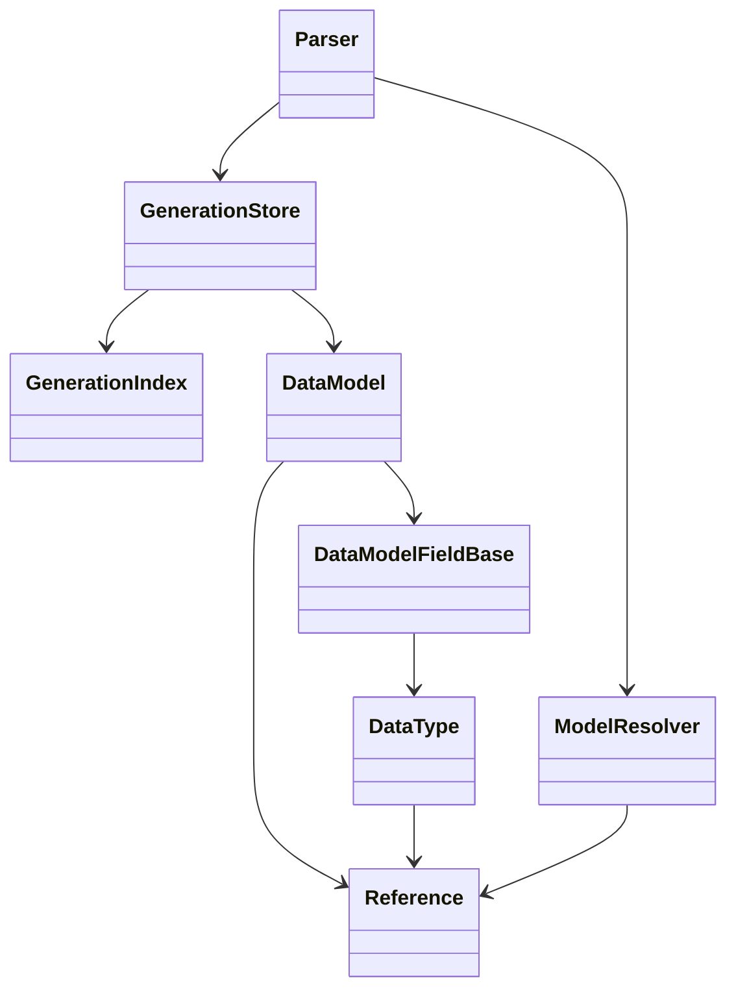

# Architecture

`datamodel-code-generator` is organized around one central idea: many input formats are normalized into a shared
generation graph, then rendered through output-model-specific backends.

This page is partly generated from source code. The generated inventory is intentionally small so the narrative can stay
hand-written while release-time details such as parser routes and output backends stay synchronized.

## Generation Pipeline



The CLI builds a `Config` from command-line arguments, `pyproject.toml`, and presets. It then calls the same
`generate()` API that library users can call directly. `generate()` selects the parser, runs it, and either returns code
or writes files. [Model Processing Passes](#model-processing-passes) lists the passes inside `Parser.parse()`.

## Entry Points

The executable entry point is defined in `pyproject.toml`:

```toml
datamodel-codegen = "datamodel_code_generator.__main__:main"
```

`src/datamodel_code_generator/__main__.py` owns CLI-only behavior:

- fast paths for `--version`, `--help`, prompt helpers, and JSON Schema output
- argument parsing and shell completion
- `pyproject.toml` profile loading and inheritance
- `--check` diff generation
- `--watch` regeneration
- structured JSON command output
- `--input-model` loading before normal generation

`src/datamodel_code_generator/__init__.py` owns the public generation API:

- `generate()`
- input type inference
- raw JSON/YAML/CSV/Dict conversion through genson
- MCP tool schema conversion
- parser construction
- generated headers and output file writing
- optional model metadata emission

## Parser Model

Each parser turns its input into `DataModel` objects. The parser-specific part is `parse_raw()`. The shared part is
`Parser.parse()`, which handles sorting, module layout, imports, rendering, exports, formatting, and optional metadata.



JSON Schema is the main reusable parser surface. OpenAPI and AsyncAPI extend it. Avro, XML Schema, Protocol Buffers,
raw data, and MCP tools convert to a JSON Schema-shaped document before using the same model-building machinery.
GraphQL is the main parser that builds models directly from its own schema API.

Ordering and module splitting use small graph helpers. `_scc.py` finds strongly connected components with an
iterative Tarjan traversal so large graphs do not hit Python recursion limits. `_graph.py` provides stable
topological ordering, the stack walk over what some starts reach (`reach`) and the nodes that reach some seeds (`reaching`). Together they keep `sort_data_models()` deterministic and let `_build_module_structure()` move
circular module SCCs into `_internal.py` forwarder modules when imports would otherwise cycle. `_mro.py` gives the
C3 order of classes and their bases over any item, also without recursion. The passes that read
cycles or an order among models (module dependencies, class body order, circular root models, keep model order, alias
cycles, nested model default factories, the structs below tagged bases, alias loops) each take a snapshot of one reference graph, `_reference_graph.py`:
the models by model key and the edges between them by kind, which answers their components, orders and loops. The
references between models come from the generation store (`GenerationIndex.reference_graph`). The edges between
groups of models, such as the modules of a quotient and the import cycles that the `_internal` merges check, are a
`GroupGraph`, which answers their components and orders the same way. The
predicates that models answer on demand by walking base classes, root types or mapping defaults (inherited fields,
ancestors, cyclic ancestry, the C3 order of bases, msgspec struct tags, pydantic protected namespaces, preservable root
constraints, recursive dataclass mapping defaults) take a snapshot of the models they reach when asked and answer
from it, each model once. Hashability (`model/_decisions/hashability.py`) reads the chain of each set item model, and
of each root model a dict key names, from such a snapshot over base classes.

## Generated Inventory

<!-- BEGIN AUTO-GENERATED ARCHITECTURE INVENTORY -->
!!! note "Generated inventory"
    This section is generated by `scripts/build_architecture_docs.py` from the current source tree.
    Edit the surrounding prose by hand, then run the script before release.

### Parser Inheritance



### Input Routes

| Input file type | Parser route | Notes |
| --- | --- | --- |
| `auto` | `pre-parser inference` | Resolved before parser selection by content inference. |
| `openapi` | `OpenAPIParser` | Routed directly by `_build_parser()`. |
| `asyncapi` | `AsyncAPIParser` | Routed directly by `_build_parser()`. |
| `jsonschema` | `JsonSchemaParser` | Routed directly by `_build_parser()`. |
| `mcp-tools` | `JsonSchemaParser after conversion` | MCP tool input/output schemas are hoisted into JSON Schema definitions first. |
| `xmlschema` | `XMLSchemaParser` | Routed directly by `_build_parser()`. |
| `protobuf` | `ProtobufParser` | Routed directly by `_build_parser()`. |
| `avro` | `AvroParser` | Routed directly by `_build_parser()`. |
| `json` | `JsonSchemaParser after conversion` | Sample data is converted to JSON Schema with genson first. |
| `yaml` | `JsonSchemaParser after conversion` | Sample data is converted to JSON Schema with genson first. |
| `dict` | `JsonSchemaParser after conversion` | In-memory mapping is converted to JSON Schema with genson first. |
| `csv` | `JsonSchemaParser after conversion` | The header and first data row are converted to JSON Schema with genson first. |
| `graphql` | `GraphQLParser` | Routed directly by `_build_parser()`. |

### Output Backends

| Output model type | Data model | Root model | Field model | Type manager |
| --- | --- | --- | --- | --- |
| `pydantic_v2.BaseModel` | `model.pydantic_v2.base_model.BaseModel` | `model.pydantic_v2.root_model.RootModel` | `model.pydantic_v2.base_model.DataModelField` | `model.pydantic_v2.types.DataTypeManager` |
| `pydantic_v2.dataclass` | `model.pydantic_v2.dataclass.DataClass` | `model.type_alias.TypeAliasTypeBackport` | `model.pydantic_v2.dataclass.DataModelField` | `model.pydantic_v2.types.DataTypeManager` |
| `dataclasses.dataclass` | `model.dataclass.DataClass` | `model.type_alias.TypeAlias` | `model.dataclass.DataModelField` | `model.dataclass.DataTypeManager` |
| `typing.TypedDict` | `model.typed_dict.TypedDict` | `model.type_alias.TypeAlias` | `model.typed_dict.DataModelFieldBackport` | `model.types.DataTypeManager` |
| `msgspec.Struct` | `model.msgspec.Struct` | `model.type_alias.TypeAlias` | `model.msgspec.DataModelField` | `model.msgspec.DataTypeManager` |

### Configuration Surface

| Config model | Field count | Purpose |
| --- | ---: | --- |
| `BaseGenerateConfig` | 222 | Shared generation options. |
| `GenerateConfig` | 237 | Public `generate()` configuration. |
| `ParserConfig` | 185 | Base parser dependency injection and parser options. |
| `JSONSchemaParserConfig` | 187 | JSON Schema parser options. |
| `OpenAPIParserConfig` | 195 | OpenAPI-specific parser options. |
| `AsyncAPIParserConfig` | 197 | AsyncAPI-specific parser options. |
| `XMLSchemaParserConfig` | 188 | XML Schema-specific parser options. |
| `ProtobufParserConfig` | 188 | Protocol Buffers-specific parser options. |
| `AvroParserConfig` | 187 | Avro-specific parser options. |
| `GraphQLParserConfig` | 188 | GraphQL-specific parser options. |

### Formatter Names

| Formatter | Default when unspecified |
| --- | --- |
| `builtin` | no |
| `black` | yes |
| `isort` | yes |
| `ruff-check` | no |
| `ruff-format` | no |
<!-- END AUTO-GENERATED ARCHITECTURE INVENTORY -->

## Intermediate Model Graph

The generation graph is built from a small set of core objects:

- `DataModel`: a generated class, root model, type alias, enum, scalar alias, or union alias.
- `DataModelFieldBase`: one field on a generated model, including defaults, aliases, constraints, and metadata.
- `DataType`: a Python type annotation tree, including containers, unions, literals, generated-model references, and
  imports.
- `Reference`: a schema reference path and generated Python name.
- `GenerationStore`: the parser-owned model list plus a query index over model and type dependencies.



`GenerationStore` is the preferred mutation boundary for parser-side changes that affect dependency facts. Parser code
should register models and update references, fields, bases, names, and paths through store methods instead of mutating
the live objects directly. `GenerationIndex` keeps stable facts about the model list and gives later phases efficient
queries such as "which data types point at this reference?". A refresh records only the models that were appended or
that store mutations changed, and rebuilds every fact only when the model list changes otherwise or
`discard_derived_facts()` drops them.

## Model Processing Passes

`Parser.parse()` runs a fixed sequence of passes between `parse_raw()` and rendering. Most of them change models,
fields and data types in place, so a fact that one pass reads may still be changed by a later pass. This section lists
the passes in execution order, says when each fact becomes final, and shows where a new decision belongs. Paths are
relative to `src/datamodel_code_generator/`; names are given as `file:function` so they can be found with `git grep`.

### Layers

| Layer | Entry point | Purpose |
| --- | --- | --- |
| L0 input loading | `parser/jsonschema.py:JsonSchemaParser.parse_raw`, `parser/openapi.py:OpenAPIParser.parse_raw` | Load sources and normalize the raw document before any schema object exists. |
| L1 parsing | `parser/jsonschema.py:JsonSchemaParser.parse_obj`, `parser/graphql.py:GraphQLParser.parse_raw` | Build `Reference`, `DataModel` and `DataType` objects and register models in the store. |
| L2 settle | segment `settle` of `parser/_passes/_tables.py:PIPELINE` | Settle yielding names, report diagnostics, sort models and base classes. |
| L3 module structure | `parser/base.py:Parser._build_module_structure` | Group models into output modules, remove duplicates, reuse across modules, merge circular imports. |
| L4 cross-module pre-pass | segment `plan` of `parser/_passes/_tables.py:PIPELINE` | Facts every module reads before any module is processed. |
| L5 per-module processing | `parser/base.py:Parser._process_single_module` | Prepare and process the models of one module; runs once per module and hands the module over to its render preparation. |
| L6 cross-module finalization | segments `cross_module`, `generic_base_class`, `decide`, `render_preparation` and `finish` of `parser/_passes/_tables.py:PIPELINE`, `parser/base.py:Parser._finalize_modules` | First point where every module has been processed: tags of tagged bases, import repairs, generic base class, decisions, constructor order and render preparation of each module, imports, final renames. |
| L7 rendering | `parser/_passes/imports.py:render_modules`, `parser/base.py:Parser._generate_module_output`, `model/base.py:DataModel.render` | Module code, templates or compiled renderers, exports. |
| L8 formatting and output | `format.py:CodeFormatter`, `__init__.py:_format_deferred_output`, `__init__.py:generate` | Format module bodies and write or return the result. |

`__init__.py:_parse_generation` may run L0–L8 again with a fresh parser (root-model collapse that stops before a
data type cycle, yielding names that class-keyed options name, untyped nullable maps, invalid dotted stdout
modules, and a run that fails after a reference held a document it had prepared as an OpenAPI object of another role,
which parses again with every role known at L0: `document_roles_to_seed`). These are retries around the whole
pipeline, not passes inside it.

**L0.** `_load_source_dict` calls `parser/_schema_documents.py:read_document`, which keeps the document as written and, under
`--use-single-value-enum-as-const`, rewrites one-value `enum` to `const` copy-on-write, except beside `nullable: true`
when the value is not null (`_single_value_enum_as_const`, which skips instance-data keywords and extension keys other
than `x-propertyNames` through `_document_child_entries`). `_parse_file` then calls `_prepare_schema_resources`, which
adds the document to the schema graph (`parser/_schema_graph.py`): `walk_schema_resources` finds which absolute URI
names which schema of it (the root, `$id` or draft-04 `id` resources, the implicit component resources of OpenAPI,
the schemas of the object a reference names the document's root as, `$anchor` and `$dynamicAnchor`) and returns one
frozen `DocumentResources` record (with the base URI of each resource and the plain names more than one schema
declares), from which
`ResourceRegistry.register` fills the registry dicts L1 resolves references through; then `$ref`s that resolve through
an embedded `$id` are rewritten copy-on-write (`parser/_schema_documents.py:rewrite_schema_resource_refs`), and one walk of the prepared document
(`SchemaGraphBuilder.index_document`, see [Metadata Output](#metadata-output)) indexes the location of every object and
makes each `$ref` and `$dynamicRef` keyword a `ResolvedRef` (a `str` equal to the value, carrying its `RefEdge`: the
holder's location and document; copy-on-write, only at the keywords that hold schemas, never inside instance data,
examples, extensions, OAuth scopes, discriminator mappings or unknown keywords; `JsonSchemaObject` and the OpenAPI
`ReferenceObject` keep the edge through a wrap validator).
Referenced documents go through the same steps when `resolve_ref` loads them: documents enter the graph in the order
L1 asks for them, and the graph never loads one by itself. Every reference whose target is static carries an edge: a rewrite of a reference to name its target (canonicalized, lenient or normalized) keeps it
(`keep_resolved_ref`); an object a reference names is read as a schema once (`SchemaGraphBuilder.read_as_schema`), so a
`$ref` the walk read as data or names there (a nested definitions container) gets one too; schemas converted from
another format are mounted with edges to the locations their targets are mounted at (an AsyncAPI payload converted from
Protocol Buffers or XML Schema under the internal container of a root the graph owns for its document,
`SchemaGraphBuilder.mount_root` and `mount_in`, so the loaded document is never written); and a reference the parser derives
gets the edge of the reference it stands for (`_derived_ref`: discriminator mappings and subtypes,
`x-python-type` names, a merged `$recursiveRef` with a fixed target, an `itemSchema` projection, an AsyncAPI Reference
Object). Only the references of the dynamic-scope rule (`parser/_schema_refs.py:dynamic_scope_target`: a `$recursiveRef`, and a plain-name
`$dynamicRef` bound in the dynamic scope or named by the first `$dynamicAnchor` of its name in the document being
parsed) stay plain strings: they resolve against the dynamic scope of the model being parsed, not their own document.
Every L1 site takes the key of a reference from its edge (`_ref_key`, `_ref_path`): the edge's spelling
resolved once, at its first consumption, in the document that holds it (`_home_context`: its location, root `$id`
and, for an OpenAPI input document or under the `api` scope, its `$self`; a schema the parser keeps in a document of its
own, an Avro schema of an AsyncAPI document, names that document as its edges' `home`) through the external mapping, the embedded
resource, the normalized spelling and `ModelResolver.resolve_ref`; a new model is named after that spelling
(`ModelResolver._add_ref_at`). A plain string has no edge and resolves in the context its caller set. A schema copied
into another (a merged `$ref` target, an inherited property) keeps its references as written: a site that asks whether
a reference is a fragment of the document parsed now reads its edge (`_is_local_ref`), and only a merged `$recursiveRef`
with a fixed target is rewritten, to a `$ref` (`parser/_schema_refs.py:pin_recursive_refs`).
OpenAPI and AsyncAPI register a schema that declares a discriminator, and a component schema whose `allOf` names one,
under the key of the reference that names the schema from its own document (`_schema_key`), the key the references to
it get, whatever document is being parsed when the discriminators are collected.
A JSON object of a loaded document is validated once per parse (`SchemaGraphBuilder.schema`): the targets
`_load_ref_schema_object`, `_load_inherited_schema_object` and OpenAPI's `resolve_object` load, the response and request
body targets of `get_ref_model`, and the `if`, `then`, `else` and `not` branches `_get_conditional_schema` reads share
one object per located value and its type, which no reader writes; `DATAMODEL_CODE_GENERATOR_CHECK_SCHEMA_GRAPH`,
which `tests/conftest.py` sets for the test suite, compares each shared object at the end of L1 with the fingerprint
taken when it was validated (`tests/checks/schema_graph.py`). The client and server bindings read the schemas of an API
document by location, one site per location (`ApiOpenAPIParser._site_facts`, see Fact Finality), which the same check
reads anew at every read.
The walks that follow references from a schema (field flags, literal and null checks, inherited properties and
overrides, validation sources, `uniqueItems` rules, merged `allOf` values) visit each schema graph node once
(`SchemaNodeId`, the location of the object a reference names: `_key_node`), and a `$ref` target merged with its sibling
keywords is dumped once per node and document being parsed (`_ref_target_dump`).
A local reference whose model a document has not parsed yet is reserved for that document (`reserved_refs`).
`_parse_file`, `_resolve_unparsed_json_pointer` and AsyncAPI's `_resolve_asyncapi_unparsed_json_pointer` take the
targets from one worklist (`_reserved_targets`: a `ReservedTarget` with the document, the key and the node the key names
in the document's prepared tree), in key order, repeating while a round reserves more keys (`_parse_file`) or adds
models (the others), and parse each target from the prepared tree.
The `$dynamicRef` analysis
(`parser/_schema_refs.py:dynamic_anchors_used`, `dynamic_ref_edges`) and the models specialized for a dynamic scope are keyed by the schema
graph node a reference names, so references that spell one schema differently share its analysis and its specialized
model. The fallbacks of the dynamic-scope rule still read the anchors L1 has registered so far (`_build_anchor_indexes`
and `_parse_file`: the root, the definitions and each schema parsed through `_parse_raw_or_validated_obj`):
`parser/_schema_refs.py:resolve_dynamic_ref`, `_resolve_recursive_ref` and `recursive_ref_target`: a `$recursiveAnchor` below `properties`
is never registered, and an OpenAPI component's `$dynamicRef` parsed before the component that declares its anchor
resolves through its edge instead (row `legacy-dynamic-anchor-parse-index`). Under
`--read-dynamic-anchors-in-document-order` the `$dynamicRef` fallback reads the first `$dynamicAnchor` of its name in
the document of the dynamic scope as loaded (`document_dynamic_anchor`, `DocumentResources.first_dynamic_anchors`).
A plain-name fragment (`#name`) left after the embedded-resource and lenient resolutions names the schema the registry
records for it against the base URI of the schema resource enclosing the reference (`parser/_schema_documents.py:plain_name_ref`,
`ResourceRegistry.plain_name_uri`): an `$anchor` or a `$dynamicAnchor` at any position of the resource; a name the
model resolver registered in the walk of the definitions (`parse_id`) keeps that answer (row `legacy-anchor-parse-index`).
An object `$ref` with sibling keywords is parsed as its target merged with them at the field that holds it (row
`ref-site` of the field table, `JsonSchemaParser._build_field_ref_site`), at each path that reaches it (row
`legacy-merged-site-per-path`); under `--use-one-model-per-ref-site` each site, the object that holds the `$ref` with
the `$dynamicAnchor` bindings of its dynamic scope, gets one model (`parser/_schema_refs.py:ref_site_reference`, a
parser-owned table like the dynamic specializations; a site with schema validators takes row `validated-ref-site`,
before `schema-validator-object`), which every copy of it a merge leaves unchanged shares, parsed from a worklist after
the model that met it, in the context it was met in (`parse_ref_sites`, drained after each `_parse_schema_obj` and
around the targets a parse reserves), so a chain of such sites nests no parse per hop. A recursion limit exceeded in a
site that another site holds, parsed in place, names the option where it would remove that nesting: without it and
unless request and response models are split (`_document_reader.py:MergedRefSiteRecursionError`, `nesting_limit`).
A plain-name `$dynamicRef` that the dynamic-scope rule leaves to its edge reserves its target as a `$ref` does
(`resolve_ref_callback`). A plain name that more than one schema of a document declares
(`DocumentResources.duplicate_names`), which JSON Schema leaves undefined, warns where a reference uses it
(`duplicate_name_location`, a `SchemaResourceRefWarning` per name), and names its first declaration in document
order under `--read-dynamic-anchors-in-document-order`.
OpenAPI parses its main document in `_parse_specification` (merging path-level parameters into shallow copies of
operations in `_process_path_items`) instead of `_parse_file`. Converted inputs (Avro, XML Schema, Protocol Buffers)
build a JSON Schema dict and call `_parse_file` without `parser/_schema_documents.py:read_document`, so document rewrites do not apply to them.

**L1.** Each place where the parser meets a schema object chooses its parse method from one table of
`parser/_schema_dispatch.py`: `_DEFINITION_TABLE` in `_parse_schema_obj` (definitions, roots, reserved targets,
AsyncAPI payloads and the `api` scope), `_FIELD_TABLE` in `parse_item` (fields, items and map values) and
`_OPENAPI_OPERATION_TABLE` in `OpenAPIParser.parse_schema` (the bodies, responses and parameters of the legacy scopes). A table
holds, in order, the steps that rewrite the site (a `$ref` with sibling keywords merged with its target,
`_merge_ref_with_schema`) and the rows whose predicates choose `parse_array`, `parse_all_of`, `parse_one_of` or
`parse_any_of` (both through `parse_combined_schema`), `parse_object`, `parse_enum`, `parse_root_type` and the other
builders; the rows of an object-kind schema (`_OBJECT_KIND_ROWS`) are shared by the definition table and the
object-kind table that `_parse_object_kind_schema` chooses from. A predicate or builder that rows of several tables share
is one module function of `parser/jsonschema.py` (`_array_applies`, `_parse_root_type_site`, ...), which
`parser/openapi.py` imports: a row holds the function itself, and a function of a concern module (`parser/_<concern>.py`)
that takes the parser first is the `--debug` tracer's wrapper in a module that imports it after `snooper_to_methods` ran.
Rows that differ only in data are one function too, bound to it without a frame of their own: the field rows
`any-of` and `one-of` are made by `_field_union_row` for their keyword, and the `one-of-any-of` rows of definitions and
operation schemas are `_parse_combined_root`, which a definition binds (`functools.partial`) to read a oneOf or anyOf
of consts as its Enum or Literal root model first. The predicate of the `all-of-beside-one-of` rows is one function
(`_all_of_beside_one_of_applies`): a definition with an allOf beside a oneOf or anyOf is that union, and an operation
schema is too unless row `legacy-operation-all-of-before-union` (without `--distribute-allof-over-unions`) keeps its
`all-of` row first. Rows call the public hooks through the parser, so overriding subclasses keep working; a
change of what a position parses is a row edit. A table also declares what its sites type (`TypedChild`: the child schemas and the models their types name): `DispatchTable.typed_children` returns the declaration of the row chosen for a site (`Row.typed`), else the table's (`DispatchTable.typed`); the field table's `python-type` and `custom-type` rows type nothing, its `constrained-item` row the root model of the site's schema (`TypedChild` `root`: it holds one type and no fields, so an object's properties type nothing, and its additionalProperties type the values of a dict only where `_parse_root_type_with_context` builds an object map, its rows `object-map` and `typed-nullable-map` of `_root_type_row`, whatever properties the schema holds), its other rows the model of the site's schema, and the definition table's sites what `_typed_model_children` lists. The row is chosen as `parse_item` chooses it, after the steps of the table (`title-name`, `ref-siblings`) rewrite the site and with the parent `parse_item` gets (the array of an item, the schema of a oneOf or anyOf member, the schema of an additionalProperties value where the output writes field constraints); a property reads a `$ref` merged with its siblings before the table chooses (`parse_object_fields`), so the walk passes the merged site there (`typed_children(as_parsed=...)`). A oneOf or anyOf member is the branch `parse_combined_schema` parses (`_combined_schema_members`: the member mixed with the keywords of its parent, a `$ref` member merged with its siblings), and an additionalProperties value is what `_parse_additional_properties_value` builds (`_additional_properties_value`: the root model of a value with effective constraints, else the site `parse_item` gets), so the walk reads both from the function that decides them. The request/response split walks a key by asking them (`_get_ref_schema_rw_model_reference_facts`), not by listing positions itself. `DispatchTable.choose` returns the chosen row as a `Choice` and the position's method
builds it in its own frame, so a nested schema costs no more stack frames per level than the parse methods it reaches
(`test_main_nesting_within_recursion_limit` fails when it does). A definition written as a `$ref` whose sibling keywords cannot merge into its circular target gets no model outside a definitions container (the `ref` row; `--openapi-as-definitions ref-components` counts the components of an OpenAPI specification as one, `OpenAPIParser._definition_entry_prefixes`); once every schema is parsed (`_end_schema_parsing`), the users of its reference move to the reference that `$ref` names (`_type_references_to_definitions_without_model`), so a reference to it is typed by its target, as such a `$ref` is at a field. Then a schema that an allOf base names, that got no model and that a field naming it would be typed by an import, the class `--external-ref-mapping` imports for a schema of a mapped document or the class `x-python-import` names (not a type expression in its place), is parsed into a stand-in (`_parse_base_stand_ins`): its model, parsed in its own document under the reference the base names (`parse_json_pointer`, past the `x-python-import` shortcut, and the targets that parse reserves there), in the module of the first model that names it, with the import kept by model key (`Parser._base_stand_in_imports`). Only that schema is a stand-in: the other models the parse adds are written, as a generated base gives them. A stand-in may name further such bases and definitions parsed as their `$ref` alone, so the parse and the redirect repeat until no new stand-in appears. Then the import types every other user of a stand-in, one that a reference its document does not map names, as it types a mapped `$ref`, and the parse adds nothing to the imports every module shares: a stand-in is never written, and the models the parse writes import what their types name. A stand-in never splits into read/write variants (`parser/_rw_split.py:get_separate_model_fields`, `_register_root_model_as`), takes part in no reuse (`_ReuseOptimizationContext`), name uniqueness, module dependency or import (L3, L5 `change_from_import`), and leaves its module where model-level type overrides remove models; a stand-in of `x-python-import` is never dropped as a generated root model is (L3 `delete_duplicate_models`), as the class it declares is the base whatever its schema describes. Once every module is processed, the import replaces the bases that name a stand-in (`apply_base_stand_in_imports`), so every pass before reads it as a generated base, in every module whatever their order. Then a model that uses a `$ref` that `--external-ref-mapping` maps and whose fragment names no schema stops with an error (`_reject_mapped_references_without_schema`), and the late hook `_generate_forced_base_models` runs. That merge, the inherited `$ref` property
merge (`_resolve_inherited_parent_property`) and a property that overrides an inherited one
(`_merge_properties_with_parent_constraints` through `_inherited_override_schema`, unless `--allof-merge-mode none`)
stand for the intersection of their parts: the earlier merge (`parser/_intersection.py`: `concatenating_row`,
`inherited_override_row`) stays wherever it enforces what the intersection enforces, and
`parser/_intersection.py:intersect_keywords` writes the tightest bounds, the least common `multipleOf`,
the common `type` and `enum` values, the union of `required` and a `false` that a part sets where the merge does not;
nested schemas follow the same rule. Under `--intersect-combined-schema-keywords` each inline branch of an `anyOf` or
`oneOf` is the intersection of its keywords and those beside it in the same way (`JsonSchemaParser._combined_branch_row`,
its `nullable` left out of the parts), and where parts meet an `enum` loses the values the merged `type` rejects. Where the document's dialect (draft 7 or earlier, OpenAPI 3.0) does not read
`$ref` siblings as parts, a sibling `enum` that the document writes does not narrow the referenced schema (the legacy
sibling enum row; an inherited property override is a part in every dialect). Null comes from the site's own `nullable`, `type` list or `null` value, else only
if every part admits it (`parser/_null_facts.py`, site `all-of-parts`). A keyword whose parts have no value in common keeps the earlier value and warns
(`warn_unsatisfiable`); `pattern`, `format`, tuple positions, combinators and allOf members are not intersected there
yet. A oneOf/anyOf of constants can become a synthetic enum
(`parser/_value_keywords.py:extract_const_enum_from_combined`). An enum class takes a value base (`IntEnum`, `StrEnum`,
`--use-subclass-enum`'s `(T, Enum)`) only when that base keeps every member value (`T(v) == v`, NaN equal to itself),
and is a plain `Enum` otherwise (`model/_decisions/enum_kind.py:decide_enum_kind`). A `const` that admits some but not
all values of the `enum` beside it leaves every enum class as written; `parse_enum` records the const for the model it
builds (`_note_const_narrowing`), the end of L1 marks every value that names that model, and L5
`type_const_narrowed_values` types those values. A Literal enum route (`_enum_value_type`), a `propertyNames` key and
a Literal root type keep only the admitted values (`_const_narrowed_enum`); a const equal to none of the values only
warns. Under `--read-const-beside-enum` and `--use-single-value-enum-as-const` each enum route reads an enum that admits
the const beside it as that const, without an enum class (`_reads_enum_as_const`); like the L0 rewrite, it keeps an enum beside `nullable: true` and
a const other than null, and a model built for the schema object itself then holds only the admitted values
(`_definition_enum`). An object map, an object without `properties` whose keys and values `patternProperties`,
`propertyNames` or `additionalProperties` type, is built by one builder at every position (`_parse_object_map`): one
dict whose value type is the union of the value types of its key classes, never a union of dicts. The dict itself admits
the null of a type array of object and null, or of `nullable: true` under `--strict-nullable` as `_get_data_type` does
for other types, so property counts stay on it, and the other types of a type array join it in a union. A `nullable`
that `parse_combined_schema` copies from an anyOf or oneOf parent into a branch is marked on the branch, and the dict of
that branch leaves it to the union. Without `--use-single-dict-for-object-maps` the builder keeps the 0.86.0 forms as
its `legacy-map-*` rows (see "Legacy rows"). Names come from `ModelResolver.add`.
Each model records the location of the schema object it is built from on its `Reference` (`_record_schema_object`).
Every use of a reference gets a new `DataType` that points to the one shared `Reference`. allOf `$ref` items become base
classes; inherited fields whose parent is not parsed yet stay as placeholders that L5 resolves. Discriminators are only
captured here (`field.extras["discriminator"]`), each mapping path with the location the parser resolves it to from
the document that declares the mapping (`parser/_union_tags.py:located_mapping_paths` over the references of
`discriminator_mapping_refs`, which an OpenAPI union built from a mapping reads too); the tag passes match a variant by
that location where it is the schema of one (`parser/_tag_plan.py:located_mapping`). Field construction already decides
const handling: `DataModelFieldBase.__init__` calls `process_const()`, which types the const and decides its default
and nullability (`model/_decisions/literal_default.py`). Dataclass-like models (`dataclasses`, Pydantic dataclasses,
msgspec Structs) sort their fields when they are built, by `DataModel.FIELD_CONSTRUCTION_ORDER_KEY`. The key reads only
facts known then: on a Pydantic dataclass, a `None` default that `--strip-default-none` may keep counts as no default,
while a msgspec Struct counts every optional field as having one, as it never strips its defaults.
`fix_constructor_field_ordering` (`parser/_passes/render_prep.py`), after the decision phase, decides with the output
model's assignment facts
(`DataModel._field_assignment_facts`, the row `FIELD_ASSIGNMENT_CHECKER` is a view of), which state what the template
writes, and moves fields whose default the template keeps after the fields without one. An inherited field that two
bases put after a default, which `dataclasses` rejects while creating the class, gets a keyword-only copy in the class
(`get_constructor_ordering_conflicts` of `parser/_passes/_shared.py`), whose types name their models from its module.

**L2–L4.**

| Pass (`parser/_passes/`) | Reads | Changes |
| --- | --- | --- |
| `ModelResolver.settle_yielding_names` (`reference.py`) | names that yield to `--model-name-map`, the site models of the parse | `Reference.name` of yielding models; the reuse groups plan (`ReuseGroups` of `parser/_model_shapes.py`): the yielding models and the site models yield the canonical place of a group of duplicates |
| `name_models` (`parser/_passes/naming.py`) | the names the resolver and the settle gave | the naming plan (`NamingPlan` of `parser/_naming.py`) that L3 reads for the name a model was numbered from; under the `legacy` policy it names no model |
| `sort_data_models` (`parser/_passes/settle.py`) | references through the store index | model order, models that need forward-reference updates |
| `sort_base_classes_for_mro` (`parser/_passes/settle.py`) | base classes | base order (before L3 and L5 reuse add bases) |
| L3 `_union_tags` snapshot (`parser/_passes/structure.py`) | discriminator mappings | union tags that reuse compares, taken before any merge |
| L3 `delete_duplicate_models` (`parser/_passes/structure.py`) | rendered model text (`ModelShapes.key` of `parser/_model_shapes.py`) | redirects users, edits base lists (drops root-model bases, not the stand-ins of `x-python-import`), removes models (a root model that names itself is removed from the bases of its children, which keep their other bases, and is recorded in `_self_named_root_models`, as the fields that use it keep its name) |
| L3 `replace_duplicate_name_in_module` (`parser/_passes/structure.py`) | class names, the imports stand-ins stand for (bound in each module that inherits one), the names `--model-name-map` reserves (`ModelResolver.reserved_names_in_module`) | `class_name` (not of stand-ins) |
| L3 `rename_submodules_hidden_by_classes` (`parser/_passes/structure.py`, `--rename-submodules-hidden-by-classes`) | class names of each module, module paths, the names that an earlier attempt of the run found each package to bind in its output where they disagreed with its renames (`ImportCycleSeeds.package_classes`, from the L7 `reject_class_named_like_submodule`) | the reference names, or the output files of a directory input, of the models of each submodule named like a class of its package (by those names where the run has them) and of the modules below it: the submodule takes the first free `padded` name (`Warn_`) that no class holds here or by those names; records the renames (`Parser._hidden_submodule_renames`) and the input file of each renamed output file, which the header of its module names (`Parser._renamed_module_inputs`); regroups the modules |
| L3 `reuse_model_tree_scope` (`parser/_passes/structure.py`) | rendered model text across modules, the import cycle seeds | moves canonicals to a shared module, replaces duplicates by empty subclasses or removes them; the subclass of a duplicate whose module is in an import cycle that an earlier attempt of the run found to fail (`ImportCycleSeeds.merges`) is named by every user, as the cycle merges and moves it to an `_internal` module, the others by the users of its module |
| L3 `resolve_circular_imports` (`parser/_passes/structure.py`) | module dependency graph (the references of field and base types and of the types that schema validator rules name, those of an alias written as a class for its rules included; without stand-ins), module paths, class names, the `--all-exports-scope` scope | merges cyclic modules into `_internal` modules, and with them the modules and merges of each import cycle through an `_internal` module that would fail (a module it imports below a package of the merge runs that forwarder while `_internal` is half built, unless the cycle is that package and modules below it, which runs first; a module it imports that uses a merged model imports it back; with `--all-exports-scope` the `__init__` module of a package that is no merged module imports the modules below it that have a name to export, so the cycles through it fail too), relocates models; a model whose class name an earlier model of the merge holds takes `<name>_<n>` with the smallest `n` no merged model holds (`_merged_class_names`); a stand-in moves along without taking part in the names or the re-exports; the modules of each import cycle that an earlier attempt of the run found to fail as the output is imported (`ImportCycleSeeds.merges`, from the L7 `check_import_reads`) join the merges as a failing cycle does, a cycle that holds no merge as a merge of its own |
| L4 `flatten_conflicting_base_layouts` (`parser/_passes/plans.py`, msgspec) | bases, fields, possible tags (`possible_tag_names` of `parser/_tag_plan.py`) and reuse duplicates (`find_possible_reuse_duplicates`) | copies base fields into Structs whose generated bases have conflicting layouts, sorted by the construction key (`DataModel.FIELD_CONSTRUCTION_ORDER_KEY`), and drops those bases |
| L4 `unconstrain_union_members_in_modules` (`parser/_passes/plans.py`, msgspec) | union members | field types |
| L4 `set_circular_root_model_paths` (`parser/_passes/plans.py`) | root-model reference graph | the circular root models (`RecursionFacts` by model key) that every module's collapse reads |

Module order is not dependency order: `_internal` modules of import cycles come first, then the tree-scope shared
module, then `_group_models_by_module`'s sort (longest module path first, reverse lexical).
Single-file output has one module, so "per module" then means the whole graph.

**L5**, per module, in this order:

| Step | Pass (`parser/_passes/`) | Reads | Changes |
| --- | --- | --- | --- |
| prepare | `alias_shadowed_imports` (`parser/_passes/_import_aliases.py`) | field names vs imported names | import aliases |
| prepare | `override_required_field` (`parser/_passes/_shared.py`) | inherited placeholders, base models (any module) | replaces placeholders by copies of inherited fields, required, defaults |
| prepare | `replace_unique_list_to_set` (`parser/_passes/modules.py`) | `uniqueItems` but that of a type list, defaults | list to set (`_create_set_from_list`), set defaults |
| prepare | `change_from_import` (`parser/_passes/modules.py`) | references to other modules, in field and base types, in the types of schema validator rules and in backend settings (TypedDict `extra_items`); not of stand-ins, nor of the bases that name them, nor of a root that names itself, which deduplication dropped (`_self_named_root_models`) | module imports, `data_type.alias` |
| prepare | `extract_inherited_enum` (`parser/_passes/modules.py`) | field-less models with Enum bases | replaces the model by a new Enum with the same `Reference`, of the class of its first Enum base (`decide_enum_kind`), without the members of the other Enums that class cannot hold (`holds_inherited_member_value`: a value `int()` refuses in an `IntEnum`, as `None` or `'bad'`; a value that is no str in a `StrEnum`) when that class is an `IntEnum` or a `StrEnum` |
| process | `set_reference_default_value_to_field` (`parser/_passes/modules.py`) | defaults of referenced models | field defaults |
| process | `reuse_model` (`parser/_passes/modules.py`) | rendered model text and union tags of this module's models | replaces duplicates by empty subclasses (users in this module redirected) or removes them (Enums, `--collapse-reuse-models`: users in every module redirected) |
| process | `replace_type_list_unique_list_to_set` (`parser/_passes/modules.py`) | the `uniqueItems` of a type list (`declares_type_list_unique_items`), the models deduplication and reuse merged into the model (`merged_models`, recorded by `merge_duplicate` and `subclass_duplicate`) and their fields of that name, own or inherited | list to set where every merged model declares `uniqueItems` there too, else the list 0.88.0 wrote; set defaults |
| process | `collapse_root_models` (`parser/_passes/modules.py`) | root models referenced from this module (any module), circular paths from L4, the module of each inner model (found by identity in the live module lists) | inlines root types, merges constraints, calls `process_const()` again, redirects references to a root model's inner model and imports it where this module does not emit it, renames (the `parent` strategy names the inner model of any module after the root it replaces, decided at the root's first holder; from then on the root is no member of its module for `change_from_import` and `import_renamed_types`), marks unused roots (not a root that a schema validator rule names); inlining a root's tree under a data type that the tree reaches would make that data type contain itself, so collapse raises `_CollapseRootModelsRecursionError` before it and `_parse_generation` parses again with every circular root model kept named (a `RecursionError` in collapse takes the same retry and is a `MODEL_GRAPH` check violation) |
| process | `set_default_enum_member` (`parser/_passes/modules.py`) | defaults vs Enum members | defaults |
| process | `sort_models` (`parser/_passes/modules.py`) | `--keep-model-order` | model order |
| process | `change_field_name` (`parser/_passes/modules.py`) | field names vs type names | field names, class names of referenced types (any module) |
| process | `restore_inherited_field_names_for_unique_aliases` (`parser/_passes/modules.py`) | inherited field names | field names |
| process | `apply_discriminator_type` (`parser/_passes/modules.py`) | captured discriminators, variant models (any module); tag values from `model/_decisions/tag_value.py`, tag defaults from `model/_decisions/literal_default.py` | tag field types, required and defaults on variants, appended tag fields, msgspec struct tags (possibly deferred to a later module) |
| process | `type_const_narrowed_values` (`parser/_passes/modules.py`) | values marked at the end of L1 with the const that narrows the enum they name, the enum now named (after reuse and collapse), its members | types each value `Literal[<Enum>.<member>]` when the members equal their values and the output's Literal holds members, None for a null const; otherwise keeps the enum and warns once per schema location |
| process | `set_one_literal_on_default` (`parser/_passes/modules.py`) | required one-literal fields; decision from `model/_decisions/literal_default.py` | default, required, nullable |
| process | `refresh_field_config` (model) | field state | backend field config |
| process | `rename_fields_hiding_types` (`parser/_passes/modules.py`) | same-named fields and types of the model family | field names or type names |
| process | `remove_overridden_models` (`parser/_passes/modules.py`) | model-level `--type-overrides`, stand-ins | removes overridden models and stand-ins from the module's list (constructor ordering still runs on them) |
| process | `apply_field_type_overrides` (`parser/_passes/modules.py`) | `--type-overrides`, field names | field types of the kept models; model-level overrides edit nodes on fields in place |
| process | `type_dict_keys_by_root_types` (`parser/_passes/modules.py`) | dict keys that name a RootModel whose instances cannot be dict keys (`DataModel._keys_take_root_type` over `model/_decisions/hashability.py:dict_key_takes_root_type`: not frozen, no validators, methods or custom root template), its root type and `Field()` constraints (any module) | types the key by the root type, the constraints written into a string type; follows root models inside that type, not union members of a key; refreshes the backend config |
| finalize | `apply_base_class_type_overrides` (`parser/_passes/modules.py`) | model-level `--type-overrides` (not of the bases that name stand-ins) | base classes; edits base-class nodes in place and keeps the generated model each replaced base stood for, which constructor ordering reads |

Once every module is processed, `write_rule_aliases_as_classes` (`parser/_passes/modules.py`, `--generate-schema-validators`) writes each type
alias that holds schema validator rules and that collapse left written as the RootModel class, under its model key:
an alias has no class body for the rules, and whether collapse inlines it into all its holders is final only then.
The class imports the models of other modules that its rules name, as `change_from_import` does for a class.
Last, `apply_base_stand_in_imports` (`parser/_passes/modules.py`) replaces the bases that name a stand-in (L1) by the
import of the class it stands for, as `apply_base_class_type_overrides` replaces bases: until then the passes of every
module read the stand-in as a generated base when they walk the bases of a model of another module, whatever the
order of the modules.
Then `settle_discriminated_unions` (`parser/_passes/modules.py`, Pydantic models and dataclasses) writes no
`discriminator=` for the union of a lone `$ref` variant that no tag reaches: `apply_discriminator_type` writes the
tags of the variants a union lists, not of one it names alone, and a union of any module may still tag that variant, so
a variant without a tag is final only once every module is processed. It writes none either for a lone variant that is
no model (a scalar, `Any` or None, as `--collapse-root-models` leaves a scalar alias in its holder, or as an inline
schema is), which Pydantic rejects as a variant, nor for a union that takes a root model, or a type alias, with a
default as a variant (`--force-optional` gives a root one), as Pydantic reads the root as a `default` schema, which no
tagged union holds; the default is what the root writes (`Field(None, ...)`, the assignment after its annotation, a
default factory), not what its facts hold. A type alias that holds the default of its schema writes it only once
`set_validate_default_on_fields` adds `validate_default=True` to the `Field()` call, so the check reads the facts that
pass reads (`validates_structured_default`: required state, default, type); under `--use-annotated` the call holds no
default, so the alias writes none.

**L6**, after the module loop:

| Pass (`parser/_passes/`) | Changes |
| --- | --- |
| `tag_fields_of_tagged_bases` (`parser/_passes/cross_module.py`, msgspec; decided by `iter_struct_tag_decisions` of `parser/_tag_plan.py`) | tags structs that inherit a tagged base (the tag field becomes a ClassVar) or opts them out, and opts out the structs whose tag field a base keeps as a field (their tag field is a typed field again) |
| `write_enum_member_tags_as_values` (`parser/_passes/cross_module.py`, msgspec) | types the tag field of a variant by the values of its enum members, as msgspec's `Literal` holds no member, once the structs are tagged |
| `import_removed_reuse_canonicals` (`parser/_passes/cross_module.py`) | imports of models that a later module's reuse removed |
| `import_renamed_types` (`parser/_passes/cross_module.py`) | imports of types that a later module renamed |
| `import_enum_member_literal_classes` (`parser/_passes/cross_module.py`) | imports for enum member literals |
| `apply_generic_base_class` (`parser/_passes/cross_module.py`) | inserts the generated base model and rewrites base classes; the module an earlier attempt of the run seeded where an import of the class failed (`ImportCycleSeeds.base_class_module`) holds it |
| decision phase: the decisions of `Parser._DECISION_PASSES` (`omit_held_null` behind `--omit-redundant-reference-null`, `omit_untaken_union_constraints` behind `--field-constraints`) | the facts each declares, read from `FinalFacts` ([Decision Phase](#decision-phase)) |

Render preparation, for the models each module had at the end of L5:

| Pass (`parser/_passes/render_prep.py`) | Runs | Reads | Changes |
| --- | --- | --- | --- |
| `assign_module_forward_reference_fields` | module by module | `--use-annotated` with deferred annotations | assignment form, may reorder fields |
| `fix_constructor_field_ordering` | over every model, each after the models it inherits from | required and default state, assignment form, inherited fields (a base a model-level override replaced as the generated model it stood for), rendered nullability (`types.py:DataType.admits_none`), field types after overrides | field order, constructor adjustments, keyword-only copies of inherited fields and the imports of their types |
| `unbind_fields` (model) | module by module | hidden type names | field binding |
| `update_type_aliases` | module by module | model order, forward references, fields a statement evaluates as it runs (functional TypedDict) | quotes forward references in place (`data_type.alias`), also with deferred annotations in the fields a statement evaluates as it runs, which a functional TypedDict takes from its bases too; a later `type` statement only where the runtime evaluates its name as the model is defined (no deferred annotations, a typed extra before Python 3.14, a functional TypedDict); union operator along one `.parent` chain; schema validator rules get quoted copies of the types that name the model or a later one |
| `set_validate_default_on_fields` | module by module | live models, defaults | deserialized defaults, default validation |
| `warn_required_assignments_after_defaults` | module by module | field order | warnings |

Then, over every model:

| Pass (`parser/_passes/render_prep.py`, `parser/_passes/imports.py`) | Changes |
| --- | --- |
| `fix_tag_opt_out_field_ordering` (msgspec) | keyword-only order of the structs that opted out of a tag, and of those inheriting from them |
| `_finalize_modules`: `prepare_type_alias_fields`, `finalize_type_alias_users` (backend) | type-alias field form, backend config |
| `mark_set_item_models_hashable` | identity hash for set item models that keep no builtin hash (`model/_decisions/hashability.py`) |
| `_finalize_structured_imports` | imports |
| `decide_nested_model_default_factories`, `freeze_field_render_plans` | the nested models' default factories (row `legacy.L-NF`), one frozen render plan per field of the built-in output models (B2) |
| model imports snapshot, unused-model removal | imports, module model lists |
| `remove_unused`, `resolve_module_import_conflicts` (backend), `_bind_module_field_names` | module imports, field binding |
| `change_imported_model_name` | renames models that collide with imports (the last class-name change) |
| `model._name_final_classes` (model hook) | renders TypedDict `extra_items` again from the data type it was built from, so that it names the final class, and a class of another module through its import |
| `_check_model_inheritance`, `reject_alias_cycles_without_schema` (output that Pydantic builds or msgspec decodes), warnings, `_set_nested_model_default_factory_metadata` | errors, warnings, publishes the nested-factory decision for the models that render without frozen plans |

Three L6 passes repair results built from facts that changed afterwards: `import_removed_reuse_canonicals`
and `import_renamed_types` (reuse and renames in a later module, including the `parent` collapse rename) and
`fix_tag_opt_out_field_ordering` (constructor ordering counts an opted-out struct's own field named like the tag at
the place of the base's tag class variable).

Constructor ordering and render preparation run once, after the decision phase, for every model: ordering reads the
facts every module and decision left, and the assignment form of every module, and orders each model after the models
it inherits from, so a model's constructor no longer depends on whether the module of its base is processed before or
after its own (since 0.87.0). Code that overrides `_process_single_module` and runs after
`super()` sees the module before its constructor order and render preparation; the generic base class, the decision
phase and that render preparation run in the pipeline before `_finalize_modules`, so an override of
`_finalize_modules` that does not call `super()` no longer skips them, and a direct call of `_finalize_modules` no
longer applies the generic base class.

**Module imports.** The passes from L1 to L7 write the imports of a module (`ModuleContext.imports`) and the imports
all modules share (`Parser.imports`) only through `parser/_imports_plan.py:ModuleImportLedger`, which applies each write to
the live `Imports` at once and keeps it as an entry with its producer: the pass (`ImportPass`), and the model and
field it wrote for. The live `Imports` is the replay of its entries (`replay`). `imports.py` reads every import the
same way: by its module and name (`_import_key`, the key every alias map uses), a stored `X as Y` split into the name and
the alias kept apart (`_stored_import`), the module `--import-overrides` moves a name to (`_override_module`, never a
`__future__` name), whether an `Imports` holds an import or drops every count of it (`_holds`, `_remove_all`),
the names an import block binds (`_iter_import_bindings`), and the alias `<name>_aliased` an import takes where a name
of its module hides it (`_aliased_name`, each caller numbering it by its released row, `legacy.alias-order`) with the
import that binds the identity under it (`_aliased_as`). How a module imports a model of another module and writes
the expression that names it is `parser/_passes/_import_binding.py`: the rule (`reference_import_target`, under an
`ImportPathRow`; a model is imported from its module, not through the module its package imports, where the module is
named like an import every module shares, such as an `--additional-imports` name, since the package binds that name
too; the import then takes an alias where a shared import binds the model's name as well), the import it adds (`register_reference_import`), the import of the generated base class, by the same
rule (`generic_base_class_import`), and the writes through the generation store
(`set_reference_expression`, `set_reference_expressions`, `import_references`), and the re-import of what a module
imported under a stale import (`reimport_references`: drop it, release the names it leaves, write the expression again,
under a `ReimportRow` named after the pass: collapsed holders, renamed types, removed reuse duplicates); the
relative import text it writes, which the forwarders of `parser/base.py` write too, is `_module_paths.py` (`relative`,
`join_module`, `exact_import`, `is_ancestor_package_reference`, `absolute`). The aliases imports take where a field name of the module hides the names they bind
are `parser/_passes/_import_aliases.py` (`alias_shadowed_imports`), which writes them into every type, runtime
expression, additional import and base class that carries the import.
The import block that `_generate_module_output` writes is `ModuleImportLedger.rendered`: a copy of the live `Imports` minus what the entries
wrote of their models' unrendered imports (`DataModel._unrendered_imports`), counted as the difference between the
replay of the entries and their replay without those imports, so the module lines keep their order and imports
written outside the ledger stay. The named row `legacy.enum-member-import-bindings` uses it: an Enum's `imports` keep
the imports of its member declarations (pydantic's `Field` for described members), so the module binds their names
for class names and reuse keys as in 0.86.0, while the import block leaves them out. The output model's `resolve_module_import_conflicts` gets the live
`Imports`; `ModuleImportLedger.external` records what it changed. `DATAMODEL_CODE_GENERATOR_CHECK_MODULE_IMPORTS`
compares each module's imports with the replay of their entries when the import text is written, so a write that
bypasses the ledger fails the check, which the test suite turns on. The names the module's `ModelResolver` gives its
imports are asked for through the ledger too (`NameLog`). After the last rename, `tests/checks/module_imports.py` plans
the models each module names from the final names (`NameTable`): `ModuleImportPlan` holds the imports of other modules'
models, named by `allocate_bindings` in the order the module asked for them (row `legacy.alias-order`), and what the
module writes for each model. Nothing is written from the plan yet; under the same check, the module must write what
the plan writes and its imports must bind every planned import.

**L7.** `_generate_module_output` builds the import block, calls the backend's `render_module_code`, renders each
model and formats the body. It first refuses each relative import block it writes (the module's, the
`--all-exports-scope` exports and a forwarder's, `parser/_passes/imports.py:reject_unimportable_imports`) that names a
module by a part that is a keyword (a directory or file named `class`) or, under `--treat-dot-as-module`, not an
identifier (`1.0` is the packages `_1` and `0`), which the output would write as a syntax error. It reads the final blocks, so an import a pass dropped (a collapsed root model) is not refused, and it
leaves the layout of the modules as released. Each such block is kept (`Parser._record_written_imports`), and
`parser/_passes/imports.py:check_import_reads` runs the import of every module of a modular output as Python does
(`parser/_passes/_import_edges.py:failing_import_reads`): the blocks in the order the formatters write them and the
names the definitions read of the modules they import as they run (Pydantic builds a class as it is defined, so its
annotations count even where the module defers them; with custom templates only the import lines count). A name read of
a module that still runs fails; the run then sets `Parser.import_cycle_seeds_to_apply`, and the generation parses again
with those seeds (`ParserRunContext.import_cycle_seeds`, `__init__.py:_parse_with_import_cycle_seeds`): where the failure
runs an import of the generic base class, they move the class once, at L6, to the first module that takes it and runs no
other module that takes or imports it; otherwise they merge the modules of that import cycle at L3. The seeds only grow; the last parse is kept only where every module of its output
imports, else the first, so an output whose modules all import is parsed once and a layout changes only where that
makes it import. Before the first module it refuses a package whose `__init__.py` binds a class named like a module or package below it
(`parser/_passes/imports.py:reject_class_named_like_submodule`): loading `pkg.Warn` binds `Warn` over the class of `pkg/__init__.py`,
or over the class it re-exports as the forwarder of an import cycle merge. It reads the final class names and import plans, and passes the package
whose `__init__.py` loads the module while its imports run, before its classes are defined or re-exported (`module_import_edges`, the
`--all-exports-scope` re-exports and the imports of the forwarders included). Under `--rename-submodules-hidden-by-classes` it
first compares the names each package's `__init__.py` binds (its classes, or the names its forwarder re-exports) with the
submodule renames of L3, which a later pass can contradict by renaming a class (`--field-type-collision-strategy rename-type`,
an import that shadows it, `--collapse-root-models-name-strategy parent`). A package disagrees where a name it binds
names a submodule, or where a submodule was renamed for a name it no longer binds; where the names of such packages grow
the seeds (`ImportCycleSeeds.package_classes`, which only grow), the run parses again with them and keeps the refusal its
output would raise (`Parser.hidden_class_refusal`), which `_parse_with_import_cycle_seeds` raises where it keeps that
attempt; otherwise the refusal stands, for a module L3 cannot rename (the shared module of tree-scope reuse). `DataModel.render` uses the compiled renderer in `model/_compiled_templates/` for built-in
templates and Jinja2 when a custom template directory is set. Type-alias styles are chosen when the parser is built
(`model/__init__.py:get_data_model_types`). Rendering a type hint and collecting a field's imports write no
nullability: `type_hint` renders the None of the type, of the nullable model it names and, for a union, of the members
whose hints strip it (`types.py:DataType._hint_null_source`), and import collection reads
`types.py:DataType.admits_none`. Render preparation writes rendered nullability once, in its first pass
(`parser/_passes/render_prep.py:finalize_rendered_nullability`, after the module bodies, whose type-alias updates write the
union operators and quotes the members' hints read), through `types.py:DataType._materialize_render_state`, which marks
the None it adds; msgspec's top-level None and the `Field()` default plan read the value without it
(`legacy-msgspec-top-level-null-as-written`; the `Field()` default plan of a Pydantic field reads the None as written the same way, which no row names). Before it, only
`parser/_passes/render_prep.py:_flatten_union_members` (render preparation), which moves member nullability onto the union, and L3's
`DataModel._write_pre_render_nullability` (`legacy-l3-import-nullability`, which overrides and constructor ordering
read; `DataModel._prepare_dedup_key` writes it for every field whose hint renders its own type before a dedup key
renders, so such a type keeps the None of the nullable model it named when duplicate deletion points it at a model
without one) write it; msgspec's `_strip_null` writes it on the copies its render plans hold. A decision before render preparation reads
`types.py:DataType.admits_none`, which computes the rendered nullability with
`model/_decisions/nullability.py:rendered_nullability` without writing it. A field of every built-in output model
(Pydantic `BaseModel`, `RootModel` and dataclass, msgspec `Struct`, stdlib dataclass, `TypedDict`, enum, type alias)
renders from one frozen render plan (`model/_render_plan.py:FieldRenderPlan`): its annotation form, its calls
(`Field()`, `field()`, msgspec `Meta()`) with each argument and the declared items it writes, its default, the imports
the calls need, every declared item it does not write (`Omitted`, with its reason), each with a `Why`, and for msgspec
the copy of the field's type its annotation writes (its `Annotated` type, or its union with `UnsetType`), which
imports, `annotated` and `type_hint` read. The field's
backend builds it: `model/pydantic_base.py:DataModelField` (a Pydantic dataclass field adds the `Field(...)` of a
forced assignment and the plain annotation of a call the dataclass must see, `model/pydantic_v2/dataclass.py`),
`model/msgspec.py:DataModelField` (`Meta(...)` inside `Annotated`, then `field(...)` or the default alone),
`model/dataclass.py:DataModelField` (`field(...)` or the default alone) and `model/typed_dict.py:DataModelField` (the
`ReadOnly`, `Required` and `NotRequired` qualifiers of the key); an enum member is a field of the output's backend,
whose plan gives the member's imports. The last render preparation pass freezes one per field in the parse's
`RenderReady` (B2), and `field`, `annotated`, `type_hint`, `represented_default`, `has_default_factory_in_field`, the
import collection and the dropped-constraints warnings read the frozen plan; before B2 they read the plan the parse's
memo keeps for the field (`model/base.py:live_render_plan`), which B2 freezes. Each frozen plan keeps the revisions of
its field (`ParseMemo.revision`), or, for a field, model or parser class outside the package or under custom templates,
what it read from its field (`DataModelFieldBase._render_inputs`: the field's attributes, and inside its types,
constraints and containers), and when the model renders (`DataModel._template_fields`) the plan of a field whose
revisions moved or where any of what it read changed, replaced or edited in place, is rebuilt (`RenderReady.refreshed`),
so a model whose `render` changes its fields first writes the change, as a pass that changes a field after render
preparation does. The plan holds
values and writes its text when it is read, so the names it holds are the final ones. Custom templates get the raw
fields, which answer from the same plan. `DATAMODEL_CODE_GENERATOR_CHECK_RENDER_PLANS` checks that each frozen or
rebuilt plan writes or omits every item its field declares and that it renders as the plan rebuilt when the modules are
written, and that the type expression of the field's type hint frozen with it renders as the type hint then. Row `legacy.L-NF`: the nested models' default factories are decided when render preparation ends, but the
import snapshot reads each field as if the factory were written (a second plan, `RenderReady.import_view`), and the
models that render without frozen plans (GraphQL unions, custom output models) read the decision only once
`_set_nested_model_default_factory_metadata` publishes it after the warnings. A RootModel's config items (its regex
engine and freezing, the literal values it validates and the neutral `extra` of the validator helpers) are decided by
pass `decide_config_items` once the helpers are planned (`model/pydantic_v2/root_model.py:RootModel._decide_config_items`);
the `ConfigDict` import comes with the writer of each item's source, so the module imports collect it. A RootModel
rendered outside a parse decides them, and its `ConfigDict` import, when it renders.

### Pass Declarations

Every pass is declared in `scripts/pass_decls.py` as a `PassDecl`: its name, phase, scope (once over every model, or
once per output module over that module's models), kind (`transform`, `plan`, `repair`, `check`, `setup`,
`bookkeeping`), the `Fact` and `RenderFact` members of `scripts/fact_tables.py` it reads and writes, explicit order
edges (`after`), the change that removes a repair (`removed_by`) and the phase it moves to (`target`). The package
holds no declaration: only the checks read them, and they join a declaration to its pass by name.
`scripts/check_fact_finality.py` (run by the test suite) checks that names are unique, phases never go back in
execution order, a repair names what removes it, and setup, check and bookkeeping passes write no fact (a check pass
may write the pseudo-fact `STDERR`, the warnings it emits, so that two passes that warn are ordered).

`Parser.parse()` runs the passes from the tables of `parser/_passes/_tables.py` (`PIPELINE`, with the bodies
`STRUCTURE_BODY`, `MODULE_BODY` and `FINALIZE_SEGMENTS` of the overridable hooks `_build_module_structure`,
`_process_single_module` and `_finalize_modules`), built from the steps
of `parser/_pipeline.py`: a `PassSpec` runs one pass, named as its declaration, when its condition holds; a
`ForEachModule` runs passes module by module; a `HookCall` calls an overridable method whose default runs a sub-table; a
`Segment` enters a phase on the store (`GenerationStore.enter_phase`, read as `GenerationStore.phase`), then runs its
steps. The labels that only the checks read live in `scripts/pass_decls.py`: the boundary each segment enters
(`BOUNDARY_BEFORE`: `PARSED`, B1, `DECIDED`, B2), the pass scope of a segment's guarded writes (`SCOPE_NAMES`) and the
sub-table of each hook (`HOOK_BODIES`). The `Runner` is the only caller of a pass; the finality check of the test suite
(`tests/checks/parse.py`) runs each one inside the scope of its declaration with the models it compares
(`CHECKED_MODELS`); steps call passes through the parser instance, so overrides and `--debug` tracing apply as to any
method. The two diagnostics warnings that name the code calling
`parse()` find that frame however deep the pipeline is (`stacklevel_at_parse_caller`).

The order rule (`scripts/check_pass_pipeline.py:check_order`): two passes of one segment conflict when one writes what
the other reads or both write the same fact. Where only the earlier writes what the later reads, a derived edge orders
them; every other conflicting pair needs explicit `after` edges, with their reasons, that connect it directly or through
other edges. An explicit edge replaces the derived edge of its pair; one that runs a reader before a writer of what it
reads is a provisional read, listed below the table. `scripts/check_pass_pipeline.py` (run by the test suite) checks
that the tables run every declaration once in `PASS_DECLS` order, in the phase of its segment and with its scope, that
the segments enter the boundaries in order and satisfy the order rule, that the repair set only shrinks, that every
decision registry follows the rules of the [Decision Phase](#decision-phase), that only `GenerationStore.seal_facts`
builds `FinalFacts`, that no code outside `Parser` reaches its name-mangled members, and lists the warnings whose
`stacklevel` reaches past their caller. A pass trace (`scripts/check_pass_pipeline.py --trace`) records each pass that
runs; the test suite keeps the traces of a few inputs and checks that some input runs every declared pass. The finality
check ([Fact Finality](#fact-finality)) compares the writes of `fact` rows with the declarations while the generator
runs; reads and the writes of presentation rows are declared from the code. A new pass gets a declaration and a table
entry.

<!-- BEGIN AUTO-GENERATED PASS DECLARATIONS -->
!!! note "Generated pass table"
    Generated by `scripts/build_architecture_docs.py` from `scripts/pass_decls.py`, in execution order.

| Phase | Pass | Scope | Kind | Writes | Reads | Notes |
| --- | --- | --- | --- | --- | --- | --- |
| PARSE | `refresh_custom_template_paths` | global | setup | - | - | Clears the template lookups of the custom template directory. Runs when: custom_template_dir. |
| PARSE | `set_typed_extra_annotation_mode` | global | setup | - | - | Chooses how typed extra items are annotated. |
| PARSE | `parse_raw` | global | transform | every Fact, CLASS_NAMES, MODEL_ORDER | - | L0 and L1, the parser subclass hook: builds and registers every model. |
| PARSE | `index_const_narrowed_values` | global | bookkeeping | - | FIELD_TYPES | Indexes the data types whose value a const narrows, by data type. |
| SETTLE | `settle_yielding_names` | global | transform | CLASS_NAMES, PLANS | CLASS_NAMES | Gives the names that yield to --model-name-map their final form, and records the reuse groups plan: the models whose names yield, and the site models, yield the canonical place of a group of duplicates. |
| SETTLE | `name_models` | global | transform | CLASS_NAMES, PLANS | CLASS_NAMES | Plans the names of the models after their last claim (parser/_naming.py:NamingPlan), which L3 reads for the name a model was numbered from; under the legacy policy the plan is empty and no model is renamed. After `settle_yielding_names`: plans the names the yielding names leave. |
| SETTLE | `report_parse_diagnostics` | global | check | STDERR | - | Reports dangling references and other parse diagnostics (parser hook). |
| SETTLE | `warn_about_unmatched_model_name_keys` | global | check | STDERR | CLASS_NAMES | Runs when: not a retry that suppresses parse warnings. After `report_parse_diagnostics`: parse diagnostics are reported first. |
| SETTLE | `prepare_parse_config` | global | setup | - | - |  |
| SETTLE | `sort_data_models` | global | plan | MODEL_ORDER | BASES, FIELD_TYPES, MODEL_ORDER | Orders models by dependency and lists those that need forward-reference updates. |
| SETTLE | `record_source_reference_paths` | global | bookkeeping | - | MODEL_ORDER | Runs when: collect_model_metadata. |
| SETTLE | `sort_base_classes_for_mro` | global | transform | BASES | BASES, MODEL_ORDER | After `sort_data_models`: the model order reads the bases as parsed; the MRO order of bases follows it. |
| STRUCTURE | `group_models_by_module` | global | plan | MODULE_MEMBERSHIP | MODEL_ORDER |  |
| STRUCTURE | `reset_collapsed_reuse_state` | global | bookkeeping | - | - |  |
| STRUCTURE | `snapshot_union_tags` | global | plan | PLANS | DISCRIMINATOR_TAGS | Records the tags of discriminated unions before any model is merged. Runs when: reuse_model. |
| STRUCTURE | `delete_duplicate_models` | module | transform | BASES, CLASS_NAMES, FIELD_ALIASES, FIELD_TYPES, MODELS_EXIST, NULLABLE | every Fact, CLASS_NAMES, FIELD_ORDER, MODULE_MEMBERSHIP, PLANS | Removes models of the module that render the same as another and redirects their users. |
| STRUCTURE | `replace_duplicate_name_in_module` | module | transform | CLASS_NAMES, NULLABLE | CLASS_NAMES, MODULE_IMPORTS, PLANS | Makes class names unique within a module; row legacy-l3-import-nullability writes nullability first. After `delete_duplicate_models`: renames the duplicates that deletion keeps. |
| STRUCTURE | `apply_forced_invalid_dotted_stdout_repair` | global | transform | CLASS_NAMES, MODULE_MEMBERSHIP | CLASS_NAMES, MODULE_MEMBERSHIP | Flattens the modules of dotted stdout output that a retry found invalid, then regroups. After `replace_duplicate_name_in_module`: flattens invalid roots under the names deduplication gave. |
| STRUCTURE | `rename_submodules_hidden_by_classes` | global | transform | MODULE_MEMBERSHIP | CLASS_NAMES, MODULE_MEMBERSHIP | Renames each submodule named like a class of its package, by the names an earlier attempt found the package to bind in its output where the run has them, then regroups. Runs when: rename_submodules_hidden_by_classes. After `apply_forced_invalid_dotted_stdout_repair`: reads the class names and module paths of the repaired layout. |
| STRUCTURE | `reuse_model_tree_scope` | global | transform | BASES, FIELD_SET, FIELD_TYPES, MODELS_EXIST, MODULE_MEMBERSHIP, NULLABLE | every Fact, FIELD_ORDER, MODULE_MEMBERSHIP, PLANS | Moves models duplicated across modules into a shared module; every user names the subclass of a duplicate in an import cycle that an earlier attempt found to fail. Runs when: reuse_model with the tree scope. After `apply_forced_invalid_dotted_stdout_repair`: shares the duplicates of the repaired module layout. After `rename_submodules_hidden_by_classes`: shares the duplicates of the renamed submodules. |
| STRUCTURE | `resolve_circular_imports` | global | transform | CLASS_NAMES, MODULE_MEMBERSHIP | BASES, FIELD_TYPES, MODULE_MEMBERSHIP | Merges modules that import each other, or whose import an earlier attempt found to fail, into _internal modules. After `reuse_model_tree_scope`: breaks the cycles of the modules tree-scope reuse leaves, its shared module included. After `rename_submodules_hidden_by_classes`: merges the renamed submodules under the names the merge gives. |
| STRUCTURE | `configure_code_formatter` | global | setup | - | MODULE_MEMBERSHIP | Runs when: format_. |
| STRUCTURE | `detect_standard_generation_templates` | global | setup | - | - |  |
| PLAN | `reset_per_run_state` | global | bookkeeping | - | - |  |
| PLAN | `flatten_conflicting_base_layouts` | global | transform | BASES, FIELD_ORDER, FIELD_SET | BASES, DISCRIMINATOR_TAGS, FIELD_SET, FIELD_TYPES | Copies base fields into msgspec Structs whose generated bases have conflicting layouts. Runs when: msgspec. |
| PLAN | `unconstrain_union_members` | global | transform | CONSTRAINTS, FIELD_TYPES | FIELD_TYPES | Runs when: msgspec. After `flatten_conflicting_base_layouts`: layouts are flattened with the union members as parsed. |
| PLAN | `set_circular_root_model_paths` | global | plan | PLANS | FIELD_TYPES, MODULE_MEMBERSHIP | Runs when: collapse_root_models. |
| PLAN | `record_emitting_modules` | global | bookkeeping | - | MODULE_MEMBERSHIP | Records the module that writes each model, for the names --collapse-root-models-name-strategy gives. |
| MODULES | `record_decimal_alias_models` | module | bookkeeping | - | FIELD_NAMES | Runs when: a field of the module is named Decimal. |
| MODULES | `alias_shadowed_imports` | module | transform | DEFAULT_EXPRESSION, IMPORT_ALIASES | FIELD_NAMES, MODULE_IMPORTS | Aliases imports that field names shadow, in types and in runtime expressions of defaults. |
| MODULES | `override_required_field` | module | transform | DEFAULTS, FIELD_SET, REQUIRED | BASES, DEFAULTS, FIELD_SET, REQUIRED | Replaces inherited placeholders by copies of the inherited fields. |
| MODULES | `replace_unique_list_to_set` | module | transform | CONTAINERS, DEFAULTS, FIELD_TYPES | CONSTRAINTS, DEFAULTS, FIELD_TYPES | After `override_required_field`: converts the defaults that inherited required fields bring. |
| MODULES | `change_from_import` | module | transform | IMPORT_ALIASES, MODULE_IMPORTS, NULLABLE, QUOTING | CLASS_NAMES, FIELD_TYPES, MODULE_MEMBERSHIP | After `alias_shadowed_imports`: imports referenced models after shadowed imports took their aliases. |
| MODULES | `extract_inherited_enum` | module | transform | MODELS_EXIST, MODEL_KIND | BASES, FIELD_SET, MODEL_KIND, MODULE_IMPORTS |  |
| MODULES | `mark_unused_models_start` | module | bookkeeping | - | - |  |
| MODULES | `set_reference_default_value_to_field` | module | transform | DEFAULTS | DEFAULTS, FIELD_TYPES | After `replace_unique_list_to_set`: turns defaults into references after unique lists became sets. |
| MODULES | `reuse_model` | module | transform | BASES, FIELD_SET, FIELD_TYPES, MODELS_EXIST, NULLABLE | every Fact, FIELD_ORDER, PLANS | Replaces duplicates of the module by empty subclasses, or removes them and redirects their users. After `set_reference_default_value_to_field`: compares models with their final defaults. After `extract_inherited_enum`: compares models after inherited enums became models of their own. |
| MODULES | `replace_type_list_unique_list_to_set` | module | transform | CONTAINERS, DEFAULTS, FIELD_TYPES | BASES, CONSTRAINTS, DEFAULTS, FIELD_TYPES, MODELS_EXIST | Writes the uniqueItems array of a type list as a set where every model merged into its model declares it. After `reuse_model`: converts the array of a type list once every merge into its model is known. |
| MODULES | `collapse_root_models` | module | transform | CLASS_NAMES, CONSTRAINTS, DEFAULTS, DISCRIMINATOR_TAGS, FIELD_TYPES, METADATA, MODELS_EXIST, MODULE_IMPORTS, NULLABLE, REQUIRED | CONSTRAINTS, FIELD_TYPES, MODEL_KIND, PLANS | Inlines the root models the module references. Runs when: collapse_root_models. After `reuse_model`: inlines the root models that reuse keeps. After `replace_type_list_unique_list_to_set`: inlines root models into the sets of type lists. |
| MODULES | `set_default_enum_member` | module | transform | DEFAULTS | DEFAULTS, FIELD_TYPES | After `collapse_root_models`: writes enum members as defaults of the types collapse inlined. After `replace_type_list_unique_list_to_set`: writes enum members as defaults of the sets of type lists. |
| MODULES | `sort_models` | module | transform | MODEL_ORDER | BASES, FIELD_TYPES, MODEL_ORDER |  |
| MODULES | `change_field_name` | module | transform | CLASS_NAMES, FIELD_ALIASES, FIELD_NAMES, FIELD_TYPES | CLASS_NAMES, FIELD_NAMES | After `collapse_root_models`: renames fields against the class names collapse settled. After `record_decimal_alias_models`: the Decimal check reads the field names as parsed. After `set_default_enum_member`: enum defaults read the types before a rename gives a keyless one its model's. After `sort_models`: models are ordered by their types before a rename gives a keyless one its model's. |
| MODULES | `restore_inherited_field_names_for_unique_aliases` | module | transform | FIELD_ALIASES, FIELD_NAMES | BASES, FIELD_ALIASES, FIELD_NAMES | After `change_field_name`: restores the inherited names that renaming changed. |
| MODULES | `apply_discriminator_type` | module | transform | CONSTRAINTS, DEFAULTS, DISCRIMINATOR_TAGS, FIELD_SET, FIELD_TYPES, MODULE_IMPORTS, NULLABLE, REQUIRED | BASES, DISCRIMINATOR_TAGS, FIELD_SET, FIELD_TYPES | Writes the tag of each discriminated union into its variants, in any module. After `sort_models`: models are ordered by their types before tags rewrite the variant types. After `set_default_enum_member`: enum defaults read the types before tags rewrite them. After `change_field_name`: tags are written into the types that a rename gave a keyless one its model's. |
| MODULES | `type_const_narrowed_values` | module | transform | FIELD_TYPES, MODULE_IMPORTS | FIELD_TYPES | Types each value by the const that narrows the enum it names. After `apply_discriminator_type`: narrows the types that tags wrote. |
| MODULES | `set_one_literal_on_default` | module | transform | DEFAULTS, NULLABLE, REQUIRED | FIELD_TYPES, REQUIRED | Runs when: use_one_literal_as_default. |
| MODULES | `refresh_field_config` | module | transform | BACKEND_CONFIG | CONSTRAINTS, DEFAULTS, FIELD_ALIASES, NULLABLE, REQUIRED | Lets each model refresh its backend field configuration (model hook). |
| MODULES | `rename_fields_hiding_types` | module | transform | CLASS_NAMES, FIELD_ALIASES, FIELD_NAMES, FIELD_TYPES | BASES, CLASS_NAMES, DEFAULTS, FIELD_NAMES, FIELD_SET, FORCED_ASSIGNMENT, KEYWORD_ONLY, NULLABLE, REQUIRED | After `refresh_field_config`: the field config is refreshed with the aliases before renaming. |
| MODULES | `remove_overridden_models` | module | transform | MODELS_EXIST | CLASS_NAMES, TYPE_OVERRIDES | Keeps the models that a model-level --type-overrides replaces out of the module. |
| MODULES | `apply_field_type_overrides` | module | transform | CONSTRAINTS, FIELD_TYPES, MODULE_IMPORTS, TYPE_OVERRIDES | FIELD_NAMES, TYPE_OVERRIDES | After `remove_overridden_models`: overrides apply to the models kept after model-level overrides (#4958). |
| MODULES | `type_dict_keys_by_root_types` | module | transform | BACKEND_CONFIG, FIELD_TYPES, IMPORT_ALIASES, MODULE_IMPORTS | CONSTRAINTS, FIELD_TYPES, METADATA, MODEL_KIND, MODULE_MEMBERSHIP | Types each dict key that names a root model whose instances cannot be dict keys by its root type. After `apply_field_type_overrides`: types dict keys after field types are overridden. |
| MODULES | `fix_constructor_field_ordering_early` | module | transform | FIELD_ORDER, FORCED_ASSIGNMENT, KEYWORD_ONLY, REQUIRED | BACKEND_CONFIG, DEFAULTS, FIELD_NAMES, FIELD_ORDER, FIELD_SET, FIELD_TYPES, FORCED_ASSIGNMENT, KEYWORD_ONLY, NULLABLE, REQUIRED | Orders constructor fields while the modules are processed, before every field has its final name. Runs when: without --order-constructor-fields-by final-names. |
| MODULES | `snapshot_module_unused_models` | module | bookkeeping | - | - |  |
| MODULES | `apply_base_class_type_overrides` | module | transform | BASES, MODULE_IMPORTS, TYPE_OVERRIDES | TYPE_OVERRIDES | After `type_dict_keys_by_root_types`: both add module imports; base overrides come after field types are final. |
| MODULES | `settle_kept_parent_roots` | global | transform | FIELD_TYPES, IMPORT_ALIASES, MODELS_EXIST, MODULE_IMPORTS | CLASS_NAMES, MODELS_EXIST, MODULE_MEMBERSHIP | After every module is processed: makes the later holders of a root model that the `parent` strategy of `collapse_root_models` kept follow its first holder where the root model still has its inner model's class name, and warns for the others. Runs when: --collapse-root-models-name-strategy parent --field-type-collision-strategy rename-type. After `remove_overridden_models`: reads the models that model-level overrides kept. After `apply_field_type_overrides`: redirects only the holder types that field overrides left. After `type_dict_keys_by_root_types`: the holders it redirects name object models, which no dict key names. After `fix_constructor_field_ordering_early`: a redirected holder keeps its name, default and requiredness; only its type names the same-named inner model. After `apply_base_class_type_overrides`: adds module imports once every module has written its own. |
| MODULES | `write_rule_aliases_as_classes` | global | transform | IMPORT_ALIASES, MODEL_KIND, MODULE_IMPORTS | CLASS_NAMES, MODELS_EXIST, MODEL_KIND, MODULE_MEMBERSHIP | After every module is processed: writes each type alias that holds schema validator rules and that `collapse_root_models` left written as the RootModel class, under its model key, and imports the models of other modules that its rules name. Runs when: --generate-schema-validators. After `settle_kept_parent_roots`: reads which root models stay written once the kept roots are decided. After `type_dict_keys_by_root_types`: the aliases written as classes are object maps, which no dict key names. After `apply_base_class_type_overrides`: imports what the rules of the new classes name once every module has written its imports. |
| MODULES | `name_inner_models_in_rules` | global | transform | FIELD_TYPES, IMPORT_ALIASES, MODULE_IMPORTS | CLASS_NAMES, MODELS_EXIST, MODULE_MEMBERSHIP | After every module is processed: makes the schema validator rules that name a root model the `parent` strategy of `collapse_root_models` replaced name its inner model, and imports it in their modules. Runs when: --generate-schema-validators --collapse-root-models-name-strategy parent. After `write_rule_aliases_as_classes`: the aliases written as classes import what their rules name, which this pass then redirects. After `fix_constructor_field_ordering_early`: the types of rules are no constructor fields. After `settle_kept_parent_roots`: reads the root models it retires. |
| MODULES | `apply_base_stand_in_imports` | global | transform | BASES, MODULE_IMPORTS | BASES | After every module is processed: replaces the bases that name a stand-in (a schema that a base names and the output types by an import) by that import, so that the passes of every module read the stand-in as a generated base whatever the module order. Runs when: a base names a stand-in. After `apply_base_class_type_overrides`: every module reads the stand-ins as the bases of models of other modules before imports replace them. After `name_inner_models_in_rules`: both add module imports once every module is processed. After `settle_kept_parent_roots`: both add module imports once every module is processed. |
| MODULES | `settle_discriminated_unions` | global | transform | DISCRIMINATOR_TAGS | DEFAULTS, DISCRIMINATOR_TAGS, FIELD_SET, FIELD_TYPES, NULLABLE, REQUIRED | After every module is processed: writes no `discriminator=` for the union of a lone `$ref` variant that has no tag, which a union of any module may still write into it, nor for a lone variant that is no model (a scalar, `Any` or None, as a collapsed alias or an inline schema leaves it), nor for a union that takes a root model, or a type alias, with a default as a variant, also where `--collapse-root-models` inlines the union into the items of a list. Runs when: the output fields write `discriminator=`. |
| CROSS_MODULE | `tag_fields_of_tagged_bases` | global | transform | BASES, DISCRIMINATOR_TAGS, FIELD_SET, FIELD_TYPES, IMPORT_ALIASES, MODULE_IMPORTS | BASES, DISCRIMINATOR_TAGS, FIELD_SET, MODULE_IMPORTS, MODULE_MEMBERSHIP | Tags the structs that declare the tag field of a tagged base, or opts them out of the tag, and opts out the structs whose tag field a base keeps as a field, typing their tag field by its const again; a struct that reuse made an empty subclass of that base declares the fields of its base instead and keeps its tag, importing the models of other modules that those fields name. Runs when: msgspec. |
| CROSS_MODULE | `write_enum_member_tags_as_values` | global | transform | FIELD_TYPES | DISCRIMINATOR_TAGS, FIELD_TYPES | Writes the values of the enum members that tag a variant, where the output's Literal holds no member. Runs when: an output whose Literal holds no enum member (msgspec). After `tag_fields_of_tagged_bases`: the tags read a member literal as no literal until the structs are tagged. |
| CROSS_MODULE | `warn_enums_admitting_other_values` | global | check | STDERR | DISCRIMINATOR_TAGS, FIELD_TYPES |  |
| CROSS_MODULE | `import_removed_reuse_canonicals` | global | repair | IMPORT_ALIASES, MODULE_IMPORTS | MODELS_EXIST, MODULE_IMPORTS, MODULE_MEMBERSHIP | Removed by RP15b. After `tag_fields_of_tagged_bases`: repairs the imports of every module once the fields reused structs copy from their bases import theirs. |
| CROSS_MODULE | `import_renamed_types` | global | repair | IMPORT_ALIASES, MODULE_IMPORTS | CLASS_NAMES, MODULE_IMPORTS | Removed by RP15b. After `tag_fields_of_tagged_bases`: imports renamed types once the fields reused structs copy from their bases import theirs. After `import_removed_reuse_canonicals`: imports renamed types next to the canonicals of removed reuse duplicates. |
| CROSS_MODULE | `import_enum_member_literal_classes` | global | repair | FIELD_TYPES, IMPORT_ALIASES, MODULE_IMPORTS | DEFAULTS, FIELD_TYPES, MODULE_IMPORTS | Removed by RP15b. After `import_renamed_types`: imports literal classes next to the renamed types. After `warn_enums_admitting_other_values`: the warning reads the enum types before literal classes replace them. |
| CROSS_MODULE | `apply_generic_base_class` | global | transform | BASES, MODELS_EXIST | BASES | Inserts the generated base model, in the module an earlier attempt seeded where its import failed, and rewrites the base classes; B1 follows. |
| RENDER_PREPARATION | `assign_forward_reference_fields` | module | transform | ASSIGNMENT_FORM, FIELD_ORDER | DEFAULTS, FIELD_ORDER, FIELD_TYPES, MODEL_ORDER | Runs when: use_annotated with deferred annotations. |
| RENDER_PREPARATION | `fix_constructor_field_ordering` | global | transform | FIELD_ORDER, FIELD_SET, FORCED_ASSIGNMENT, IMPORT_ALIASES, KEYWORD_ONLY, MODULE_IMPORTS, REQUIRED | ASSIGNMENT_FORM, BACKEND_CONFIG, CLASS_NAMES, DEFAULTS, FIELD_NAMES, FIELD_ORDER, FIELD_SET, FIELD_TYPES, FORCED_ASSIGNMENT, KEYWORD_ONLY, MODULE_IMPORTS, NULLABLE, REQUIRED | Orders constructor fields so that fields without a default come first, reading the fields of bases, each model after its bases; an inherited field that bases put after a default gets a keyword-only copy. After `assign_forward_reference_fields`: a field written by assignment is a dataclass default, which ordering reads from the bases of every module. |
| RENDER_PREPARATION | `unbind_hidden_type_fields` | module | transform | UNBOUND_FIELDS | CLASS_NAMES, FIELD_NAMES | Leaves fields unbound that hide a type their class names (model hook). |
| RENDER_PREPARATION | `update_type_aliases` | module | transform | FIELD_TYPES, NULLABLE, QUOTING, TYPE_ALIAS_BODY | BASES, CLASS_NAMES, FIELD_NAMES, FIELD_SET, FIELD_TYPES, MODEL_ORDER, UNBOUND_FIELDS | Quotes forward references and defers recursive containers. Removed by RP16b. After `fix_constructor_field_ordering`: ordering reads the field types before aliases quote them. After `assign_forward_reference_fields`: the forward-reference assignment reads the field types unquoted. |
| RENDER_PREPARATION | `collect_live_models` | module | bookkeeping | - | - |  |
| RENDER_PREPARATION | `set_validate_default_on_fields` | module | transform | CONSTRAINTS, DEFAULTS, DEFAULT_EXPRESSION, DEFAULT_VALIDATION, IMPORT_ALIASES | DEFAULTS, FIELD_TYPES, MODELS_EXIST | After `assign_forward_reference_fields`: the forward-reference assignment reads which fields have a default, which deserializing it keeps. |
| RENDER_PREPARATION | `warn_required_assignments_after_defaults` | module | check | STDERR | DEFAULTS, FIELD_ORDER, FORCED_ASSIGNMENT, KEYWORD_ONLY, REQUIRED |  |
| RENDER_PREPARATION | `fix_tag_opt_out_field_ordering` | global | repair | KEYWORD_ONLY | BASES, DEFAULTS, FIELD_SET, KEYWORD_ONLY, REQUIRED | Runs when: msgspec. Removed by G08. After `warn_required_assignments_after_defaults`: the pydantic warning and this msgspec repair never read or write the same models. |
| RENDER_PREPARATION | `finalize_rendered_nullability` | global | transform | FIELD_TYPES, NULLABLE | FIELD_TYPES, NULLABLE, QUOTING | Writes the None each type hint renders, once, after the module bodies set union operators and quotes; rendering and import collection write none. Rendering the members' hints writes the import of the Any an empty union renders as. |
| RENDER_PREPARATION | `collect_all_models` | global | bookkeeping | - | - |  |
| RENDER_PREPARATION | `prepare_type_alias_fields` | global | transform | METADATA, MODULE_IMPORTS, TYPE_ALIAS_BODY | FIELD_TYPES, MODELS_EXIST, MODEL_KIND | Rewrites the bodies of type aliases (alias bodies are not part of FIELD_TYPES) and compiles patterns. |
| RENDER_PREPARATION | `finalize_type_alias_users` | global | transform | BACKEND_CONFIG | FIELD_TYPES, MODEL_KIND | Lets the backend configure the models that use type aliases (model hook). |
| RENDER_PREPARATION | `mark_set_item_models_hashable` | global | transform | SET_ITEM_HASH | CONTAINERS, FIELD_TYPES |  |
| RENDER_PREPARATION | `finalize_structured_imports` | global | transform | DEFAULT_EXPRESSION, IMPORT_ALIASES, MODULE_IMPORTS | CONSTRAINTS, DEFAULTS, FIELD_NAMES, MODULE_IMPORTS | Aliases imports that runtime default expressions shadow (Avro also aligns shared defaults). Moves to IMPORTS. After `prepare_type_alias_fields`: aliases imports after alias bodies dropped their con* imports. |
| RENDER_PREPARATION | `finalize_sequence_interface` | global | transform | BACKEND_CONFIG | CLASS_NAMES, FIELD_TYPES, MODEL_KIND | Runs when: use_root_model_sequence_interface. After `finalize_type_alias_users`: both write backend config; the sequence interface is decided last. |
| RENDER_PREPARATION | `decide_nested_model_default_factories` | global | plan | - | DEFAULTS, FIELD_TYPES, MODELS_EXIST, MODEL_ORDER | Decides, from the final model order and reference cycles, the default factories of optional nested models that the render plans read (row legacy.L-NF). Runs when: use_default_factory_for_optional_nested_models. |
| RENDER_PREPARATION | `order_constructor_fields_by_decided_nested_factories` | global | transform | FIELD_ORDER, FORCED_ASSIGNMENT, KEYWORD_ONLY, REQUIRED | BACKEND_CONFIG, DEFAULTS, FIELD_NAMES, FIELD_ORDER, FIELD_SET, FIELD_TYPES, FORCED_ASSIGNMENT, KEYWORD_ONLY, NULLABLE, REQUIRED | Orders constructor fields again by the decided nested factories, which the orderings before leave out under --order-constructor-fields-by written-defaults. Runs when: use_default_factory_for_optional_nested_models and order_constructor_fields_by_written_defaults. |
| RENDER_PREPARATION | `freeze_field_render_plans` | global | plan | - | every Fact, BACKEND_CONFIG, DEFAULT_EXPRESSION, DEFAULT_VALIDATION, FIELD_ORDER, FORCED_ASSIGNMENT, KEYWORD_ONLY | Freezes one render plan per field of the built-in output models, which rendering reads; B2 follows. |
| IMPORTS | `snapshot_model_imports` | global | plan | - | every Fact, BACKEND_CONFIG, DEFAULT_EXPRESSION, IMPORT_ALIASES, QUOTING, TYPE_ALIAS_BODY | Collects the imports of every model once; B2 precedes it. |
| IMPORTS | `append_model_imports` | global | transform | MODULE_IMPORTS | - |  |
| IMPORTS | `remove_unused_models` | global | transform | MODELS_EXIST, MODULE_IMPORTS, MODULE_MEMBERSHIP | MODELS_EXIST | Removes the models that collapse left unused from their modules. After `append_model_imports`: removes the imports of unused models after every model added its imports. After `snapshot_model_imports`: the snapshot holds the imports of unused models, which leave with them. |
| IMPORTS | `validate_explicit_field_aliases` | global | check | - | FIELD_ALIASES, FIELD_NAMES | Runs when: aliases. |
| IMPORTS | `prepare_schema_runtime_validation_module_code` | global | transform | MODULE_CODE, MODULE_IMPORTS | CLASS_NAMES, FIELD_NAMES | Runs when: generate_schema_validators. After `remove_unused_models`: plans validator helpers for the kept models. |
| IMPORTS | `sync_schema_runtime_validation_module_imports` | global | transform | MODULE_IMPORTS | MODULE_CODE | Runs when: generate_schema_validators. After `prepare_schema_runtime_validation_module_code`: adds the imports of the planned helpers. |
| IMPORTS | `merge_runtime_expression_imports` | global | transform | MODULE_IMPORTS | DEFAULT_EXPRESSION | Runs when: runtime expressions. After `sync_schema_runtime_validation_module_imports`: both add module imports; runtime expressions come after validator helpers. |
| IMPORTS | `remove_unused_imports` | global | repair | MODULE_IMPORTS | CLASS_NAMES, FIELD_TYPES, MODULE_CODE, MODULE_IMPORTS | Drops the imports no rendered name uses; becomes a check. Removed by RP15b. After `merge_runtime_expression_imports`: removes unused imports once every producer added its imports. |
| IMPORTS | `resolve_module_import_conflicts` | global | transform | IMPORT_ALIASES, MODULE_IMPORTS | FIELD_NAMES, MODULE_IMPORTS | Lets the backend alias imports that clash with names of the module (model hook). After `remove_unused_imports`: resolves the conflicts of the imports that are used. |
| IMPORTS | `alias_builtin_shadowing_module_imports` | global | transform | IMPORT_ALIASES, MODULE_IMPORTS, QUOTING | FIELD_TYPES, IMPORT_ALIASES, MODULE_IMPORTS | Aliases a module import named like a builtin that its module also writes bare, e.g. ``list[str]``. After `resolve_module_import_conflicts`: aliases the module imports once their names are final. |
| IMPORTS | `alias_builtins_hidden_by_submodules` | global | transform | IMPORT_ALIASES, MODULE_IMPORTS, QUOTING | FIELD_TYPES, IMPORT_ALIASES, MODULE_IMPORTS, MODULE_MEMBERSHIP | Renames the import of a model that a package's own submodule hides the name of, and imports a builtin that it hides, e.g. ``list``, under an alias for its bare uses. After `alias_builtin_shadowing_module_imports`: aliases the builtins once the module imports are aliased. |
| IMPORTS | `bind_module_field_names` | global | repair | IMPORT_ALIASES, UNBOUND_FIELDS | FIELD_NAMES, MODULE_IMPORTS | Removed by RP15b. After `resolve_module_import_conflicts`: binds field names against the final import names. After `alias_builtin_shadowing_module_imports`: binds field names against the aliases of module imports. After `alias_builtins_hidden_by_submodules`: binds field names against the aliases of hidden builtins. |
| IMPORTS | `change_imported_model_name` | global | transform | CLASS_NAMES | CLASS_NAMES, FIELD_TYPES, MODULE_IMPORTS | Renames models that collide with imports, or with an import every module writes that a type of the module names as text, the last class-name change. |
| IMPORTS | `import_models_of_hidden_submodules` | global | transform | IMPORT_ALIASES, MODULE_IMPORTS, QUOTING | BACKEND_CONFIG, CLASS_NAMES, FIELD_NAMES, FIELD_TYPES, IMPORT_ALIASES, MODELS_EXIST, MODEL_ORDER, MODULE_IMPORTS, MODULE_MEMBERSHIP, UNBOUND_FIELDS | Imports a model of a submodule from the submodule where its package's ``__init__`` binds the submodule's name itself, by its ``__future__`` import or a class, e.g. ``from .annotations import Item``, or where another import of the module binds the name of its module import, e.g. ``from .BaseModel import Thing`` beside ``pydantic.BaseModel``, names the enum of an enum member literal through that import, e.g. ``Literal[Kind.book]``, and imports under an alias what the ``__init__`` imports by the name of a submodule that the output loads, e.g. ``Any_aliased``. After `change_imported_model_name`: decides on the final class names; the new imports take names that no class holds. After `bind_module_field_names`: imports the models anew once field names are bound; the new imports take names that no field holds. |
| IMPORTS | `name_final_classes_of_additional_properties` | global | transform | BACKEND_CONFIG | CLASS_NAMES, IMPORT_ALIASES | Renders backend settings that name the classes of additional properties (TypedDict extra_items) from their final names, a class of another module through its import (model hook). Runs when: additional properties reference classes. After `import_models_of_hidden_submodules`: names the classes of other modules through their final imports; backend config is written after the hidden submodules are decided, as `decide_config_items` writes it later. |
| IMPORTS | `refresh_sequence_interface_after_renames` | global | repair | BACKEND_CONFIG | CLASS_NAMES | Runs when: use_root_model_sequence_interface and a model was renamed. Removed by RP15b. After `name_final_classes_of_additional_properties`: both write backend config; the sequence interface is decided last. After `import_models_of_hidden_submodules`: backend config is written after the hidden submodules are decided, as `decide_config_items` writes it later. |
| IMPORTS | `replan_schema_validators_after_renames` | global | repair | MODULE_CODE, MODULE_IMPORTS | CLASS_NAMES | Runs when: generate_schema_validators and a model was renamed. Removed by RP15b. After `change_imported_model_name`: plans the validator helpers again for the renamed models. After `bind_module_field_names`: binding reads the module imports before the helpers are planned again. After `import_models_of_hidden_submodules`: adds the imports of the helpers once the models of hidden submodules are imported. |
| IMPORTS | `decide_config_items` | global | plan | BACKEND_CONFIG, MODULE_CODE | BACKEND_CONFIG, CONSTRAINTS, MODULE_CODE | Decides the config items each model's class writes (model hook). After `name_final_classes_of_additional_properties`: both write backend config; config items are decided last. After `refresh_sequence_interface_after_renames`: both write backend config; config items are decided last. After `replan_schema_validators_after_renames`: reads the neutral extra config that planning the validator helpers sets on root models. |
| IMPORTS | `remap_import_overrides` | global | transform | MODULE_IMPORTS | MODULE_IMPORTS | Runs when: import_overrides. After `replan_schema_validators_after_renames`: import overrides move the final imports. After `import_models_of_hidden_submodules`: import overrides move the final imports. |
| IMPORTS | `reject_unavailable_imports` | global | check | - | MODULE_IMPORTS | Runs when: a configured type is unavailable on the target Python. |
| IMPORTS | `record_generated_class_names` | global | bookkeeping | - | CLASS_NAMES | Runs when: class names are collected, or the run records what it names. |
| IMPORTS | `translate_final_name_keys` | global | bookkeeping | - | CLASS_NAMES | Records the output names of the models renamed after L2 that keys of the options read at L1 name, by the path the model had at L2, for the parse again that gives them to those models. Runs when: a key of the options read at L1 exists, a model was renamed after L2, and the run neither applies such names nor records what it names. |
| IMPORTS | `record_model_placement` | global | bookkeeping | - | CLASS_NAMES, MODULE_MEMBERSHIP | Runs when: typed or untyped nullable maps. |
| IMPORTS | `check_model_inheritance` | global | check | - | BASES, FIELD_SET, MODULE_MEMBERSHIP |  |
| IMPORTS | `reject_alias_cycles_without_schema` | global | check | - | CONSTRAINTS, FIELD_TYPES, MODELS_EXIST, MODEL_KIND, MODULE_MEMBERSHIP, NULLABLE, TYPE_ALIAS_BODY | Runs when: output that Pydantic builds or msgspec decodes, or a root model that names itself was dropped. |
| IMPORTS | `warn_about_dropped_constraints` | global | check | STDERR | CONSTRAINTS |  |
| IMPORTS | `warn_about_decimal_defaults` | global | check | STDERR | DEFAULTS | After `warn_about_dropped_constraints`: warnings keep their order. |
| IMPORTS | `warn_about_variant_discriminator_tags` | global | check | STDERR | DISCRIMINATOR_TAGS | After `warn_about_decimal_defaults`: warnings keep their order. |
| IMPORTS | `warn_about_msgspec_decoding` | global | check | STDERR | FIELD_TYPES | After `warn_about_variant_discriminator_tags`: warnings keep their order. |
| IMPORTS | `set_nested_model_default_factory_metadata` | global | transform | DEFAULT_EXPRESSION | - | Publishes the nested-factory decision on the models, for the models that render without frozen plans (GraphQL unions, custom output models; row legacy.L-NF). Runs when: use_default_factory_for_optional_nested_models. |
| IMPORTS | `record_pydantic_floor` | global | check | - | BACKEND_CONFIG, CONSTRAINTS, FIELD_ALIASES, FIELD_TYPES, MODEL_KIND, TYPE_ALIAS_BODY | Runs when: an explicit target Pydantic version. |
| IMPORTS | `add_root_init_result` | global | bookkeeping | - | MODULE_MEMBERSHIP |  |
| RENDER | `render_modules` | global | transform | FIELD_TYPES | every Fact, ASSIGNMENT_FORM, BACKEND_CONFIG, CLASS_NAMES, DEFAULT_EXPRESSION, DEFAULT_VALIDATION, FIELD_ORDER, FORCED_ASSIGNMENT, IMPORT_ALIASES, KEYWORD_ONLY, MODEL_ORDER, MODULE_CODE, MODULE_IMPORTS, MODULE_MEMBERSHIP, PLANS, QUOTING, SET_ITEM_HASH, STDERR, TYPE_ALIAS_BODY, UNBOUND_FIELDS | L7: renders every module; writes the import of the Any an empty union renders as; seeds a parse again where a module of a modular output fails to import, or where the names a package binds disagree with the renames of its submodules. |

Provisional reads, from the explicit edges:

- `settle_yielding_names` reads CLASS_NAMES before `name_models` writes it: plans the names the yielding names leave.
- `sort_data_models` reads BASES before `sort_base_classes_for_mro` writes it: the model order reads the bases as parsed; the MRO order of bases follows it.
- `delete_duplicate_models` reads CLASS_NAMES, NULLABLE before `replace_duplicate_name_in_module` writes it: renames the duplicates that deletion keeps.
- `replace_duplicate_name_in_module` reads CLASS_NAMES before `apply_forced_invalid_dotted_stdout_repair` writes it: flattens invalid roots under the names deduplication gave.
- `apply_forced_invalid_dotted_stdout_repair` reads MODULE_MEMBERSHIP before `rename_submodules_hidden_by_classes` writes it: reads the class names and module paths of the repaired layout.
- `apply_forced_invalid_dotted_stdout_repair` reads MODULE_MEMBERSHIP before `reuse_model_tree_scope` writes it: shares the duplicates of the repaired module layout.
- `rename_submodules_hidden_by_classes` reads MODULE_MEMBERSHIP before `reuse_model_tree_scope` writes it: shares the duplicates of the renamed submodules.
- `reuse_model_tree_scope` reads MODULE_MEMBERSHIP before `resolve_circular_imports` writes it: breaks the cycles of the modules tree-scope reuse leaves, its shared module included.
- `rename_submodules_hidden_by_classes` reads CLASS_NAMES, MODULE_MEMBERSHIP before `resolve_circular_imports` writes it: merges the renamed submodules under the names the merge gives.
- `flatten_conflicting_base_layouts` reads FIELD_TYPES before `unconstrain_union_members` writes it: layouts are flattened with the union members as parsed.
- `override_required_field` reads DEFAULTS before `replace_unique_list_to_set` writes it: converts the defaults that inherited required fields bring.
- `alias_shadowed_imports` reads MODULE_IMPORTS before `change_from_import` writes it: imports referenced models after shadowed imports took their aliases.
- `replace_unique_list_to_set` reads DEFAULTS before `set_reference_default_value_to_field` writes it: turns defaults into references after unique lists became sets.
- `set_reference_default_value_to_field` reads FIELD_TYPES before `reuse_model` writes it: compares models with their final defaults.
- `extract_inherited_enum` reads BASES, FIELD_SET before `reuse_model` writes it: compares models after inherited enums became models of their own.
- `reuse_model` reads CONTAINERS, DEFAULTS, FIELD_TYPES before `replace_type_list_unique_list_to_set` writes it: converts the array of a type list once every merge into its model is known.
- `reuse_model` reads CONSTRAINTS, DEFAULTS, DISCRIMINATOR_TAGS, FIELD_TYPES, METADATA, MODELS_EXIST, NULLABLE, REQUIRED before `collapse_root_models` writes it: inlines the root models that reuse keeps.
- `replace_type_list_unique_list_to_set` reads CONSTRAINTS, DEFAULTS, FIELD_TYPES, MODELS_EXIST before `collapse_root_models` writes it: inlines root models into the sets of type lists.
- `replace_type_list_unique_list_to_set` reads DEFAULTS before `set_default_enum_member` writes it: writes enum members as defaults of the sets of type lists.
- `collapse_root_models` reads FIELD_TYPES before `change_field_name` writes it: renames fields against the class names collapse settled.
- `record_decimal_alias_models` reads FIELD_NAMES before `change_field_name` writes it: the Decimal check reads the field names as parsed.
- `set_default_enum_member` reads FIELD_TYPES before `change_field_name` writes it: enum defaults read the types before a rename gives a keyless one its model's.
- `sort_models` reads FIELD_TYPES before `change_field_name` writes it: models are ordered by their types before a rename gives a keyless one its model's.
- `change_field_name` reads FIELD_NAMES before `restore_inherited_field_names_for_unique_aliases` writes it: restores the inherited names that renaming changed.
- `sort_models` reads FIELD_TYPES before `apply_discriminator_type` writes it: models are ordered by their types before tags rewrite the variant types.
- `set_default_enum_member` reads DEFAULTS, FIELD_TYPES before `apply_discriminator_type` writes it: enum defaults read the types before tags rewrite them.
- `apply_discriminator_type` reads FIELD_TYPES before `type_const_narrowed_values` writes it: narrows the types that tags wrote.
- `refresh_field_config` reads FIELD_ALIASES before `rename_fields_hiding_types` writes it: the field config is refreshed with the aliases before renaming.
- `remove_overridden_models` reads TYPE_OVERRIDES before `apply_field_type_overrides` writes it: overrides apply to the models kept after model-level overrides (#4958).
- `type_dict_keys_by_root_types` reads FIELD_TYPES before `settle_kept_parent_roots` writes it: the holders it redirects name object models, which no dict key names.
- `fix_constructor_field_ordering_early` reads FIELD_TYPES before `settle_kept_parent_roots` writes it: a redirected holder keeps its name, default and requiredness; only its type names the same-named inner model.
- `type_dict_keys_by_root_types` reads MODEL_KIND before `write_rule_aliases_as_classes` writes it: the aliases written as classes are object maps, which no dict key names.
- `fix_constructor_field_ordering_early` reads FIELD_TYPES before `name_inner_models_in_rules` writes it: the types of rules are no constructor fields.
- `tag_fields_of_tagged_bases` reads MODULE_IMPORTS before `import_removed_reuse_canonicals` writes it: repairs the imports of every module once the fields reused structs copy from their bases import theirs.
- `tag_fields_of_tagged_bases` reads MODULE_IMPORTS before `import_renamed_types` writes it: imports renamed types once the fields reused structs copy from their bases import theirs.
- `import_removed_reuse_canonicals` reads MODULE_IMPORTS before `import_renamed_types` writes it: imports renamed types next to the canonicals of removed reuse duplicates.
- `import_renamed_types` reads MODULE_IMPORTS before `import_enum_member_literal_classes` writes it: imports literal classes next to the renamed types.
- `warn_enums_admitting_other_values` reads FIELD_TYPES before `import_enum_member_literal_classes` writes it: the warning reads the enum types before literal classes replace them.
- `assign_forward_reference_fields` reads FIELD_ORDER before `fix_constructor_field_ordering` writes it: a field written by assignment is a dataclass default, which ordering reads from the bases of every module.
- `fix_constructor_field_ordering` reads FIELD_TYPES, NULLABLE before `update_type_aliases` writes it: ordering reads the field types before aliases quote them.
- `assign_forward_reference_fields` reads FIELD_TYPES before `update_type_aliases` writes it: the forward-reference assignment reads the field types unquoted.
- `assign_forward_reference_fields` reads DEFAULTS before `set_validate_default_on_fields` writes it: the forward-reference assignment reads which fields have a default, which deserializing it keeps.
- `warn_required_assignments_after_defaults` reads KEYWORD_ONLY before `fix_tag_opt_out_field_ordering` writes it: the pydantic warning and this msgspec repair never read or write the same models.
- `snapshot_model_imports` reads MODELS_EXIST before `remove_unused_models` writes it: the snapshot holds the imports of unused models, which leave with them.
- `remove_unused_imports` reads MODULE_IMPORTS before `resolve_module_import_conflicts` writes it: resolves the conflicts of the imports that are used.
- `resolve_module_import_conflicts` reads MODULE_IMPORTS before `alias_builtin_shadowing_module_imports` writes it: aliases the module imports once their names are final.
- `alias_builtin_shadowing_module_imports` reads IMPORT_ALIASES, MODULE_IMPORTS before `alias_builtins_hidden_by_submodules` writes it: aliases the builtins once the module imports are aliased.
- `alias_builtin_shadowing_module_imports` reads IMPORT_ALIASES before `bind_module_field_names` writes it: binds field names against the aliases of module imports.
- `alias_builtins_hidden_by_submodules` reads IMPORT_ALIASES before `bind_module_field_names` writes it: binds field names against the aliases of hidden builtins.
- `change_imported_model_name` reads MODULE_IMPORTS before `import_models_of_hidden_submodules` writes it: decides on the final class names; the new imports take names that no class holds.
- `bind_module_field_names` reads MODULE_IMPORTS before `import_models_of_hidden_submodules` writes it: imports the models anew once field names are bound; the new imports take names that no field holds.
- `import_models_of_hidden_submodules` reads BACKEND_CONFIG before `name_final_classes_of_additional_properties` writes it: names the classes of other modules through their final imports; backend config is written after the hidden submodules are decided, as `decide_config_items` writes it later.
- `import_models_of_hidden_submodules` reads BACKEND_CONFIG before `refresh_sequence_interface_after_renames` writes it: backend config is written after the hidden submodules are decided, as `decide_config_items` writes it later.
- `change_imported_model_name` reads MODULE_IMPORTS before `replan_schema_validators_after_renames` writes it: plans the validator helpers again for the renamed models.
- `bind_module_field_names` reads MODULE_IMPORTS before `replan_schema_validators_after_renames` writes it: binding reads the module imports before the helpers are planned again.
- `import_models_of_hidden_submodules` reads MODULE_IMPORTS before `replan_schema_validators_after_renames` writes it: adds the imports of the helpers once the models of hidden submodules are imported.
- `import_models_of_hidden_submodules` reads MODULE_IMPORTS before `remap_import_overrides` writes it: import overrides move the final imports.
<!-- END AUTO-GENERATED PASS DECLARATIONS -->

### Decision Phase

The `decide` segment (`DECIDE`, entered at B1 right after `apply_generic_base_class`) runs the decisions of the
parser's registry, `Parser._DECISION_PASSES` (`parser/_phases.py`). The registry holds three decisions. `omit_held_null`
(`parser/_held_null.py`, `--omit-redundant-reference-null`, #5081): a type that names a model holding null itself (a
root model or type alias whose type admits None, or an enum with a None member) drops the None it restates of that
model; the None it writes itself stays. `omit_untaken_union_constraints` (`parser/_union_constraints.py`,
`--field-constraints`, #6022): a keyword a schema declares beside a union, which the call of the field that holds the
union writes as a `Field()` argument (`written_constraints`, what the renderer writes), leaves the field when the value
of a member cannot take it (`DataTypeManager.member_constraint_keywords`) and every member keeps the check without it
in the output (the call of its own field writes the keyword, the keyword applies to none of its values, or it is
None); otherwise the field keeps it. `serialize_as_any_for_every_subclass` (`parser/_serialize_as_any.py`,
`--use-serialize-as-any-for-every-subclass`, #5673): every live model is marked by whether a live model below it in the
class hierarchy, at any depth and by the bases final at B1, declares fields of its own
(`GenerationStore.mark_serialized_as_any`); a type that names a marked model, by its name or through its module, is
written `SerializeAsAny[...]` under `--use-serialize-as-any`. A decision is a
`DecisionPass`: a `DecisionSpec` (the name of its `PassDecl` in
`DECISION_DECLS` of `scripts/pass_decls.py`, a global transform of `DECIDE` that reads and writes `Fact` members only,
and the issue it fixes), the writer protocol of its
writes (a `DecisionWriter`), `run(facts, writer)` and, for a decision behind an option, `when(parser)`. When a decision
runs, `GenerationStore.seal_facts` builds the one `FinalFacts` of the parse: per output module, the models that render
(unused models, which leave their modules later, are left out), as the read-only views of `model/_views.py`
(`ModelView`, `FieldView`, `DataTypeView`, `ReferenceView`), and the keywords the value of a union member takes in the
output model (`member_keywords`). The views list the facts final at B1 and rendered
nullability through `admits_none`, never the `is_optional` that render preparation writes; presentation attributes are
not part of them, and type checking rejects writes through a view. Every decision writes through `_DecisionWriter`, the
one implementation of the writer protocols over the store, which records the models it changes (`DecisionOutcome`). A
writer never changes a data type node that other fields share: it replaces the node in the one field with a copy
first.

The decisions run in registry order, which must be the order the order rule computes from their declarations
(`decision_order`): a decision that reads what another writes runs after it, every other conflicting pair needs an
`After` edge in the `after` of its declaration (the only explicit edges a decision has), and the registration order
breaks ties. The finality check runs each inside the
scope of its declaration, so it holds its writes to the facts it declares. With the finality check on, `FinalFacts`
holds guarded views that report each read of a render fact as `render-read` ([Fact Finality](#fact-finality)).
`scripts/check_pass_pipeline.py` checks every registry: unique names that no table pass has, global transforms of
`DECIDE` that read and write facts only, an issue each, writer protocols that `_DecisionWriter` implements, and the
order rule, whose order the registry lists.

### Hidden Couplings

**Per-module passes that change models in other modules.** L5 receives only the current module's models, but reaches
other modules through references. A model in another module may already be processed (its ordering, defaults and
quoting are done) or not yet (its overrides, collapse and reuse have not run).

| Pass | Crosses modules by | Consequence |
| --- | --- | --- |
| `override_required_field` | copying fields of bases in any module | reads base fields at whatever stage that module is in |
| `reuse_model` | removing duplicates (Enums, `--collapse-reuse-models`) and redirecting their users in every module | earlier modules imported the removed duplicate; repaired by `import_removed_reuse_canonicals` |
| `collapse_root_models` | inlining root models of any module; under the `parent` strategy, giving the inner model of any module the root's class name and path | the root's own module may collapse its members later; earlier modules imported the inner model's old name under its old path, repaired by `import_renamed_types` |
| `change_field_name`, `rename_fields_hiding_types` | renaming types of any module | earlier modules imported the old name; repaired by `import_renamed_types` |
| `apply_discriminator_type` | rewriting tag fields of variants in any module | variants in earlier modules were ordered, validated and quoted without the tag; msgspec tags are final only in L6 |

**Nodes with more than one holder.** A `DataType` normally has one owner (`parent`). These create more holders, and
an in-place write to such a node changes every holder:

- Same-module root-model collapse inlines `root_type_field.data_type.model_copy()`, a shallow copy that shares the
  root type's `data_types` list and `dict_key` with the root model and with every other site that inlined it.
  Cross-module collapse uses `_copy_data_type`, a tree copy. The shared members keep `parent` in the root model's
  tree, so a later collapse that replaces one (`replace_nested_data_type`, then `set_nested_data_types` on that
  `parent`) rebinds only the root model's list and detaches the old member, which the other holders still contain.
- `_create_set_from_list` returns a `model_copy()` that shares its members with the list node, and for nested lists
  the store's `swap_data_type` rebinds the parent's `data_types` to a new list.
- `apply_generic_base_class` puts one `BaseClassDataType` object into the base list of every target model.
- `extract_inherited_enum` builds the merged Enum from the base enums' field objects and gives it the original
  model's `Reference`.
- Reuse, collapse-reuse redirects and `Reference` objects are shared by design: a rename or an edit of a canonical
  model is seen by every user.

Known in-place writers on such nodes: forward-reference quoting in `update_type_aliases`, model-level type overrides
(`_apply_override_to_data_type`), import aliases (`change_from_import` and the L6 import repairs), and root-model
collapse replacing a member of a shared list.

### Fact Finality

"Final after" names the last pass that can still change the fact. A decision that reads the fact belongs after it.
`scripts/fact_tables.py` holds the same information per attribute (`final_after`, `frozen_at`) for the checkers.

| Fact | Final after |
| --- | --- |
| which models exist | L6 unused-model removal in `_finalize_modules` |
| model kind (Enum, root model, class) | the model's own L5 `extract_inherited_enum` and `reuse_model` (tree scope: L3) |
| bases | L6 `apply_generic_base_class`; base order is sorted in L2 before reuse adds bases |
| instance field set | end of the L5 loop; msgspec: L6 `tag_fields_of_tagged_bases`; keyword-only copies of inherited fields that the ordering pass adds (L6 `fix_constructor_field_ordering`); the effective field set is unchanged |
| field order | end of the L5 loop (discriminator tags append fields to variants of any module); initial order: L1 construction key (`DataModel.FIELD_CONSTRUCTION_ORDER_KEY`); msgspec keyword-only: L6 `fix_tag_opt_out_field_ordering` |
| field names | the model's own L5 `rename_fields_hiding_types` |
| field types | end of the L5 loop (collapse, overrides and discriminator tags reach every module; overrides replace the module's own field types in its L5 `apply_field_type_overrides`, before constructor ordering); pydantic v2 type-alias bodies: L6 `prepare_type_alias_fields`; msgspec tag fields of structs that opt out of their tag: L6 `tag_fields_of_tagged_bases`; msgspec tag fields typed by enum members: L6 `write_enum_member_tags_as_values` |
| rendered nullability of a type | end of the L5 loop, like the field types it is computed from with `types.py:DataType.admits_none`; render preparation writes it into `is_optional` once (see L7) |
| set vs list containers | end of the L5 loop (collapse and overrides can still replace item types) |
| required, nullable | end of the L5 loop (discriminator tags, one-literal defaults, collapse `process_const()`); msgspec: L6 |
| default values | the model's own L5 `set_validate_default_on_fields`, unless another module's discriminator pass changes it; default-factory metadata: decided at the end of render preparation (`decide_nested_model_default_factories`), published at L6 (`_set_nested_model_default_factory_metadata`) |
| discriminator tags | pydantic: end of the L5 loop, but for `settle_discriminated_unions` after it; msgspec: L6 `tag_fields_of_tagged_bases` |
| applied type overrides | field types: the module's own L5 `apply_field_type_overrides`; base classes: the model's own L5 `apply_base_class_type_overrides` |
| root-model collapse | end of the L5 loop (circular paths: the L4 snapshot, not recomputed) |
| class names and reference paths | L6 `change_imported_model_name` |
| the names planned after the last claim, and the name L3 groups and restores a model by (`NamingPlan.base_of`) | L2 `name_models` |
| schema resources and anchors of a document (`parser/_schema_graph.py:DocumentResources`, the registry dicts), and the schema version it is read by (`JsonSchemaParser._read_dialects`, from `parser/_schema_documents.py:loaded_document_dialect`) | the document's load in L0; loading the document again replaces its entries (a document that declares no version keeps the one its first load gave it) |
| the site of a located schema object that the target bindings read (`parser/openapi_scope.py:ApiOpenAPIParser._site_facts`, `_site_facts.py:SiteFacts`: the keys it writes, its annotations and default as written, and where its `$ref` leads, as the parser resolves it) | the load of its document and of the documents its references name, with their schema resources (`$id`, `$self`); the key of a reference's edge at its first consumption. No pass writes it, and it is read once per location that holds a value; `DATAMODEL_CODE_GENERATOR_CHECK_SCHEMA_GRAPH` reads each kept site anew at every read and reports one that differs, and a string `$ref` of a site that leads to no loaded schema |
| what the parser reads a model's schema to say of its other and pattern properties, which the target bindings read for the text and the multipart parts of the values that hold the model (`_target_binding.py:TargetApiOpenAPIParser.object_facts`, by the schema's location: its `_model_additional_properties` and whether it has `patternProperties`) | L1, when the model's schema object is recorded (`_record_schema_object`); no pass writes it |
| schema location of a model (`reference.py:location_of`, kept on the `Reference` object, not keyed by its path) | end of L1 |
| where a field was built (`reference.py:field_origin_of`: its kind and the location of the schema object it is built from) | L1, except the tag fields L5 appends: when the field is built in L1, a tag field when the L5 discriminator pass appends it; a copy keeps the origin of the field it copies, except that the copy of an inherited field a property override resolves to takes the override's, and a field another later pass builds has none |
| where a type node was built (`reference.py:type_origin_of`: the location of the subschema `parse_item` built it from, of the union branch, or of the property or root schema for a field's type; the innermost build keeps its record) | when the node is built in L1; a copy keeps the origin of the node it copies (`reference.py:keep_node_records` for the `Annotated` form a type alias body is rebuilt as), and a node a later pass builds has none |
| whether a string holds raw octets (`reference.py:binary_content_of`, BINARY_CONTENT: the specification's reading, whatever the model type: a format that maps to bytes other than bytes mapped from base64 text, or in OpenAPI 3.0 and later a content media type without a content encoding) | when the type mapping builds the node in L1; a copy keeps it (`reference.py:keep_node_records`, as for the origin), and an enum or const of such strings or a node a later pass builds has none |
| read/write facts of a schema key (`--read-only-write-only-model-type`: whether the documents it reaches declare a readOnly or writeOnly property, `parser/_rw_split.py:get_ref_schema_rw_model_reference_facts`, `get_ref_schema_rw_model_field_facts`) | the L0 load of the documents it reaches; never read from parsed fields. A model at a special path records its split in L1 before a reference reads it |
| module membership | L6 unused-model removal |
| field aliases | the model's own L5 `rename_fields_hiding_types`; validated in L6 |
| names written in annotations, module imports except future imports | end of `_finalize_modules` |
| the class an enum member literal names its enum by (the first item of each pair of `DataType.enum_member_literals`, whose members are field types) | L6 `import_models_of_hidden_submodules` |
| `from __future__` imports (msgspec deferred annotations, forward references) | written in L7 rendering (`_get_module_future_imports`); on a target with native deferred annotations, the inputs of a module's own `annotations` import (`_writes_module_future_annotations`: its models, their order, field names and unbound fields, class names, the names written in annotations, dataclass slots) are final after `bind_module_field_names` and `change_imported_model_name`, where `import_models_of_hidden_submodules` reads the decision for a package `__init__` |
| set item identity hash | L6 `mark_set_item_models_hashable` |
| import cycle seeds (`ParserRunContext.import_cycle_seeds`: the merges and the module of the generic base class a parse again lays out, and the names of the packages whose submodule renames disagreed with them) | the L7 `check_import_reads` and `reject_class_named_like_submodule` of the earlier attempt of the run; the run reads them from its first pass |

In practice, the fields, types, defaults, tags and bases of every model are final once `apply_generic_base_class`
has run in `_finalize_modules`, except pydantic v2 type-alias bodies (`prepare_type_alias_fields`). Models that
collapse left unused stay in the module lists until unused-model removal, so a pass placed there skips
`unused_models` (`run_unused_models`). Removal finds a model through the module index built before L3 merges import cycles, so it does not
reach a merged `_internal` module, except for a root model that the `parent` strategy replaced by its inner model,
which is removed from the module that holds it: unused roots of other collapses stay in merged modules. Later passes
change presentation or derive from those facts.

The finality check (`tests/checks/finality.py`, `DATAMODEL_CODE_GENERATOR_CHECK_FACT_FINALITY`, on in every test) checks
this table and the pass declarations while the generator runs. It keeps a fingerprint per model: the values of the
`fact` rows of `scripts/fact_tables.py` on the model, its fields and the data types of their types and of its bases,
holding the objects it keys. When a pass ends, it compares the models the pass touched (the models of its module and the
models they reference, for a module pass; the models that guarded writes and store operations reached; the models the
pass reported changed with `GenerationStore.note_changed_models` or a field's `invalidate_semantic_caches`) and reports
a changed row as

- `undeclared` when the pass declares none of the row's facts,
- `other-module` when a module pass changed a model of another module (whether that module is done is in the report),
- `frozen` when every declared fact of the row is final at a freeze point the pipeline has passed: B1 (entering
  `DECIDE`, right after `apply_generic_base_class`) for facts, B2 (entering `IMPORTS`) for the rendered nullability
  rows and the render facts that `RENDER_FACT_FREEZE_POINTS` freezes there,
- `after-final` when the phase is later than the row's `final_after`; a decision writes the facts it declares until
  `DECIDE` ends, whatever the row's `final_after`.

A change that no pass covers is `unattributed`, found at the next comparison of its model: when a pass touches it, when
the next pass starts (for a guarded write outside every pass), at the start and the end of each module and when the
pipeline leaves a phase: entering a phase (`GenerationStore.enter_phase`, which includes B1 and B2) compares every
model. With `DATAMODEL_CODE_GENERATOR_CHECK_FACT_FINALITY_SWEEP` on as well (the test suite on the newest Python), a
global pass that transforms or repairs compares every model too. A pass that runs in another phase than it declares is `wrong-phase`. At B2 the ordering-input
check compares the fields of bases that constructor ordering read after the decision phase
(`get_inherited_constructor_info` of `parser/_passes/_shared.py`), with the facts `fix_constructor_field_ordering` declares as reads, with those
fields at B2 (`ordering-input`): render preparation of a later module must not change what an earlier module's
ordering read. `KNOWN_WRITES` in
`tests/checks/finality.py` lists the violations of today's pipeline, each with the roadmap item that removes it and a
witness, the `datamodel-codegen` arguments of one run that makes it; they are reported with `report:<path>` and never
raise. `python scripts/check_fact_finality.py --witnesses` (and the test suite) run the witnesses and report the entries
whose witness no longer makes them, so the list only shrinks. Presentation rows, parser state, module imports and
computed rows (a property of the model class) are not fingerprinted, and only type aliases hold `TYPE_ALIAS_BODY` in
their rows. A row is judged by the freeze points of the facts the pass declares, so a pass that declares only
`IMPORT_ALIASES` (final at render) can change `DataType.type`, `python_type`, `kwargs`, `extras` or
`enum_member_literals` after B1 without a report, and one that declares only `TYPE_ALIAS_BODY` (final at B2) can
change a type alias's `data_type` or `data_types` after B1, although `FIELD_TYPES` of those rows is final at B1. A decision of the decision phase reads
`FinalFacts` through guarded views: reading a render fact, an attribute (or a key of `extras` or `__dict__`) whose row
holds facts none of which is a `Fact` final at B1, is `render-read`, named after the running decision. The views give
the graph objects they reach as views and their lists as tuples, and see only what a decision reads on them, not what
the methods and properties of the classes read inside.

The check also seals the graph at the freeze points: once the pipeline has passed B1, each guarded write to an object
that a fingerprint holds (an attribute assignment of a fact or presentation row, or a mutation of a guarded list such as
`fields`, `base_classes` or `data_types`) is judged when it is made, inside store operations as well, with the same
`frozen` rule: the facts the running pass declares among the row's facts, or all of the row's facts outside every pass.
A write that changes no value is not judged, and it covers presentation rows, which no fingerprint holds.

### Generation Store

`GenerationStore` (`parser/generation.py`) owns `Parser.results` and indexes, per model, its reference and paths and,
per `DataType` occurrence, its owner model, field index and role (field, base, nested, dict key). It also records
`DataType` objects that occur in more than one place (`shared_data_type_fact_ids`), models by path and by model key,
and every reference occurrence of a type tree as a site (`parser/_sites.py:RefSite`): its owner model, field, position
in the tree, node, target model key, kind (`type`, `base`, `alias_body`) and provenance, keyed by the id of its
occurrence and listed per target (`sites_by_target`). Queries refresh the facts when a mutation marked them dirty,
either incrementally for appended and changed models or with a full rebuild. Every store mutation states what it does
to the sites (`SITE_EFFECTS`, `NO_SITE_EFFECT`): a new site takes the provenance of the mutation that made it
(`redirected` with the model it named before and the site at its place, `collapsed` with the root model and its site,
`overridden`, `copied`), the sites of the parsed models are `parsed`, and a site whose occurrence a refresh keeps keeps
its provenance; renames touch no site, since sites store no names.

Every mutation goes through the store's `GraphBuilder`, the capability that `GenerationStore.builder()` returns
(`Parser._graph_builder` in the parser): one method per mutation of `GENERATION_STORE_MUTATION_METHODS`, each calling
the store's operation of the same name, so that a store subclass that overrides an operation and the debug checks that
wrap the operations on the store keep seeing every call. The operations on `GenerationStore` itself are deprecated for
every other caller (`@deprecated(category=None)`: ty lists the callers, and no warning is raised at run time).

A `Reference` takes a `ModelKey` when it is built: `Reference.model_post_init` stores the next value of a process-wide
counter in its `__dict__`, beside its schema location, and `_model_keys.py:model_key_of` reads it. A reference that
no model was built with, such as one a parser extension builds, names the model at its path (`names_by_path`, row
`legacy-keyless-reference-by-path`), and the tables the passes keep by model key and by path for it are read through
`keyed_or_path`. A rename of the model at that path (`rename_named_type`) gives the types that name it by such a reference
the model's own reference, so that they follow the new name; it reads the model that is emitted there, not a root model
that collapse replaced (`_replaced_root_models`). The store keys `model_by_ref_id`,
`sites_by_target` and the reference counts of root collapse by it, through
`GenerationStore.model_key`, instead of `id(reference)`, which Python reuses once a Reference is freed. Copies of a
Reference (`deepcopy`, `model_copy`, pickling) keep the key of their original, so the store would take a copy for
the model it was copied from. `DATAMODEL_CODE_GENERATOR_CHECK_MODEL_GRAPH` reports a Reference object that the store
records or is asked about when another one took its key first, and, at the end of L1, a model parsed from a JSON
document that has no owner and is not a root. The owner is the model whose builder built this one: the check
(`tests/checks/model_graph.py`) runs each model builder of `JsonSchemaParser` in a frame whose cell takes the model it
built when it returns, and a model records the frames open when it is recorded. A read or write variant stands for its
base model in those frames, so it takes the base's owner; a document parse (`_parse_file`, also for a `$ref` target)
starts with no frame open, so its models are roots. Because the key sits in `__dict__`, two distinct
References with equal fields compare unequal under pydantic before 2.6, whose `==` compares `__dict__`; no parser
comparison depends on that (GR5 turns the remaining `==` sites into `is`). Other parser maps still identify models by
path, class name or `id()`.

The store owns the parse's memos (`_parse_memo.py:ParseMemo`), which `Parser.parse` makes current while it runs. The
model layer keeps there what it derives from the mutable models instead of on them: the dedup keys of a model, the
member indexes of an enum (by model key), whether a field's type names its model (by field key) and the members a union
node joined when it rendered (by node key). A value is kept with the epoch its owner has in its table; the methods that
cleared the caches these memos replace (`invalidate_render_caches`, `invalidate_semantic_caches`) bump the epoch, so the
memos return what those caches returned. Outside a parse values are computed at each read. The render plan of a field
(`FIELD_RENDER_PLAN`, `model/base.py:live_render_plan`) and its imports (`FIELD_IMPORTS`, `field_imports`, by the plan
they read) are derived values: the memo keeps each with the revisions it read, the field's own, its model's own and,
for every model its type references, that model's own and its fields' (`ParseMemo.derived`). The store's mutations
bump what they write (`bump_field`, `bump_node`, `bump_model`, and the invalidation methods above); a node bump reaches
every field whose value read the node or its member list and the field that holds it. `rename_model` and
`update_model_reference` bump the model, so the fields that reference it compute again, and so does a model's
constructor, which names the model the source of its reference. Every bump moves the memo's clock: a value whose
revisions were seen to hold at the current clock is returned without comparing them again, and the references of a
field's type walked at the current clock are not walked again. `DataModel.imports` joins the
fields' kept imports with the model's own (`_additional_imports`) at each read; the snapshot of the IMPORTS phase is
where they become final. Fields and models of classes outside the package, and every field of a parse by a parser
class outside it, compute both at each read (`DataModel.clear_imports_cache` is a deprecated no-op).
`DATAMODEL_CODE_GENERATOR_CHECK_RENDER_MEMOS` (`tests/checks/memos.py`) computes every returned value anew and fails on
a difference, except for the dedup keys and self references whose stale values today's output keeps
(`legacy-stale-dedup-keys`, and the self-reference exemption of `tests/checks/memos.py`), which it records with a report file.

The mutation APIs are the `GenerationStore` methods listed in `GENERATION_STORE_MUTATION_METHODS`, for example
`replace_field_type`, `replace_nested_data_type`, `set_fields`, `set_base_classes`, `update_model_reference` and
`redirect_reference_users`. `rename_model` is the writer of class and reference names after the L2 settle; its callers name one of six schemes
(module, flattened module, field type, imported name, internal module and collapsed root), each with its own universe
for uniqueness, and it records every rename with the names before and after it (`GenerationStore.renames`, forgotten
when the next run enters the parse), which `import_renamed_types` reads for the field type and collapsed root renames. The resolvers of the module, flattened module, field type and imported name schemes, and of the forwarder that
replays the imported names of a released layout, come from `parser/_passes/_name_allocation.py:scheme_resolver`, one
row per scheme.

`scripts/fact_tables.py` says which attribute holds which fact. `ATTRIBUTE_FACTS` has one row per owner class and
attribute, `__dict__` key, dict entry (`extras["kw_only"]`) or cached property, with its kind (`fact`, `presentation`,
`cache` or `bookkeeping`), the `Fact` and `RenderFact` members a write changes, the store operations allowed to write
it, the `Phase` whose passes write it last today and its freeze point: the latest freeze point among its facts (every
`Fact` at B1, every `RenderFact` at its `RENDER_FACT_FREEZE_POINTS` entry), after which nothing may write it once the
pass pipeline is in place. The finality checks still check each `Fact` at B1 unless a pass declares an exception.
Bookkeeping rows name no fact and no store operation. The module docstring lists the three allowed exceptions to the
kind rules (plan rows, rendered nullability, the schema-validator plan cache). The module imports only the standard
library and `typing_extensions` (`scripts/check_architecture_boundaries.py` registers it as the `facts` leaf layer), so
the checkers can read it without importing the package.

`scripts/check_generation_store_usage.py` (with `tests/parser/test_generation_store_usage.py`) reads that table and
the store mutations (`SITE_EFFECTS`, `NO_SITE_EFFECT`) with `ast` and reports every write that does not go through a
store operation:

- in `parser/`: writes of fact and presentation attributes of model-graph classes (assignment, `del`, augmented
  assignment, `setattr` and `object.__setattr__` with a literal name, item writes and list, dict and set mutators,
  also through a local alias), `__dict__` writes, the direct `.data_type`, `.fields`, `.base_classes` and
  `.reference` writes, list mutators on model collections and `Reference.children` reads. A `setattr` with a
  computed name is reported too. Writes to the parser itself (`self`) and to schema objects (parameters annotated
  `JsonSchemaObject`, and the copies and `SCHEMA_OBJECT_TYPE.model_validate` results made from them) are not model
  writes;
- in `model/` and `types.py`: the same writes inside the parser-facing hooks (`PARSER_HOOK_METHODS`), the private
  helpers that write rendered state when a pass reads `type_hint` or collects imports (`RENDER_STATE_WRITERS`), and
  every model function these reach through calls on any receiver, at any depth, including writes to `self`. The
  closure stops at construction (`CONSTRUCTION_METHODS`), reference bookkeeping (`REFERENCE_METHODS`) and render
  entry points (`RENDER_ENTRY_POINTS`, each with its reason);
- in all three: caches kept on model objects: `__dict__` entries, cache attributes and `cached_property`.

Every finding is keyed by path, function and target, without line numbers, and
`scripts/generation_store_allowlist.toml` holds the findings that existed when the checker learned them, with a count
each. A new finding fails, and so does an entry that no longer matches, so the list only shrinks: a change that routes
a write through the store removes its entry. The checker also fails when a model-graph class sets an attribute (in
any method) without a row, when a row names nothing the sources declare or write, when a model method that parser
code calls (directly, or by name through `getattr`/`hasattr`) reaches a fact write that no hook covers, and when a
hook, construction or render-entry list names a function that no model module defines.

The checker does not follow these forms, so they must not be used for model writes: `obj.__setattr__("name", value)`,
`obj.extras.__setitem__(key, value)` and other dunder calls, unbound method calls such as `list.append(obj.fields,
field)`, and `functools.partial(setattr, obj)`.

The runtime write guard (`tests/checks/finality.py`, `DATAMODEL_CODE_GENERATOR_CHECK_STORE_WRITES`) checks the same
rule while the generator runs in the test suite, for writes the scan cannot follow. It arms at the end of L1:
`DataType`, `DataModelFieldBase` and `DataModel` get a `__setattr__` guard for the fact and presentation attributes of
`ATTRIBUTE_FACTS`, the lists those attributes hold become guarded copies (shared where the originals were shared; they
are not `list` exactly and outlive the parse, acting as plain lists afterwards), each store operation named in a row's
`store_ops` runs in a write scope, and the pipeline of `parser/_passes/_tables.py` runs in pass scopes (`ParseChecks.scope`:
`_build_module_structure` in STRUCTURE, the `plan` segment in PLAN, each `_process_single_module` in MODULES, the
`cross_module` and `generic_base_class` segments in CROSS_MODULE, the `decide` segment in DECIDE, the
`render_preparation` segment, `_finalize_modules` included, in RENDER_PREPARATION, the `finish` segment in IMPORTS and the
`render` segment in RENDER; before them, SETTLE; inert without an armed guard). A write outside every store
operation is reported once per line and parse with the line that wrote it, the parser method running and the pass
scope and phase; the construction of an object (its `__init__` and what that calls) writes freely. Any store operation
accepts any guarded write, and the phase is not checked: which operation and phase may write which attribute is left
to the finality checks. With the area off nothing is installed. The guard does
not see writes through `object.__setattr__`, through `__dict__`, into dict attributes, or into a list an object got
outside a store operation after L1. The guards, the guarded lists and the store-operation scopes belong to the checks
of one parse (`parse_checks`, armed by `ParseChecks.arm`), which the finality check shares: a parse loads
`tests/checks/finality.py` and installs them only when either area is on, and the guard reports writes only when
`STORE_WRITES` is on, while the finality check uses them to learn which models a pass touched.

The test suite runs the guard in every test (`tests/conftest.py:StoreWritesCheck`): it reports into a file of the test
process, and after each test the checker names each write of the package by the function that contains the reported
line and by the target the scan gives that write (`runtime_writes`), and the test fails for a write the allowlist
does not list. Most writes the guard sees are findings of the scan. A write only the guard sees (a method the hook
closure does not reach, a write made inside a helper the scan stops at) has an entry whose value is its witness, the
`datamodel-codegen` arguments of one run that makes it; `python scripts/check_generation_store_usage.py --witnesses`
(and the test suite) run them, and an entry whose witness no longer writes it is stale. The entries only shrink, like
the counted ones. When the scan learns to find a write a witness covers, the witness becomes a count entry
(`--write-allowlist` makes that move); it is the only move that may raise the counted total.

Current behaviour that a decision reading the index must allow for:

- Index queries answer over the parsed universe: the models parsers registered (`Parser.results`) plus
  redirected edges, removed ones included, not the module lists that L3–L6 edit. A model a later pass builds (a reuse
  subclass, the merged inherited Enum, the generic base class) is registered in the emitted universe only, and
  `retire_model` (`replace_model` for a model built in another's place) records each model that leaves the output
  (duplicates, reused and overridden models, unused models leaving their written module list). Under
  `DATAMODEL_CODE_GENERATOR_CHECK_MODEL_GRAPH`, the written models must equal the emitted universe after render
  preparation.
- A store operation called with `refresh="deferred"` notes the models it changes for the next refresh but does not
  mark the facts dirty, so they stay as they were until another mutation. `drop_union_member_constraints` (msgspec
  `unconstrain_union_members`, slice assignment on `data_types`), `swap_data_type` for the nested lists of
  `replace_unique_list_to_set` (which stay sets when an unhashable default keeps the field a list), `apply_const`
  (`process_const()` during collapse) and `use_assignment_for_forward_references` change models this way. Under
  `DATAMODEL_CODE_GENERATOR_CHECK_MODEL_GRAPH`, every refresh that records only the noted models compares its facts
  with a full rebuild.
- The operations that write values the facts do not record neither note models nor mark the facts dirty: a field's
  default (`set_field_default`), `required` (`require_field`), name, original name and aliases (`rename_field`,
  `set_field_identity`), constraints (`set_field_constraints`), extras
  (`set_field_extras`, `set_field_extra`, `drop_field_discriminator`), and the import of a model-level
  `--type-overrides` entry (`override_type_import`, `add_model_import`), and the `Union` or `Optional` that a quoted
  name asks of the types joining it (`drop_union_operator`). An entry written into a field's extras, a discriminator
  dropped from a field's type, an override's import and a dropped union operator are seen by every holder of the dict
  or type.
  A copy takes the name, original name and aliases of the placeholder it replaces, and the other values its caller
  gives, when it is made (`_copy_data_model_field` with `identity` and `FieldCopyFacts`); the writes on a copy's
  type and raw schema default before it is installed (`_copy_resolved_inherited_field`, `_apply_override_to_field`)
  stay outside the store.
- Most fact writes after parsing still bypass the store; `scripts/generation_store_allowlist.toml` lists them by
  function. The checker cannot see writes through a model-list variable (`models.sort()` on a module's list), writes
  to module imports (`ModuleContext.imports`, which go through the import ledger and its runtime check instead, see
  L6 above), or writes in model methods that the hook closure does not reach; the runtime guard sees the last kind, and
  the allowlist lists them with a witness.
- Dedup keys (cached on the model, read through `ModelShapes.key`) and model shapes are separate caches, not store facts.

### Placement Guide

Procedure for a new decision:

1. List every fact the decision reads, including facts of models reached through references, bases, variants and
   root models.
2. Look up each fact in the finality table. Put the decision after the pass where the last of them becomes final. If
   that point is in L6, the decision is a cross-module pass, not a per-module one.
3. If a pass that runs earlier needs the decision's result, move the pass that sets the fact earlier (for example,
   split it into a plan computed from facts that are final at that point and an apply step), or move the consumer
   after the decision. Never predict what a later pass will do.
4. Before changing a node, check whether it can have more than one holder. Replace it in its owner through the store's
   mutation APIs instead of writing to it.

| The decision reads | Earliest correct place |
| --- | --- |
| raw keywords of one schema object (`const`, `enum`, `nullable`, `uniqueItems`, extension keys) | L1 at that object, or record them on the field for a later pass |
| names settled by `--model-name-map` or yielding names | after L2 `settle_yielding_names` |
| the names of the models once every model has claimed one (the naming plan) | after L2 `name_models` |
| field set, required or nullable of a model in the same module, without discriminator tags | after that module's `set_one_literal_on_default` |
| a fact of a model in another module that the module loop can still change | L6, after the module loop (facts that settle earlier, such as mapped names, follow their own row) |
| discriminator tags or msgspec ClassVars | L6, after `tag_fields_of_tagged_bases` |
| type overrides | field types of a model in the same module: after that module's `apply_field_type_overrides`; of a model in another module: after the module loop; base classes: after the model's `apply_base_class_type_overrides` |
| bases including the generic base class | L6, after `apply_generic_base_class` |
| class names | L6, after `change_imported_model_name` |
| where a model comes from in its document | after L1, through `location_of(model.reference)`, never from `Reference.path` or a parse path |
| imports or names written in annotations | end of `_finalize_modules`, or at render |
| the target Python or Pydantic version a generated construct needs | any pass: read its row in `_requirements.py` (`python_target_meets`, `pydantic_target_meets`, or `model_target_meets` for the target recorded on a Pydantic model); a new construct gets a row instead of a version comparison |

A decision that changes field order, defaults or required state must also run before constructor ordering reads them
(`fix_constructor_field_ordering` and `fix_tag_opt_out_field_ordering`, after the decision phase); when that conflicts with a row above,
step 3 applies.

**One home per decision.** A decision that several passes or backends need is one pure function in
`model/_decisions/` over the immutable facts it reads, passed by keyword (or as a frozen record), or, for a decision
over dumped schemas or frozen schema facts, in a pure parser core (`parser/_intersection.py`,
`parser/_null_facts.py`, `parser/_model_shapes.py`); the adapter that reads those facts is the only
code that reads the live objects, and callers are to go through it (readers of the stored `is_optional` move in a later
step). `scripts/check_architecture_boundaries.py` keeps the package free of concrete backends and the parser cores free
of everything but the standard library and the leaves they read (`_json_schema.py`, `_model_keys.py`, `_records`,
`_regex_syntax`).
A table that `types.py` reads while it is imported is a top-level leaf instead, as the model package imports
`types.py`: `_requirements.py`, `_constraint_applicability.py` and `_container_kinds.py`.

| Decision | Pure core | Adapters |
| --- | --- | --- |
| the schema a `$ref` with sibling keywords, an inherited property override or, under `--intersect-combined-schema-keywords`, a branch of an `anyOf` or `oneOf` beside keywords stands for: the intersection of its parts, keyword by keyword, keeping the earlier merge wherever it enforces the same (JSON value equality, enum intersection and tightest bounds included); an allOf whose `anyOf` and `oneOf` members hold values is the union of one intersection per combination of one branch of each, at most `BRANCH_COMBINATION_LIMIT` | `parser/_intersection.py`: `intersect_keywords`, `warn_unsatisfiable`, `json_values_equal`, `intersect_enum_values`, `intersect_constraint`, `enum_metadata`, `INTERSECTED_KEYWORDS`, `branch_combinations`; `LEGACY_ROWS`, by the option whose off state they are, the rows of 0.86.0 output a parse keeps without `--intersect-allof-keywords` (`legacy-merge-row`, `legacy-lookahead-patterns`, `legacy-all-of-site-form`, `legacy-all-of-null-as-written`) and of 0.88.0 output without `--intersect-combined-schema-keywords` (`legacy-combined-branch-row`, `legacy-enum-outside-type-kept`, `legacy-schema-maps-merged-as-schemas`, `legacy-type-narrowing-override-deferred`, `legacy-type-shape-length-from-max-items`, `legacy-all-of-ref-siblings-ignored`, `legacy-all-of-alias-member-base`, `legacy-all-of-union-null-dropped`), with `kept_legacy_rows`, the options' only policy; the inherited property override: its presentation row `inherited_override_row` and the rows of `--allof-merge-mode` (`inherits_keyword`, which keywords and defaults an override inherits; `merge_inherited_value` and `merge_inherited_keyword`, how one subschema value or keyword merges, rows `override` and `type-shape` of `InheritedRow`; `inherited_positional_tail`) | `parser/jsonschema.py`: `JsonSchemaParser._legacy_intersection` (the kept rows, read by every site the options change; `legacy-all-of-null-as-written` through `NullMode.type_excludes_member_null`; `legacy-enum-outside-type-kept` as `removes_enum_outside_type` of every site's intersection, which `parser/_schema_reading.py:_intersect_dumps` hands the core as the value check `_json_value_admitted`, also read by `parser/_schema_validators.py`), `JsonSchemaParser._combined_branch_row` (each inline branch `_combined_schema_members` gives `parse_combined_schema` and the request/response walk, over `all_of_member_row` without bounds), `JsonSchemaParser._value_ref_branch_with_site` (a `$ref` branch that names no object, merged with the value keywords beside its union as with siblings, then an inline branch, unless `legacy-ref-branch-without-site-parts`) and `JsonSchemaParser._parse_ref_branch_model` (the class of a `$ref` branch: with the allOf members beside its union, `parse_all_of` of both, unless that row), `JsonSchemaParser._parse_all_of_union_parts` and `_all_of_union_combinations` (the union parts of an allOf, a part at `union_part-<p>` below the site, and a union model per combination of one branch of each over `branch_combinations` by model, unless `legacy-union-parts-joined`); `parser/_schema_refs.py`: `intersect_ref_siblings_schema` (the merged schema of the intersection, its unsatisfiable `enum` or `const` marked as reported, for `merge_ref_with_schema`, which adds the item bounds of a `contains` beside the `$ref` through `holder` and keeps the reference it ends at through `target_ref`, and `parser/_inherited_schemas.py:resolve_inherited_parent_property`) over `intersect_ref_siblings`; `parser/_rw_split.py`: the inherited field overlay `overlay_inherited_field`; `parser/_passes/_shared.py`: the field whose default an override takes, `inherited_default_source`; `parser/_inherited_schemas.py`: `merge_properties_with_parent_constraints` and its one entry per property `inherited_override_schema` (the type shape of `--allof-merge-mode none`: `merge_inherited_type_shape_dict`, the length of a closed tuple through `get_inherited_type_shape`), `override_row` (the presentation row under the parse's merge mode, maps name by name unless `legacy-schema-maps-merged-as-schemas`, also for the allOf of maps in `parser/_all_of_values.py`), `get_deferred_inherited_property_names` with `copy_carries_override` (which partial overrides stay a copy of the inherited field), and `all_of_members` with `alias_target`, the one reader of allOf members for `JsonSchemaParser.parse_all_of` (`_parse_all_of_item` and the declared property names), `iter_allof_refs` and `JsonSchemaParser._typed_model_children` (a `$ref` member's siblings as a part where the dialect reads them, unless `legacy-all-of-ref-siblings-ignored`, and the target an alias names, unless `legacy-all-of-alias-member-base`, and a `$ref` member naming an allOf that holds a union read in its place, marked with the locations read through, unless `legacy-ref-member-union-dropped`: `_read_through_members` over `parser/_all_of_values.py:holds_union_member`, and a property such a member and another member both declare is one field, the intersection of the declarations over `all_of_member_row`: `read_through_property_conjunctions`, written where first declared by `with_conjoined_properties`); the allOf merges read its helpers (`parser/_lightweight_types.py:_intersect_constraint`, `intersect_enum_values`) and its rows `concatenating_row` and `all_of_member_row`; `parser/_all_of_values.py:all_of_value_union_site` (the allOf of value unions of `JsonSchemaParser.parse_all_of`, before it parses a member, and of a field under `--distribute-allof-over-unions`) and `all_of_value_variants` (the value branches beside object branches there), unless `legacy-value-union-members-unread` |
| where a schema object's null comes from (a `type` of null or a `type` list holding null, an `anyOf`/`oneOf` member typed null, `nullable`, a null `enum` value) and what each L1 site reads from it; OpenAPI passes `nullable` under `--strict-nullable` as a fact (a marker the first `_get_data_type` call sets) instead of rewriting `type`; today's disagreeing sites are named `legacy-*` rows, each deleted by its fix (G12, G01 decision 3): root models ignore `nullable` (`legacy-root-model-type-only`), references read only a `type` of null (`legacy-ref-target-null-type-only`), root and array sites read `nullable` without `--strict-nullable` (`legacy-root-type-nullable-ungated`, `legacy-array-nullable-ungated`; `allOf` sites read it so by G01 decision 3, `all-of-own-null`), a copied `nullable` leaves a map without null (`legacy-map-copied-nullable`), a `Literal` enum reads its null value alone (`legacy-enum-literal-value-only`), and OpenAPI's `nullable` counts as a type list only after the type is first built (`legacy-nullable-as-type-list`); RP13 deletes the three use-site rows (`legacy-nullable-as-type-list`, `legacy-root-model-type-only`, `legacy-ref-target-null-type-only`) | `parser/_null_facts.py`: `resolve_null_facts` (`NullSources`, `NullMode`, `NullFacts`), `dump_null_sources` (the own `type` and `nullable` of a dump), and the forms converters write null in, `with_null` (`NullForm`) and `null_schema` (also the null member of `JsonSchemaParser._add_nullable_combined_schema_branches` and `parser/_all_of_values.py:all_of_site_schema`) | `parser/_intersection.py:inherited_override_row` (row `inherited-typed-without-null` from a dump); `parser/jsonschema.py:_null_sources` and `parser/_schema_object.py`: `_read_type` and `_type_null_sources` (the facts), `JsonSchemaParser._null_mode` (overridden by `parser/openapi.py:OpenAPIParser._null_mode`) and `JsonSchemaParser._null_facts`; sites `JsonSchemaObject.type_has_null`, `_excluded_null_members` (for `JsonSchemaParser.parse_combined_schema`), `_enum_entries_skip_null`, `JsonSchemaParser`: `get_object_field`, `_get_data_type`, `_get_python_type_override`, `_object_nullable`, `_create_registered_root_model`, `get_ref_data_type` and `_cache_ref_data_type_facts`, `_parse_ref_nullable_only_item`, `_build_constrained_type_union`, `parse_array_fields`, `_parse_root_type_with_context`, `_parse_multiple_types_with_properties`, `parse_enum`, `_literal_values_type`, `_add_nullable_combined_schema_branches`, `_enforced_value_keywords`, `_reads_enum_as_const`, `_all_of_part_admits_null` (site `all-of-union`, read by `parse_all_of` for the union of an allOf member's variants unless `legacy-all-of-union-null-dropped`); `parser/_schema_documents.py:_single_value_enum_as_const`, the document rewrite; `parser/_inherited_schemas.py`: `merge_inherited_type_shape_dict`, `mark_partial_inherited_fields`, `get_inherited_schema_types`; `parser/_value_keywords.py`: `resolve_array_field_required_nullable`, `extract_const_enum_from_combined`; `parser/_all_of_values.py`: `merge_all_of_root_schema`, `all_of_root_value_schema`; `parser/_object_maps.py:object_map_admits_null`; `parser/graphql.py:GraphQLParser.parse_field` (`GraphQLParser._null_mode`); the converters `parser/avro.py` (`NULL_SCHEMA`), `parser/protobuf.py` (`WELL_KNOWN_SCHEMAS`) and `parser/xmlschema.py` (`nillable`) |
| whether a type's rendered hint, or the annotation a field writes around it, includes None, and the None a reference keeps after model merges: where the None of a type comes from is one record on the type (`TypeNull`), which each merge writes with the null of the schema every moved reference named, in both directions; row `legacy-merged-reference-null`: a reference whose schema admits null takes the null of the model it names after the merge, unless `--keep-reference-null-on-merged-models` makes the merges record that null as the one the reference keeps (`TypeNull.keeps_named`, passed by `parser/_passes/_shared.py:merge_duplicate` and `subclass_duplicate` and read by `_target_binding.py:_Binder._reference_null`) | `model/_decisions/nullability.py`: `rendered_nullability`, `takes_member_null`, `member_null`, `field_renders_none`, `reference_null`, `reference_adds_null` (record `TypeNull`) | `types.py:DataType.admits_none`, `names_nullable_model`, `adds_reference_null`; `model/_field_imports.py:field_none_source` (the field's facts into `field_renders_none`, for `model/base.py:DataModelFieldBase._field_null_source` and `field_admits_none`); writes: `types.py:DataType._materialize_render_state` (see L7) and the record, through `DataType._update_type_null`, from the store operations `redirect_reference_users`, `redirect_model_reference_users`, `mark_target_null`, `clear_target_null`, `write_rendered_null` and `drop_held_null` of `parser/generation.py:GenerationStore`; not yet: `_target_binding.py` derives the None of a reference from the bound model (`_Projector._project`, `_Models.preexisting_null`, `_Models.alias_nullable`, `_annotation_null`) |
| whether a member of a union is the None it adds: the type None without members of its own | `types.py:_is_plain_none` | the `is_none` that a member gives `member_null` (`types.py:DataType._gives_member_null`), the members whose keywords a union takes (`types.py:DataTypeManager.constraint_keywords`) and whose leaves it enforces (`parser/_value_keywords.py:_enforcing_leaves`), and the None members an override drops from an inherited union (`parser/_field_copies.py:_without_null_members`); left out: the bare None a hint writes (`types.py:DataType._is_bare_none`), which has no alias, reference or callable either |
| how a data type writes its type hint, and the base hint of RootModel generics: one expression of its tree (`TypeExpr`: `TypeLeaf`, `RefLeaf`, `TypeApply`) that one renderer writes through the backend hooks of its nodes (`_get_wrapped_reference_type_hint`, `_wrap_discriminator_type_hint`, `_CONSTRAINED_TYPE_TO_BASE`, the container orders, the `type_hint` of a class that writes its own); names, quotes and None are read when it is written | `types.py`: `type_expr_of`, `render_type_expr` | `types.py:DataType.type_hint` and `base_type_hint`; the expression frozen with each field render plan is checked against the type hint when the modules are written (`DATAMODEL_CODE_GENERATOR_CHECK_RENDER_PLANS`) |
| which class an enum is written as: under `--keep-enum-member-values` a value base (`IntEnum`, `StrEnum`, `(T, Enum)`) only when it keeps every member value, else `Enum`; without it the 0.86.0 base of the schema type unless that base refuses a member (`legacy-value-base-changing-a-member`); merged enums keep today's kinds as named `legacy-*` rows, and msgspec keeps the 0.86.0 base where it could not decode that `Enum` (`legacy-msgspec-decodable-value-base`, until G16 decides msgspec Enums; capability `DataModel._DECODES_MIXED_ENUM_VALUES` through `model/output.py:OutputModelContext.decodes_mixed_enum_values`) | `model/_decisions/enum_kind.py`: `decide_enum_kind` | `parser/jsonschema.py:JsonSchemaParser._get_enum_model_class` (schema enums, also those merged from `const` branches and those of the converted formats); `parser/graphql.py:GraphQLParser.parse_enum_as_enum_class`; `parser/_passes/modules.py:extract_inherited_enum` (L5); classes: `model/enum.py:_enum_class` |
| the builtin type the members of an enum are instances of, its value base: the `T` of the `(T, Enum)` that `--use-subclass-enum` writes, or the `str` and `int` of a `StrEnum` and an `IntEnum`; it tells whether the members equal their values (the keys of discriminator choices), which constraint keywords a type that names the enum takes and which values msgspec decodes; row `legacy-merged-enum-specialized-only`: merging the enums that a field-less model inherits reads the class of the first alone (`StrEnum`, `IntEnum`) | `model/enum.py`: `enum_value_base` (rows `EnumValueBaseRow`) | `model/enum.py:Enum.value_base` (read by `types.py:DataTypeManager._constraint_keywords` through `ModelView.value_base`); `parser/_tag_plan.py:_written_enum_member_keys`; `parser/_passes/imports.py`: `_msgspec_mixed_enum_message`, `_msgspec_wide_int_enum_message`; `parser/_passes/modules.py:extract_inherited_enum` and its L1 prediction `parser/_all_of_values.py:merged_enum_fails` |
| whether an enum is written as a `Literal` | `model/_decisions/enum_kind.py`: `enum_as_literal` | `should_parse_enum_as_literal` of `parser/jsonschema.py:JsonSchemaParser` and `parser/graphql.py:GraphQLParser`; legacy bypass: the enum branch of `parser/jsonschema.py:JsonSchemaParser.parse_array_fields` (a `type` list holding `array`) writes an Enum class without asking, so `--enum-field-as-literal all` leaves it a class |
| which constraint keywords each emitted type takes in each output model, which keywords a declared schema type holds (a string reads `minItems`/`maxItems` as its lengths), which JSON kind each keyword applies to, the `con*` and `msgspec.Meta` arguments, the classes that enforce a zero bound and the values decoded from base64 text that carry their constraints; which declared keywords a field writes (a number keyword when a number value of the emitted type meets it, a string keyword when the type takes it) and which it leaves out with a warning; the keywords a type enforces itself by its zero-bound class or its literal values, which `--omit-redundant-constraints` leaves out at every position, the zero bound a field form keeps on its type, the `Decimal` of `--use-decimal-in-field-forms`, the `EncodedStr` of `--use-encoded-str-for-constrained-base64`, the reading by kind of `--read-length-keywords-by-type` (the options as the record `ConstraintOptions`); why a field drops its constraints when it is written (a self-reference outside a container, a strict type with arguments, `AnyUrl`, the number constraints of a `None` type) and the float `multipleOf` divisors msgspec checks inexactly; how a field assembles its constraints, one rule for an object property and a root field (the declared keywords it reads, an array's whatever the options and the others under `--field-constraints` and not beside a model or an enum class; the hostname pattern, the property counts of a map, the item counts of an array (a field whose type is no array takes none, nor does a root beside a model: `can_hold_array`; nor does one whose schema declares types without an array: `admits_array`) and the lengths a fixed tuple leaves out, none of the keywords and item counts for a heterogeneous type list but the `uniqueItems` its array member reads, then what it records), whose site facts are the rows of `_ConstraintSite` (a root is the model its schema becomes, so it reads the keywords beside a `$ref`, a combinator or an object too; a type list of number kinds keeps its shared bounds on a property, whose type leaves them out; a root always holds a constraints record); rows `legacy-consumed-at-object-property`, `legacy-property-literal-pattern`, `legacy-property-counts-beside-models`, `legacy-root-tuple-lengths`, `legacy-root-records-by-option`, `legacy-all-of-root-format-kinds`, `legacy-undeclared-keywords-off-literal`, `legacy-override-keeps-string-keywords`, `legacy-anyurl-keeps-string-keywords`, `legacy-reference-takes-every-keyword`, `legacy-length-keywords-across-kinds` keep today's disagreeing sites | `_constraint_applicability.py`: the `OutputKeywords` rows `BASE_OUTPUT`, `PYDANTIC_OUTPUT`, `MSGSPEC_OUTPUT`; `listed_type_keywords`, `unlisted_type_keywords`, `shape_keywords`, `member_keywords`, `literal_number_keywords`, `DeclaredKinds`, `kind_keywords`, `declared_keywords`, `other_kind_keywords`, `split_declared_keywords`, `declared_string_keywords_taken`, `length_reading`, `untaken_values`, `undeclared_keywords_taken`, `property_consumed_keywords`, `keyword_kinds`, `all_of_root_keyword_kinds`, `constrained_type_keyword_order`, `shape_meta_keywords`, `meta_keywords`, `overridden_declared_constraints`, `resplit_overridden_constraints`, `untaken_minimums`; `ConstraintOptions`, `enforced_keywords`, `literal_enforces_every_keyword`, `writes_beside_literal`, `literal_met_keywords`, `field_form_zero_bound`, `decimal_field_form`, `strict_decimal_multiple`, `encoded_str_field_form`, `length_keywords_by_type`, `render_drop`, `none_type_keywords`, `inexact_float_divisor`, `engine_pattern_types` | `types.py:DataTypeManager.constraint_keywords`, `member_constraint_keywords` (one walk, `_constraint_keywords`: the model a type names is read only for a union member's value, row `legacy-reference-takes-every-keyword`) and `type_constraint_keywords` (its `CONSTRAINT_KEYWORDS`, `NUMBER_VALUE_TYPES`, `TARGET_NUMBER_KEYWORDS`, `CONSTRAINED_TYPE_CONSUMED_KEYS` and the flags, the keyword groups of `types.py` and the `con*` filters of `model/pydantic_v2/types.py` read the rows); `parser/_value_keywords.py`: `split_constraint_values`, `keywords_taken`, `declared_kinds`, `schema_kinds`, `type_list_keywords` (also for the array builder of a type list, `JsonSchemaParser.parse_array_fields`); the field assembly `parser/jsonschema.py:JsonSchemaParser._assemble_field_constraints` and `_mark_assembled_constraints` (sites `_PROPERTY_SITE` for `get_object_field`, with the zero-bound keywords of an object property, and `_ROOT_SITE` for `_parse_root_type_with_context`); the zero-bound keywords of `parser/_inherited_schemas.py:drop_incompatible_inherited_constraints`; the format step of `parser/_all_of_values.py:handle_allof_root_model_with_constraints`; `parser/_type_overrides.py`: `decide_overridden_constraints` and `mark_untaken_constraints` (behind `Parser._decide_overridden_constraints` and `_mark_untaken_constraints`); `parser/_passes/modules.py:_discriminator_tag_constraints` (the tag keyword); `model/msgspec.py:DataModelField._meta_keywords`, `_dropped_meta_keywords` and `_literal_decided_meta_keywords`; `types.py:DataTypeManager.constraint_options` (the options) and `encodes_constrained_base64`; `parser/_value_keywords.py`: `type_enforced_keywords` (over `_enforcing_leaves`), `can_hold_array`, `const_literal_enforces_constraints` and `literal_written`; `model/pydantic_v2/types.py:DataTypeManager._field_form_kwargs`, `get_data_type` and `get_data_float_type`; `model/base.py:DataModelFieldBase._constraints_blocked_by`, `model/pydantic_base.py:DataModelField._warned_omissions` and `_normalized_constraint_arguments`; capability `DataTypeManager._WRITES_CONSTRAINED_TYPES` through `model/output.py:OutputModelContext.writes_constrained_types`; the string and bytes types whose pattern the regex engine choice reads (`model/pydantic_v2/base_model.py:_pattern_data_type`); not yet: `parser/_value_keywords.py:has_effective_constraints` (its own keywords of a type) and the array builder's own assembly (`JsonSchemaParser.parse_array_fields`: `get_array_constraints` and the lengths of a fixed tuple) |
| the keys deduplication and reuse compare models by (the rendered model and its imports, the rendering with referenced names masked, the union tags taken before any merge, the referenced models compared pairwise, the reuse candidate key and the stdout fingerprint); rendering for a key writes nothing, as `model/base.py:DataModel._prepare_dedup_key` first decides a root model's sequence interface and writes the nullability the field types render; today's disagreeing users are named `legacy-*` rows, replaced by keys over model facts (G06, G07): same-name deduplication leaves union tags out, renders models under their own class name, redirects root models that name the model of their own name and tells bases apart by type hint (`legacy-same-name-dedup`), collapse-reuse skips root models, renders each round anew and tells bases apart by reference (`legacy-collapse-reuse`), tree scope compares root models (`legacy-tree-scope`), and `--reuse-model` skips root models only under `--collapse-root-models` (`legacy-reuse-model`); every user but collapse-reuse compares the key the parse's memo kept for a model in an earlier pass, which only render-cache invalidation drops (`legacy-stale-dedup-keys`); which model of a group of duplicates stays canonical, keeping its name and its place: a model created to yield its name yields that place too, a site model in same-name deduplication and a yielding model (a model of a typed map value) for every other user, recorded once those names are settled | `parser/_model_shapes.py`: `ModelShapes` (`ShapeRow`, `ShapeSource`), `skips_root_model`, `reuse_candidate_key`, `stdout_fingerprint`, `STALE_DEDUP_KEYS`, `ReuseGroups` (`site_models_last`, `typed_map_values_last`, `yields_to`, `canonical_pair`) | `parser/base.py`: `_ModelShapeSource` (the facts); `model/base.py:DataModel._fresh_dedup_key` (writes what the rendering decides, then renders the key; `get_dedup_key` keeps it in the parse's memo); `parser/_passes/_shared.py:compared_models` (the models a user compares: those reuse may change, without the root models its row leaves out); user `parser/_stdout_repair.py:stdout_model_fingerprint` (behind `Parser._stdout_model_fingerprint`); `parser/_passes/settle.py:settle_yielding_names` (records the plan); `parser/_passes/modules.py`: user `reuse_model`; `parser/_passes/plans.py`: user `find_possible_reuse_duplicates`; `parser/_passes/structure.py`: users `delete_duplicate_models` (`renders_as_duplicate`), `replace_duplicate_name_in_module`, `find_duplicate_models_across_modules`, `replace_typed_map_value_duplicates`; `parser/_passes/imports.py:record_model_placement`; `parser/_stdout_repair.py:model_inventory` (behind `Parser._model_inventory`); not yet: L4 `find_possible_reuse_duplicates` predicts with the first model of a candidate key, without the yield |
| what becomes of a duplicate that deduplication or reuse found, in the slot of the user that found it: it leaves the output and every user, in any module, names the equal canonical model and records the null of the schema it named; a duplicate that reuse removes instead of subclassing it keeps the tags of the unions that named it (`keeps_duplicate_tags`), and the children of a merged model take their bases once each as the user's row tells them apart (`ShapeRow.base_dedup`); after a merge or a subclass, every model that inherits the canonical model or the subclass, however distant, and whose bases Python would refuse (a base twice, an order C3 cannot merge: `model/base.py:python_base_classes`, not for a TypedDict, which merges its bases itself) lists them once each, descendants first (`settle_python_bases`); reuse removes an Enum, the model of a typed map value, every duplicate under `--collapse-reuse-models` and, in tree scope, every duplicate the output's models cannot inherit (`SUPPORTS_TREE_SCOPE_REUSE_MODEL_INHERITANCE`), and makes any other an empty subclass of the canonical model in its place, which the users of its module (of every module under single-model splitting) name; the canonical model records each duplicate merged into it either way, read by `replace_type_list_unique_list_to_set` | `parser/_passes/_shared.py`: `merge_duplicate`, `removes_reuse_duplicate`, `subclass_duplicate`, `merged_models`, `settle_python_bases`; the path suffix of the subclass, `model/base.py:_REUSE_PATH_SUFFIX` (written by `DataModel.create_reuse_model`), and the model it replaced, `DataModel.reused_reference` (read by `_target_binding.py:_Binder.reuse_origin`, `_Binder.source` and `_Binder.reused`, wherever a later step moved either model) | `parser/_passes/structure.py`: `delete_duplicate_models` (same-name and collapse-reuse merges), `replace_typed_map_value_duplicates`, `create_shared_module_from_duplicates`; `parser/_passes/modules.py`: `reuse_model` (`redirect_removed_reuse_users` records the users whose module already imported the duplicate, for `import_removed_reuse_canonicals`); not routed: a root model that names the model of its own name (`_drop_duplicate_root_model`: its users name what its root names, without a merge) |
| which values of a `const` or an `enum` meet the length, bound and `multipleOf` keywords beside them that the field does not write (the `Literal` of a Pydantic field or root that writes a keyword keeps its values), and which keywords the values decide, so msgspec leaves them out silently; no value left keeps them as written with the unsatisfiable warning | `_constraint_applicability.py`: `literal_check`, `LITERAL_DECIDABLE_KEYWORDS` | `parser/jsonschema.py:JsonSchemaParser`: `_literal_view` (`parse_enum`, `parse_enum_as_literal`), warning `_admitted_or_warn`; `parser/_value_keywords.py`: `check_literal_const` (`get_const_data_type`), `combined_values_admitted` (`extract_const_enum_from_combined`), `literal_written` (the const of `_get_data_type`, the enum and const of `_parse_root_type_with_context`); `parser/_intersection.py:warn_unsatisfiable`; `model/msgspec.py:DataModelField._literal_decided_meta_keywords`; not yet: `pattern` (G01's static pattern scanner) and the literals of `_build_lightweight_type` |
| whether a JSON value is a number: an int or a float, a `bool` being none (the generated runtime keeps its own copy, `_runtime/model_codecs/media.py:json_number`, as it never imports the generator) | `_constraint_applicability.py:json_number` | the values the literal check compares with a bound or `multipleOf` (`_constraint_applicability.py:_meets`), the zero bounds and the `multipleOf` divisors the recommender counts (`_recommend/_signals.py`: `_redundant_constraint`, `_Walker.count_validation_keywords`) and a protocol helper's seconds (`_client/protocols.py:_Validator.seconds`); left out: an integer (`json_integer`, the row below), the dispatches that tell a bool before a number (`_client/pagination.py:_json_type`, `_option_names.py:toml_text`); not yet: the JSON equality of a number in the parser (`parser/_intersection.py:json_values_equal`) |
| whether a JSON value is an integer: an int, a `bool` being none (the generated runtime keeps its own copy, `_runtime/model_codecs/media.py:json_integer`) | `_constraint_applicability.py:json_integer` | the counts `minContains` and `maxContains` give (`parser/_value_keywords.py`: `get_contains_count_constraints`, `contains_false_requires_match`), the int constraint values the schema models keep exact (`types.py:_preserve_float_constraint_precision`) and a builtin formatter line length (`_builtin_formatter.py:_is_valid_builtin_line_length`); left out: an int of exactly the `int` class (`type(value) is int`: `_client/protocols.py`, `_client/config.py`, `parser/avro.py`, `python_literal.py`, `_target_binding.py`), which refuses the subclasses of `int` too |
| the least or greatest integer that a `ge`, `gt`, `le` or `lt` bound admits, as the `ge` or `le` that says so: the ceiling or floor of the bound, one more or less for an exclusive one; the schema models read the decimal that is written (`arithmetic="exact"`), the check of a msgspec union reads the float it is (`arithmetic="float"`, row `legacy-msgspec-float-bounds`), or the decimal the schema writes under `--read-msgspec-union-bounds-exactly` (`union_bound_arithmetic`) | `_constraint_applicability.py`: `integer_bound`, `union_bound_arithmetic` | `types.py:normalize_integer_constraint` (the bounds of an integer field), `model/msgspec.py:_integer_bounds` (which integers the int member of a union admits beside a float member, over `_UnionLeaf.read`: the `Meta` values or every schema bound of a side that `Meta` takes, together, `DataModelField._union_meta_constraints`; the options reach `DataModelField.unconstrain_union_members` from `parser/_passes/plans.py:unconstrain_union_members_in_modules`) |
| whether the instances of a model hash by value: a set item model keeps the builtin hash of its class where the backend lets set item models keep it and no `--additional-imports` may shadow the builtin annotations, the first class of its chain (the model and the generated models it inherits from, walked over the reference graph) that sets `frozen` freezes it, every class of the chain is the backend's own class without a custom base class, class code or custom templates, and the values validated for each field hash as builtin values; any other set item model hashes by identity (`__hash__ = object.__hash__`); a dict key that names a root model whose chain does not freeze it, and that checks nothing beyond its root type, takes the root type | `model/_decisions/hashability.py`: `set_items_may_keep_builtin_hash`, `keeps_builtin_hash`, `frozen_by_config` (`HashClassFacts`), `dict_key_takes_root_type`, `field_value_hashes`, `value_hashes` (`ValueHashFacts`) | `model/base.py`: `set_item_models_keeping_builtin_hash` (for `parser/_passes/render_prep.py:mark_set_item_models_hashable`), `DataModel._keys_take_root_type` (for `parser/_passes/modules.py:type_dict_keys_by_root_types`), `DataModel._hash_class_facts`; rows `model/pydantic_v2/base_model.py`: `BaseModel._hash_class_facts` (`frozen` of its `ConfigDict`, the builtin class `_uses_builtin_hash_implementation`, also of `RootModel`), `_validated_value_hashes` (its exact `DataModelField` class); capabilities `DataModel._FIELD_VALUE_HASHES` (None: every set item model hashes by identity; Pydantic v2 `BaseModel`: `_validated_value_hashes`) and `DataModel._DICT_KEYS_TAKE_ROOT_TYPE` (Pydantic v2 `RootModel`) |
| whether `--collapse-root-models` keeps a root model named at a site that names it or inlines it there (it stays named without a root field, when a model-level `--type-overrides` key replaces it, when circular, with runtime object rules, with constraints its holder's type would not carry, with a constrained map, under `--field-constraints` with constraints beside a dict, union or list of the holder, where its root type names a model and no name strategy is set, and as a list item where the parser does not collapse those, which GraphQL does not), and whether the later holders of a root model that the `parent` strategy collapsed at its first holder name its inner model too; row `legacy-predicted-rename` keeps such a root model for its later holders, as 0.86.0 did, where the run renames colliding types and both models are written in one module, until `settle_kept_parent_roots` reads the final class names | `model/_decisions/collapse_eligibility.py`: `keeps_root_model_named` (`CollapseSiteFacts`, `KeepRule`), `later_holders_follow` (`LaterHolderFacts`) | `parser/_passes/modules.py`: `collapse_site_facts` (for `collapse_root_models_in_scope`), `first_holder_facts`, `settle_kept_parent_roots`; capability `Parser._collapses_list_item_root_models` (False in `parser/graphql.py`) |
| how the constraints of two fields overlay (the overriding values win): the class of the result comes from the first given argument (inherited field copies) or the first `ConstraintsBase` (collapsing root models, `ConstraintsBase.merge_constraints`) | `model/base.py:_overlay_constraints`, rows `first-given` and `first-constraints` | `parser/_field_copies.py:_copy_resolved_inherited_field`; `parser/_passes/modules.py:collapse_root_models_in_scope` through `ConstraintsBase.merge_constraints` |
| whether a root field constrains its value: row `declared` when its constraints set a value (`ConstraintsBase.has_constraints`), row `with-consumed` also when its type or a direct member of it writes a keyword itself | `model/base.py:_has_root_field_constraints` (`_RootConstraintRow`) | `declared`: `parser/_passes/modules.py:collapse_site_facts` (`CollapseSiteFacts.constrained_root_field`), `_target_binding.py:_Binder.constrains` (an alias or root model the target checks); `with-consumed`: `collapse_site_facts` (`constrained_root`), `parser/base.py:Parser._get_duplicate_root_reference` (under `--use-site-models-for-constrained-refs`); another rule: the constraints but `uniqueItems` a root field writes (`parser/_passes/modules.py:_root_constraint_keywords`, `model/pydantic_v2/root_model_type_alias.py:_constrained_root_model`) |
| the kind of a const or enum value, its JSON type, the kinds of the members an enum class holds (its value base, or the values as written without the aliases of earlier members), and whether a `Literal` or a msgspec tag holds it | `model/_decisions/enum_kind.py`: `literal_value_kind`, `json_type`, `enum_member_kinds`, `is_literal_kind`, `is_tag_kind` | `_target_binding.py:_Models.symbols` (`json_type`); `parser/_value_keywords.py`: `partition_enum_values`, `get_const_data_type`, `extract_const_enum_from_combined`; `parser/_passes/imports.py`: `_msgspec_enum_kinds` (`enum_member_kinds`, read by `_msgspec_enum_clashes`, `_msgspec_member_slot`, `_msgspec_null_enum_message` and `_msgspec_mixed_enum_message`); discriminator tags through `model/_decisions/tag_value.py` (`field_tag`, `enum_tag_literal`, `union_tag_values`); the type of a const through `model/_decisions/literal_default.py:const_type` |
| discriminator tags: which value tags a union variant (L1 branch literals, L5 tag fields, L6 redeclared tag fields), which field holds the tag property, which schemas a mapping path names, which value a mapping key names, how tags are told apart, and the `tag` and `tag_field` of a msgspec Struct; today's disagreements are named `legacy-*` rows, each deleted by its fix: the L6 redeclared tag field read only as a one-value `Literal` (`legacy-literal-only`), the tag field of a nested or inline variant read without the root model its type names (`legacy-nested-root-model-tag`), `1 == True` at L5 and L6 but not at L1 (`legacy-python-equality`), the redeclared tag field picked in string-hash order when both its names are tag fields (`legacy-hash-order`), msgspec `tag_field` by Python name without `--use-msgspec-tagged-unions` (`legacy-python-name`), the L1 tag property replacing a declared one (`legacy-literal-property-replaces-declared`), and the wider mapping-path keys of the msgspec layout prediction (`legacy-any-key`) | `model/_decisions/tag_value.py`: `field_tag`, `variant_tags`, `tag_field_matches`, `tag_field_kept`, `redeclared_tag_field`, `mapped_tags` (`mapping_path_keys`, `schema_path_keys`), `mapping_key_tag`, `tag_key` (`same_tag`, `same_tags`, `distinct_tags`), `union_tag_values`, `tagged_union_discriminator`, `struct_tag_field`, `struct_tag_conflicts`, `struct_tag_clash`, `struct_tag_options`, `struct_discriminator_tag`, `enum_tag_literal`, `enum_tag_members`, `enum_tag_as_values` | `parser/_passes/_shared.py`: `_get_discriminator_field_value` with `_FieldTagFacts`, `_tag_field_matches`, `_keeps_instance_field`, `_get_mapping_discriminator_values`, `enum_discriminator_literal` (also as `parser/base.py:Parser._get_enum_discriminator_literal`), `enum_discriminator_members` (read with `enum_tag_as_values` by L6 `write_enum_member_tags_as_values` in `parser/_passes/cross_module.py`); `parser/_tag_plan.py`: `tags_of_variant` with `_VariantTagFacts` (`UnionView.tags`); read by L3 `declared_union_tags`, L4 `possible_tag_names` and the L5 decisions `site_validity`, `iter_tag_field_decisions` and `tag_msgspec_unions` (`parser/_tag_plan.py`), which L5 `apply_discriminator_type` (`parser/_passes/modules.py`) writes, and the L6 decision `iter_struct_tag_decisions` (`parser/_tag_plan.py`), which L6 `tag_fields_of_tagged_bases` (`parser/_passes/cross_module.py`) writes, `parser/_passes/imports.py:_msgspec_refused_structs`; `parser/_union_tags.py:get_single_literal_value` (also as `JsonSchemaParser._get_single_literal_value`) with `_SchemaTagFacts`, `get_union_variant_literal_values`, `get_tagged_union_field_values`, `set_tagged_union_discriminator` (L1); `model/msgspec.py:Struct._tag_options`, `Struct.discriminator_tag`; not here: tag defaults and nullability (next row) and tag patterns (`_drop_discriminator_tag_patterns`) |
| the tag plan: which fields are union sites (a discriminator object naming a property), and what the tag passes recorded in a parse (the tags each variant keeps from the first union that tags it, or under `--merge-shared-variant-tags` every tag the unions give it, read from every union once the variants it nests have tags, the inline variants that take the tag they inherit, the fields a union with a reused variant annotates, the msgspec unions that wait for later modules, what became of the structs below tagged bases, and the union tags reuse compares); each pass keeps its slot, so today's timing is named `legacy-*` rows, each deleted by deciding after the module loop: a union is tagged when its module is processed (`legacy-decide-in-union-module`), a variant keeps the tags of the first union that tags it (`legacy-tag-from-earlier-union`), the inline variants are decided at the first collapse or apply that asks (`legacy-inline-variants-at-first-ask`), L4 layout flattening reads a superset of the msgspec tag fields (`legacy-predicted-tag-names`), and the union `--collapse-root-models` inlines as list items is checked by the Python names of its variants' tag fields where L5 checks one that writes `discriminator=` by the schema's names (`legacy-collapse-python-name-mode`); the L5 decisions, which the passes write through the store in the order they read them: whether a union can be tagged, the Python name of its tag field, the tags of each variant and the form each tag field takes, which msgspec unions take struct tags, and which `discriminator=` Pydantic cannot build; the L6 decision, which L6 writes the same way, base by base in the order of the reference graph: which msgspec structs below tagged bases take the tags their fields redeclare, opt out of the tag they inherit, or declare the fields of their bases; the class constants of a backend these read are the rows of `TagCapabilities` (`variant_takes_tag`, `writes_argument`, `struct_tags`, `bool_tags`, `literal_holds_members`, `flattens_layouts`), a variant's from its own class | `parser/_tag_plan.py`: `UnionSite`, `union_site`, `iter_union_sites`, `TagPlan` (`VariantTags`, `UnionTagDecision`, `inline_variant_tags`, `merged_variant_tags`, `record_variant_tags`, `record_collapsed_tags`, `record_settled`), `TagCapabilities` (`tag_capabilities`), `site_names`, `shared_site_names` (`field_namer`), `site_validity` (`site_mode`, `has_any_variant`), `nested_variant_tags`, `UnionView`, `iter_tag_field_decisions` (`KeptTagField`, `RetypedTagField`), `mapped_struct_tag`, `appended_takes_struct_tag`, `tag_msgspec_unions` (`MsgspecUnion`), `settle_site`, `iter_root_default_unions`, `iter_struct_tag_decisions` (`StructTagDecision`), `declared_union_tags`, `possible_tag_names` | `parser/_passes/structure.py:snapshot_union_tags` (L3); `parser/_passes/plans.py`: `reset_per_run_state`, `flatten_conflicting_base_layouts` (L4); `parser/_passes/modules.py`: `inline_variant_models`, `merged_variant_models`, `collapse_root_models_in_scope`, `apply_discriminator_type` (`_tag_discriminator_unions`), `settle_discriminated_unions`, `process_each_module` (L5); `parser/_passes/cross_module.py:tag_fields_of_tagged_bases` (L6); `parser/_passes/render_prep.py:fix_tag_opt_out_field_ordering`; `parser/_passes/imports.py`: `warn_about_variant_discriminator_tags`, `alias_reused_variant_literal`; `parser/base.py`: `Parser._model_shapes`, `Parser._tag_capabilities` (the `when` of the tag passes in `parser/_passes/_tables.py`); not yet: the discriminator reads of `collapse_root_models_in_scope` and `get_collapsed_unions` (`parser/_passes/modules.py`) and of `warn_about_msgspec_decoding`, which also take a discriminator that names no property |
| the type a const takes, and the default, required and nullability of a field fixed to one value: by its `const`, by one `Literal` under `--use-one-literal-as-default`, or as a discriminator tag (an optional tag is its field's default where Pydantic rejects one, a tag whose type L5 writes is required); today's disagreements are named `legacy-*` rows, each deleted by its fix: a required or defaulted const drops the null its schema admits (`legacy-const-drops-null`, #4873), an optional const that no `Literal` holds is not nullable either (`legacy-const-without-literal-not-null`), a msgspec const is never nullable and takes no default (`legacy-msgspec-const-not-null`), and a one-literal default drops the null of a `type` list that a tag keeps (`legacy-one-literal-drops-type-null`) | `model/_decisions/literal_default.py`: `decide_literal_default`, `const_type` | `model/base.py:DataModelFieldBase._process_const_as_literal` (the `process_const` hook of the Pydantic, dataclass and TypedDict fields: L1, and L5 `collapse_root_models` again), `model/msgspec.py:DataModelField.process_const`; `parser/_passes/modules.py` (L5): `set_one_literal_on_default`, and `set_tag_literal_default` for the tags fields hold (also those nested choices give a union) and those `apply_discriminator_type` writes (also the Enum tags of nested choices where `discriminator=` is written; default from `_get_single_discriminator_default`); `parser/_value_keywords.py:get_const_data_type` (L1, which returns the const type before the null a `type` list or `nullable` adds); writes: `model/base.py:_apply_literal_default`; not routed: the tag field `apply_discriminator_type` appends is built required and takes no default under `--force-optional`, where a tag whose type it writes does |
| which members a union holds, in which order, whether it writes None itself, and how it writes them: each builder passes its row (`declared` for the jsonschema and OpenAPI builders, `ordered` for msgspec field hints with None and `UNSET` as members), render preparation rewrites the union around a quoted container under `flattened` (a member that only groups its members gives them its place, and every member's None moves to the union), every `DataType` drops a member that admits any value and null beside another member and takes its None (`constructed`), and rendering keeps each written member once and takes over the None of its members; today's disagreements are named `legacy-*` rows, each deleted by its fix: the branches beside `array` of a type array go before it (`legacy-non-array-first`), the member collapse replaces goes last (`legacy-replacement-last`), the GraphQL union template writes `Union[...]` whatever the union operator (`legacy-graphql-template`), rendering compares a member's text before stripping its None (`legacy-dedup-before-strip`), and Pydantic writes `MISSING` after the rendered hint, keeping a union in it nested (`legacy-missing-appended`) | `model/_decisions/union_assembly.py`: `assemble_union` (`MemberFacts`, `UnionPolicy`, `UnionPlan`), `merge_members`, `join_union` | `types.py:build_union` (with the builder's `self.data_type`) for `parser/jsonschema.py` and `parser/openapi.py`, `model/msgspec.py:DataModelField._ordered_union_data_type`; `types.py:DataType.__init__`; `parser/generation.py:GenerationStore.replace_nested_data_type` (L5 collapse); `parser/graphql.py:GraphQLParser.parse_union`; `types.py:render_type_expr` (`_render_union`); `_target_binding.py` (`_ordered_union`, the structural projection); `model/pydantic_v2/base_model.py:DataModelField._type_hint_with_missing_sentinel`; `parser/_passes/render_prep.py:_flatten_union_members` (`flattened`); `types.py:union_members` gives the members of a type that is a union at its top level and `types.py:written_union_members` the members of a union as written, with such member unions spread (msgspec's plain-union checks, and the nested-union checks of `parser/_passes/imports.py` and `parser/_passes/_shared.py:_iter_discriminator_data_types`); a container's item union takes `constructed` from `DataType.__init__`, and the None of its items stays inside the container (`model/_decisions/nullability.py:takes_member_null`: a container is no union); not yet: msgspec's decode view (`model/msgspec.py:DataModelField._union_leaves`) spreads alias unions by its own rule |
| the type of an object map: one dict with the key type of its patterns or `propertyNames` and the union of the value types of its key classes, the null and the other types of its type array (an L1 builder over raw keywords of the map object, not a pure core); an `additionalProperties` schema that asserts something admits the keys outside the patterns, which makes the keys those of `propertyNames` or `str`, except for msgspec, which keeps its 0.86.0 type until G16 decides msgspec union fallbacks (capability `DataModel._DECODES_VALUE_UNIONS` through `model/output.py:OutputModelContext.decodes_value_unions`) | `parser/jsonschema.py:JsonSchemaParser._parse_object_map` | the map positions of `parser/jsonschema.py`: the object and typed nullable map rows of the field table (`parse_item`), the map branches of `_parse_root_type_with_context`, the dict root of `parse_object` (`parser/_object_maps.py:get_additional_properties_root_field`, whose counts read the object's own keywords; where schema validators check the patterns its dict is `dict[<propertyNames key or str>, Any]`); the dict is built by the public hooks `parse_pattern_properties` and `parse_property_names` and by `parse_additional_properties_map` and `parse_nullable_map` (`parser/_object_maps.py`); a dict that is the only member of a type array of object and null, built by `_get_data_type`, is the type itself (`_get_type_array_data_type`); `parser/_object_maps.py:legacy_object_maps` (cached as `JsonSchemaParser._legacy_object_maps`), the only reader of `--use-single-dict-for-object-maps` and `--check-pattern-maps-strictly`, gives the rows of 0.86.0 maps they leave out (`legacy-map-*`, `legacy-validated-pattern-maps`), and `typed_nullable_map_value_schema` the values `--use-typed-nullable-map-values` and `--use-typed-map-values-beside-other-types` type; `_object_map_key_type` gives the key type of every map position (rows `pattern-map`, `property-names-map`, `extra-field`) |
| what the class body writes after a field's annotation (its call, its default, or nothing) and what that gives the model's constructor (a default value or factory, whether the field takes part, whether it must be given a value: required, its default not kept beside it under `--use-default`), per output row (`model`, `dataclass`, `pydantic-dataclass`, `msgspec`), classified when a pass reads it; row `legacy-stdlib-annotated` (a stdlib dataclass `field(...)` under `--use-annotated` counts as unassigned); the written assignment is read with the nested-model default factories it has then, before L6 records the recursive paths that drop them (`legacy-nested-factory-at-read`) | `model/_decisions/assignment.py`: `classify_assignment`, `participates_in_constructor`, `excluded_from_init`, `requires_value`, `struct_assigned`, `written_data`; the record `model/_render_plan.py:AssignmentFacts`; `model/base.py:_default_state` (a default is none given, `None` or another value: `DefaultState`) | `model/base.py:DataModel._field_assignment_facts` (the row of the class, or its own hooks when it replaces them without naming a row) over `_assignment_inputs` and the field hook `DataModelFieldBase._written_assignment` (overridden by the dataclass, Pydantic dataclass and msgspec fields); readers: the L1 construction key, `parser/_passes/render_prep.py`: `fix_constructor_field_ordering` and `fix_tag_opt_out_field_ordering` (after the decision phase), `DataModel.field_binds_class_attribute` (L5 `hides_named_type` of `parser/_passes/modules.py`, `_is_hidden_by_earlier_field`), `warn_required_assignments_after_defaults` (`parser/_passes/render_prep.py`); views: `FIELD_ASSIGNMENT_CHECKER`, `FIELD_DEFAULT_CLASSIFIER`, `FIELD_PARTICIPATES_IN_CONSTRUCTOR`, `FIELD_CONSTRUCTION_ORDER_KEY` of the built-in outputs and `DataModelFieldBase._get_constructor_default_info`; `requires_value` readers: the `Field(...)`, default and default-factory choices of `model/pydantic_base.py`, `model/pydantic_v2/dataclass.py`, `model/dataclass.py` and `model/msgspec.py`, the nested-factory tests of `model/base.py`, `_applies_default` (`parser/_passes/render_prep.py`) and the constructor ordering conflicts (`parser/_passes/_shared.py`); the four model templates (`model/template/`) spell the same test themselves; `_default_state` readers: `_model_written`, the `field()` items of `model/dataclass.py`, the default and default-factory choices of `model/pydantic_base.py`, `model/dataclass.py` and `model/msgspec.py`, the nested-factory tests of `model/base.py`, the `MISSING` default of `model/pydantic_v2/base_model.py` and `_applies_default` (`parser/_passes/render_prep.py`); `_target_binding.py:_emitted_default` still spells it itself (Root A); `excluded_from_init` readers (a declared `init=False`): `_assignment_inputs`, the constructor participation hooks of the neutral model, `model/dataclass.py` and `model/pydantic_v2/dataclass.py`, the `field()` items and the inherited `init=False` a required copy keeps (`DataClass.prepare_required_inherited_field`), which `DataClass.restore_required_inherited_field_state` removes and tests as it pops it; a declared `default_factory` is `DataModelFieldBase.has_default_factory`, read by `_model_written`, the inherited factory a required copy drops (`DataModel.prepare_required_inherited_field`), the nested-model factory of `model/dataclass.py` and the declared factory of `model/pydantic_base.py`; not routed: `model/dataclass.py:_has_constructor_default` (nested mapping defaults, which skips rendering structured values) and the nested-factory metadata (`_set_nested_model_default_factory_metadata`) |
| which model or field an option keyed by a class name, `Class.field` or a field name applies to, per option at the pass that reads it and under the names models have there: the order of the keys (`Class.field` before `field`), the class part of a key (the pairs it splits into at its dots: row `every-dot`, `first-dot` for `--type-overrides`), model-level against scoped `--type-overrides` keys, and which of a model's names the class part is compared with (`class_key` rows `predicted`, `reference-name`, `original-name`, `class-name`, named where a model is looked up; `model_type_override` rows `class-name`, read by the removal, the references and the bases alike, and `predicted-class-name` for a model-level `--type-overrides` key); row `legacy-reparse-for-final-names` keeps the options read while models are built on the name a model is created under, and parses again with the final names when a yielding name that their keys name changed; a key of those options that names the name a rename after L2 (`GenerationStore.rename_model`) gave a model also names that model: the run records the name by the path the model had at L2 and parses again, and the lookups of that path compare the key with it after the name of their row, the template data of the name joining that of the path; the class-name keys of `--model-name-map` name the models of the output without them: a generation run generates the input without them first and translates each to the model it names there, by schema path, and every other name that model had there stays free only for the models that end that run with it | `_user_keys.py`: `field_keys`, `class_field_key`, `class_key`, `ClassScope`, `scoped_key`, `first_present`, `first_given`, `mapped_base_class`, `template_data_keys`, `model_level_type_override`, `model_type_override`, `type_override_classes`, `ConstructionKeys`, `class_name_keys`, `model_name_path_keys`, `translate_class_keys` (over a `ModelNameRecord`, to `ModelNameKeys`) | `__init__.py:_parse_generation` (the run without the class-name keys); `reference.py`: `ModelResolver._get_model_name_map_value`, `ModelResolver.apply_model_name_keys`, the allocations and the settle it records; `parser/_passes/imports.py:record_generated_class_names` (the final names), `translate_final_name_keys` (the output names keys name, by path); `__init__.py:_parse_generation_run` (the parse again with them); `reference.py:ModelResolver.class_scope`; `reference.py`: `FieldNameResolver.prepare_explicit_field_aliases`, `FieldNameResolver.get_valid_field_name_and_alias`, `ModelResolver.resolve_default_value`; `parser/base.py`: `Parser.get_serialization_alias`, `Parser._apply_final_class_field_aliases`, `Parser._resolve_base_class`; `parser/_passes/settle.py`: `settle_yielding_names`; `parser/_passes/modules.py`: `apply_field_type_overrides`, `remove_overridden_models`, `derived_override_import`, the reused tag fields; `parser/_passes/_shared.py`: `_ReuseOptimizationContext.from_type_overrides`, `enum_site_override_import`; `parser/_type_overrides.py:apply_override_to_data_type`; `parser/_passes/plans.py` (the base layouts); `parser/_tag_plan.py` (tag field names); `parser/avro.py`; `parser/graphql.py`; `parser/openapi.py:OpenAPIParser.parse_parameters`; `parser/jsonschema.py` (the root models, `parse_object`, allOf, `JsonSchemaParser._extra_template_data_for_reference`); `parser/_inherited_schemas.py:parse_inherited_schema_fields`; `parser/_rw_split.py`; `model/base.py:DataModel.__init__` (template data keys); `model/scalar.py:_DataTypeScalarBase.__init__`; `_target_naming.py:TargetNames.aliased` |
| where a run's remote lock lives and its policy: the lockfile option or `datamodel-codegen.lock` in the default directory (the directory of the pyproject.toml the command line read, or that `load_pyproject_config()` read for the config of `generate()`; else the working directory on the command line and the caller's directory in `generate()`), its literal path (the lexical form from the caller's directory, the working directory on the command line, in every run) and its canonical path (the resolved form of the literal one, which every run opens, checks and publishes to), and update, locked, verify or inactive | `_lock_plan.py`: `default_lock_parent`, `remote_lock_plan`, `owns_lock_update`, `models_lockfile` | `__main__.py`: `_remote_lock_plan`, `_target_lockfile`; `__init__.py`: `_resolve_generation_remote_lock`, `_prepare_atomic_generation_remote_lock` |
| how a remote lock update is staged for the publication journal: the held directory it is published into, its private staging (`.datamodel-codegen-lock-`) and the staged file | `remote_lock.py`: `_open_lock_staging`, `_staged_lock` | `__init__.py:_generate_with_atomic_remote_update`, `__main__.py:_RemoteLockTransaction`, `_api_generation.py:_stage`, `remote_lock.py:RemoteReferenceLock.commit` |
| how a generation's output and model metadata are staged for the publication journal: their private staging, the options that write there (`output`, `emit_model_metadata`), the held directory each is published into (an output that is an existing directory at its root, else its parent), an output that is an existing directory staged as an empty directory (as the models of a target are through `staged_artifact_path`), and the staged files paired with their targets (a staged directory file by file, nothing staged pairs nothing); the concrete roots (each artifact's resolved path and concrete parent) are bound when the caller plans the run (the command line when it plans the job, `generate()` when it stages); the model metadata pairs as staged, so one that is missing when a run publishes fails the publication of every file | `_publication.py`: `artifact_roots`, `stage_outputs`, `StagedOutputs`, `StagedArtifact` | `__init__.py:_generate_with_atomic_remote_update`; `__main__.py`: `_get_job_config`, `_single_job_plan`, `_stage_job_plan` |
| where a private staging directory beside a target goes, on the filesystem the target is published to: in the deepest existing parent of the target (a relative target joined to the caller's directory), or beside the output `around` that contains the target, so a render writes nothing into that output | `_publication.py`: `staging_directory_for` | `_publication.py:stage_artifact` (the command line and `generate()`), `_api_generation.py:_staging` (the models and the formatting of a target); left out: `_api_generation.py:_stage` (stages in the anchor `publication_anchor` holds) and `_target_selection.py:_render` (a render directory under the working directory) |
| where an artifact is staged in its private staging directory: under the target's name, or a default name (`output`, `model-metadata.json`) for a target without one, created as an empty directory when the caller asks | `_publication.py:staged_artifact_path` | `_publication.py:stage_artifact` (the output and model metadata of the command line and `generate()`), `_api_generation.py:_generate_models` (the models of a target and their model metadata) |
| the encoding a generated file of a target run is written in and read back in: models and Python files (`.py`, `.pyi`) in the model encoding, other text as UTF-8; the planner writes the files of a target in it, and the generation payload, `generate()`'s returned texts and `--check` decode rendered files in it | `_api_generation.py`: `file_encoding`, `artifact_text` | `_api_generation.py:_Planner.encoding`; `_target_cli.py`: `_target_json`, `_compare_target` (the files a directory comparison compares one by one); `_target_selection.py:_render` |
| the encoding of the text Ruff reads and of the code and messages it writes: UTF-8, as Ruff reads and writes UTF-8 only; a file written in another encoding is held as UTF-8 while Ruff formats it and written back in its encoding, and the files of a target are staged for Ruff in UTF-8 | `format.py:_RUFF_ENCODING` | `format.py`: `CodeFormatter.apply_ruff_lint`, `CodeFormatter.apply_ruff_formatter`, `CodeFormatter.apply_ruff_check_and_format`, `CodeFormatter._ruff_check`, `CodeFormatter._run_ruff_command` (its messages), `_held_as_utf8`; `_api_generation.py:_Planner.defer`; left out: `format.py:_read_by_ruff` (reads `utf-8-sig`, as Ruff skips a byte order mark) |
| the deepest existing ancestor of a local path: rows `directory` (an existing directory: the publication anchor, the remote lock's temporary file, a watch root) and `exists` (any existing path: the parents a publication creates are the ones below it); the deepest existing path above a path a run creates must be a directory (`creation_root`: private staging, and the check of `generate()`, the command line and the target runs that the output, the model metadata and a lock update can be created, which names a regular file there or a root that does not exist); a root that fails the test (a missing drive) is returned (the watcher) or raises the caller's error (the remote lock; `missing_root`, which names the root, for the publication walks) | `_paths.py`: `existing_ancestor`, `missing_root`, `creation_root` | `__init__.py:_refuse_uncreatable_paths`; `_publication.py`: `publication_anchor`, `staging_directory_for`, `_create_target_parent`; `remote_lock.py:_nearest_existing_directory`; `watch_dependencies.py:_nearest_existing_directory` |
| where a local path is published: its concrete parent (its parent with `~` expanded and symlinks resolved) joined with its last component as written; the journal binds staged files to it and checks it again on Windows, the remote lock commits to it, the watcher watches it beside the lexical and resolved forms, the target coordinator stages, shares and collision-checks models at it, and the command line and `generate()` anchor staged output and model metadata at the concrete parent | `_paths.py`: `concrete`, `concrete_parent` | `_publication.py`: `_planned_staged_file`, `_validate_planned_target`; `remote_lock.py:RemoteReferenceLock.commit`; `watch_dependencies.py:_path_variants`; `_api_generation.py`: `_Planner.check_collisions`, `_stage`, `_unshared`; `_publication.py:artifact_roots`; `__init__.py:_prepare_directory_input`; left out: `_target_cli.py:_stage_implementations` (resolves an existing services directory to compare it with the output root) |
| the lexical and the resolved form of a path an option or a caller spells: `~` expanded and a relative spelling joined to the caller's directory (or the working directory), then its dot components folded as written (lexical, symlinks kept) or its symlinks resolved (resolved: a symlink loop stays as written on every Python version, and an existing path whose links lead to nothing that exists, such as `/dev/stdin` reading a pipe, keeps its lexical form); the path checks of `generate()`, the command line and the target coordinator compare these forms, the watcher records the lexical form, staging is placed from them, and the command line reads its path options and `load_pyproject_config` its start path in the resolved form | `_paths.py`: `lexical`, `resolved` | `__init__.py`: `_validate_generation_path_conflicts`, `_prepare_generation_input`; `__main__.py`: `_validate_remote_lock_artifacts`, `_preflight_job_plans`, `_validate_staged_job_plans`; `_api_generation.py`: `_root_input`, `_remote_lock`, `_Planner`; `_publication.py`: `staging_directory_for`, `artifact_roots`; `_lock_plan.py:remote_lock_plan`; `watch_dependencies.py`: `_path_variants`, `_symlink_event_paths`, `_resolved_path`; `_cli_config.py` (the path validator of the command-line config); `_project_config.py:load_pyproject_config` |
| how two local paths relate: they overlap when one lies inside the other or is the other, compared as written (`Path.is_relative_to` either way; one inside the other is `Path.is_relative_to` itself), and they name one file when both exist and reach one inode; the callers choose the forms they compare (lexical, resolved or both) and what an error of the filesystem means (the path check of `generate()` and of a direct command raises it; the job and lock checks of the command line, the watcher and the journal's rollback take it as no match) | `_paths.py`: `overlaps`, `same_file` | `__init__.py:_validate_generation_path_conflicts`; `__main__.py:_paths_overlap_or_samefile` (the job and lock checks); `_api_generation.py:_remote_lock`; `_publication.py:_restore_backup`; `watch_dependencies.py:_logical_working_directory` |
| what a generation wrote at an output path and whether it can replace what the destination holds: a file is one module, any other existing path a package, nothing written neither; one module pairs with the destination itself, a package's files with their paths below it; one module cannot replace an existing directory, a package an existing file, and every run that writes, stages or checks an output (a direct write, `--check`, `--output-format json`, `--update-lock`, jobs, `generate()` with a lock update, the models of a target) refuses such a generation with the refusal of a direct write before it copies, compares or publishes anything; `--diff-against` reads no destination | `_paths.py`: `output_layout`, `output_files`, `layout_refusal` | `__main__.py`: `_main` (the refusal and the single-file switch of `--check`), `_compare_directories`, `_copy_generated_output`, `_generated_files_from_output`; `__init__.py`: `_write_results_to_output`, `generate`, `_generate_with_atomic_remote_update`; `_publication.py:StagedArtifact.files`; `_api_generation.py`: `_staged_models`, `_generate_models` |
| the Pydantic release that generated models need above an explicit target, which a generation states once, as a `UserWarning`, for the output it keeps | `_requirements.py`: `pydantic_floor`, `pydantic_floor_message` over the rows (`label`, `config_key`; `CONFIG_KEY_REQUIREMENTS` is a view of them) | constructs: `_pydantic_constructs` of `model/base.py:DataModel` and `DataModelFieldBase`, `model/type_alias.py`, and `model/pydantic_v2/base_model.py` (`DataModelField`, `BaseModel`, and `_PydanticV2Model` for `BaseModel` and `dataclass.py:DataClass`), whose config keys come from `_rendered_config_items` (`_PydanticV2Model`, `RootModel`), the items the renderer, the imports and the alias decisions read too; record: `parser/_passes/imports.py:record_pydantic_floor` at the end of L6, into `pydantic_floors_recorded`; statement: `__init__.py:_parse_generation`, for the parse it keeps |
| whether Pydantic needs Python's `re` (the `python-re` engine) for a pattern, decided from the static scan of the Rust grammar: a lookaround and syntax Rust rejects, whichever Python's `re` parses it; row `model` (the config of a model, or of the models that use a type alias keeping string patterns: syntax Rust rejects counts for the pattern of a string type or a `Literal`, which Pydantic compiles, the string types read from the constraint table; a verbose pattern is read when it starts with `(?x)` and any other keeps the default engine), row `adapter` (a schema validator's adapter: also a pattern the scan cannot read, a verbose pattern; `is_portable_pattern`, its negation, is what the allOf intersection and the pattern conjunction read); the rows disagree only on a verbose pattern that Rust accepts; row `legacy-dataclass-overwrites-engine` (a `pydantic_v2.dataclass` replaces an engine its config names); row `legacy-dataclass-follows-every-reference` (a `pydantic_v2.dataclass` also reads the patterns of every model its fields reach) | `_regex_syntax.py`: `needs_python_engine`, `is_portable_pattern` | `model/pydantic_v2/base_model.py`: `_needs_python_regex_engine` (the string type or `Literal` a field's pattern constrains), `_pattern_needs_holder_engine` (a type-alias root before compiled patterns, read at L1 by `parser/_all_of_values.py:patterns_need_holder_engine`); `model/runtime_validation.py:_needs_python_regex_engine` (the types of an adapter and the string patterns of the aliases they name); `model/pydantic_v2/dataclass.py:DataClass._select_python_regex_engine` (the config a dataclass writes) |
| whether a pattern means the same when each control character in it is written as its escape (`\n` for a line feed), which decides a pattern's raw literal: a regex reads `\t`, `\n`, `\f` and `\r` as the character each names, except after a backslash and in a verbose pattern, where the character is ignored or ends a comment, and `\b` is a word boundary, not a backspace; a pattern for which it does not is written as the plain literal | `_regex_syntax.py`: `control_escapes_keep_meaning` | `model/pydantic_v2/types.py:_get_regex_literal` |
| how the config of a Pydantic v2 model takes Python's regex engine once a pattern needs it: `regex_engine="python-re"` unless the config already names an engine, which the model keeps (row `legacy-dataclass-overwrites-engine`: a dataclass writes it over the engine its config names) | `model/pydantic_v2/base_model.py`: `BaseModel._select_python_regex_engine` | `BaseModel.refresh_field_config` (called by `BaseModel.__init__` and the pass `refresh_field_config`), `_PydanticV2Model.finalize_type_alias_users`; not routed: `model/pydantic_v2/dataclass.py`: `DataClass._select_python_regex_engine` (lazily, from `imports` and `render`), which replaces a named engine and writes into the dict its config holds |
| targets (`--generate-client`, `--generate-server`): what an API object of an OpenAPI document says (method, path, parameters, bodies, responses, media, encodings, headers, links, callbacks, servers, security, schemes), read once where the API walk visits it, then recorded; no `YamlValue` or raw-key read after the walk (the served-document copier copies the recorded objects) | `parser/openapi_scope.py` (the walk); planned: `_target_walk.py` | `_fastapi/source_document.py` (copies the source as written, #4534) |
| targets: where a `$ref` or a JSON pointer of a loaded document leads (no second `urljoin`/`unquote` follower in a target) | `parser/_schema_graph.py`, `parser/_api_reference.py`, `parser/openapi_scope.py` | `_target_documents.py` |
| which container a node of a type tree is in: the flag of each container slot (`is_frozen_set`, `is_set`, `is_sequence`, `is_list`, `is_mapping`, `is_dict`, `is_tuple`), the order in which a type hint looks for the slots it writes as a generic class (the tuple is a form of its own), and the kinds of slot a decision treats alike: mappings (a dict or a `Mapping`, which writes a key), item containers, sequences (a list or a `Sequence`), arrays (with the tuple), generic containers, any container, unhashable containers (what Pydantic validates as a list, a set or a dict) and sets, each without the slots a legacy row leaves out (`ContainerKind.without`); the class each slot is written as (a builtin or an abstract class of `collections.abc`, or the alias of `typing` without `--use-standard-collections`; a set, list or dict as the frozen set, `Sequence` or `Mapping` under `--use-generic-container-types`) and the slot each builtin container class stands for; and the slot of each generic class a target's type view writes a container as (a `frozenset`, `Sequence` or `Mapping` under `--use-generic-container-types` reads as the slot that writes it), which the view keeps beside its class (`GenericType.slot`), so an `--import-overrides` entry that moves where the class is imported from leaves it | `_container_kinds.py`: `CONTAINER_FLAGS`, `WRITTEN_CONTAINERS`, `SLOT_CLASSES` (`ContainerClass`), `written_slot`, `abstract_class_module`, `BUILTIN_CONTAINERS`, `CONTAINER_CLASSES` (read off `SLOT_CLASSES`), `ContainerKind` (`node in MAPPINGS`, `ITEM_CONTAINERS`, `SEQUENCES`, `ARRAYS`, `GENERIC_CONTAINERS`, `CONTAINERS`, `UNHASHABLE_CONTAINERS`, `SETS`), `LegacyKindRow`; `types.py:_container_name` (the class a written slot is spelled as) | the class a slot is written as: `types.py` (`_container_name`, the tuple of `_render_form`), `_target_binding.py:_Projector` (`_container`, which records the slot, `_structural`); the slot of a builtin class: `parser/_passes/modules.py:_is_builtin_type_collision`, `_target_types.py` (the builtin containers have no lexical kind); every caller asks a kind: `types.py:DataType._is_container`, `DataTypeManager._shape_constraint_keywords`, `_build_type_expr`; `model/msgspec.py:DataModelField._shape_meta_keywords`, `model/dataclass.py:_mapping_annotation`, `model/pydantic_v2/base_model.py:_value_hash_facts`; `parser/_sites.py:position_step`, `parser/_value_keywords.py:dropped_property_counts`, `parser/_schema_validators.py:get_executable_unique_items_paths`, `parser/jsonschema.py` (the property counts of a mapping field and root, `_get_root_model_sequence_type`), `parser/_passes/modules.py` (`collapse_site_facts`, `root_key_data_type`), `parser/_passes/render_prep.py` (`_is_generic_class_container`, `collect_set_item_references`), `parser/base.py:Parser._get_duplicate_root_reference`, `model/pydantic_v2/root_model.py:RootModel.finalize_sequence_interface`; `_target_binding.py` (`_ALONE`, `_Projector._container`); a target's type view through `_target_types.py:container_slot` (`_target_types.py:contained`, `_client/codec_plan.py:_Planner` (`shape`, `kinds`), `_client/model_facts.py:ModelFacts.json_types`, `_fastapi/render.py:Module.composed`); the JSON kinds of a class by its name: `CONTAINER_CLASSES` (`_client/codec_plan.py:_JSON_KINDS`); the key, snapshot and merge of every flag (`model/_field_imports.py:data_type_import_key`, `parser/_field_copies.py`) are other decisions; a kind without a legacy row's slots: `parser/_value_keywords.py` (`_carried_constraint_keywords`, `_enforcing_leaves`), `parser/_schema_validators.py` (`data_type_may_accept_array`, the item paths of `get_executable_unique_items_paths`), `parser/jsonschema.py` (the array of an `allOf` root), `parser/_passes/_shared.py:_unique_items_tuple`, `parser/_passes/modules.py:collapse_site_facts` (`holder_has_container`) |
| how a `DataType` is copied: a node copy owns its lists and `kwargs` and keeps the private state of its original (`_copied_node`); a tree copy shares the References it names, registered with them or not and linked to its holders or not (`_copy_data_type`: `register_references`, `link_parents`); a deep copy copies the References too and keeps the private state but the `Literal` import alias, with its rendered None not rendered yet (`DataType.__deepcopy__`) | `types.py`: `_copied_node`, `_copy_data_type`, `DataType.__deepcopy__` | `types.py:DataTypeManager.copy_data_type` (a leaf prototype takes a node copy, a nested one a deep copy), `parser/base.py:Parser._copy_model_type`, `model/msgspec.py:DataModelField._copy_data_type` |
| how a field is copied: a copy owns its data type tree (`_copy_data_type`, or the type its caller built), its extras, validation aliases and mutable default, and is made with the names and aliases (`FieldIdentity`) and the other values (`FieldCopyFacts`: required, nullability, constraints, extras, read/write only, default) its caller gives, so no copy is finished by hand before it is installed | `model/base.py:DataModelFieldBase.copy_owning`; `parser/_field_copies.py:_copy_data_model_field` (its typed form); `parser/_field_rows.py`: `FieldIdentity`, `FieldCopyFacts` | every copy calls the core, `model/base.py:DataModelFieldBase.copy_deep` (public) directly and the others through the overridable `Parser._copy_model_field` hook outside `parser/_field_copies.py`: `parser/_field_copies.py:_copy_resolved_inherited_field` (both placeholder kinds), `parser/_passes/_shared.py:override_required_field` (its plain copy), `parser/_inherited_schemas.py:build_missing_required_field`, `parser/_passes/plans.py:flatten_base_layouts`, `parser/_passes/render_prep.py:copy_inherited_conflicts`, `parser/_rw_split.py`: `copy_unregistered_fields`, `prepare_rw_model_variant`, `parser/graphql.py:GraphQLParser` (inherited typename fields); the target binding records copies through the hook (`_target_binding.py:TargetApiOpenAPIParser._copy_model_field`); not routed: the functional-syntax view of `model/typed_dict.py:TypedDict.all_fields`, and the field `parser/openapi.py:OpenAPIParser.parse_object_fields` rebuilds from a field's `__dict__` |
| making a field required where a required name asks for it: its `required`, and under `--use-default` the default it keeps beside it when it has one (`uses_default_with_required`) | `parser/generation.py:GenerationStore.require_field`, through `GraphBuilder.require_field`; `parser/_field_rows.py:uses_default_with_required` | `parser/jsonschema.py:JsonSchemaParser._parse_object_common_part` (the object's required names, and a property its bases require, which keeps no default beside it), `parser/_rw_split.py`: `collect_inherited_fields_for_request_response`, `get_raw_inherited_fields` (the inherited fields of the request and response variants), `parser/_passes/plans.py:flatten_base_layouts` (a field a model adopts from a flattened base); a copy takes `required` when it is made (`FieldCopyFacts`) |
| which data types and models name a `Reference` (its back links, `Reference.children`, in the order they were added): a data type when it is built, registered as a copy or moved to another reference, and a model for each base when it is built, come after the other children (`add_child`); a data type that leaves its reference drops every record of itself (`drop_child`), the type a root-model collapse replaces drops with every child nothing holds (`drop_child_and_detached`), a type built only to read facts from drops every node of its tree (`drop_tree`), and disposing a parse forgets them all (`clear_children`); the children the store redirects, and asks the modules of, are the data types (`data_type_children`: a data type names its reference through `replace_reference`), the others are the models that inherit it (`Reference.iter_data_model_children`, which `--use-serialize-as-any` asks for a subclass with fields) | `_graph_links.py`: `add_child`, `drop_child`, `drop_child_and_detached`, `drop_tree`, `clear_children`, `data_type_children`; `reference.py:Reference.iter_data_model_children` | every caller calls the core: `types.py:DataType` (`__init__`, `replace_reference`, `register_reference`, `unregister_reference`), `parser/_rw_split.py:unregister_temporary_type`, `_target_binding.py:_Models.lightweight`, `model/pydantic_v2/base_model.py:BaseModel.create_typed_extra_field`, `model/base.py:DataModel` (`__init__`, `replace_children_in_models`), `reference.py:Reference.replace_children_references`, `parser/generation.py:GenerationStore` (`_dispose`, `redirect_reference_users`, `has_users_in_other_modules`, `redirect_model_reference_users`, `collapse_root_data_type`, `_replace_data_type_reference`), `model/pydantic_v2/types.py:_writes_serialize_as_any` (whether `--use-serialize-as-any` wraps a type naming the reference, which `PydanticV2DataType._should_wrap_with_serialize_as_any` and `_target_binding.py:_Binder.reference` ask) |
| which field and model hold a data type node (its other back links, through `parent`): a data type is the holder of its members and of its dict key (`link_members`, which every copy that keeps its parents and every member msgspec writes again calls, so that collapse sees a dict key as it sees a member), its nearest holder that is a field, through the data types above it (a field is the holder with `invalidate_semantic_caches`; a model has no `parent`), its outermost holder (the field's model, or the top of a chain nothing holds), and the models of a list whose `base_classes` hold a base class node, which has no `parent` (the store scans its models while its facts are stale and a refresh is deferred, and reads the base owners its facts index otherwise); a tree its holder lets go of clears the `parent` of every node (`clear_parents`) | `_graph_links.py`: `link_members`, `nearest_field`, `chain_root`, `base_owners`, `clear_parents` | every caller calls the core: `_parse_memo.py:ParseMemo.bump_node`, `types.py:_copy_data_type`, `model/msgspec.py:DataModelField._unconstrained_members`, `model/msgspec.py:DataModelField._written_type`, `model/pydantic_v2/base_model.py:BaseModel.create_typed_extra_field`, `parser/_passes/_shared.py:_detach_deferred_inherited_field_parents`, `parser/generation.py:GenerationStore._cache_owners_for_data_type`, `model/base.py:DataModel.replace_children_in_models`; the public `_internal_utils.py:get_most_of_parent` (the nearest holder of a class, re-exported by `parser/base.py`) keeps its own walk |
| how the generation store indexes the data type occurrences of a model, whether a full build records the model or a refresh records it again: each occurrence by id, the occurrence its object is found by (the last in `(owner parse order, id)` order) with the ids of every occurrence of an object that occurs more than once, the owners of a base class node, and the sites of each target in that order wherever a site is inserted; an occurrence the model keeps keeps its id, the others take new ids | `parser/generation.py:GenerationIndexBuilder._record_data_types`, with `_record_fact` (`_index_data_type_object`, `_add_target_site`), `_forget_fact` and `_update_base_owners` | `GenerationIndexBuilder.build` (every model, with no old ids) and `GenerationIndexBuilder.update`, through `_record_data_types_again` (the appended and changed models, whose sites it replaces); only the key order of the base owners differs between the two, and nothing reads it |
| whether text is a name Python binds (an identifier and no keyword), alone or as a dotted path: row `target` (the target's identifier characters, for every name the generator writes or checks for the target, the names an option, template data or a schema extension gives included: `--schema-validator-base-class-name`, `--validators` field names and functions, `--additional-imports`, the paths `--base-class`, `--base-class-map`, `--class-decorators` and `--type-overrides` name, `customBasePath`, `customTypePath`, `x-python-import` (its `qualname`, `native-field` and `symbols` included), template keys and the bare type names of template data) and `ascii` (Starlette's path placeholders, the field names the Pydantic resolver keeps as given); whether Python imports a module by a part of its path: row `target` (a name by the target's rule, the parts `--treat-dot-as-module` writes for the dots of a name), `keyword` (a keyword alone is refused, the parts written without it) and `legacy-keyword-directory-kept` (an identifier, a keyword kept) | `_target_unicode.py`: `is_python_name`, `is_dotted_python_name`, `is_importable_part` | every caller calls the core with its row; the parts of a module path: a directory of the input that keeps its name (`model/base.py:_directory_module_name`, the oldest target) and the relative imports a module writes (`parser/_passes/imports.py:reject_unimportable_imports`); untrusted data (template keys and options, `--validators` field names and functions, `--additional-imports`, the paths `--base-class`, `--base-class-map`, `--class-decorators` and `--type-overrides` name (`base_config.py:_NAMED_PATHS`), `customBasePath`, the type names of template data) goes through `python_literal.py:_normalized_safe_python_name` with its target, which reads a `str` past its subclass; a check made before the run's target is final (the config validators, `validators.py:ValidatorDefinition`, `parser/_schema_object.py:JsonSchemaObject.validate_custom_base_path`) refuses only what the newest target does not bind, and the run checks again for its target where it writes the name (`Parser.__init__`, `Parser._resolve_base_class`, the model's `validators.py:normalize_validators`), as `_target_config.py:TargetConfig` checks for the newest target and then `check_target`; a model reads its target from `DataModel.target_python_version` (the newest by default), which `model/base.py:_build_for_target` sets while the model is constructed, so its constructor's decisions read it and no constructor takes an argument for it: the parser builds every model through `Parser._new_model`, and a model built from another one takes that one's target; the nodes of a Python type expression (`_python_type_annotation.py`) hold names of the newest target, whichever parser gave them; text the running interpreter reads for a name does not depend on which characters it knows: the path of a class decorator and the decorator the matcher names are read with letters lent for the others (`_target_unicode.py:host_identifiers`, in `_python_decorator.py:python_decorator_path` and `is_named_python_decorator`), and a `--type-overrides` value that is a name or a dotted path is read by the target's characters, never by the parser (`parser/_type_overrides.py:_override_expression`, `base_config.py:_type_override_class_paths`); the field-name resolver's keyword escape (`reference.py:FieldNameResolver.get_valid_name`) and the decorator matcher's tokens (`_python_decorator.py:_parse_direct_target`) are other decisions |
| the key two names or paths of generated files compare in, as case-insensitive file systems compare them: NFC, then case-folded by the target's rules (the generated files of an API run, the client's helper names and webhook packages, the reserved file names `__init__` and the Windows devices, the folded name scopes of client resources and server routers, the client's resource namespaces); a derived name of generated API code is written in the NFKC form Python reads an identifier in (`TargetNames.function`, `TargetNames.pascal`), so two tags Python reads as one name take the duplicate suffix | `_target_naming.py`: `fold_key`, `TargetNames` | every caller calls the core; the order of the server entrypoint's imports (`_fastapi/render.py:ServerRenderer.main`) sorts case-folded and is another decision |
| which names the builtins namespace has, by the static table and never the running interpreter: its classes and `None`, the names an annotation writes bare, of the target (row `target`: type overrides, bare type names and the builtins that a module import, a package's submodule or a field hides, where a name a later Python adds is free for a user's symbol) or of every supported target (row `any-target`: a `builtins.X` path that some target has is told from an unknown one, and refused for a target without it); with its functions and constants, the names a field hides (`target_builtin_names`); the public attributes of `str`, `int`, `float` and `bytes` on the target, which the members of a subclass enum avoid (`target_builtin_type_attributes`) | `_python_target_names.py`: `is_builtin_type_name`, `target_builtin_names`, `target_builtin_type_attributes` | every caller calls the core with its row: `_python_type_import_registry.py` (`is_python_builtin_type_name`, `get_qualified_python_type_import_path`), `parser/base.py:Parser` (`builtin_names`); `parser/_passes/imports.py` (`_alias_builtin_shadowing_module_imports`, `_alias_builtins_hidden_by_submodules`, `_bind_module_field_names`, all of the target); `reference.py:EnumFieldNameResolver` reads the attributes of its target, or of the oldest supported target (`PythonVersionMin`) without one (API only) |
| which top-level modules the standard library of the target has, by the static table and never the running interpreter | `_python_target_names.py:target_stdlib_module_names` | `_builtin_formatter.py:_import_category` (the standard-library import section); `parser/_type_overrides.py:bind_python_type` (a two-part `Literal` value whose first name is such a module names one of its symbols, never a member of a class of the same name) |
| how `repr()` writes text and the values that hold it, so that a message quoting a name or path a user gave and a string literal of generated code read the same on every interpreter: a character that the newest target prints is itself and any other its escape, by the static tables (`ASSIGNED`, `UNPRINTABLE`) and never the running interpreter; a string of a class that keeps the `repr()` of `str` is its text; a tuple, list, set or dict is written as `repr()` writes it around the `repr()` of its items (`[...]` inside itself); `pprint` wraps the strings it writes so | `_target_unicode.py:string_repr`, `python_literal.py:stable_repr`, `stable_pformat` | every caller calls the core: `python_literal.py` (`represent_python_value`, `represent_untrusted_python_value`, `message_repr`, which the messages of the name checks call: `validators.py`, `parser/_type_overrides.py`, `model/base.py`), the `repr` and `pprint` filters of the model templates (`model/base.py`, `model/_compiled_template_runtime.py:filter_repr` and `filter_pprint`), the wrapped string literals of the builtin formatter (`_builtin_formatter.py:_format_wrapped_string_literal`) and the literals the models write themselves (`model/`: validator fields, msgspec tags, discriminators, examples, `extra_items`, Literal sources, runtime validation rules, the `deprecated` message), the other messages that quote a value and the code that `_client`, `_fastapi` and the other targets write; `imports.py`, which the literal writer imports, calls `string_repr`; not routed: the requirement table's own error (`_requirements.py`, a leaf that names its ASCII rows), the `AttributeError` of a module `__getattr__`, which writes the interpreter's own message and runs while modules import, the `repr()` of bytes, which is ASCII, and the keys that compare values only (`parser/_all_of_values.py:schema_signature`, `parser/avro.py`, `_recommend/_signals.py`) |
| the supported target versions and how a dotted version compares: its integer parts (a target Pydantic version, the minimum of a requirement row), the oldest target Python version (`PythonVersionMin`) and the newest (`NEWEST_TARGET`: the default target on an interpreter newer than every target, and the target whose identifier rules accept every identifier) | `enums.py:_version_key`, `_format_types.py` (`PythonVersion.version_key`, `PythonVersionMin`, `NEWEST_TARGET`) | `enums.py:_pydantic_version_key`, `_requirements.py` (the minimum keys of the rows), `model/__init__.py` (`DEFAULT_TARGET_PYTHON_VERSION`), `_target_unicode.py` (the identifier rules of the newest target) |
| the target Python version a generated construct needs, as an option's documentation, a message or an implied setting names it: the minimum of the construct's row in the requirement table | `_requirements.py:REQUIREMENTS` | `cli_options.py` (the `--keyword-only` and `--use-specialized-enum` relations), `_cli_config.py` (the `--keyword-only` check), `base_config.py:implied_target_settings` (the target a target implies for `StrEnum`), `parser/_type_overrides.py:_base_class_refusal` (the target that can subclass `typing.Any`) |
| how a name that its scope already holds is told apart: the first candidate of the feature's sequence that the scope does not hold, row `underscore` (`name_1`: fields, target scopes and imports, `_internal` modules, merged classes, validator functions, import aliases), `joined` (`Name1`: classes of the models and of target scopes, which take the duplicate name suffix of the model type: its `--duplicate-name-suffix` entry, the default entry, else the suffix given alone; the exports of an `__init__.py` whose name a prefixed name of `--all-exports-collision-strategy` takes get none), `joined-from-2` (`Name2`: converted definitions, schema validator helpers), `underscore-from-2` (`name_2`: input model definitions, bundled components of the served document), `joined-from-0` (route slots) and `padded` (`name_`: field-collision import aliases, the starred-parse sentinel) | `_free_names.py`: `first_free`, `candidate_at`, `is_numbered`; `reference.py`: `ModelResolver._duplicate_name_suffix`, `ModelResolver._name_taken` (the test of the models' class names, by row: `plain`, `beside-yielding` for a model that does not yield beside yielding names, `yielding-module` for a yielding name, `map-conflict` for a `--model-name-map` value; every row but `map-conflict` takes a name `--model-name-map` reserves for other models, `ModelResolver.reserved_for_another`, which the `module` scheme of L3 reads too) | every caller passes its scope's test and its hints, and the target scopes read the models' suffix (`_target_naming.py:TargetNames.of`); the field-name resolver's loop (`reference.py:FieldNameResolver.get_valid_name`) makes a name valid and numbers the name before its case is changed |
| how a class name is made from the words of a free text: its runs of ASCII letters and digits, each titled, joined; the feature's row is how a word is titled (`first_upper`: the converters' definition and namespace names, MCP tools, AsyncAPI, the recommender's `--class-name` for an input file; `str.title`: a schema title, `title_to_class_name`; the XML Schema titler for its namespace names), the prefix a name that would start with a digit takes (`Model`: MCP tools and the recommender) and the name of a text without a word (each caller's) | `_name_words.py`: `pascal_words`, `first_upper`, `ASCII_WORD` | every caller calls the core with its row: `parser/base.py:title_to_class_name`, `parser/_convert_common.py:_namespace_name`, `parser/mcp.py:_to_definition_name`, `parser/asyncapi.py:_make_model_name`, `_recommend/_rules.py:pascal_case_input_stem`, the Avro and XML Schema titlers |
| the name L1 gives a model it builds for another model, the parent: the parent's name and the word of the model's role, after the parent's allocated name for the enum of a nullable enum (`Enum`) and after the name the parent asked for otherwise: the model of a map's values (`AdditionalProperty`), the enum of an allOf array's items (`Item`), the map branch of a type list (`Object`), the constrained branch of a type list (its type, titled) and the response of a status code under `--use-status-code-in-response-name` (the code, capitalized); the request and response variants of a model (the suffix goes before a trailing `--class-name-suffix` and its digits); a union branch without a name of its own takes the union's name (row `legacy-variant-takes-parent-name`) | `parser/_naming.py`: `composed_name` (`ComposedRole`), `rw_variant_name` | `parser/jsonschema.py:JsonSchemaParser` (`_parse_all_of_root_value`, `_parse_additional_properties_value`, `_build_constrained_type_union`, `_parse_array_union_constrained_branch`, `parse_enum`), `parser/_object_maps.py:get_typed_additional_properties_field`, `parser/_schema_validators.py:collect_pattern_property_validators`, `parser/openapi.py:OpenAPIParser.parse_responses`, `parser/_rw_split.py:get_rw_model_variant_reference`, `parser/_union_tags.py:parse_combined_schema_items` |
| the model whose builder built a model (its owner), and what the code that names a model claims for it, recorded while L1 parses when a naming rule reads them: the builder frames open when a model's location is recorded (a read or write variant stands for its base in them, a document parses with none open), whether the model is an entry of a definitions container of its document, the model a name is composed from (`Composed`: the enum of a nullable enum, the model of a typed extra field's values, a read or write variant) or the position of a union branch named as the union (`Ordinal`), the part of a branch's name its tag gives (`Tag`), and the name each model asked the resolver for (`reference.py:NameRequest`) | `parser/_naming.py`: `NamingFrames`, `BuildFrame`, `BuildRecord` (`owner`, `root`, `claim_for`), `Composed`, `Ordinal`, `Tag` | `parser/base.py:Parser._start_naming_frames` (`_records_naming_claims`), `parser/jsonschema.py`: the six model builders (`_builds_model`), `_parse_file` (`_parses_document`), `JsonSchemaParser._record_schema_location` (`_is_definition_location`), `JsonSchemaParser._get_rw_model_variant_reference`, `parse_enum`; `parser/_object_maps.py:get_typed_additional_properties_field`, `parser/_union_tags.py:parse_combined_schema_items`, `reference.py:ModelResolver` (`add`, `_add_ref_at`); `tests/checks/model_graph.py:check_model_owners` reads the records |
| which name a model takes once every model has claimed one, and the name L3 numbers a class its module holds from and gives back where the module leaves it free: the plan of the names after the last claim, by model key (`PlannedName`: module, class and base), made under the naming rules (`NamingRules`) from the claims of the models (`NameClaim`: role, owner, the model a name is composed from, document rank and order, the name L1 gave); with no rule on (`legacy`) it plans no name, so every model keeps the name the L1 resolver allocated first come, first served (`legacy-first-come`, `legacy-external-only-primary-first`, `legacy-closest-registered-parent`, `legacy-fixed-definition-patterns`, `legacy-allof-members-under-holder`) and `settle_yielding_names` settled, and L3 restores the name it asked for (`legacy-module-restore`); under `--naming-strategy definitions-first` the first definition of each family of one asked name takes it, a model that held it takes the name the definition gave up or the first free one, a model whose name is composed from a renamed one is named again from it, and every other name stays reserved; under `--naming-strategy enclosing-model` (L1 names as `full-path` does) every model is named again, owners first and definitions before the others: a model built for another one takes the owner's final class joined once with its own part (the name it asked for, the part its tag gives, its position as a branch named as the union, or the word of a composed role), a definition, a document root and an operation model their own names; the options read while models are built see the planned names in a parse again | `parser/_naming.py`: `plan_names`, `NamingPlan` (`base_of`), `PlannedName`, `NamingRules`, `NameClaim`, `Namer` | `parser/_passes/naming.py:name_models` (the claims, the resolver's names as a `Namer`, the renames of scheme `plan` and the names a parse again assigns, `planned_names_to_assign`); `parser/base.py`: `_naming_rules_of` (a resolver class outside the package that overrides how models are named keeps them, with a warning), `_ModelShapeSource.own_class_name` (the dedup of one class name renders a model under its base); `reference.py:ModelResolver` (`add`, `_add_ref_at` take `_assigned_names`); `__init__.py:_parse_generation` (the parse again); `parser/_passes/structure.py`: `delete_duplicate_models` (groups the models of a module by their base), `replace_duplicate_name_in_module` (gives the base back); the L1 allocation stays in `reference.py:ModelResolver` (`add`, `_add_ref_at`, `get_class_name`, `_get_unique_name`, `_rename_external_ref_with_same_name`, `_find_parent_reference`, `_is_primary_definition`) and `parser/jsonschema.py:JsonSchemaParser._parse_all_of_union_model`; `tests/checks/naming.py` replays the resolver's naming calls of a parse and requires the names it ends with |
| the definition name each named type of a converted schema takes (Avro, XML Schema): in the order of their local names, a local name one type declares is its name (row `lone`: `titled` for Avro, `as-written` for XML Schema), else the namespace's name (`_namespace_name`) when the namespaces of the local name differ, the titled local name and the titled kind when one qualified name has several kinds (an XML Schema type and element); each takes the first free name (`joined-from-2`); the caller's rows are its titler (`first_upper`, the XML Schema titler) and the order of the types of one local name (Avro by full name, XML Schema by namespace, absent first, then kind) | `parser/_convert_common.py:_name_definitions` | every converter calls the core with its rows: `parser/avro.py:_AvroSchemaConverter._prepare_definition_names`, `parser/xmlschema.py:_XMLSchemaConverter._prepare_definition_names` |
| how generated code builds a date, time or datetime, and an XML Schema timedelta, at run time: an expression on the `datetime` module imported as `datetime_module` (the builtin formatter lays a call on that binding out like a field call), and for the ISO text of a date, time or datetime its `fromisoformat` call | `imports.py:IMPORT_DATETIME_MODULE`; `python_literal.py`: `_datetime_expression`, `_isoformat_expression` | Avro's date, time and datetime logical defaults (`parser/avro.py:_logical_default_expression`; its timedelta defaults import `timedelta` directly), XML Schema's temporal defaults (`parser/_xmlschema_literals.py`), `_builtin_formatter.py:_is_datetime_module_call` |
| how generated code builds a value from its text at run time: the call of the value's constructor on the string literal of the text, an expression whose value (`str()`) stays the text | `python_literal.py:_text_constructor_expression` | Decimal defaults (`parser/_passes/render_prep.py:deserialize_decimal_default`) and constraints (`parser/_passes/_shared.py:normalize_default_value_constraints`), compiled patterns (`model/pydantic_v2/base_model.py:_compiled_python_pattern`); Avro's `Decimal` defaults keep the call as their value (`parser/avro.py:_logical_default_expression`) |
| whether a parsed non-finite float is held source-safe (written `float('inf')`, `float('nan')`) or as a plain float: each one of a parsed JSON value, and one of a converted schema exactly when the converter's caller writes Python source (row `source_safe_non_finite`: the parsers and AsyncAPI payloads that convert Protocol Buffers or XML Schema, not the `convert_*_schema_data` functions) | `python_literal.py`: `_converted_float`, `_safe_non_finite_value` | the converters' float literals, each with its grammar's non-finite forms: `parser/protobuf.py:_ProtobufDescriptorConverter._parse_default`, `parser/_xmlschema_literals.py:_safe_float` |
| the path that the output writes a module's file at: each `-` of a name as `_`, then without `--treat-dot-as-module` the dots of a name but the one before its extension as `_` (the parser's result keys; a model's module path has the dots of its directories and its file's name as `_` already, and a directory Python cannot import by its name once its `-` is `_` (`my dir`, `1.0`; `café-models` can) is sanitized as a file's name is, `model/base.py:get_module_path`), with it each dotted name split into packages, a file name keeping its extension | `_module_paths.py`: `written_name`, `written_names`, `flat_name`, `normalized_path`, `package_path`, `expanded_path`, `written_path` | every caller calls the core: the module files and the result keys of the parser (`parser/base.py`, `parser/_passes/imports.py:render_modules`), the directories of a model's module path (`model/base.py:_directory_module_name`), the stdout repair (`parser/_stdout_repair.py`), the imported module names (`parser/_passes/_import_binding.py:reference_import_target`), the `--all-exports-scope` exports (`parser/_init_exports.py`), the written submodules of a package (`parser/_passes/imports.py`), the packages of the import cycles (`parser/_passes/_import_edges.py`) and the targets' result keys (`_target_binding.py`); left out: option and config keys and the alias generators |
| which module a written Python file holds: the file's path without its `.py` and without a package's `__init__` (a module path without a file name reads the same), below the package the reader names, and whether a file is a package's `__init__.py` | `_module_paths.py`: `module_parts`, `dotted_module`, `is_package_init` | every caller calls the core: the parser's module names (`parser/base.py`, `parser/_passes/plans.py`, `parser/_passes/imports.py`), the `--all-exports-scope` exports (`parser/_init_exports.py`), the written submodules of a package (`parser/_passes/imports.py:_package_submodule_names`), the targets' model imports (`_openapi_codec_plan.py:artifact_module`), the dynamic models (`dynamic.py`), the import of the generic base class (`parser/_passes/_import_binding.py:generic_base_class_import`), and the `__init__.py` tests of the target CLI, the API generation and the source filter; left out: the files on disk beside a written module (`_shadowed_modules.py`) |
| the dotted name of a name in a module: the module's dotted name, a dot and the name, or the name alone without a module; a model is named across modules by it (its class name in the root module), and an import names the path of its name (`import m` names `m`; `Import.from_full_path` splits a path back) | `_module_paths.py`: `dotted_name`; `imports.py:_import_path` | every caller calls the core: the models a data type names (`types.py:DataType.full_name`, `parser/_passes/_shared.py:_get_data_type_target_full_name`), the enum classes of enum member literals (`parser/_passes/cross_module.py`), the inner models collapsed roots name (`parser/_passes/modules.py`), the released names of an internal module (`parser/_passes/imports.py`), the nested models of a dotted class name (`parser/jsonschema.py:parse_object_fields`), the paths of imported types (`types.py`, `parser/_value_keywords.py`, `parser/_type_overrides.py`, `_target_binding.py`, `_client/model_facts.py`), runtime symbols (`_python_type_annotation.py`) and the server packages beside a server package (`_fastapi/packages.py`); left out: Avro full names |
| which expressions a node of a Python type annotation (`PythonTypeExpr`) holds, in written order, and the node rebuilt around the ones a rewrite changed, sharing every unchanged subtree: all of them (row `all`: the base and the arguments of a subscript, the items of a union, a parameter list or a tuple, the model of a field path, the owner of a member, the value of a starred expression) or its values (row `values`: the arguments of a subscript and the items); and whether a subscript is a `Literal`, by its base's last name | `_python_type_annotation.py`: `_children`, `_with_children`, `is_literal_python_type_expr` | `_python_type_annotation.py`: `_iter_names` (row `all`, the names of `iter_python_type_expr_names`, `iter_python_type_expr_qualified_names` and `iter_python_type_expr_head_names`), `rewrite_python_type_expr`, `write_refused_literal_values`, `bytes_and_str_literal` and `literal_values_as_text` (row `all`), `read_literal_enum_members` and `iter_literal_members` (row `values`); `types.py:DataTypeManager._literal_value_paths`; left out: `render_python_type_expr`, which spells each kind; the decisions that read some kinds only (`python_type_expr_arguments`, `model/_decisions/nullability.py:written_annotation_null`, `model/_decisions/hashability.py:_python_type_hashes`); a `Literal` told by its import (`written_annotation_null`) or by its path (`types.py:_annotation_constraint_keywords`) |
| whether a rewrite changed no part of a value, so that it keeps the value itself, shared with every holder, and builds a new one only after a change: each rewritten part is its original part at its position, the same object | `_copy_on_change.py:unchanged` | the node of a Python type annotation rebuilt around its rewritten children (`_python_type_annotation.py:_with_children`), the containers that hold parser-owned runtime expressions, a mapping by its keys and values in order (`python_literal.py`: `rewrite_runtime_expressions`, `_rewrite_runtime_mapping`), the lists and mappings of a parsed JSON value that hold a non-finite float (`python_literal.py:_safe_non_finite_value`), the imports a module writes (`parser/_imports_plan.py:ModuleImportLedger.rendered`, which returns the live imports when no entry changed) and the nested values of an inherited schema (`parser/_inherited_schemas.py:normalize_inherited_nested_schema_value`) |
| whether a module lies below a package (the package's path starts its own and is shorter, so Python runs the package's `__init__` first) or within it (that package or below it); a dotted name lies below or within another by their parts | `_module_paths.py`: `is_below`, `is_within`, `is_below_name`, `is_within_name` | every caller calls the core: the ancestor package imports (`_module_paths.py:is_ancestor_package_reference`), the forwarders (`parser/base.py`), the import cycles below a package (`parser/_passes/_import_edges.py`), the stdout repair (`parser/_stdout_repair.py`), the modules a package's `__init__.py` exports (`parser/_init_exports.py:collect_exports_for_init`) and the submodules a class of a package hides (`parser/_passes/imports.py:submodules_hidden_by_packages`); by dotted name: the loaded modules of a watched formatter package and the children its refresh loads from source (`format.py`: `_local_package_modules`, `_package_modules`, `_WatchSourceFinder`), the private inflect package a failed import removes (`reference.py:_import_inflect_without_typeguard_instrumentation`), the optional libraries a target's imported names need (`_target_render.py:model_dependencies`) and the client helper names that collide (`_client/protocols.py:_collides`); left out: a schema path below a definitions container (`parser/jsonschema.py:_is_named_schema_definition_path`) |
| which modules a written module imports when Python runs it, read from its final import plan: for each relative import block, the module its text names from the module's package (a module that writes a package's `__init__.py`, by the path it is written at, names it from that package) and the dotted name of each name it imports, which is the submodule of that name where the module has one | `parser/_passes/_import_edges.py`: `relative_import_targets`, `module_import_edges`, `_written_package` | every caller calls the core: the modules the written modules load (`parser/_passes/imports.py:_loaded_modules`, for the imports of a package's `__init__.py` that a loaded submodule hides; it also counts each written module with models under `--all-exports-scope`), the refusal of a block written with a part Python cannot import by (`parser/_passes/imports.py:reject_unimportable_imports`), the refusal of a class named like a module below its package, unless the package loads the module first (`parser/_passes/imports.py:reject_class_named_like_submodule`, which adds the imports of the forwarders) and the packages whose `__init__.py` a module writes (the aliases of `parser/_passes/imports.py` for the names a package's submodules hide) |
| which modules import each other before the imports are planned, and which of their import cycles fail when one of their modules is imported first: a module imports the modules of the models that the field and base types of its models reference and that their schema validator rules name; once the modules of each cycle merge into an `_internal` module, a cycle through it fails unless it is a package and modules below it, which runs first (the cycles left without that package are checked again); importing a module runs the `__init__` module of each package above it first, and with `--all-exports-scope` the `__init__` module of a package imports the modules its exports reach | `parser/_passes/_import_edges.py`: `module_dependency_graph`, `_failing_cycles`, `_failing_import_cycles` (`_exported_imports`) | `parser/_passes/structure.py:_module_merges` (behind `resolve_circular_imports`), which leaves the stand-ins out, names the `_internal` module of each merge and joins each failing cycle to its merges; the imports that passes after the merges add (the module of the generic base class, `parser/_passes/cross_module.py:apply_generic_base_class`, which picks it by `parser/_passes/_import_edges.py:generic_base_class_module`, and the models reuse makes canonical, `parser/_passes/modules.py`), which no merge reads, are checked on the written modules instead (next row) |
| whether a written module fails to import, and what a parse again lays out otherwise: importing a module runs the packages above it first, then its relative import blocks in the order isort, Ruff and the builtin formatter write them (the furthest package first), each importing the module it names and then the submodule of each name the module has, or else reading the name, which a module that still runs binds only if one of its import lines that ran bound it; then the names its definitions read of the modules it imports (`pets.Pet`); a read of a name a running module has not bound fails; where the failure runs an import of the generic base class, the class moves once to the first module that takes it and reaches no other module that takes or imports it, else the modules of the import cycle that holds it merge | `parser/_passes/_import_edges.py`: `written_import_blocks`, `import_plan`, `runs_into_import_cycle`, `failing_import_reads`, `import_cycle_seeds` | `parser/_passes/imports.py:check_import_reads` (L7, after the last block is written), which reads the definition reads from the final facts (`_definition_reads`) and maps each written module back to the modules of the module structure; `parser/_passes/structure.py:_module_merges` joins the seeded merges |
| which fields the statement that defines a model evaluates as the module runs: none of a `type` statement, which defers its value; the fields of the functional TypedDict's dict literal, the inherited ones included; the value of any other type alias and the root type of a Pydantic root model; and the annotations of a class where the module does not defer them (row `definition`); the passes that order the models of a module or check what it evaluates read less or more (rows `legacy-class-body-without-alias-values`, `legacy-keep-order-type-statement`, `legacy-evaluated-without-root-model`) | `parser/_passes/_shared.py:definition_reads` | every caller calls the core with its row: the forward references a module quotes (`parser/_passes/render_prep.py:update_type_aliases`, row `definition`), the models a class body evaluates first (`parser/_passes/_shared.py:_sort_models_by_class_body_references` and the unresolved models of `parser/_passes/settle.py:sort_data_models`), `--keep-model-order` (`parser/_passes/modules.py:_keep_model_order_deps`) and the root models that name themselves (`parser/_passes/imports.py:reject_alias_cycles_without_schema`); not yet: the module merges (`parser/_passes/_import_edges.py:module_dependency_graph`), which read every reference |
| which names a package's `__init__.py` exports under `--all-exports-scope`, and of which modules: the names of a module's models that do not start with `_`, of each module below the package that the scope reaches (`children`: the modules directly below it, `recursive`: every module below it) | `parser/_init_exports.py`: `exported_names`, `exports_reach` | every caller calls the core: the exports of an `__init__.py` (`parser/_init_exports.py:collect_exports_for_init`) and the names of its own models, which they must not take (`parser/base.py`), and the import cycles of the module merges, through the modules a package re-exports (`parser/_passes/_import_edges.py:_exported_imports`, `parser/_passes/structure.py:_module_merges`); left out: the modules the written modules load (`parser/_passes/imports.py:_loaded_modules`), which count each written module with models under either scope |
| the package of the user's implementations that a server package imports: `services`, beside the server package (in its parent package, at the top level for a top-level server package), and the dotted name of another package beside it; the docstrings of the server package's and the `services` package's initializers, which the renderer writes and the API generation reads back from an earlier run (the server package a directory holds, also from the docstring of earlier versions without its name, and the server package that imports the implementations, rewritten when another server package takes them over) | `_fastapi/packages.py`: `SERVICES`, `services_package`, `beside`, `server_docstring`, `generated_server`, `implementations_docstring`, `implementations_owner`, `adopted` | every caller calls the core: the stubs, the package initializers, the README and the next steps of the server renderer (`_fastapi/render.py`) and the services checks of the API generation (`_api_generation.py`); left out: the module `services.py` inside the server package, which holds the Protocols |
| how a JSON Pointer token is escaped, joined, split and decoded, and how the fragment of a `$ref` is read: split at each `/` first, then each token percent-decoded and unescaped, so `a%2Fb` is the one token `a/b` and a leading `%2F` opens the pointer (`pointer_opening`), which the parser reads as the pointer `/` opens (`#%2Fdefinitions/A` is `#/definitions/A`) | `_json_pointer.py`: `escape_token`, `unescape_token`, `join_pointer`, `fragment_pointer`, `pointer_tokens`, `fragment_tokens`, `reference_tokens`, `decode_token` | the readers of a `$ref` fragment: the parser's spelling of a reference keyword (`parser/_schema_graph.py:pointer_ref_spelling`, read by `canonical_ref_spelling`, the keywords the schema graph indexes and `parser/_schema_documents.py:rewrite_schema_resource_refs`), `parser/_api_reference.py:pointer_tokens` (strict), `parser/_schema_reading.py:unescape_json_pointer_segment`, `parser/openapi_scope.py:ApiOpenAPIParser._schema_reference_location`, `_target_binding.py:_pointer_tokens`, `_fastapi/source_document.py:SourceDocument.resolve` and `_recommend/_signals.py:_local_tokens`; left out: a text that is already decoded (`fragment_tokens`: `parser/base.py:_source_path_from_reference_path`, `_recommend/_metrics.py:_identity_steps`) |
| whether the fragment of a reference locates by JSON Pointer (an empty one the whole document) or is a plain name that names an anchor, and how long the opening of its pointer is: `/` or its octet `%2F` in a URI fragment, `/` in a decoded one | `_json_pointer.py`: `pointer_opening`, `is_pointer_fragment` | `_json_pointer.py`: `reference_tokens`, `fragment_tokens` (row `decoded`); `parser/_api_reference.py:check_pointer_interpretation`; `parser/_schema_graph.py:pointer_ref_spelling` (which writes an opening `%2F` of a reference keyword as `/`); `reference.py:ModelResolver.resolve_ref` (the anchor of a document and the `$id` of the current scope), `parser/_schema_reading.py:_is_plain_name_fragment` (read by `parser/_schema_documents.py` and `parser/_schema_refs.py`), `parser/_schema_documents.py:resolve_schema_resource_ref`, `parser/_schema_graph.py:ResourceRegistry.location` |
| how generated Python spells a call, a subscript, a keyword argument, a tuple, list, set or dict display and an import statement from the texts of their items (the separator, `()` for a subscript without arguments, the comma a lone tuple item needs, `set()` for a set without items, the colon of a dict entry, the equals sign of a keyword its data names, and `import m`, `from m import a, b` and `a as b`), the escapes of the text of a single-quoted literal (the quote, the backslash, the control characters and the null byte, which a module cannot hold; a raw literal only the quote and the control characters, and only for a text whose closing quote stays the first one a reader meets and that holds no null byte or lone surrogate, which a raw literal cannot escape; a pattern's caller also asks that its control characters keep their meaning as regex escapes), and the text of a docstring (the backslash, a triple quote and the null byte escaped; the one-line form, whose last double quote is escaped, and the block form) and of a comment (line endings as LF; an inline comment continues each line with `# `); each writer makes its item and value texts itself, a type renderer decides which types a subscript holds, and a writer of imports which names it imports, in which order and when one takes an alias | `_python_syntax.py`: `call_text`, `subscript_text`, `keyword_argument`, `tuple_display`, `list_display`, `set_display`, `dict_display`, `module_import`, `from_import`, `aliased`, `SINGLE_QUOTED_ESCAPES`, `RAW_SINGLE_QUOTED_ESCAPES`, `QUOTE_AND_CONTROL_ESCAPES`, `raw_single_quoted`, `escape_docstring`, `format_docstring`, `comment_safe`, `inline_comment_safe` (`model/base.py` keeps their names, and the Jinja filters `escape_docstring` and `format_docstring`) | the docstring of a client codec (`_client/codec_render.py:_description`) |
| the line endings of a text read as Python's universal newlines read a file: CRLF and a lone CR as LF | `_python_syntax.py:normalize_newlines` | `_python_syntax.py:comment_safe`; `__init__.py`: `_is_comment_only_source`, `_prepare_directory_input` (the headers that mark a generated file); `_source.py:DirectoryInputFilter.iter_files`; `parser/base.py:Source.from_path`; `__main__.py`: `_read_existing_output` and the generated files `--check` compares; `_api_generation.py:_normalized` (then one final newline); `_builtin_formatter.py:_split_python_lines` |
| the generation timestamp a file header names when its run pins none: the current UTC time in whole seconds, as ISO 8601 text | `_generation_timestamp.py:current_timestamp` | the file header of a run without a pinned timestamp (`__init__.py:_build_file_header_parts`), a target run, which pins one before it generates its models (`_api_generation.py:plan_target`; each later target of a batch takes the first one's), and the two runs of `--diff-against`, which pin one for both (`__main__.py:_main`) |
| which member of a loaded document a JSON Pointer token names, and which tokens are errors rather than misses: a list item by an RFC 6901 index only (never `-1`, `01` or a character of a string), and a value that is no container has no member; row `canonical` (locations the parser recorded and the target readers: a mapping member by the token, as the parser's `$ref` reads it, else by the integer YAML key the token is the index of; every token that names none is a miss) and `refusing` (the targets of the parser's `$ref`s: a mapping member by the token only, a missing member a `KeyError`, a list token that is no index an error) | `_document_reader.py`: `member`, `member_key` (the key a list or a mapping holds the member of a token under, which `member` reads and the copy-on-write rewrite of `parser/_schema_documents.py:rewrite_schema_resource_refs` writes), `descend` | the walks that read through it: `parser/_schema_reading.py:_get_model_by_decoded_path` (the parser's: `{}` or the missing sentinel, also for a walk through a scalar) and `_split_json_pointer`; `_openapi_generation.py:SourceLease.exists`, the schema sites of `parser/openapi_scope.py:ApiOpenAPIParser._located_site`, the `borrow` reader of `_target_binding.py`, `_fastapi/source_document.py`, `_recommend/_signals.py:_resolve_local` |
| the parse path of the target a JSON Pointer names: the parse path of its document, then `#/` with the pointer's first token, then its other tokens (the path the resolver adds the target's model at) | `parser/jsonschema.py:JsonSchemaParser._pointer_parse_path` | `parser/jsonschema.py:JsonSchemaParser`: `parse_json_pointer`, `_parse_file` and `_parse_reserved_targets` (the reference tokens of `_split_json_pointer`, as written), `parser/asyncapi.py:AsyncAPIParser._resolve_asyncapi_ref` (the decoded tokens); left out: the paths a parser builds for a container it names itself (`parser/openapi.py`: `OpenAPIParser._definition_entry_prefixes`, `_process_path_items`; `parser/asyncapi.py`: `_iter_converted_schema_schemas`, `_iter_asyncapi_schemas`) and the `#` path of `parser/openapi_scope.py:ApiOpenAPIParser.parse_json_pointer` |
| what a loaded document value that is not a mapping reads as: an empty mapping, so a reader finds no members, keys or items in it | `_document_reader.py:as_mapping` | the readers of loaded documents: `_target_binding.py`, `_fastapi/source_document.py`, `_fastapi/plan.py:_member`, `_recommend/_signals.py` (the schema signals), `_recommend/_metrics.py:_component_names` (the trial vocabulary), `parser/_value_keywords.py:_validation_keywords`, `parser/asyncapi.py`: `_iter_mapping_items`, `AsyncAPIParser._iter_asyncapi_schemas` and `AsyncAPIParser._collect_discriminator_document`, `model/msgspec.py:_user_struct_options` and `model/pydantic_v2/base_model.py:_config_dict_items` (template data) and `remote_lock.py:_read_entries`; `parser/_passes/modules.py:collapse_root_models_in_scope` keeps its own guard while routing it would move the line a warning of its file names |
| a model's read (request) or write (response) variant (`--read-only-write-only-model-type`): its path, the base path followed by one special token naming the direction, which the parser adds the variant at and the target binding looks the variant up at, and the base path and direction a reader takes back from the last special token; the direction its class-name suffix (`Request`, `Response`) names; and the flag that leaves a property out of it (readOnly for a request variant, writeOnly for a response one) | `reference.py`: `_rw_variant_path`, `_rw_variant_of`, `_rw_direction`, `_rw_variant_flag` | `parser/_rw_split.py:get_rw_model_variant_reference`, `_target_binding.py:_Binder._variant`, `TargetApiOpenAPIParser._create_variant_model` (the split's left-out fields by the variant's key); readers `reference.py:_source_path` (`_Binder.source`, `parser/_passes/_shared.py:_get_schema_path`), `parser/_rw_split.py:ref_schema_generates_variant`, `request_response_ref_schema_generates_variant`, `_target_binding.py:_Models.__init__`, `_Models.variant_direction`; the flag: `parser/_rw_split.py:_rw_facts_need_variant`, `_rw_variant_fields` (`create_request_response_models`), `_target_binding.py:_Models.variant_exclusions` (the name of what the split left out), `_client/fields.py:_Fields.model` (request), `_client/plan.py:Planner._received` (response) |
| the token of a model the generator makes at a path (a special path, `parser.base.get_special_path`): how it is spelled and built, and whether a path, or a token of one, holds one (a model the generator made, or a place below one: no document holds a schema there) | `reference.py`: `_special_path`, `_is_special_path`, `_special_token_pattern` | every caller calls the core: the raw-schema readers of `parser/_inherited_schemas.py`, `parser/_rw_split.py` and `parser/_all_of_values.py`, the inline variants of `parser/_tag_plan.py`, `parser/_api_reference.py:ApiModelResolver`, `reference.py:ModelResolver.resolve_ref`, `_target_binding.py:_SchemaUses.schema_uses`, and the identity steps of `_recommend/_metrics.py` (keywords of word characters only) |
| the HTTP vocabulary the generator and both generated runtimes read: the status classes (`STATUSES`, `SUCCESS_STATUSES`, `REDIRECT_STATUSES`, `ERROR_STATUSES`), the named statuses (`SWITCHING_PROTOCOLS`, `OK`, `NO_CONTENT`, `NOT_MODIFIED`), the status key a status selects, its range key and the declared response it selects (`status_key`, `range_key`, `declaring`), the key under which an operation declares a response (`response_key`: `default`, a status of three ASCII digits from 100 to 599, or a range `1XX` to `5XX`; any other key, such as an extension `x-note`, an empty key, `0204` or a status with a non-ASCII digit, declares no response to the client, the server, the cache and polling helpers and the wire plan alike), the status an exact or range key names (`exact_status`, `range_start`), which responses carry no content (HEAD, 204, 205, 304 and 1XX: `bodyless`, and for a declared key `response_bodyless`, which reads the key `1XX` as the statuses it holds; the server plan gives its answer to the server render as `ResponseSpec.bodyless` and `PrimarySpec.bodyless`), a media type's essence and kind, media ranges, and the declared media type a received one dispatches to (`most_specific`: exact, its essence, `type/*`, `*/*`, the first without parameters within one, for a client's response, request body and multipart part as for a server's request body); the ASCII digit run a header writes for a count, a delay or a timestamp (`ascii_digits`: a page's total, an upload offset, `Retry-After`, a `Cache-Control` delta, a signature timestamp; each site keeps its sign, bound and conversion), the token and quoted-string of a header field (`TCHARS`, `TOKEN`, `QUOTED`: a media type's parameters, a Link's parameters, Cache-Control's directives), whether text is a token as a whole (`is_token`: a raw call's method, a header field name of a request option, a header or cookie parameter and a server result, a cookie name a cookie parameter writes, the header or cookie name of an apiKey security scheme (`_target_contract.py:api_key_place`), and a client setting that names a header or a subprotocol), the JSON media type (`JSON_MEDIA_TYPE`: the media type a server result without one, a socket message, a JSON form-data part and an OAuth token response take), which header fields a set of lowercase names leaves out, the others kept in order (`fields_without`: the Content-Type a client call relabels, the Content-Length of a compressed body, the framing HTTPX2 writes, the credentials a client strips on a redirect to another origin, a cache entry's replaced fields and its Content-Length, and the credentials the generator drops when a URL input's fetch is redirected to another origin), the quoted-string of a MIME header field as a multipart part's Content-Disposition is read (`LENIENT_QUOTED`), and the text of a parameter value, a quoted string without its quotes and escapes (`unquoted`: a media type's, a Link's and a Content-Disposition's parameters) | `_runtime/model_codecs/media.py` (copied into every client and server package; the generator imports it, the runtime never imports the generator); `_target_contract.py`: `response_key`, `exact_status`, `range_start` (the declared keys only the generator reads) | `_target_binding.py:_Contracts.operation` (the responses an operation declares, by `response_key`; two keys of one response key, such as `2XX` and `2xx`, are an error: `_document_reader.py:document_statuses`), `_client/naming.py:token` (a setting value of any type), `_target_operations.py:response_bodyless` (a declared response's key), `_client/caching.py:_Caches.responses` (the response a cacheable status selects: `_client/plan.py:success_response`; a status that carries no content, such as a 204 a `2XX` selects, is refused: `bodyless`), `_client/plan.py:Planner.response` and `_fastapi/plan.py:Planner.response`, `_primary` (the answers of `response_bodyless`) |
| what a received model codec's failure says of the data, in every client runtime site that decodes through a codec (bodies, parts, events, messages, webhook events): bytes that are not JSON or a value the model refuses (`codec_condition`), the body error each condition becomes (`coded`; a checked binary body reads every failure as a refused value, `syntax=False`), and the response failure a body error becomes (`ResponseDecoder._decoded`) | `_runtime/client/operations.py`: `codec_condition`, `coded`, `ResponseDecoder._decoded` (copied into every client package) | the sites that raise their own errors from the condition: `_runtime/protocols/streams.py:_Events._decoded`, `_runtime/protocols/websocket.py:_Sockets._message`, `_runtime/protocols/webhook_events.py:EventDecoder.decode` |
| what the runtime reads back from JSON and writes as JSON, so that every site parses JSON text, restores a saved value, writes JSON text and tells JSON numbers alike: the builtin values JSON text parses into (`json_value`; row `constants="refuse"`: NaN and the infinities raise ValueError where a saved value holds the result, a stream's cursor; row `floats="decimal"`: a number with a fraction or an exponent is the Decimal its text spells, a page's total), and the value a saved wire value restores, itself without a codec, else as its codec decodes its JSON (`_restored`), the compact JSON text a value writes with the runtime's own errors, worded alike on every Python version (`json_text`, `json_bytes`), whether a value is a JSON integer or number, a bool being neither (`json_integer`, `json_number`), and the canonical JSON that identifies a value, its members sorted by name (`canonical_json`: a polling state, a pager's end values), and the SHA-256 digest of it (`json_digest`: a pager's continuations and seed, a cache helper's base key) | `_runtime/model_codecs/media.py`: `json_value`, `json_text`, `json_integer`, `json_number` (copied into every client and server package), `_runtime/client/operations.py:_restored` (copied into every client package), `_runtime/protocols/records.py`: `canonical_json`, `json_digest` (copied with every helper) | the sites that read them: the stdlib codecs' `decode` (`model_codecs/stdlib.py.jinja2`), `_runtime/protocols/records.py:plain_copy`, `_runtime/protocols/webhook_events.py:_parsed`, `_runtime/protocols/streams.py:_json`, `_runtime/protocols/pagination.py:_exact`, `_runtime/client/operations.py`: `ParameterSpec.restored`, `BodyMedia.restored`; `_runtime/server/responses.py:_content`; `_runtime/protocols/pagination.py`: `_integer`, `_restored`, `_runtime/protocols/resume.py:state_count`, `_runtime/protocols/sources.py:_count`, `_runtime/protocols/uploads.py:_Upload._offered`, `_runtime/protocols/caches.py`, `_runtime/client/timing.py:usable_seconds` |
| how the client runtime reads a URL-encoded or form-data body before its model reads it, so that a form response, a form object and a form-data part are read alike: the ordered name/value pairs URL-encoded bytes hold, each percent-decoded with a plus sign as a space (`form_pairs`: a form response's pairs, `decode_form`'s members), and whether a form-data part is read as JSON, its member being of the JSON kind or the part naming a JSON media type, or as the text of its member's lexical kind in the part's charset (`_text_kind`, `_typed_text`: a form object's members and the parts a codec decodes) | `_runtime/model_codecs/media.py:form_pairs` (copied into every client and server package), `_runtime/client/multipart_responses.py`: `_text_kind`, `_typed_text` (copied with multipart responses) | `_runtime/client/operations.py:_pairs`, `_runtime/model_codecs/media.py:decode_form`; `_runtime/client/multipart_responses.py`: `_part_value`, `_part_text` (a part's text failure as the body's), `_decoded` |
| how the generated runtimes keep a value built once per object, so that every cache of a native reader, serializer or per-call value is kept alike: keyed by the object's identity, the entry holding the object so that the identity stays its own, built on first use and kept only when the build succeeds (`identity_cached`: a msgspec decoder and a Pydantic TypeAdapter of a type, the extras serializer of an adapter, the client's source of a binary body input and base URL of a server list) | `_runtime/model_codecs/shared.py:identity_cached` (copied into every client package, and into a server package with the extras serializer) | `_runtime/model_codecs/msgspec_structs.py:_decoder`, `_runtime/model_codecs/pydantic_adapters.py:adapter`, `_runtime/model_codecs/pydantic_extras.py:extras_serializer`, `_runtime/client/body_sources.py:BodyBindings.bind`, `_runtime/client/client.py:Core._base` |
| what every model codec backend builds alike, so that a backend's codec class writes only how it converts, decodes and serializes: a value from header, form or part text through the backend's own conversion, text that is no JSON literal staying text for a backend that validates it (row `_validates`: msgspec and Pydantic) and refused by the stdlib mappers (`ModelCodec.text`), and a validating backend's model from the field arguments a call gives by wire name, converted as one mapping (`ValidatingCodec.assemble`); the generated type a validating codec keeps, by which its backend reads its native reader (`ValidatingCodec.type`) | `_runtime/model_codecs/shared.py`: `ModelCodec`, `ValidatingCodec` (copied into every client package) | the codec classes that build on them: `_runtime/model_codecs/msgspec_structs.py:MsgspecCodec`, `_runtime/model_codecs/pydantic_adapters.py:AdapterCodec`, the stdlib codecs of `_runtime/model_codecs/stdlib.py.jinja2` |
| what identifies a parameter of a request: its location and name, a header's name without regard to case (RFC 9110); the API walk's duplicate and override identity, the target checks that compare parameters, credentials and helper targets, and the client runtime's helper writes read it; and where a parameter or an apiKey credential of the target contract goes: a parameter's declared location and wire name, which keys its plan, and an apiKey security scheme's location (one of `API_KEY_LOCATIONS`: query, header, cookie) and nonempty name, a token in a header or a cookie (RFC 9110, RFC 6265: `is_token`), which the client, the server and the wire plan read alike; and the parameter a `location:name` key of a parameter-name setting selects, with an empty name for a nameless querystring | `_runtime/model_codecs/parameters.py:parameter_key` (copied into every client and server package; the generator imports it, the runtime never imports the generator); `_target_contract.py`: `parameter_location`, `parameter_place`, `api_key_place`, `parameter_name_key` | `parser/openapi.py:_parameter_identity`, which the paths scope's walk (`OpenAPIParser._process_path_items`) and `parser/openapi_scope.py:ApiOpenAPIParser._parameter_declarations` identify a parameter by (its record keeps the name first); `_openapi_wire_plan.py`: `_claimed`, `parameter_collisions`, `_parameters`, `_parameter`; `_client/security.py`: `SecurityPlanner.binding` and `_scheme`, `_client/protocol_plan.py:_target_problem`, `_client/plan.py:Planner._idempotency_header` and `Planner.parameters`, `_client/pagination.py:_target_key` and the helper planners; `_fastapi/plan.py`: `Planner.parameter` and `_scheme`; `_openapi_wire_plan.py:auth_names`; `_target_operations.py:placeholder_problems`; the `parameter_names` settings: `_client/config.py:_parameter_name`, `_fastapi/config.py:_parameter_key`; `_runtime/protocols/`: `writes.position`, `writes.targeted`, `pagination._started`, `uploads.UploadPlan.__post_init__` |
| what the keys of an OpenAPI document's paths say: which fields of a path item hold an operation (`PATH_ITEM_METHODS`; views: `OPERATION_METHODS`, the fields before OpenAPI 3.2 added `QUERY_METHOD`, which the paths scope, the API walk of an earlier document and the recommender read; `path_item_operations`, the API walk's reading of a path item: the methods, from OpenAPI 3.2 also `QUERY_METHOD` and each entry of `additionalOperations`, which is refused when it is no mapping or names one of the `FIXED_HTTP_METHODS`), which keys of `paths` hold a path item (not `PATHS_PARAMETERS`, the parameters of every path, and no `x-` extension key; row `legacy-object-extension-paths` reads such a key that holds an object as a path), which paths `--openapi-include-paths` selects (each path and pattern with a leading slash, by `fnmatch.fnmatch`), which entries of an operation's Responses Object are responses (its status codes and `default`; an `x-` extension that holds no object is none, and row `legacy-object-extension-responses` reads one that holds an object as a response), and the operation in effect: its own parameters, then those of its path item (after those of `paths`) it does not override, and the document's security requirement unless it declares its own (an empty list included), on a copy that leaves the document unchanged | `_openapi_paths.py`: `PATH_ITEM_METHODS`, `OPERATION_METHODS`, `QUERY_METHOD`, `ADDITIONAL_OPERATIONS`, `FIXED_HTTP_METHODS`, `PATHS_PARAMETERS`, `path_item_operations`, `holds_path_item`, `operation_responses`, `path_selected`, `rooted_path`, `effective_parameters`, `inherited_security`, `effective_operation` | every caller reads or calls the core: `parser/openapi.py` (`OPERATION_NAMES`, the public list of `OPERATION_METHODS`, which both walks read; `OpenAPIParser._normalize_path` and `_matches_path_pattern`, the hooks of both walks; `OpenAPIParser._process_path_items`, which overrides by `_declared_identity`; the `Operation` model, whose `responses` it reads by `operation_responses`), `parser/openapi_scope.py:ApiOpenAPIParser._api_operations` (`path_item_operations`) and `_walk_api_operation` (overrides by the identity of `_parameter_identity`; reads the responses by `operation_responses`), the operation contract of the target binding (`_target_binding.py:_Contracts.operation`, the inherited security as a fact), the `$ref` edges of a document (`parser/_schema_reading.py`), the members of an OpenAPI path item (`_openapi_objects.py:OBJECT_MEMBERS`) and the recommender (`_recommend/_signals.py`; `_path_operations` reads the keys of `paths` and the fields of a path item of the api scope as its walk does, through `holds_path_item` and `path_item_operations`, and those of the paths and webhooks scopes as theirs do, with row `legacy-object-extension-paths` and `OPERATION_METHODS`; `_count_operations` counts the operations of the api scope's walk, and in the other scopes the methods of every key of `paths`, a key that is no string included, for the size note) |
| which members of an OpenAPI object of each role (path item, operation, parameter, header, media type, encoding, request body, response, callback, the root and its components) hold other objects, in one, a list or a map, and their role; the component kind of each role a reference can name; and the schemas an object of a role holds, through the objects between them: a document a reference names at its root holds the object that reference's position expects (OpenAPI: "a document containing a referenceable Object at its root based on the expected type of the reference"), so those schemas declare its `$id` and `$anchor` values (a Reference Object holds none, and an object that holds itself, as a YAML alias does, is descended once on its path) | `_openapi_objects.py`: `OBJECT_MEMBERS`, `COMPONENT_KINDS`, `COMPONENT_ROLES`, `object_members`, `held_schemas` | the schema resources of a document (`parser/_schema_documents.py:implicit_schema_resources`, the roles a reference records where it is followed, `parser/_schema_refs.py:hold_document_root`, at `parser/openapi.py:OpenAPIParser.get_ref_model`, `_global_parameter` and `parser/openapi_scope.py:ApiOpenAPIParser._reference_target`), the components the API walk reads (`parser/openapi_scope.py`) and the served document (`_fastapi/source_document.py`: `_holders`, which indexes a document as the object a reference names it as in `SourceDocument.held`, and the members it copies) |
| what the security of the target contract says, read alike by the wire plan and both targets: an operation's security requirement alternatives in source order, each piece as declared (an alternative that is not a mapping, a key that is not a scalar, scopes that are not a list of strings) and the view that takes only mappings from string scheme names to lists of string scopes (`Requirement`; empty without a `security` fact), the schemes a requirement names (those the document that uses its operation declares, by name), the scopes a requirement may list for a scheme (scope tokens for oauth2 and openIdConnect; role names, any text, for another scheme, and none in OpenAPI 3.0), and the scheme an http security scheme names, in lower case | `_target_contract.py`: `requirement_alternatives`, `security_requirements`, `scope_problem`, `scheme_catalogues`, `operation_schemes`, `http_scheme` | `_client/security.py`: `SecurityPlanner` (`binding`, a diagnostic per piece) and `_scheme`; `_fastapi/plan.py`: `Planner.security`, `Planner.scheme` and `_scheme`; `_openapi_wire_plan.py:auth_names` (the apiKey credentials of the view) |
| the text a recorded literal of the target contract holds: the value of a string scalar (`LiteralScalar` holding a `str`), and none for any other literal | `_target_contract.py:literal_text` | the tags of an operation, which leave the others out (`_target_operations.py:tags`), the scopes of a security requirement (`_target_contract.py:_texts`), the tag values a client codec reads from a tag field's `Literal` (`_client/codec_plan.py:_Planner.discriminator`), the operation a server link names (`_fastapi/plan.py:_link_operation_problem`) and the member names of a documentation mapping (`_fastapi/plan.py:json_literal`) |
| what a sequence read item by item gives: the value of every item in order, or none for the whole when one item gives none; a lazy reading stops at the first item that gives none, so a caller whose readings must all run (each records its problem, or may raise) reads them into a list first | `_all_or_none.py:all_or_none` | the scopes of a security requirement and the requirements of an operation (`_target_contract.py`: `_texts`, `security_requirements`), the member names of a documentation mapping and a list of JSON scalars as a default (`_fastapi/plan.py`: `json_literal`, `_literal`), the servers of a client operation and their variables (`_client/plan.py`: `_servers`, `_variables`), the events of a webhook helper (`_client/webhooks.py:webhook_uses`), the JSON types of a union (`_client/model_facts.py:ModelFacts.json_types`), the arguments of a generic an input model reuses (`input_model.py:_exported_generic_expression`), the parts of a legacy IPv4 literal (`http.py:_parse_legacy_ipv4_address`), the lineages of the heads of a C3 merge (`_mro.py:linearize`) and the models of an acyclic order (`_reference_graph.py:ReferenceGraph.acyclic_order`); left out: the literal patterns of the lookaheads (`_regex_syntax.py:lookahead_patterns`; the regex leaf imports only the standard library) |
| the parts of a request the client runtime writes and reads back, so that what one site writes another reads alike (a credential placed is the credential a redirect strips, a dot segment refused is the segment sent): the schemes of an HTTP URL (`HTTP_SCHEMES`, also the generator's server base), the placeholders of a path or server template (`PLACEHOLDER`, also the server's and the generator's) and the template filled with values (`filled`), the characters the literal text of a path keeps (`PATH_SAFE`) and the encoding that keeps a text's percent-encoded octets (`percent_encoded`), the name of a query field as forms decode it (`query_field`), and the name of a Cookie pair (`cookie_name`) | `_runtime/client/options.py:HTTP_SCHEMES`, `_runtime/client/paths.py:filled`, `_runtime/model_codecs/parameters.py`: `PLACEHOLDER`, `PATH_SAFE`, `percent_encoded`, `_runtime/client/urls.py:query_field`, `_runtime/client/positions.py:cookie_name` (copied into every client package, `parameters.py` into every server package too; the generator imports `options.py` and `parameters.py`, the runtime never imports the generator) | `_client/plan.py:Planner.servers` (the document's location as a server base); the sites that read them: `_runtime/client/client.py` (`_query`, `_server_url`, `Core._prepare`), `_runtime/client/positions.py:credentialed`, `_runtime/client/auth.py:_place`, `_runtime/client/urls.py`: `_origin`, `strip_query`; `_runtime/protocols/client.py:CacheRequest.identity`, `_runtime/protocols/pagination.py:_Walk.sent`; `_runtime/server/requests.py` (`RawPath`, `_encoded`, `ParameterAdapter._path`), `_runtime/model_codecs/parameters.py:_percent` (a parameter that allows reserved characters), `_target_naming.py:PATH_PLACEHOLDER` (the generator's routes, names and server URLs), `_client/render.py:_sent_path` |
| the text of a credential the client places, so that a credential obeys the rule of its position and both client authentications write Basic alike: the credentials of the Basic scheme (`basic_credentials`: a basic scheme's and an OAuth client's), the octets a cookie value sent as it is may hold (`cookie_octets`, beside `header_text`: a cookie credential's and a cookie parameter's), and the error the failure of an application's credential callable or callback becomes (`provider_failure`: `AuthError` `provider_failed` keeping it as the cause, for the failures the application failure row below wraps) | `_runtime/client/auth.py`: `basic_credentials`, `provider_failure` (copied with any credential scheme); `_runtime/model_codecs/parameters.py:cookie_octets` (copied into every client and server package) | the sites that place or check them: `_runtime/client/auth.py`: `_called`, `_text`, `_place`; `_runtime/client/oauth.py`: `_secret`, `_Provider._notify`, `_Provider._request`, `_Provider.atoken`; `_runtime/model_codecs/parameters.py:_encode_cookie` |
| what a failure of application code the client runtime calls becomes, so that every feature keeps the application's own SDK error and chains any other exception alike: an SDK error it raises propagates as it is, with its own cause and context, and any other exception is raised as the calling feature's failure, which keeps it as its cause (`called`, `acalled` with the feature's failure: a credential callable's, an OAuth client secret's and a token callback's `provider_failure`, a cache store's `store_failed`) | `_runtime/client/errors.py`: `called`, `acalled` (copied into every client package) | the sites that call application code: `_runtime/client/auth.py:_called`; `_runtime/client/oauth.py`: `_secret`, `_Provider._notify`, `_Provider.atoken`; `_runtime/protocols/cache.py`: `_run`, `_arun` (a store's `get`, `set` and `delete`, with `store_failed`) |
| what the client generator calls each helper kind, so that a new kind is named in one row: the label documentation and messages give the kind (`SSE`, `upload`), the keyword the kind's methods take its options by (`HELPER_ARGUMENTS` reserves each), and the runtime class of those options | `_client/naming.py:HELPER_KINDS`, `_runtime/protocols/options.py:_KIND_OPTIONS` (the class each kind's `helper_defaults` take; the generator imports it, the runtime never imports the generator) | `_client/render.py:_helper_options` (keyword and class of a method's options), the readers of the label: `_client/render.py` (`_helper_noun`, `ClientRenderer.stream_label`), `_client/streams.py:_Streams.helper`, `_client/polling.py:_Polls.required` (body refusals) |
| what a protocol helper's configuration stands for at run time, so that the validator checks the records the renderer spells: the selector and request target record of each selector and target (`selector_record`, `target_record`: a body pointer, a header and its occurrence or the status; a parameter's location and name, a querystring property or a body member), the frame every WebSocket message of a codec takes with the media kind its payload is typed as (`MESSAGE_CODECS`), and the continuation kinds that count a pagination helper's position (`COUNTED_CONTINUATIONS`: an item offset or a page number, each with a first value, a step and one end evidence, run as a `CountPlan`) | `_client/protocols.py` (`selector_record`, `target_record`, `MESSAGE_CODECS`, `COUNTED_CONTINUATIONS`) | `_client/protocols.py:_Validator` (`selector`, `target`, `message`, `continuation`), `_client/render.py:_Helpers` (`selector`, `target`, `continuation`, `message_types`), the counted pagination a client's runtime reference describes (`_client/render.py:ClientRenderer.runtime_documentation`) |
| how generated code spells a runtime record the generator holds, so that a record's class, keywords and defaults come from the runtime record itself: its class named from the module of the package's runtime copy that defines it, each field the constructor takes by keyword unless it holds the field's default, a record in a field by its own constructor and a tuple item by item, as a call or as the arguments of a module-level plan constant (rows: a member's plan by its positional constructor, its name and kind and `repeated=True` only when it repeats, for the members of a parameter plan, a form and a form-data body read as parts (`member_plan`: `FieldPlan`, `PartPlan`); a security record's schemes by their constants) | `_target_render.py`: `runtime_record`, `record_plan`, `member_plan` | `_target_render.py:parameter_plan`, the form and part plans of a client's body media (`_client/render.py:_Registry`: `form`, `multipart_members`, `branches`) and a server's form media (`_fastapi/render.py:_body_media`); left out: a member of a body sent as parts, which writes its kind only for JSON and its codec, media types and style by keyword (`_client/render.py:_Registry.sent_plan`); `_client/render.py:_Helpers` (`selector`, `target`, `continuation`: selectors, request targets and the four continuation plans), `_client/render.py:_Registry` (`servers`, `retry_metadata`, `field_arguments`: an operation's servers and their variables, its idempotency key header and its field arguments), `_client/render.py:_Security.source` (the security schemes and each operation's security binding) |
| where a protocol helper's schema reference is and the type its value use is read or sent as, so that every helper kind refuses a missing schema alike: the reference's location when its document has the pointer (`location`), the type of the schema's value use in a direction, or `missing` (`schema_type`), and the refusal that names the setting (`missing_schema`: the item_schema, result schema, schema or event_schema) | `_client/protocol_plan.py`: `HelperPlanner.location`, `HelperPlanner.schema_type`, `missing_schema` | the planners that check a helper's schemas: `_client/pagination.py:_Pages.schema` (item and result schemas of pagination, polling and upload helpers), `_client/streams.py:_Streams.locations` (stream and WebSocket schemas), `_client/webhooks.py:webhook_uses` (event schemas) |
| how an SSE, NDJSON or webhook helper routes its events, so that the planners, the stream plan and the webhook decoder read one configuration alike: the selector its discriminator reads, none for one event schema (`discriminator`), and whether a stream helper gives an event of an unmapped type as an `UnknownEvent` (`StreamSpec.keeps_unknown`) | `_client/streams.py`: `discriminator`, `StreamSpec.keeps_unknown` | `_client/streams.py` (`_events`, `_Streams.terminal`, `_discriminated`), `_client/render.py:_Helpers` (`event_type`, `stream_plan`), `_client/webhooks.py:_Webhooks.event` |
| the names a client package's generated modules define for each other, so that the module that defines a name and every module that imports it spell it alike: the constant or function of a family that serves a module's index-th item (`numbered`: an operation's registry plan and security binding `OPERATION_n`, its keywords record `KEYWORDS_n`, a helper's plans `PLAN_n`, `CANCEL_n`, `STREAM_n`, `SOCKET_n` and typed accessors `_items_n`, `_result_n`, `_immediate_n`, a use's model codec `codec_n`), an operation's response alias (`response_alias`), header decoder (`header_decoder`), the constant of its header decoders (`header_constant`: the method name upper-cased, which the types module claims in its scope, as two names can upper-case alike), the classes of a resource and its views in the sync and asyncio modules (`resource_class`), a resource's PascalCase name (the class name of each part of its dotted namespace, joined), the namespaces a resource opens (its outer ones first) and its parts, and the class of a helper namespace (the target's PascalCase parts, then `Protocols`) | `_client/naming.py`: `numbered`, `response_alias`, `header_decoder`, `header_constant`, `resource_class`, `helper_classes`, `namespace_class`; `_client/plan.py`: `Planner._resource_pascal`, `_opened`, `_namespace_parts` | the references of other modules: `_client/render.py` (`_response_type`, `_operation_plan`, `_helper_plan`, the helper namespaces of `_Helpers.module`), `_client/codec_render.py:UseAccessors.reference`; the resource names and types of the client plan (`_client/plan.py`) and the helper classes of the protocol plan (`_client/protocol_plan.py`) |
| what a client package declares from its operations and helpers, so that its clients, runtime copies and documentation read one answer: an operation accepting gzip request bodies (`compresses`: the `compression` keyword, the request coding and the compression runtime), the pagination helpers among its helpers (`_pages`) and whether one follows the URLs a server gives (`PaginationSpec.follows`, `_follows`: a next-URL or Link continuation, the `allowed_origins` keyword and the runtime reference), and whether a cache helper is among them (`_caches`) | `_client/runtime.py:compresses`, `_client/pagination.py:PaginationSpec.follows`, `_client/render.py`: `_pages`, `_follows`, `_caches` | - |
| how a target turns its output into files, so that the client and the server render through their roles and copy their runtime alike: the roles a target renders its modules through (a template directory's overrides, or the builtins without one; `roles`) and the copies of the runtime modules it declares with their packages' initializers, in path order, which the coordinator heads and encodes without formatting (`runtime_files`) | `_target_templates.py:roles`, `_api_generation.py:runtime_files` | - |
| the values a protocol helper's bindings write into a later request, so that every helper reads and checks them alike: each selector's value read from a response that must give it (`required_values`: a missing value and a header read once that the response repeats refused), and a read value that makes a path segment a dot segment once encoded refused as a value the server gave (`refuse_dotted`: a targeted operation's, a pager's or a stream reopen's segments; the caller's own path arguments in a segment keep the texts `callers` gives) | `_runtime/protocols/pagination.py:required_values`, `_runtime/protocols/writes.py`: `dotted_write`, `refuse_dotted` (copied with any helper that has bindings) | the sites that read or restore binding values: `_runtime/protocols/pagination.py`: `targeted_values`, `_Walk.bound`, `_Walk.dotted`; `_runtime/protocols/streams.py`: `_bound`, `_restore`; `_runtime/protocols/polling.py:_Operation._restore`, `_runtime/protocols/uploads.py:_resume_start` |
| where a protocol helper writes values into a later request and which names it writes, so that every helper's plan derives them alike: the operation taking the values as wire values (`targeted_writes`: each binding's and then each extra target's argument position or pointer, its codec skipped, and the path segments a read value is written to; `targeted` without the path segments), and the header and query fields those writes replace, which a call's options must not patch (`header_written`: a header parameter written, by its name in any case; `query_written`: a query parameter written, by its name, but an exploded form or deepObject object parameter by the properties it owns, any name where it accepts additional ones, and a form querystring by the member a pointer names or, written whole, the properties it owns; a path or cookie parameter, another querystring and the body write neither; a helper's writers are every operation it writes, an upload's create call with the size target included) | `_runtime/protocols/writes.py`: `targeted`, `targeted_writes`, `header_written`, `query_written`, `written_fields` (copied with any helper that has bindings) | the plans that hold them: `_runtime/protocols/pagination.py`: `PaginationPlan.__post_init__`, `_first`, `_limits` (a count's own position); `_runtime/protocols/polling.py`: `CancelPlan.__post_init__`, `PollingPlan.__post_init__`; `_runtime/protocols/uploads.py:UploadPlan.__post_init__`; `_runtime/protocols/streams.py`: `StreamResumePlan.__post_init__`, `_unpatched` |
| what a protocol helper reads from a response at a selector, so that every helper reads and refuses response values alike: the wire value a body pointer, a header (every occurrence as an array, or one, a repeated one refused as malformed) or the status gives (`selected`, `read_selector`), one that must be given (`required`), the decoded value a helper returns from a response, read by its accessor only after the wire value has the member (`accessed`: a page's items, an operation's immediate or inline result; a missing or null member, or a None the accessor reads, refused), and the rule a null or mistyped value breaks besides an absent one (`unfit`, through `absence`) | `_runtime/protocols/values.py`: `selected`, `read_selector`, `required`, `accessed`, `unfit` (copied with every helper that reads responses) | the sites that read them: `_runtime/protocols/pagination.py`: `_Walk.build`, `_selected`, `_ended` (a missing or null continuation may end the traversal), `_runtime/protocols/polling.py`: `_Operation._created`, `_Operation._succeeded`; `_runtime/protocols/streams.py:_Events._advance` (a missing or null cursor is kept or cleared by its plan's rows), `_runtime/protocols/webhook_events.py` |
| whether a protocol helper continues from a checkpoint, so that every resumable helper refuses a state alike: its state as a plain JSON copy that the helper's decoder reads (`decoded_state`: a state that is not JSON, or one that does not fit the helper, refused as the state's invalid value), then the server's expiry it saved not past by the client's wall clock (`unexpired`: refused as expired), in that order (`restored`) | `_runtime/protocols/resume.py:restored` (copied with every polling, stream and upload helper) | the helpers that restore one: `_runtime/protocols/polling.py:_restored` (the handle restores itself and keeps the expiry), `_runtime/protocols/streams.py:_restored`, `_runtime/protocols/uploads.py:_resume_start`; a pager's checkpoint is its server continuation, kept as the caller gives it (`_runtime/protocols/pagination.py:_restored`) |
| the bytes the client runtime moves a body in and keeps of one, so that every read, send and download takes the same slices and every error the same prefix: the 64 KiB slice a body is read, sent, compressed and iterated in (`CHUNK`, `pieces`; a compressor is fed through `_fed`, which calls `check` before each slice where an attempt gives one), the 64 KiB an error keeps of a received body (`MAX_ERROR_BODY_BYTES`, also the helpers' `MAX_RAW_PREFIX`; `bounded_body` cuts a body to it, or to a WebSocket's lower message limit, and tells whether it cut), and how a body written to a path becomes the file under its name or leaves none (`_created`, `_committed`, `_discarded`) and how a failed write ends the stream it started (`_Raw._write_failed`) | `_runtime/client/content.py`: `CHUNK`, `pieces`; `_runtime/client/errors.py`: `MAX_ERROR_BODY_BYTES`, `bounded_body`; `_runtime/client/compression.py:_fed`; `_runtime/client/raw.py`: `_created`, `_committed`, `_discarded`, `_Raw._write_failed` (copied into every client package; compression with a declared coding) | the sites that read them: `_runtime/client/raw.py`: `RawResponse.stream_to`, `RawResponse._write`, `AsyncRawResponse.stream_to`, `AsyncRawResponse._download`, the `_iterate` of both responses, `ReceivedBody.add`, `_Raw._saved_failure`; `_runtime/client/compression.py`: `_gzipped`, `gzipped_attempt`, `_AsyncGzipAttempt.aiter_bytes`; `_runtime/client/bodies.py:BinarySource.chunks`; `_runtime/protocols/streams.py:_Events._decode_error`, `_runtime/protocols/websocket.py:_Sockets._decode_error` (through `bounded_body`), `_runtime/protocols/errors.py:MAX_RAW_PREFIX` (a re-export); `_runtime/protocols/uploads.py:_Content.read` |
| which native failure proves that its request was never sent, so that a send counts as unsent exactly when a retry may send it again: a failure to connect or to take a connection from the pool (ConnectTimeout, PoolTimeout, ConnectError), with its retry reason | `_runtime/client/native.py:_unsent` (copied into every client package) | `_runtime/client/native.py`: `delivery` (the send it leaves NOT_SENT), `transport_retry_reason` (the reason of an `APIConnectionError`'s cause) |
| the timeouts a client call runs within, so that every call, helper session and native client bounds its phases and deadlines alike: phase timeouts that give every phase one value (`every_phase`: a number, None for no limit, a WebSocket handshake's cap), resolved phases as an HTTPX2 timeout (`native_phases`: the SDK-owned native client's from `DEFAULT_TIMEOUT`, a stream's with its idle timeout as the read phase), the deadline a total timeout sets from the instant a call or a helper session started (`total_deadline`), and the earliest of several deadlines, the first given of those that end together (`earliest`) | `_runtime/client/timing.py`: `every_phase`, `total_deadline`, `earliest`; `_runtime/client/native.py:native_phases` (copied into every client package) | the sites that read them: `_runtime/client/options.py:phases` and `_UNLIMITED`, `_runtime/client/native.py`: `native_client`, `native_async_client`; `_runtime/client/logical.py`: `OperationSession.__init__`, `LogicalCallContext.__init__`; `_runtime/protocols/client.py`: `_SessionCall.__init__`, `_SocketCall.timeout`, `_SessionWait.__init__`; `_runtime/protocols/streams.py:_limits`, `_runtime/protocols/websocket.py:_Sockets._wait` |
| the call layers of a protocol helper, so that every helper merges its limits and refuses a patch alike: the layers each limit of a call is merged from (`helper_layers`: the call's helper options, then its request options, refused when of another type; then the call's helper options before the client's helper defaults of the helper), and the refusal of a call that fixes an idempotency key of the helper's operations or sends a header or query name of a field the helper writes (`refuse_patched`, by the `written_fields` of the helper's writes: among the call's own extra ones, then the client's and its views' default ones; a pager's count position, which the defaults may set for the first request, among the call's own ones only) | `_runtime/protocols/client.py:_ProtocolCore`: `helper_layers`, `refuse_patched`, `fixed_key`, `named` (copied with any helper) | the `_limits` of `_runtime/protocols/`: `pagination.py`, `polling.py`, `uploads.py`, `streams.py` (with `_unpatched`), `websocket.py`, `cache.py` |
| the values the client runtime takes from an application, so that every option, record and saved value refuses the same ones: a timezone-aware datetime (`is_aware`: a datetime whose offset from UTC is not None; a token set's expiry, a webhook's now, a cache entry's times, a saved server expiry read back), and an option of its declared types or, where a callable may stand in for it, one that can be called (`checked_instance` with `callables`: a scheme credential, an OAuth client secret and refresh callback, a clock source; each site keeps its own field path), and a duration in seconds (`usable_seconds`: a number, no boolean, finite as a float and not negative, zero only where allowed; row `legacy-compare-before-float`; each site raises its own error) | `_runtime/client/timing.py`: `is_aware`, `checked_instance`, `usable_seconds` (copied into every client package) | the sites that check them: `_runtime/client/timing.py`: `seconds`, `checked_seconds`; `_runtime/client/options.py:RetryOptions.__post_init__`; `_runtime/client/oauth.py`: `_aware`, `_settings`, `_refresh_settings`, `_expiry`; `_runtime/client/auth.py:SchemeCredentials.__init__`; `_runtime/client/timing.py:Clock.__post_init__`; `_runtime/protocols/webhook_events.py:local_arguments`; `_runtime/protocols/caches.py:CacheEntry.__post_init__`; `_runtime/protocols/resume.py:state_expiry` |
| which config fields hold paths and JSON and what each stage of a run does with them: every path field is read relative to the pyproject.toml directory when it comes from that file (`~` expanded, and inline JSON of a JSON field is a value, not a file, unless a file of that name exists, which the JSON options read first and `--watch` watches: a failed plan's recovery reads each raw value the same way), the command line expands `~` and resolves the ones `cli_resolved` marks, `generate()` expands `~` in the paths a run writes (`OUTPUT_PATH_FIELDS`: the model output, the model metadata and a target's package) and makes the ones `caller_relative` marks absolute against the caller's working directory (`http_local_ref_path` against the output's directory), and `--watch` watches each as the input, a file, a directory or an output; a target's JSON fields are the JSON fields with the prefix of its settings; the default encoding (also of the JSON files option values name) and the default watch delay | `_config_fields.py`: `PATH_FIELDS`, `TARGET_SELECTORS` and the views of them, `names_path`, `names_file`, `json_file`, `option_path` (`~` expanded, a `~user` that names no user refused as an invalid value of the option), `DEFAULT_ENCODING`, `DEFAULT_WATCH_DELAY` | `_project_config.py`: `_resolve_pyproject_relative_paths`, `_resolve_relative_paths_from`, `load_pyproject_config`; `_cli_config.py:Config.validate_path`; `config.py:GenerateConfig.expand_output_paths`; `__init__.py:_prepare_generation_config`; `watch_dependencies.py`: `WatchDependencies._add_config`, `_configured_path`; `__main__.py`: `_create_config`, `_record_raw_job_config_dependencies`, `_target_usage_errors`; `base_config.py:_selected_target`; the defaults: `arguments.py` (the `--encoding` and `--watch-delay` help, `DEFAULT_ENCODING`), `json_config.py` (`DEFAULT_ENCODING`, `json_file`), `base_config.py:BaseGenerateConfig.encoding`, `config.py:ParserConfig.encoding`, `_parser_context.py:ParserSourceContext.encoding`, `_cli_config.py:Config.watch_delay`, `__main__.py:_batch_outer_settings` (the `Config` field defaults); left out: the `encoding` parameter defaults of functions, which every caller in the package passes (`http.py`, `format.py:CodeFormatter`, `parser/protobuf.py`, `parser/xmlschema.py`), `__init__.py:_prepare_atomic_generation_remote_lock` (the model outputs the lock is checked against) and `_target_selection.py` (the settings file and `http_local_ref_path` of a target render) |
| whether a profile selection names a profile: an empty name selects none, as no name does, for `--profile`, the `profile` of `load_pyproject_config()` and of a job, and each parent of `extends`; a run that selects none reads, watches, recommends for and names the base table | `_project_config.py:names_profile` | `_project_config.py`: `_resolve_profile_extends`, `_get_pyproject_toml_config_with_path`; `__main__.py`: `_get_job_config`, `_record_raw_profile_dependencies`, `_plan_jobs_unchecked`, `_main` (the selector and table of the recommendation); `_target_cli.py:_implied_notice` |
| which option an enabled option turns on, over any value given for that option (`--use-annotated` turns on `--field-constraints`, `--use-type-alias-type` turns on `--use-type-alias`), at every stage that applies option values | `_option_rules.py`: `IMPLIED_OPTIONS`, `implied_options`, `enable_implied_options` | `_cli_config.py`: `_prepare_cli_config_args` (the command-line values, as merging copies only the given fields), `Config.validate_root`; `base_config.py`: `BaseGenerateConfig.normalize_use_type_alias_type`, `implied_model_settings` (beside its own rules: an unset `field_constraints` follows `use_annotated`, and msgspec turns an unset `use_annotated` on); `preset.py:ResolvedPresetConfig.updates` (the `use_annotated` a preset leaves, `force_field_constraints`); `cli_options.py:CLI_OPTION_META` (the `implies` relations of the two options) |
| which output model types are Pydantic's (`pydantic_v2.BaseModel`, `pydantic_v2.dataclass`): the outputs that take the MISSING sentinel, that warn of the coming `--use-annotated` default, for which a target that uses the sentinel implies Pydantic 2.14, that write a type alias as `TypeAliasType` before Python 3.12, that take the Pydantic group of a preset, whose target packages depend on Pydantic, and the Pydantic family of `--input-model-ref-strategy reuse-foreign` (also for no output type); and the arguments a dataclass decorator takes, the keys of `DataclassArguments` | `enums.py`: `_PYDANTIC_MODEL_TYPES`, `DataclassArguments` | `enums.py:_get_output_model_family`; `__init__.py:_apply_missing_sentinel_config`; `__main__.py:_apply_model_run_options`; `base_config.py:implied_target_settings`; `model/__init__.py:get_data_model_types`; `preset.py` (the Pydantic option group of `standard-20260619`); `_target_render.py:PYDANTIC_BACKENDS` (their values, read by `_target_render.py:pydantic_target_problem` and `_client/target.py:_backend_dependencies`); the dataclass arguments: `model/base.py:_safe_dataclass_arguments`, `arguments.py:_dataclass_arguments`, `_target_binding.py:_DATACLASS_PARAMETERS`; left out: `_openapi_codec_plan.py:PydanticBackend`, a `Literal` type of the same values that `_fastapi/target.py:_BACKENDS` (the server's backends) maps them to |
| the choices of a command-line option that takes the values of an enum: the values of its members, in their order | `arguments.py:_values` | the options of `arguments.py` that take an enum's values (`--extra-fields` listed those of `ExtraFields` by hand); not routed: the options whose choices are no enum's (`--output-format`, `--install-skill`, `--skill-scope`, `--preset`, `--output-format-json-schema`, `--list-deprecations` and `--list-experimental`) |
| which command-line options are deprecated, and the message each one's help (`Deprecated: <message>`) and documentation row (`CLIOptionMeta.deprecated`, `deprecated_message`) give: the `cli-option` entries of the deprecation registry, by the flag each targets | `deprecations.py:cli_deprecations` | `arguments.py:_deprecated_flag` (the help of `--allow-extra-fields`, `--parent-scoped-naming`, `--set-default-enum-member` and `--validation`), `cli_options.py:_opts` (the documentation rows); not routed: the warnings an option emits when it is used, by registry id (`_cli_config.py`, `warn_deprecated`) |
| the namespace a parse of the command line starts from: colors on, every other option unset, in the namespace the argument parser fills | `arguments.py:_reset_namespace` | `arguments.py` (the shared `namespace` when the module loads); `__main__.py`: the fast path of the prompt helper outputs and `_main`; `_agent_skill_cli.py:run_agent_skill_installer` |
| which command-line arguments set a config field to a value | `_option_names.py:option_arguments` | `cli_options._negative_option`, the writers' spellings: `__main__.py:generate_cli_command`, `_option_names.py:values_arguments`, `_recommend/_rules.py:option_arguments` |
| the values that preset config items set, keyed by field name, as pyproject.toml spells them (each item's spelling is `PresetConfigItem.pyproject_value`) | `preset.py:_pyproject_values` | the readers of a preset's values: `_recommend/__init__.py:_preset_values`, `_recommend/_rules.py:_rule_values`, `preset.py:_copyable_config_data`; `scripts/recommender_calibrate.py` |
| the command-line arguments that set several config fields to values: each field's arguments (`option_arguments`) in the given order, a value that no option can express left out | `_option_names.py:values_arguments` | `__main__.py:_cli_arguments` (the command of a recommendation: sorted by field name, each argument as `str`), `_recommend/_rules.py:values_arguments` (the recommender's options and trial candidates: `_recommend/__init__.py:_option`, `_recommend/_report.py:_candidate_payload`), `_target_cli.py:_implied_notice` (the command that sets the settings a target implied); not this decision: one value's arguments (`__main__.py:generate_cli_command`, which writes a list as one argument, and whether an option expresses a value, `_recommend/__init__.py:_plan`) |
| the value a configuration holds for a field as pyproject.toml spells it, the spelling that rule values and configured values are compared in | `_option_names.py:configured_value` | `_recommend/__init__.py`: `_plan` (the baseline a preset leaves), `_disagreements`; `_recommend/_rules.py:_rule_values` (an optional rule's values) |
| the config values that recommended options set together: each option's values in order, a later option's value of a field replacing an earlier one's | `_recommend/__init__.py:_merged_values` | `_recommend/__init__.py`: `_applied` (a candidate's generation config), `_trial_candidates` (the options a candidate adds), `_set_command` (the command and pyproject.toml keys of the recommendation) |
| which classes of two generations of a trial are the same class: a key that one class holds on each side, the identity path of its model or the set of its field names (a class with fewer than two fields has none); a renamed pair is renumbered when the names differ in digits only | `_recommend/_metrics.py:_match` | `_recommend/_metrics.py`: `location_changes` (by identity path, with the keys only one side holds), `name_stability` (by field names) |
| how the recommender names a trial candidate next to another configuration: that configuration's label (`current`, `preset`, `recommended` or the selected candidate), then `+` or `-` and the decision of the option the candidate adds or removes | `_recommend/__init__.py:_label` | `_recommend/__init__.py`: `_candidates` (the recommendation with or without one option), `_remeasure` (the selected candidate with or without one option) |
| how the recommender fills a text with the signals of a schema: the counts and facts by name, an empty fact written as `none` | `_recommend/_rules.py:format_text` | `_recommend/_report.py`: the rule texts of an option (reason, contested reason, caveats) and the rows of the schema summary (`_signal_lines`); `_recommend/_report.py:_option_payload` (JSON) |
| how a text report of the command line wraps a paragraph: lines of at most 100 columns, never broken at a hyphen, the first line and the others each after its indent | `_message_text.py:wrapped_lines` | `_recommend/_report.py` (the rule texts, trial effects and footnotes, the changes of a migration, the notes), `_registry_render.py:_render_registry_table` (the notes of `--list-experimental`) |
| the JSON text of a machine-readable output of the command line and of the JSON Schemas of its outputs and config: indented by two spaces, in the style each output was released with, row `ordered` (key order and non-ASCII text kept: the generation, check, batch, command and recommendation payloads, model metadata), `sorted` (sorted keys: the prompt payload and its schema, the remote lock) or `sorted-ascii` (sorted keys, non-ASCII text escaped: the registry and preset listings, the config schema); a document whose array is not held in memory (the jobs of a batch run, the resources of the remote lock) is written item by item in the same bytes | `_json_output.py`: `dump_json`, `schema_document` (`JSON_SCHEMA_DRAFT_2020_12`, re-exported by `model_metadata.py`), `write_streamed_json` | none: the callers pass their row; `scripts/build_model_metadata_schema.py` builds the static model metadata schema through `schema_document` |
| the keys every structured JSON output of the command line starts with, before its `kind`: `version` 1 and `format` `json` | `_json_output.py:OUTPUT_HEAD` (typed by `OutputHead`, which `_Envelope` of `prompt.py` declares as payload fields) | none: the payload constructions unpack it (`_structured_output.py`: `generation_output_json`, `command_output_json`, `check_output_json`; `prompt.py:_generate_prompt_json`; `_recommend/_report.py:recommendation_payload`), and `__main__.py:_write_batch_json_spool` writes the head of the batch document from it through `write_streamed_json` |
| the payload `--emit-model-metadata` writes: `version` 1, then the generated models (none for a run that collected no metadata) | `model_metadata.py:model_metadata_payload` (typed by `ModelMetadata`) | none: `parser/base.py:Parser._build_model_metadata` and `model_metadata.py:dump_model_metadata` call it |
| how a registry of the command line (deprecations, experimental features) is listed: its entries as JSON (`sorted-ascii`), a text table (each entry's wrapped note after it where the registry's page sets `table_notes`: experimental features) or a Markdown page with a summary table and the details of each entry, the format `--list-deprecations` / `--list-experimental` names, the JSON items of its `--output-format json` payload, and the release-note sections of a version (a heading and a bullet per entry, only when it has entries) | `_registry_render.py`: `_RegistryPage`, `_render_registry`, `_render_registry_table`, `_render_registry_markdown`, `_render_registry_entries_json`, `_render_release_notes` | `deprecations.py` and `experimental.py` keep their data, sort order, cells and details and give their page; `__main__.py:_print_registry` (the `--list-*` output); `preset.py:render_presets_json` writes its own entries through `_render_registry_json` |
| the JSON Schemas `--output-format-json-schema` prints: their names, in the order of the option's choices, the function that writes each, and where the command line prints it, row `argv` (before the argument parser loads, when the request is the whole command: `config`, `generation`, `model-metadata`, `structured-output`), `parsed` (once the parser has read the command, before `--version`: `generate-prompt`) or `main` (where the command handles `--version`: `recommend-options`); a parsed command with the options of `--install-skill` steps aside from the fast paths, so that every name refuses them without it | `_json_output.py`: `JSON_SCHEMA_NAMES`, `json_schema_path`, `json_schema_text` | `__main__.py` (the argv and parsed fast paths, `_skill_options_given`, `_main`), `arguments.py` (the option's choices and metavar), `prompt.py:PROMPT_GUIDANCE_SECTIONS` (the list of names) |
| targets: whether a type admits None and how None is stripped (the target half of the null row above; a target never inspects members for `NoneType`) | `model/_decisions/nullability.py` (`written_annotation_null` for an annotation the document writes) | `_target_types.py` (`admits_none`, `present`, `without_none`, `takes_null` over the frozen views; `sole_present`, the one member of a union besides None, which `_target_types.py:unwrapped`, `_client/model_facts.py` (`ModelFacts.unwrapped`, `ModelFacts.model`), `_client/pagination.py:_Pages.present` and `_fastapi/plan.py` (`Planner.member`, `_constrained`) unwrap a type by, and `_target_binding.py` (`_SchemaUses.held`, the model a type holds, and `_UseFacts.holder`) read the model a type holds by), `_target_binding.py:_Binder.schema_null` (the null a merged schema's use keeps), `types.py:DataType.admits_none`, `types.py:reference_names_nullable`, `model/base.py:DataModelFieldBase._field_null_source` |
| targets: the JSON and lexical kind of a type's values (the kind tables of codecs, parameters, forms and parts), and the kind of each strict or constrained Pydantic scalar type, which the lexical kinds and the client's JSON types both read | `_target_types.py:lexical_kind` (`CONSTRAINED_SCALARS`); planned: `_target_types.py:json_kinds` | `model/_decisions/enum_kind.py:literal_value_kind` (the kind row above), `_target_binding.py:_UseFacts` (the text of parameters, headers and forms, by the type each use binds), `_openapi_wire_plan.py:LexicalKinds` (the batch reader of form members and parts, through `_target_types.py:member_kind`), `_client/model_facts.py` (`_NAMED`) |
| how a parser builds a field it writes: the field class's constructor (its validation-free form for the `property` row where the class declares one), the configured field options each kind of field takes (a new option reaches every kind unless its row leaves it out; rows `property`, `typename`, `array-root`, `root`, `enum-member`, `bare`, and `legacy-graphql-field`, `legacy-boolean-property`, `legacy-alias-option-only`), the alias or validation aliases and the `--serialization-aliases` entry of a named field; the name, original name and aliases that a copy takes from the placeholder it replaces, and those a field built earlier takes for a new name (rows `required-copy`, `final-class`, `rename`), in the form the field class writes them (`DataModelFieldBase.alias_form`: a field before Pydantic 2.4 writes a non-identifier alias as the serialization alias and a validation alias, as its constructor does, unless its class has a generated base class, whose signature the class takes, so the alias stays `alias=`; `GenerationStore.set_field_identity` and `rename_field` write it, for the class the caller says inherits or the model that holds the field, and `set_base_classes` writes it again for the fields of a model it leaves without a base class, as L3 `delete_duplicate_models` leaves a model whose only base is a root model); whether a required field keeps its default beside `required` under `--use-default` (`use_default_with_required`), where it is built and where a required name makes it required later; the description of a GraphQL enum value, which its member takes in its extras only where `--use-field-description` or `--use-inline-field-description` writes it (a Pydantic field with a description registers the `Field` import, which moves the order of the module imports) | `parser/base.py:Parser._build_field` over `Parser._field_option_kwargs`, `Parser._field_aliases`, `Parser._take_field_aliases`; `parser/_field_rows.py`: `FieldRow`, `FieldFacts`, `FieldAliasRow`, `FieldIdentity`, `FIELD_OPTIONS_LEFT_OUT`, `FIELD_ROWS_BUILT_WITHOUT_VALIDATION`, `FIELD_ROWS_WITHOUT_VALIDATION_ALIASES`, `uses_default_with_required`; `parser/_passes/_shared.py:placeholder_identity`; `model/base.py:DataModelFieldBase.alias_form` (the form is written by `model/pydantic_v2/dataclass.py:DataModelFieldBackport` and `parser/generation.py:_write_alias_form`) | `parser/_field_copies.py:_copy_resolved_inherited_field` (both placeholder kinds); `parser/base.py:Parser._apply_final_class_field_aliases`; `parser/_passes/_shared.py:override_required_field` (its plain copy); `parser/_inherited_schemas.py:build_missing_required_field` (also its copy of an inherited field); `parser/jsonschema.py:JsonSchemaParser`: `get_object_field` (the field's schema facts), `parse_object_fields`, `parse_array_fields`, `parse_array`, `_parse_root_type_with_context`, `_parse_multiple_types_with_properties`, `parse_enum`, `_build_all_of_ref_root_model`; `parser/graphql.py:GraphQLParser`: `parse_field`, `_typename_field`, `parse_enum_as_enum_class`, `_parse_enum_as_root`, `parse_union`, `_resolve_typename_collisions`; `parser/_passes/modules.py:apply_discriminator_type` (through `DiscriminatorHost`); `uses_default_with_required` readers: `Parser._effective_default_state` (the fields the JSON Schema, OpenAPI and GraphQL parsers build), `JsonSchemaParser._parse_object_common_part`, `parser/_rw_split.py`: `collect_inherited_fields_for_request_response`, `get_raw_inherited_fields`, `parser/_passes/_shared.py:apply_inherited_field_default`, `parser/_passes/plans.py:flatten_base_layouts`; the placeholder copy of `override_required_field` without a class keeps its default whether or not the copy is required; not routed: the copy `OpenAPIParser.parse_object_fields` rebuilds from a field's `__dict__`, and the typed extra field of `model/pydantic_v2/base_model.py:BaseModel.create_typed_extra_field` |
| the method resolution order of generated models and the effective fields a model has with its bases (targets enumerate members through it, not by their own C3): the C3 merge and walk over any item, by rule `first-head` (the generator's order: a conflict takes the first head, a cycle is cut where the walk meets it) or `python` (Python's order, None where Python refuses the class), the descendants-first order of bases, and the member each name resolves to through that order (the first owner that declares it, at the place of the last: msgspec's struct options, the fields of a TypedDict; or, as dataclasses, Pydantic and msgspec collect fields, the field of the first base whose own bases or itself declare it: the fields of every other model and the fields a target binds), with whether a field takes a positional place in the constructor | `_mro.py`: `c3_merge`, `linearize`, `sort_descendants_first`, `resolve_members`, `collect_members`; `model/base.py:linearize_data_models` (the models' order, from the snapshot of their bases) | `model/base.py`: `_effective_field_owners` (a model's fields, the class variables as rows `declared` or `no-place`, the fields of bases as rows `collected` or `nearest` of `DataModel._BASE_FIELDS`), `python_base_classes`, `DataModel.iter_all_fields`, `sort_data_models_for_mro` (its `c3_merge` names the core's); `parser/_passes/_shared.py:takes_positional_place`; `parser/_passes/settle.py:sort_base_classes_for_mro`; `parser/_inherited_schemas.py`: `linearize_inherited_schema_refs` and `sort_inherited_base_classes_for_mro` (raw schemas, `first-head`); rule `python`: `parser/_inheritance_check.py:check_model_inheritance` (behind `Parser._check_model_inheritance`), `_target_binding.py:_Models.field_bindings` |
| Pydantic `extra`, closedness and by-name configuration of a model through its bases (targets read it, never derive it) | planned: `model/_decisions/closedness.py` | none yet (the first adapter is the target seam; the model backends follow) |
| targets: the structure and spelling of a model type: the model's `TypeExpr`, frozen once at the seam (no target builds, unwraps or inspects a type view for a decision) | `types.py`: `type_expr_of`, `render_type_expr`; planned: `_target_types.py:freeze_type` | `_target_module.py:TargetModule`, `_target_module.py:TypeComposer` (text of support compositions) |
| targets: the Python builtins a type names bare, which a module's own names must not shadow: the twelve classes a `BuiltinType` names (`bool`, `bytes`, `complex`, `float`, `int`, `str`, `object`, `list`, `set`, `frozenset`, `dict`, `tuple`) | `_target_contract.py:BuiltinName` | `_target_binding.py:_BUILTINS` (the `BuiltinType` of each), `_target_module.py:_BUILTINS` (the names `TargetModule` reserves) |
| targets: the operation plan both targets read (groups, operation and argument names, settings resolution, parameters and defaults, media, bodies, responses, status classes, bodyless statuses, forms, parts, security requirements); where the client and the server differ, a named policy row | `_target_operations.py` (the computations both targets share today: the grouping tag, derived operation and type names, argument names and `--aliases` entries, settings resolution, path placeholder checks, whether a document declares a declaration itself (`declared_in`), a media key's normalized type and its refusal (`declared_media_type`), whether a body or response sends JSON null (`json_null`), whether a body's model reads and writes it, all but raw bytes the models leave unconstrained (`coded_use`), the refusal of a use without a native type or with one no generated module can import (`native_type`, `UNSPELLABLE`, reported at the binding stage by `binding_problem`), and the stop of a planning phase (`raise_planned`); the differences are rows of `TargetPolicy`, `CLIENT` and `SERVER`; statuses and media types are the HTTP vocabulary row's) | `_client/plan.py:Planner.resolved`, `_fastapi/plan.py:Planner.selected` (each target keeps only its own forms and its own rules where they differ) |
| targets: how a model use's native codec is chosen and copied, alike in both targets: the file a target copies and the module generated code imports from of each model codec runtime module, and the runtime module that writes the extra members of Pydantic dataclasses, which Pydantic never dumps (its files, its own and those of the codec modules it imports, its module, the serializer a client's codecs take and the JSON writer a server's responses dump by) | `_openapi_codec_plan.py`: `codec_file`, `codec_module`, `ExtrasRuntime` (`EXTRAS`) | `_client/codec_plan.py:CodecRuntime.modules`, `_client/codec_render.py` (the model bindings' import and codec arguments), `_client/runtime.py:Capabilities.modules`, `_fastapi/render.py` (`ServerRenderer.runtime`, `_declared`) |
| targets: how the targets read one accepted batch: its type uses and symbols by identity, the field bindings of each symbol in the order its class declares them, the value use of each schema occurrence by its location and direction, the facts of the value an alias or root model stands for (the one member the binder gives it), whether a parameter, header or request body is required (its `required` fact, which the binder records as the parser reads it, a value such as `'yes'` or `1` included, and refuses where the parser does: `_target_binding.py:_read_required`; true for a path parameter a placeholder names; a header records no location or name, which its headers map implies), and the first reference of a declaration that reaches no object or whose document does not load | `_target_contract.py`: `uses_by_id`, `symbols_by_id`, `members_by_consumer`, `schema_uses`, `wrapped_facts`, `wrapped_type`, `is_required`, `unresolved_reference` | `_openapi_wire_plan.py` (`_WirePlanner`, `LexicalKinds`, `_parameter`), `_client/model_facts.py:ModelFacts`, `_client/plan.py:Planner`, `_client/security.py:_scheme`, `_fastapi/plan.py:Planner` and `_unresolved`, `_target_types.py:takes_null` (each keeps its own tables; nothing caches them across planners) |
| targets: the id of a type use a binding records (`TypeUseId`): the sites a use is located at (its use site, schema and declaration, each in its loaded document), the direction its role reads or sends (`neutral` for a schema's own use), and the neutral value use a schema has of itself, which `schema_uses` binds and the lookups of the extra and helper schemas find by that id | `_target_binding.py:_SchemaUses.use_id` | `_target_binding.py:_SchemaUses.use` (every use it binds), `_SchemaUses.own_use` (the lookups of `_SchemaUses.extras` and `_SchemaUses.helper_uses`) |
| what the wire declarations of an operation hold, read alike by the wire plan and both targets: the children of a declaration of one kind, in order (`children_of`: a response's media, headers and links, a body's media, a media's encodings, an encoding's headers), the media of an operation's request body, none without one (`request_media`), and the headers the encodings of that body declare (`encoding_headers`) | `_target_contract.py`: `children_of`, `request_media`, `encoding_headers` | `_openapi_wire_plan.py:_headers` (the headers of the responses, then the requested encoding headers); `_client/plan.py`: `Planner.part_media`, `Planner._headers`, `Planner.media_list`, `_encoded`, `encoding_header_uses`, `style_uses`, `form_uses`; `_fastapi/plan.py`: `invalid_links`, `_encodings`, `Planner.body`, `Planner.response`; left out: the children a use walk descends into, every kind but encodings (`_openapi_wire_plan.py:operation_uses`), the content of a content parameter, its first child (`_openapi_wire_plan.py:_content_parameter`), and the encodings of a media that need a header only parts carry, which read every child of the media (`_client/plan.py:Planner.media`) |
| the style a parameter or a form member's encoding writes and whether it explodes (OpenAPI: the Encoding Object's `style` and `explode` follow the Parameter Object's): the style defaults by the location, and an `explode` that is not given is true for the form and cookie styles | `_openapi_wire_plan.py:_style_of` | `_openapi_wire_plan.py`: `_parameter` (the location of the parameter) and `_encoding` (a member of a form is a query parameter, whose cookie style the plan refuses); left out: whether an encoding's written facts differ from the defaults (`_fastapi/plan.py:_planned`, `_client/plan.py:_encoded`: the first encoding of a multipart response no builtin reader applies) |
| which keywords of a schema hold subschemas, the shape of each value (a map of named schemas, a list, one, or one or a list) and the roles each keyword plays (applicator, in place, conditional, child of an array or an object, unmatched, unevaluated, held as a `JsonSchemaObject` field, definitions); a walker that visits another set or order than a role gives keeps it as a named view of the table; the keywords that hold schemas only for references (`DEFINITION_KEYS`) and those whose values are instance data; the subschemas one keyword holds, read by its shape, and the walk over every value of a loaded JSON value | `_json_schema.py`: `SCHEMA_POSITIONS`, `SCHEMA_SHAPES`, `schema_positions`, `DEFINITION_KEYS`, `INSTANCE_DATA_KEYWORDS`, `subschema_entries`, `json_nodes`; views `SCHEMA_MAP_KEYS`, `SCHEMA_VALUE_KEYS`, `COMBINATOR_POSITIONS`, `NAMED_SCHEMA_MAPS`, `MODELED_SCHEMA_MAPS`, `ITEM_POSITIONS`, `NAMESPACE_DEFINITION_KEYS`, `MODEL_VALUE_POSITIONS`, `REF_PRE_PASS_FIELDS`, `REF_PRE_PASS_POSITIONS` | the walkers of `parser/jsonschema.py` (`_walk_schema_objects`, `_iter_referencing_schemas`), `parser/_schema_refs.py:_iter_ref_walk_children` and `parser/_schema_documents.py` (`iter_schema_resource_children`, `_find_json_schema_anchor_pointer`, through `subschema_entries`), `_fastapi/source_document.py:_holders` (the schemas whose `$id` and `$anchor` the served document indexes, through `subschema_entries`) and their keyword tables; through `json_nodes`: `parser/xmlschema.py:_schema_dicts`, `_input_model_transport.py`, `input_model_result.py`, `_client/protocols.py:_literal_problem`, `_recommend/_metrics.py:_collect_words`; `parser/_schema_object.py:_locate_dump`, `parser/_intersection.py`, `_fastapi/source_document.py:SourceDocument.schema_member`, `input_model.py`, `_recommend/_signals.py`, `_recommend/_metrics.py`, `__init__.py:is_schema` |
| how a block runs with the generator's own warnings ignored (a retry parse, a recommendation trial, a probe of a type: the run the user sees reports them): the warning filters saved, one category (every warning by default) ignored while the block runs, and the filters restored after it | `_warning_control.py:quiet` | `parser/base.py:Parser._run_with_suppressed_warnings` (the hook the settle passes call for a retry parse), `__init__.py:_parse_again` (the category its caller names, or none), `_recommend/_trial.py:_run_candidate`, `parser/jsonschema.py:JsonSchemaParser._typed_model_children` (the extra items type of a key model) |
| whether a warning about a schema is shown: once per parse for each key it reports (the schema's location, with the keywords or patterns it names), recorded in that warning's set of the parser | `_warning_control.py:first_report` | `parser/jsonschema.py`: `JsonSchemaParser._warn_unsatisfiable`, `_warn_untaken_patterns`, `_warn_inexact_object_map`, `_enum_positions_outside_const` |
| which frames a warning's `stacklevel` and the caller of `Parser.parse()` skip: the wrappers that `--debug` puts around the functions it traces | `_warning_control.py:is_tracer_frame` | `parser/_pipeline.py:parse_caller`, `parser/_passes/_warnings.py:warn_as_module` |
| how a message lists items in English: the conjunction before the last item, also after a serial comma from three items on, or between every two items; and the first items of a longer list followed by how many more there are | `_message_text.py:english_list`, `_message_text.py:listed_with_more` | the client helper checks (`_client/pagination.py`, `polling.py`, `streams.py`, `protocols.py`, `codec_plan.py`), the target option checks (`base_config.py`, `__main__.py`, `_api_generation.py`, `_target_render.py`), the client README (`_client/render.py`), the prompt (`prompt.py`), the Pydantic floor and Decimal default warnings (`_requirements.py:pydantic_floor_message`, `parser/_passes/imports.py:warn_about_decimal_defaults`), and `parser/jsonschema.py` (the shifted enum entries, the inexact object maps) |
| which form a word of a message takes for a count: the one form for exactly one, else the other (by default the word with `s`, or `es` after an `s`), also with the count written before it | `_message_text.py:for_count`, `_message_text.py:counted` | the target option checks (`__main__.py`, `_client/protocol_plan.py`), the recommender (`_recommend/__init__.py`, `_recommend/_report.py`), the dropped constraint warnings (`model/base.py`, `model/pydantic_v2/base_model.py`), `parser/_passes/imports.py:warn_about_decimal_defaults`, `parser/_passes/settle.py:warn_about_unmatched_model_name_keys`, `parser/jsonschema.py` (the shifted enum entries) |
| how a message, a help text or a registry entry names an extra of the generator: its requirement (`datamodel-code-generator[x]`) and the pip command that installs it, written as a shell runs it (no prompt character), as a code span or as plain text | `_message_text.py:extra_requirement`, `_message_text.py:install_command` | the missing-extra errors and warnings (`__init__.py:enable_debug_message`, `http.py:_get_http_stack`, `watch.py:_get_watchfiles`, `format.py:CodeFormatter._find_ruff_path`, `parser/openapi.py` (`--validation`), `parser/protobuf.py`, `parser/graphql.py`), the help of `--url`, `--formatters` and `--debug` (`arguments.py`), the `extra.httpx2` entry of `experimental.py` |
| how a block runs with context variables set (the scopes of an invocation, a parse or a rendering): each variable set to its value in order before the block, and reset by its token in reverse order after it, also when the block raises | `_context_scope.py:context_values` | the scopes `deprecations.py:cli_migration_warning_scope`, `_naming_hint.py:naming_hint_scope`, `reference.py:unmatched_model_name_keys_unreported`, `parser/base.py:dropped_constraints_recorded`, `parser/_passes/_state.py:pydantic_floors_recorded`, `_parse_memo.py:rendering_memo` and `watch_dependencies.py:WatchDependencies.generation`; `parser/base.py`: `Parser.parse` (the schema graph, the render plans, the memo and the caller frame of a parse) and `Parser._finalize_modules` (those of them no parse has set); `model/base.py` (the constructor-ordering flags) |
| the reason (`Why`) a field's render plan records for an item that more than one output backend writes (the plain or `Annotated` annotation; the default as given, written alone after the annotation, Pydantic's `MISSING`, or none for a required field; the factory of a mutable default or of an optional nested model; a forced assignment; an explicit alias; a constraint the type does not take): its rule, keyword and option, one value each; a reason only one backend writes stays in that backend's module | `model/_render_plan.py` (`PLAIN_ANNOTATION` to `UNTAKEN_BY_TYPE`, beside `Why` and `RuleId`) | none: the field plans of `model/base.py`, `model/dataclass.py`, `model/msgspec.py`, `model/pydantic_base.py`, `model/pydantic_v2/base_model.py` and `model/pydantic_v2/dataclass.py` import them |
| how a message, a warning or the model metadata names the schema object it is about: its location as `document#pointer` with the document URL redacted (`redact_reference`), or the caller's text when it has none; the parse path of a `SchemaParseError`, which redacts each part when it is printed | `_url_redaction.py:named_location`, `parser/_schema_object.py:_named_path` | `parser/_passes/settle.py:_named_model_path`, `parser/base.py:Parser._model_metadata` |
| how the parse of the input sources ends: after the parse in its block, the targets the parsed documents leave (row `resolve`: the targets the sources reserve, `_resolve_unparsed_json_pointer`, for JSON Schema, Avro, XML Schema and Protocol Buffers; OpenAPI's `_resolve_specification_targets`, which parses the models specialized for a dynamic scope first and the models that parameter models use last; AsyncAPI's `_resolve_asyncapi_unparsed_json_pointer`, which reads each target in the document of its context), then `_end_schema_parsing`, and on every path the release of the inherited-field state (`_clear_inherited_field_caches`) and of the local source cache | `parser/jsonschema.py:JsonSchemaParser._parsing_session` | the parsers' `parse_raw`: JSON Schema, Avro and XML Schema (`parser/_schema_documents.py:parse_converted_sources`), OpenAPI and its `api` scope, Protocol Buffers, AsyncAPI |
| how a cache of a run or of the process bounds what it keeps: a map of the most recently used keys, where a read of a key it holds makes that key the most recently used (unless the reader refuses the value, as a stale XML Schema entry) and a write drops the least recently used keys past the bound the caller gives, returning what it dropped; a cache that keeps a value only from the second sighting of its key marks the keys it saw in such a map | `_caches.py`: `BoundedLru` (`recent`, `put`), `SeenKeys.mark` | `_source.py`: `_load_parser_source_data_from_path_bytes`, `_load_cached_parser_source_data`, `_store_parser_source_data`; `parser/xmlschema.py:_load_xml_schema_data_from_path`; `http.py:_HTTPFetchSession`: `get_ips_from_host`, `get_response` (which closes the clients it drops); `model/base.py:_refresh_custom_template_paths` (which forgets the dependencies of the directories it drops); left out: `_runtime/protocols/cache_stores.py:_Entries`, which generated packages copy and which never imports the generator |
| which nodes a walk from some starts reaches, and in which order: a stack walk that takes the node pushed last first (the last start first), takes a node unless it took one of the same key before (the node itself, or its key, such as a model's identity or a name), and pushes the nodes the visit of the node returns, in their order; a walk that needs only the set of nodes reads the same walk | `_graph.py:reach` | `_reference_graph.py`: `ReferenceGraph.reached`, `ReferenceGraph.preorder`, `walk_graph`; `_recommend/_signals.py`: `_reachable`, `_walk_components`; `parser/_passes/plans.py:flatten_conflicting_base_layouts`; `parser/graphql.py:GraphQLParser._resolve_typename_collisions`; `_client/target.py:_HelperDigests.contract`; `input_model.py:_native_generic_field_paths`; `model/pydantic_v2/base_model.py:has_lookaround_pattern` (the models whose patterns a Pydantic dataclass reads, row `legacy-dataclass-follows-every-reference`) |
| which nodes reach some seeds: the seeds and every node from which an edge, or a chain of edges, leads to one of them; each user gives the edges (the types of a model's fields and its bases, or its bases alone) | `_graph.py:reaching` | `model/pydantic_v2/base_model.py:models_reaching_string_pattern_aliases` (the models that reach a type alias keeping a string pattern); `_openapi_codec_plan.py:extras_symbols` (the models whose values reach a Pydantic dataclass that allows extra members); `parser/base.py:Parser.__get_resolve_reference_action_parts` (the models a rebuild call names: those with a forward reference and the models below them) |
| which loaded document the file part of a reference key names: the document at that file (`_get_ref_body`, which a parser may extend, as OpenAPI indexes the discriminators of each document it loads), or the document being parsed when the part is empty | `parser/_schema_refs.py:ref_file_document` | `parser/_schema_refs.py`: `read_ref_value`, `ref_schema_exists`, `ref_cycle_document`; `parser/jsonschema.py:JsonSchemaParser._ref_document_context`; `parser/openapi.py:OpenAPIParser.get_ref_model`; `parser/openapi_scope.py:ApiOpenAPIParser._reference_target` |
| how a schema refers to one of its definitions by name: `#/<key>/<name>`, with the key `definitions` or `$defs` and the name as the reference writes it (the converters write `definitions`, the schemas of input models and the rewritten local references `$defs`); a reader that tells such a reference by its start reads the same text without a name | `_json_schema.py:definition_ref` | `parser/avro.py:_AvroSchemaConverter._ref`, `parser/protobuf.py:_ProtobufDescriptorConverter._reference_schema`, `parser/xmlschema.py:_XMLSchemaConverter` (`_ref`, `_inherited_content_restriction`), `parser/asyncapi.py:_move_json_schema_definitions_to_components`; `_json_schema.py`: `_local_definition_ref_name`, `_rewrite_local_definition_ref`; `input_model.py`: `_transform_single_model_to_inheritance`, `_InputModelDefinitions.normalize`, `_load_model_schema`; `parser/jsonschema.py:JsonSchemaParser._resolve_type_import_from_defs` |
| which JSON types the types a `type` keyword lists admit: the ones it lists, and `integer` where it lists `number`; the types two lists both admit, in the order of the first (a `number` of the first gives `integer` where the second admits only integers), and those of them that no other of them admits | `_json_schema.py:admitted_types` | `parser/_schema_reading.py:_numeric_type_domain`; `parser/_inherited_schemas.py:is_inherited_type_narrowing`; `parser/_schema_validators.py:_get_conditional_property_values` (which also reads an integral float as an integer); `parser/_intersection.py`: `intersect_types`, `common_types`; `_client/pagination.py:_fits`; left out: `_runtime/model_codecs/media.py`, which generated packages copy and which never imports the generator |
| which types a `type` list holds other than `null`, in their order: each one it lists (a type listed twice counts twice where `has_multiple_types` counts them) or, with `distinct`, one of each (the types a heterogeneous root union under `--field-constraints` counts, and the one type beside `null` whose constraints a schema takes) | `_json_schema.py:non_null_types` | `parser/_schema_object.py:JsonSchemaObject.has_multiple_types`; `parser/jsonschema.py`: `_get_data_type`, `_build_constrained_type_union`, `_get_array_union_non_array_types`, `_should_skip_root_field_constraints_for_multiple_types`, `_iter_non_object_union_types`; `parser/_all_of_values.py`: `_non_null_types`, `handle_allof_root_model_with_constraints`, `all_of_site_schema`; `parser/_inherited_schemas.py:merge_inherited_type_shape_dict`; `parser/_intersection.py:_Reconciler._type`; `parser/_value_keywords.py`: `extract_const_enum_from_combined`, `has_effective_constraints`; left out: the tests of every listed type against a set that holds `null` (`parser/jsonschema.py`: `_has_shared_numeric_union_constraints`, `_get_type_array_data_type`; `parser/_schema_reading.py:_object_map_other_types`) and the set of a parent's types (`parser/_inherited_schemas.py`), which read no order; `_client/pagination.py`, which keeps `null` where the value writes it |
| the type of a member of a `type` list other than `null` that is not the object of its own model: where the constraints of the schema are localized into the members, the annotated alias that takes those of them that apply to the member's type (where none apply, the type it takes otherwise); otherwise the map of an object member whose map values the run types, and any other member's type and format without constraints | `parser/jsonschema.py:JsonSchemaParser._type_list_branch` | `parser/jsonschema.py`: `_iter_non_object_union_types` (the members beside an object model or map), `_add_array_union_non_array_types` (the members beside an array), `_build_constrained_type_union` (the members of a type list that take annotated aliases, but an object with `propertyNames` or `patternProperties`); left out: the members beside an object map that keep their constraints (`_get_constrained_data_type`, as `get_data_type` maps the members of a type list) |
| which models the passes leave out as unused, by identity: the passes between the module loop and unused-model removal leave out every unused model of the run (`run_unused_models`), the render preparation of a module the unused models it added, and the nested-default-factory decision and unused-model removal the unused models whose module writes the list they leave (`unused_model_lists`, which says whether it does) | `parser/_passes/_shared.py`: `UnusedModels`, `run_unused_models`, `unused_model_lists` | `parser/_passes/decide.py:decide` (the facts of the decision phase); `parser/_passes/modules.py`: `name_inner_models_in_rules`, `write_rule_aliases_as_classes`; `parser/_passes/render_prep.py`: `collect_live_models`, `prepare_type_alias_fields`, `decide_nested_model_default_factories`; `parser/_passes/imports.py:remove_unused_models` |
| how the client runtime reads received text: the bytes in the charset their raw content type names, UTF-8 when it names none or an unknown one, a byte that charset cannot decode raising `UnicodeDecodeError` for each reader to turn into its own failure | `_runtime/client/media.py:charset_text` (copied into every client package) | `_runtime/client/operations.py:_text` (a text response), `_runtime/client/raw.py:_Raw._text` (a raw response's text), `_runtime/client/multipart_responses.py:_typed_text` (a form-data part read as text) |
| how the generator fetches the text of a URL input or of a remote reference: with the HTTP options of the config or the parser that asks for it (the headers each request sends, TLS verification, the query parameters of the first request, its timeout or the default one, whether a private network host may be named, the encoding the body is read in, and its HTTP backend unless a parser's session brings its own client stack and response observer) | `http.py:_get_configured_body` | `__init__.py:_prepare_generation_input` (a `--url` input, through the remote text cache), `_recommend/__init__.py:_read_input` (the `--url` input of `--recommend-options`), `parser/base.py:Parser._get_text_from_url` (a remote reference, through the parser's session and the remote text cache) |
| how an operation that replaced an entry of a process-wide mapping puts it back: the entry saved before (`mapping.get(key, ABSENT)`), or no entry when the mapping held none | `_process_state.py`: `ABSENT`, `restore_entry` | the modules a dynamic multi-module run registered (`dynamic.py:_execute_multi_module`), an input model module loaded from a path (`input_model.py:_restore_path_module`) and the importer cache entry of the working directory (`input_model.py:_cwd_import_scope`); left out: a single dynamic module, registered only under a name no module holds, which its run removes (`dynamic.py:_execute_single_module`), and the parent package attribute a failed formatter refresh puts back with `setattr` (`format.py:_restore_watch_package`) |
| whether an annotation of an input model names a class itself: no generic alias or other special form (`get_origin` gives none) and a `type` | `input_model.py:_plain_class` | the walks of `input_model.py` over annotations: `_collect_core_type_identities`, `_find_models_in_type`, `_pydantic_generic_metadata`, `_native_generic_field_paths` and `_exported_runtime_symbol`; not routed: the checks that take any class (`isinstance(tp, type)` alone, for an enum, a model or a TypedDict) |
| whether an object is a Pydantic model class: a `type` that subclasses `BaseModel`, `BaseModel` itself included | `input_model.py:_model_class` | the models a walk of the nested types records and descends into (`_find_models_in_type`), the type family of a model (`_get_type_family`), the model bases of a model (`_get_base_model_parents`, which leaves `BaseModel` itself out) and the input models a run loads (`load_model_schema`, `_load_single_model_schema`); not routed: the models of a generated module (`dynamic.py`), which are classes already |
| the path a file URI names to the targets: the path of the URI, its host, query and fragment left out | `_target_documents.py:_file_path` | the identity of a document a file URI names (`document_identity`) and the file a message names for a reference (`named_document`); not this rule: the file the parser reads for a `file:` reference (`parser/jsonschema.py:JsonSchemaParser._get_ref_body_from_url`, which keeps a host as a UNC path) and the path of a schema resource's file URI (`parser/_schema_documents.py:_file_uri_path`: all of the URI after `file:`, as `url2pathname` of the running Python reads it) |
| the exit code of each outcome of the command line: 0 done, 1 a difference found (a check or an input diff), 2 an error, 3 interrupted | `enums.py`: `_ExitCode` (`OK`, `DIFF`, `ERROR`, `INTERRUPTED`) | the members of `__main__.Exit`, and the ints a target run returns (`_target_cli.py`: `run_target`, `_run`), an Agent Skill installation returns (`_agent_skill_cli.py:install_agent_skill_command`, also on its fast path) and a JSON Schema printed on a fast path returns (`__main__.py:_print_json_schema`); not routed: the `sys.exit(0)` of the module-level fast paths of `__main__.py` (`--version`, `--help`, the prompt), which run before its import block |
| the schema default the property a field is built from declares, as the field keeps it for default value overrides: its value, none declared (`_RAW_SCHEMA_DEFAULT_UNDEFINED`) or no record (a run without overrides, a field no property builds) | `parser/_passes/_keys.py:raw_schema_default`, `declares_raw_schema_default` | the default an inherited field takes in the derived class scope (`parser/_passes/_shared.py:apply_inherited_field_default`), the field whose default an override of an inherited field takes (`inherited_default_source`); not routed: the writes of the record (`parser/jsonschema.py:JsonSchemaParser.get_object_field`, `parser/_field_copies.py:_copy_resolved_inherited_field`) |
| whether the schema at a key splits under `--read-only-write-only-model-type request-response`, as the parser caches it: one answer for both variants, `Request` and `Response`, which split together | `parser/_rw_split.py:_cache_request_response_split` | the keys a reachability walk reaches with and without a variant (`request_response_ref_schema_generates_variant`) and a model that splits (`create_request_response_models`); not routed: a root model's split (`parser/jsonschema.py:JsonSchemaParser._register_root_model_as`), which records each variant after preparing it |
| which JSON types a `type` keyword lists, in order: the one a string names, or the string items of a list, and none for any other value | `_json_schema.py:declared_types` | the parser's reads of a schema's `type` (`parser/_intersection.py`, `_all_of_values.py`, `_inherited_schemas.py`, `_schema_validators.py`, `_value_keywords.py`, `jsonschema.py`), whose values the schema object has validated as strings; the types a schema declares to the recommender (`_recommend/_signals.py:_types`) |
| whether a generation class is one of the built-ins: a model, field or type class that the model package defines (its module is under `datamodel_code_generator.model.`), not a custom one | `model/base.py:_model_package_class` | whether every configured generation class of a parser is a built-in (`parser/base.py:Parser.__init__`, `_configured_generation_types_are_builtin`) and whether a template is rendered with its compiled renderer (`model/base.py:_builtin_renderer`); not this rule: whether a class is one of the package's at all (`model/_render_plan.py:_package_class`), a built-in Pydantic v2 model (`model/pydantic_v2/version.py`) and the backend modules the inheritance check names (`parser/_inheritance_check.py`) |
| whether a built-in template is rendered with its compiled renderer, whose output equals the Jinja output: the class is one of the built-ins and no custom template directory is set; a custom class or a custom template directory renders it with Jinja, and so does a model rendered with positional arguments | `model/base.py:_builtin_renderer` | `DataModel._render_template` (the template of a model, whose custom template directory is its own) and `pydantic_v2/base_model.py:BaseModel._render_core_schema_runtime_validation_helpers` (the shared helpers of a module, whose custom template directory is the first one among its models); left out: the Jinja template a custom directory selects (`DataModel.template`) |
| the type a Python type expression spells: the expression bound for the target (`Parser._bind_python_type`: its names and the imports they take), written as the bound expression rendered, with the bound type as its `python_type` | `parser/_type_overrides.py:python_type_data_type` | `x-python-type` that the schema type does not take (`parser/jsonschema.py:JsonSchemaParser._get_python_type_override`), an `x-python-import` that names a runtime symbol (`JsonSchemaParser.get_ref_data_type`) and a `--type-overrides` annotation (brackets, a union, or a bare builtin or registry name), which every parser applies (`parser/_type_overrides.py:override_annotation`, optional where the field it replaces is); not this rule: the import aliases a bound type takes later (`parser/_passes/_import_aliases.py:_alias_data_type_structured_imports` rewrites the type through the store) |
| the arguments a code formatter of generated modules takes from the model settings: the target Python version, string wrapping, quotes (`skip_string_normalization` unless `--use-double-quotes`), the custom formatters and their arguments, the encoding, the formatters, the built-in line length, and whether imports used only for type checking move into `TYPE_CHECKING` blocks (unset, the model class and whether the output has several modules decide) | `format.py:_model_formatter_arguments` | the formatter of a parse (`parser/base.py:Parser._build_code_formatter`, which a parser subclass may override), the deferred Ruff run over a written package (`__init__.py:_format_deferred_output`) and the formatter of a client or server package (`_api_generation.py:_Planner.finish`, a `TargetCodeFormatter`); each constructs the formatter itself and adds the settings path, the third-party packages and deferred formatting, and the formatter of a parse and of a client or server package also the formatter directory |
| whether a name can name the shared schema validator base class (`--schema-validator-base-class-name`): a name the target Python binds (row `target` of `is_python_name`), or none given; the message when it cannot | `base_config.py:_schema_validator_base_class_name_error` | for the newest target, the command line (`_cli_config.py:Config.validate_schema_validator_base_class_name`, which raises `Error`) and `generate()` and the parser config (`config.py:validate_schema_validator_base_class_name`, which raises `ValueError`); for the run's target, `Parser.__init__`, which raises `Error` |
| whether a reference or an input names a URL, not a path: it starts with `https://`, `http://` or `file://`, the schemes the generator fetches | `_url_redaction.py:is_url` (also `reference.is_url`) | the `--url` value the command line accepts (`_cli_config.py:Config.validate_url`) and the `--watch` input it refuses (`__main__.py`), the references the resolver fetches (`reference.py:ModelResolver`) and the parsers' remote references (`parser/_schema_documents.py`, `_schema_object.py`, `_schema_refs.py`, `jsonschema.py`, `openapi.py`, `asyncapi.py`) |
| the field whose default an override of an inherited field takes where its class defers the inherited default: the inherited field where `--allof-merge-mode` inherits `default` (`parser/_intersection.py:inherits_keyword`) and the override declares no default, else the override | `parser/_passes/_shared.py:inherited_default_source` | the deferred overrides of a class that defers the inherited default (`parser/_rw_split.py:merge_inherited_field_overrides`), the overrides of an object's inherited fields its parse resolves (`parser/jsonschema.py:JsonSchemaParser._parse_object_common_part`, with default value overrides) and the inherited placeholders a pass replaces (`parser/_passes/_shared.py:override_required_field`); not this rule: an override whose own field defers the inherited default, which takes the inherited field's |
| the schema version a document is read by and its features (whether the keywords beside a `$ref` apply, `ref_sibling_keywords`: every draft but draft 4, 6 and 7, OpenAPI 3.1 and later, AsyncAPI 3, and `auto`): the configured version unless `auto`, else the one the document declares (`$schema`, `openapi`, `asyncapi`), else that of the document that loads it, else the document's own content; a JSON Schema document a specification loads keeps the specification's own fields | `parser/schema_version.py:document_dialect` (`DocumentDialect`, the draft flags of `_DRAFT_FLAG_CHANGES`) | each loaded document's version, recorded in L0 (`parser/_schema_documents.py:loaded_document_dialect`); the readings of the parser (`parser/jsonschema.py:JsonSchemaParser._read_dialect`: `schema_features`, `_ref_sibling_keywords_enabled`, `_ref_siblings_are_parts`, read through `_features_at`, `_ref_siblings_apply_to` and `_document_schema_paths`, which under `--read-schema-version-per-document` read the version of the document a schema object is in (`_dialect_at`), and keep row `legacy-first-read-dialect` without it); under `--ignore-ref-siblings-by-schema-version`, a `$ref` in a version that ignores the keywords beside it read as its target alone where its document object is validated (`parser/_schema_object.py:JsonSchemaObject.read_ref_alone_where_its_siblings_are_ignored`, through `JsonSchemaParser._ignores_ref_siblings_at` in the validation context); the one the recommender reads (`_recommend/_signals.py:_dialect`) |
| which fields of an AsyncAPI 2 channel hold an operation, in order: `publish`, then `subscribe` | `_document_reader.py:CHANNEL_OPERATIONS` | the channel walk of generation (`parser/asyncapi.py:AsyncAPIParser._iter_channel_schemas`, through the public `OPERATION_NAMES`) and the recommender's message schemas and operation count (`_recommend/_signals.py`: `_message_schemas`, `_count_operations`); not this rule: the AsyncAPI 3 `operations` map, which the recommender counts by its keys |
| what a read of nested schemas ends in when it exceeds the Python recursion limit: the error "Schema nesting is too deep to generate", for a document whose schemas nest too deep and for one that holds a schema in itself through a YAML alias | `_document_reader.py:nesting_limit` | the parse of generation (`parser/_passes/settle.py:parse_raw`) and the signals of the recommender (`_recommend/__init__.py:_measure`) |
| which schema a media type object holds, and whether it is its `itemSchema`: the `schema`, else the `itemSchema` of OpenAPI 3.2; a key set to null holds nothing, so `schema: null` reads the `itemSchema` as an absent `schema` does | `parser/openapi.py:OpenAPIParser._pick_media_schema` | the validated media reader (`OpenAPIParser._get_media_schema`: the request bodies and responses of an operation, a content parameter) and the raw media reader (`OpenAPIParser._get_raw_media_schema`: the request-bodies scope and the API walk of `parser/openapi_scope.py`) |
| whether an AsyncAPI value is a Multi Format Schema Object, the wrapper of a schema in its `schema`: a mapping with a `schemaFormat`, or one whose keys other than `x-` extensions and keys that are no string are `schema` alone; an OpenAPI or JSON Schema document has no such wrapper, so a `schema` key there is an unknown keyword | `_document_reader.py:is_multi_format_schema_object` | the schemas generation reads (`parser/asyncapi.py:_parse_multi_format_schema_object`) and the schemas the recommender measures (`_recommend/_signals.py:_unwrap`: the component schemas of an AsyncAPI document, and the payloads and headers of its messages) |
| the array schema OpenAPI 3.2 `itemSchema` stands for: an array whose items are the item schema, for the media type object a document is read from as a validated object and as a raw one | `parser/openapi.py:_item_schema_array` | the validated media reader (`parser/openapi.py:OpenAPIParser._array_schema_from_media_item_schema`, for `_get_media_schema`) and the raw media reader (`OpenAPIParser._get_raw_media_schema`, which the request-bodies scope and the API walk of `parser/openapi_scope.py` read); not routed: `_acquire_item_schema` of `parser/openapi_scope.py` and `_target_binding.py`, which project the stream array over a generated item declaration |
| the data type a media type object's schema parses into: the schema `_get_media_schema` reads (its `schema`, or the array `itemSchema` stands for), parsed at the path of the media type, the special path of `itemSchema` for that array, with the location of a boolean schema; none for a media type with no schema | `parser/openapi.py:OpenAPIParser._parse_media_schema` | the request bodies (`OpenAPIParser.parse_request_body`) and the responses (`OpenAPIParser.parse_responses`) of an operation; not routed: the content of a parameter (`OpenAPIParser.parse_all_parameters`), which takes the schema as the field's own and parses it as an item |
| how the walk reads a declared schema: as the value it declares (`value`) or as the array of the items of a stream (`item_stream_array`, the `itemSchema` of a media type) | `_site_facts.py:Projection` | `parser/openapi_scope.py`: `ApiDeclarationFrame.projection`, `ApiOpenAPIParser._schema_frame`; `_target_contract.py:TypeUseId.projection`; `_target_binding.py` (the acquisitions and schema uses by location) |
| where the walk finds a declared schema: among the schemas of a document (`schema`), in a parameter (`parameter`), in a request or a response body (`request_body`, `response_body`), in a response header (`response_header`) or in a header of the encoding of a request or a response body (`request_encoding_header`, `response_encoding_header`) | `_site_facts.py:TypeUseRole` | `parser/openapi_scope.py`: `ApiDeclarationFrame.role`, `ApiOpenAPIParser._schema_frame` and the walk methods that give a role (`SchemaRole`, the name the module keeps for it); `_target_contract.py:TypeUseId.role`; `_target_binding.py` (the record of an acquired schema, `_Reader.record`, and the role of each use by location); not this rule: `_json_schema.py:SchemaRole`, what a subschema keyword does |
| the reference a discriminator mapping value names: a value with a `/` or a `#` is a reference or a path and stays as it is, any other value is a schema name of `#/components/schemas/` (a bare file name is a schema name too) | `_document_reader.py:discriminator_mapping_ref` | the discriminator mappings the parser reads (`parser/openapi.py:OpenAPIParser._normalize_discriminator`, `_discriminator_mapping_ref`; AsyncAPI inherits them) and the document a FastAPI server serves (`_fastapi/source_document.py:SourceDocument.discriminator_target`, which keeps the name of the component a schema name takes there) |
| the directory the documents that a JSON option value names resolve against: the directory of the JSON file it names (a relative file joined to the given directory, the directory of a link kept as given), else the directory its settings come from (the working directory for options, the pyproject.toml directory for its keys) | `json_config.py:document_base` | the target settings of the command line (`_target_cli.py:_base`, read by `_target_selection.py:target_of`) and the bases `generate()` takes from a loaded project configuration (`_project_config.py:load_pyproject_config`, kept for `_target_selection.py:generate_selected_target`); not this rule: a config given to `generate()` without a project file, whose documents resolve against the caller's working directory |
| what both JSON reports of a target record of it: its package, the runtime dependencies of the generated project and the settings the run implied | `_target_cli.py:_payload_fields` | the report of `--check` and `--diff-against` (`_target_payload`, a `TargetPayload`) and the generation report (`_target_json`, a `GeneratedTargetPayload`, which adds the README, the entrypoint, the implementations and the usage) |
| which `generate()` field takes the value of a command-line option whose field it names differently: `use_default` is `apply_default_values_for_required_fields`, `force_optional` is `force_optional_for_required_fields` and `default_values` is `default_value_overrides` | `_option_names.py:GENERATE_FIELD_NAMES` | the project keys and the set fields of a loaded project configuration (`_project_config.py:load_pyproject_config`) and the config a command-line run generates with (`__main__.py:_generation_config`, where the run's own `default_value_overrides` replaces the one the option gives), and the `generate()` field the playground names for an option (`scripts/build_playground_assets.py`: `config_dest`) |
| whether a `--url` input allows the remote references it names: an unset `--allow-remote-refs` is on | `__main__.py:_imply_remote_refs` | the command-line run (`__main__.py:_main`) and the trial configurations of `--recommend-options` (`__main__.py:_recommend_generation_config`) |
| the words of a recommendation that its JSON report spells as the recommender does: the mode (`quick` or `full`), where the input was read from (`file`, `url`, `stdin`, `directory` or `input-model`), a config value as pyproject.toml spells it (a bool, a string or a list of strings) and why a configured value stays although a rule suggests another (`explicit`, `preset` or `newer-preset`) | `_recommend_vocabulary.py`: `RecommendMode`, `InputSource`, `OptionValue`, `DisagreementKind` | the recommender (`_recommend/__init__.py`, `_recommend/_rules.py`, `_recommend/_trial.py`) and the payloads of its JSON report (`_structured_output.py`: `RecommendInputPayload`, `RecommendOptionsPayload`, `RecommendCandidatePayload`, `RecommendOptionPayload`, `RecommendDisagreementPayload`); the leaf stays outside `_recommend/`, as importing the report would run the recommender's modules (13% of printing the JSON Schema of the structured output); left out: the modes the argument parser accepts (`arguments.py:_recommend_mode`, which keeps its own copy) |

**Keeping a decision in its home.** A new site goes through the home: build the facts in an adapter and call the
core, or, for a decision with no home yet, add the home with the change instead of a second copy. An adapter is a
place that reads raw facts and hands them to the core; calling the core needs no adapter.

**Legacy rows.** A `legacy-*` row names an exception that keeps the output of an earlier release. Every row that `src/`
names is a row of this table with what deletes it (`fix`: an issue, a plan group, or `keep` for output that stays the
default for good), and the page names no row the code lacks (`tests/test_legacy_rows.py`). A new exception to a home
is a new named row, never an anonymous `if`.

| Row | Keeps | Fix |
| --- | --- | --- |
| `legacy-exact-ints-as-floats` | the schema models read an int constraint as a float where one equals it and is written as it | keep |
| `legacy-msgspec-float-bounds` | without `--read-msgspec-union-bounds-exactly`, the check of a msgspec union reads the bound of a float member as the float it is, so an integral bound past `2**53` is the integer of its binary value (`int(1e300)`), where the schema models read the decimal that is written (`10**300`), and the int member of a union can keep a constraint that rejects an integer the float member accepts | keep |
| `legacy-rw-parsed-facts` | without `--dedupe-request-response-variants`, the read/write facts and graph node of a key come from a temporary parse of its fields, the walk reads every reference of a key, and every model collects its inherited fields to decide its split | keep |
| `legacy-rw-unowned-parent-fields` | without `--dedupe-request-response-variants`, the inline models of an allOf parent's own fields are parsed at no owner path | keep |
| `legacy-rw-allof-before-custom-type` | the request/response walk reads a root model whose schema holds an allOf beside a `$ref`, a `customTypePath` or a type list whose branches take annotated aliases as built from its allOf (the models of the allOf's lightweight type, not its members), where the parser builds its root type from the `$ref`, the custom type or the type list (`_root_type_row`) | G-13 |
| `legacy-rw-extra-items-as-written` | the request/response walk reads the TypedDict extra_items type of additionalProperties as written, not with its false allOf values read as `set_additional_properties` reads them | B5 |
| `legacy-merge-row` | a `$ref` with siblings and an inherited property override are the earlier merge (`concatenating_row` / `inherited_override_row`) | G01 |
| `legacy-lookahead-patterns` | patterns are joined by lookaheads with no warning; an allOf member merge keeps the later pattern | G01 |
| `legacy-all-of-site-form` | allOf value sites keep their earlier form with no conflict warning (a model without fields only where their parts admit an object); a `$ref` member's sibling `enum`/`const` does not narrow its literals | G01 |
| `legacy-all-of-null-as-written` | null is read as written where allOf parts meet (null members beside a `type` without null, an allOf map member's `type` keeps its null, a `None` merged enum value fits) | G01 |
| `legacy-combined-branch-row` | without `--intersect-combined-schema-keywords`, a branch of an `anyOf` or `oneOf` is its merge with the keywords beside it, the branch's value of a keyword winning (`all_of_member_row` without bounds) | keep |
| `legacy-enum-outside-type-kept` | without `--intersect-combined-schema-keywords`, an `enum` value that the merged `type` rejects stays where parts meet | keep |
| `legacy-schema-maps-merged-as-schemas` | without `--intersect-combined-schema-keywords`, an inherited property override (and an allOf of maps) merges a `properties` or `patternProperties` map as a schema, so names spelled like a keyword the merge mode does not inherit, or `nullable`, are dropped | keep |
| `legacy-type-narrowing-override-deferred` | without `--intersect-combined-schema-keywords`, a partial override without constraints is a copy of the inherited field, which keeps the inherited type and drops at most its null, also where the override narrows the type further | keep |
| `legacy-type-shape-length-from-max-items` | without `--intersect-combined-schema-keywords`, the type shape of `--allof-merge-mode none` keeps the length of a tuple only from an explicit `maxItems` equal to `minItems` | keep |
| `legacy-all-of-ref-siblings-ignored` | without `--intersect-combined-schema-keywords`, an allOf member that is a `$ref` with sibling keywords is read as the `$ref` alone, also where the dialect reads the siblings as parts | keep |
| `legacy-all-of-alias-member-base` | without `--intersect-combined-schema-keywords`, an allOf member naming a schema that is only a `$ref` takes that alias as its base, which later passes drop as a root model | keep |
| `legacy-all-of-union-null-dropped` | without `--intersect-combined-schema-keywords`, the union of the variants an allOf member's `anyOf` or `oneOf` gives admits no null, also where every part admits it | keep |
| `legacy-ref-branch-without-site-parts` | without `--distribute-allof-over-unions`, a `$ref` branch of an `anyOf` or `oneOf` takes the `properties` and `required` beside it, not the allOf members (which an inline branch takes) nor the value keywords beside it | keep |
| `legacy-operation-all-of-before-union` | without `--distribute-allof-over-unions`, an OpenAPI request or response body with an allOf beside an `anyOf` or `oneOf` is parsed by its allOf and the union is dropped | keep |
| `legacy-union-parts-joined` | without `--distribute-allof-over-unions`, every `anyOf` and `oneOf` of an allOf is parsed at the site's path and their branches join one union, each with the other parts | keep |
| `legacy-ref-member-union-dropped` | without `--distribute-allof-over-unions`, an allOf member naming an allOf that holds an `anyOf` or `oneOf` is a base, which later passes drop as a root model | keep |
| `legacy-value-union-members-unread` | without `--distribute-allof-over-unions`, the value branches of an allOf's `anyOf` and `oneOf` are read only where every combination admits no object and the site writes a model: a field writes `Any`, a field of one `$ref` member that type, and an allOf of object branches leaves them out | keep |
| `legacy-map-union-of-dicts` | without `--use-single-dict-for-object-maps`, patternProperties give a union of dicts, one per rendered value type, with no inexact-map warning (msgspec, which cannot decode it, gets the one dict) | keep |
| `legacy-map-pattern-keys-only` | without `--use-single-dict-for-object-maps`, an additionalProperties schema beside patternProperties types no key; the dict admits the keys of its patterns only | keep |
| `legacy-map-null-left-to-field` | without `--use-single-dict-for-object-maps`, the dict of an object map takes neither the null of its type array or `nullable` nor its property counts, which stay on the field (a type array of object and null is a union holding the dict); only the typed values of `--use-typed-nullable-map-values` make one dict, optional where its type array lists null, joined with the other types | keep |
| `legacy-validated-pattern-maps` | without `--check-pattern-maps-strictly`, the root dict of a map the patternProperties validator checks has `str` keys and counts no pattern, a declared key whose simple schema a pattern rejects witnesses the check, and the model of an object without properties joins no other type of its type array | keep |
| `legacy-nullable-as-type-list` | OpenAPI `nullable` is read as a type list only after the first `_get_data_type` of a schema (a list item is nullable under a root model and not elsewhere) | G12 |
| `legacy-merged-reference-null` | a reference whose schema admits null takes the null of the model it names after a merge, so it loses the None when that model rejects null, unless `--keep-reference-null-on-merged-models` keeps the null of its schema | #4816 |
| `legacy-root-model-type-only` | a root model ignores `nullable` and reads only its `type` | G12 |
| `legacy-ref-target-null-type-only` | a reference reads only a `type` of null (or strict `nullable`) of its target, not a type list | G12 |
| `legacy-map-copied-nullable` | a `nullable` copied into a combined branch leaves its map without null (the owner kept it) | keep |
| `legacy-root-type-nullable-ungated` | a root field is nullable by `nullable` without `--strict-nullable` | #5054 |
| `legacy-multiple-types-nullable-not-recorded` | a type list with an object records only the type list's null; `--read-nullable-beside-type-list` reads `nullable` too | keep |
| `legacy-array-nullable-ungated` | an array field is nullable by `nullable` without `--strict-nullable` | #5054 |
| `legacy-enum-literal-value-only` | a `Literal` enum admits null by its null value alone | #5054 |
| `legacy-msgspec-top-level-null-as-written` | msgspec reads `is_optional` for the top-level None before render preparation writes rendered nullability | RP13 |
| `legacy-member-null-from-hint-text` | a union takes the None of a member by rendering the member's hint | RP13 |
| `legacy-l3-import-nullability` | L3 deduplication renders write nullability that overrides and constructor ordering read | RP14 |
| `legacy-consumed-at-object-property` | a zero-bound class consumes its keyword only at an object property; `--omit-redundant-constraints` omits it everywhere | keep |
| `legacy-property-literal-pattern` | an object property writes no pattern beside the `Literal` of an enum, which a root field writes, so it accepts an enum value the pattern rejects; writing it changes which payloads are accepted | #6052 |
| `legacy-root-tuple-lengths` | under `--field-constraints` a root field keeps the lengths its schema declares for a fixed tuple, and takes no item counts for it, where an object property and the array builder leave them out; msgspec then warns that `Meta` takes no length on a tuple | keep |
| `legacy-property-counts-beside-models` | an object property whose type is a model keeps the item counts that `contains` and boolean `items` imply, where Pydantic raises `Unable to apply constraint 'min_length'` when the model validates an array; a root field writes none there | #6035 |
| `legacy-root-records-by-option` | a root field records the constraints it leaves out (and their warning) and those its type decides only under `--field-constraints`, where an object property records them once it takes any | keep |
| `legacy-all-of-root-format-kinds` | an allOf root keeps, silently, the keywords of the kinds its format names | G03b |
| `legacy-undeclared-keywords-off-literal` | the `Literal` of a const or enum takes no keyword of an undeclared kind | G03b |
| `legacy-override-keeps-string-keywords` | `--type-overrides` keeps the string keywords the replaced type took | G03b |
| `legacy-anyurl-keeps-string-keywords` | `AnyUrl` takes every string keyword and Pydantic then drops them all at render | G03b |
| `legacy-length-keywords-across-kinds` | without `--read-length-keywords-by-type`, a declared array holds `minLength`/`maxLength` and a declared string `minItems`/`maxItems`, written as length bounds, also where the field forms write the array branch of a union with a string beside `maxLength` as an item count | #5821 |
| `legacy-reference-takes-every-keyword` | a type that names a model takes every keyword where the L1 field assembly and msgspec read it, as the model's own type decides them, where the decision phase reads the model (a root model, an object model or a plain enum takes none) | G-91 |
| `legacy-value-base-changing-a-member` | the 0.86.0 `IntEnum` or `(T, Enum)` base that changes a member value (`2.5` becomes `2`); `--keep-enum-member-values` keeps the values | keep |
| `legacy-msgspec-decodable-value-base` | msgspec keeps the 0.86.0 value base so that the class decodes its members | G16 |
| `legacy-inherited-first-base-class` | an enum merged from allOf takes the class of the first enum | G01-3 |
| `legacy-inherited-specialized-without-member-check` | a merged enum keeps the `IntEnum` or `StrEnum` of the first and, since 0.87.0, leaves out the members it cannot hold | G01-3 |
| `legacy-merged-enum-specialized-only` | merging the enums that a field-less model inherits reads the value type of the first from its class alone (`StrEnum`, `IntEnum`), so where the first is a `(T, Enum)` the merged enum keeps the members `T` cannot hold | G01-3 |
| `legacy-const-drops-null` | a required or defaulted const drops the null its schema admits | #4873 |
| `legacy-const-without-literal-not-null` | an optional const that no `Literal` holds is not nullable but defaults to None | #4804 |
| `legacy-msgspec-const-not-null` | a msgspec const is never nullable and takes no default | #5054 |
| `legacy-one-literal-drops-type-null` | a one-literal default drops the null of a type list that a tag keeps | #5054 |
| `legacy-non-array-first` | the branches beside `array` of a type array go before it | keep |
| `legacy-replacement-last` | the member that collapse replaces goes last in its union | OPT-6 |
| `legacy-graphql-template` | the GraphQL union template writes `Union[...]` whatever the union operator | OPT-8 |
| `legacy-graphql-field` | a GraphQL field takes neither `--use-frozen-field` nor `--use-default-factory-for-optional-nested-models` (an optional nested model defaults to `None`) | #5588 |
| `legacy-boolean-property` | a property whose schema is `true` or `false` takes neither `--use-serialize-as-any`, `--use-default-kwarg` (it writes `Field(None, ...)`), `--use-frozen-field` nor `--use-default-factory-for-optional-nested-models` | #5588 |
| `legacy-alias-option-only` | a required name without a property or an inherited field, and the tag field the discriminator pass appends, take `--use-serialization-alias` only of the field options (no `Annotated` under `--use-annotated`) | #5588 |
| `legacy-dedup-before-strip` | rendering compares a member's text before stripping its None | OPT-5 |
| `legacy-missing-appended` | Pydantic writes `MISSING` after the hint and keeps a nested union | RP14 |
| `legacy-any-key` | the msgspec layout prediction of L4 matches mapping paths by all four key kinds | G05 |
| `legacy-hash-order` | the redeclared tag field is picked in string-hash order when both its names are tag fields | G05 |
| `legacy-literal-only` | L6 reads a redeclared tag field only as a one-value `Literal` | G05 |
| `legacy-nested-root-model-tag` | L5 reads the tag field of a variant a nested choice gives a union, and of an inline variant, without the root model or type alias its type names, so such a union stays plain; reading it there would make Pydantic reject a payload of a variant whose tag is optional | #6044 |
| `legacy-literal-property-replaces-declared` | the L1 tag property replaces a declared one | G05 |
| `legacy-python-equality` | `1 == True` share a tag at L5 and L6 but not at L1 | G05 |
| `legacy-python-name` | msgspec `tag_field` by Python name without `--use-msgspec-tagged-unions` or `--tag-msgspec-by-payload-name` | keep |
| `legacy-same-name-dedup` | same-name deduplication leaves union tags out and renders models under their own class name | G06 |
| `legacy-collapse-reuse` | collapse-reuse skips root models, renders each round anew and tells bases apart by reference | G06 |
| `legacy-tree-scope` | tree-scope reuse compares models by its own key | G06 |
| `legacy-reuse-model` | `--reuse-model` compares models by its own key | G06 |
| `legacy-stale-dedup-keys` | users compare a dedup key memoized by an earlier pass | FIX-9 |
| `legacy-graphql-affix-only` | GraphQL names get affixes only: no uniqueness, map, strategy or singularization | G09 |
| `legacy-recursion-follows-path` | recursion facts follow paths through `_internal` relocation | GR9a |
| `legacy-keyless-reference-by-path` | a reference that no model was built with names the model at its path | GR11 |
| `legacy-module-follows-path` | module entries follow paths | GR11 |
| `legacy-keep-order-short-name` | a false dependency on a same-named model of another module | GR11 |
| `legacy-replaced-root-shares-path` | a collapsed root and its inner model name each other | GR11 |
| `legacy-nested-factory-at-read` | the assignment is read with the nested factories it has then, before L6 records the recursive paths | PH2 |
| `legacy-nested-factory-order-before-nullability` | a Pydantic dataclass under `--strip-default-none` keeps the required-fields answer of the first read | PH2 |
| `legacy.L-NF` | the import snapshot reads fields as if the nested factory were written | PH2 |
| `legacy-stdlib-annotated` | a stdlib dataclass `field(...)` under `--use-annotated` counts as unassigned | DC12 |
| `legacy-collapse-internal-module-import` | a model of an `_internal` module that a type inlined into a module names (collapsed root types, dict keys typed by root types) is named through the `_internal` module, which the module imports (`field_internal.Pet`), where the module's own types import the model from it | keep |
| `legacy.alias-order` | import names in the order that L5 and L6 repairs asked for them | RP15b |
| `legacy.enum-member-import-bindings` | an enum's `Field` import is bound but not written | RP15b |
| `legacy.pdc-annotated-strip` | a Pydantic dataclass drops the `Annotated` import whenever it must see the field's metadata, also when the hint writes `Annotated` | RP15b |
| `legacy-run-alias-generator-import` | a BaseModel keeps importing the run's `--alias-generator` where it does not render it, so that class naming is unchanged | RP15b |
| `legacy-reparse-for-final-names` | the L1 rows read the name a model is created under; when a yielding name changed and an L1 key names the created or the final name, the whole input is parsed again with the final names | keep |
| `legacy-number-before-case` | under `--capitalise-enum-members` a member whose capitalized name is taken is numbered without its casing (`a_1` beside `A`, `FieldNameResolver.get_valid_name`), unless `--capitalise-numbered-enum-members` cases it too (`A_1`) | keep |
| `legacy-first-character-of-path-key` | a paths key loses its first character when its operation models are named, a leading slash or not (`pets` names `EtsGetResponse`, `OpenAPIParser._process_path_items`), unless `--keep-first-character-of-path-keys` strips only a leading slash, as for webhook names | keep |
| `legacy-converter-placeholder-title` | an AsyncAPI payload in Avro or XML Schema that names no type of its own takes the converter's title `Model` (`convert_avro_schema_data`, `_convert_xml_schema_data`), which its field writes and `--use-title-as-name` names its class by, unless `--name-converted-payloads-by-message` drops it, so the payload is named after its message as a JSON Schema payload is | keep |
| `legacy-whole-name-singular` | the item model of an array is named by singularizing its whole name as one word (`actions_caches` names `ActionsCach`, `ModelResolver._singular_name`), unless `--singularize-last-word-of-item-names` singularizes only its last word (`ActionsCache`) | keep |
| `legacy-module-suffix-model` | the `module` scheme of L3 `replace_duplicate_name_in_module` gives a taken name the suffix `Model` without reading the `--duplicate-name-suffix` map, unless `--use-duplicate-name-suffix-for-every-collision` reads it (row `map-or-model`) | keep |
| `legacy-variant-takes-parent-name` | a branch of a union that no tag, title or `--infer-union-variant-names` names takes the union's name (`composed_name`, role `variant-parent`), so its model is numbered after the union's, or prefixed with it under `--naming-strategy full-path` (`StreamEventStreamEvent`) | #4826 |
| `legacy-first-come` | the first model to ask the L1 resolver for a name takes it and a later one is numbered, in the order L1 reaches them, whatever each is (a definition, an inline model, a variant), so a definition can be numbered after an inline model of its name (`ModelResolver.add`) | #4825 |
| `legacy-external-only-primary-first` | under `--naming-strategy primary-first` only a reference of another file gives its name to a primary definition; an inline model of the same file that took the name first keeps it, and the definition is numbered (`Package1`, `ModelResolver._rename_external_ref_with_same_name`) | #4825 |
| `legacy-closest-registered-parent` | the parent whose name `--naming-strategy full-path` and `parent-prefixed` put before a model's is the closest path a reference holds when the model is named, not the model it is built for, so a definition that no `$ref` named first takes the root model's name (`ModelCustomer`, `ModelResolver._find_parent_reference`) | #4855 |
| `legacy-fixed-definition-patterns` | the resolver tells a primary definition by the text of its path, a direct child of `#/definitions/`, `#/components/schemas/` or `#/$defs/` (`ModelResolver._is_primary_definition`), not by the definition containers the parser reads (`JsonSchemaParser._is_named_schema_definition_path`) | G-55 |
| `legacy-allof-members-under-holder` | the union members of an allOf beside a `oneOf` or `anyOf` are named after the allOf's holder and numbered after it (`Event1`, `Event2`), not after their branches (`JsonSchemaParser._parse_all_of_union_model`) | #4847 |
| `legacy-module-restore` | once L3 has made the classes of a module unique, a model the resolver numbered takes back the name it asked for where the module leaves it free, the first such model first (`replace_duplicate_name_in_module`, `NamingPlan.base_of`) | G-55 |
| `legacy-both-prefixes` | under `--parent-scoped-naming` with `--naming-strategy full-path` an inline model takes the parent's name twice, the `full-path` prefix before the `parent-prefixed` one (`ModelResolver._parent_prefixed`) | #5666 |
| `legacy-predicted-rename` | the later holders of a root model that the `parent` strategy collapsed keep naming it where the run renames colliding types and both models are written in one module, until `settle_kept_parent_roots` reads the final class names | keep |
| `legacy-decide-in-union-module` | a discriminated union is tagged when its module is processed, not after the module loop | G05 |
| `legacy-tag-from-earlier-union` | a variant keeps the tags of the first union that tags it, unless `--merge-shared-variant-tags` gives it every tag the unions give it | G05 |
| `legacy-inline-variants-at-first-ask` | the inline variants that take the tag they inherit are decided at the first collapse or apply that asks | G05 |
| `legacy-predicted-tag-names` | L4 layout flattening reads a superset of the msgspec tag fields (`possible_tag_names`) | G05 |
| `legacy-collapse-python-name-mode` | the union that `--collapse-root-models` inlines as list items is checked by the Python names of its variants' tag fields, where L5 checks one that writes `discriminator=` by the schema's names | G05 |
| `legacy-cycle-through-scalar` | the check for a `$ref` cycle (`parser/_schema_refs.py:is_ref_circular`) counts a pointer that walks through a scalar as a target that cannot be loaded, so a `$ref` to it keeps its siblings unmerged, where the other readers of a pointer find nothing there | keep |
| `legacy-target-version-text` | where the targets tell OpenAPI 3.0 (the role scopes of a security requirement) or 3.2 (cookie style, querystring parameters, repeated path templates of the server), `_target_contract.py:openapi_release` reads the first three characters of the entry document's `openapi` text, so 3.20 is 3.2 and 3.01 is 3.0, where the other target checks read it before the second dot as the parser does | #5919 |
| `legacy-compare-before-float` | the duration limits of the client options (`_runtime/client/timing.py:checked_seconds`) and an OAuth token response's `expires_in` (`_runtime/client/oauth.py:_expiry`) compare the value with the largest float before reading it, so an integer just past it, which rounds to it, is refused where the other durations read it as the largest float | G-03 |
| `legacy-served-version-regex` | the served document of the server (`_fastapi/source_document.py`) reads the digits around the first dot of the source's `openapi` text, and 3.1 without them, for whether `$id` declares a resource and which component kinds it has, so 3.01 is 3.1, 3.20 is 3.20 and 2.0 is 2.0 | #5919 |
| `legacy-dataclass-overwrites-engine` | a `pydantic_v2.dataclass` that needs Python's `re` writes `python-re` over a `regex_engine` its config names (`--extra-template-data`), which a `pydantic_v2.BaseModel` keeps | #5637 |
| `legacy-dataclass-follows-every-reference` | a `pydantic_v2.dataclass` takes Python's `re` for a pattern of any model its fields reach through references (`has_lookaround_pattern(follow_references=True)`): a model or dataclass with a config of its own and a type alias whose patterns the target compiles count too, where the models that use a type alias read only the string patterns of the aliases they reach (`models_reaching_string_pattern_aliases`) | G-52 |
| `legacy-flat-bare-loads` | the check of module imports named like a builtin counts every name node of a rendered model as a bare load of it: stores, and names that a function, lambda or comprehension of a custom template binds itself | keep |
| `legacy-abstract-containers-as-unions` | the keywords a field's type consumes or enforces itself read a `Sequence` or `Mapping` through to its members, like a union, where every other container is its own leaf | #5821 |
| `legacy-collapse-beside-lists-and-dicts` | under `--field-constraints`, collapse keeps a constrained root model beside a list, a dict or a union only, and inlines it into a `Sequence`, `Mapping`, set or tuple | #5819 |
| `legacy-object-extension-paths` | the paths scope's walk (`OpenAPIParser._process_path_items`) reads a `parameters` or `x-` key of `paths` that holds an object as a path, and so does the recommender (`_recommend/_signals.py`: `_path_operations` for the paths and webhooks scopes, `_count_operations` for the size note of the other scopes), while the api scope's walk and the recommender's reading of it skip it | #5746 |
| `legacy-object-extension-responses` | a `x-` key of an operation's Responses Object that holds an object is read as a response by the paths scope's walk (the `Operation` model) and the API walk (`_walk_api_operation`), as they always have, so the models of its content are generated, while the key of any other value is skipped, which no response can be | keep |
| `legacy-ascii-table-keys` | the notice of the settings a target implied quotes a table key that is no bare key (a job or profile name such as `ジョブ`) with `\u` escapes, where `--generate-pyproject-config` and the recommender write its characters as they are | keep |
| `legacy-keyword-directory-kept` | a directory of the input named like a keyword (`class`) keeps its name as one named by an identifier does, so a module that imports it is refused, where a directory that is no identifier is written as a file's name is | G-92 |
| `legacy-class-body-without-alias-values` | the order of the models whose class body evaluates others (`_sort_models_by_class_body_references`, the unresolved models of `sort_data_models`) reads the fields of a root model only, not the value of a type alias, the fields of the functional TypedDict or annotations the module evaluates | G-08 |
| `legacy-keep-order-type-statement` | `--keep-model-order` reads the value of a `type` statement, which Python defers, and the fields of the functional TypedDict only where it reads the annotations of a class, which are deferred only by `from __future__ import annotations`, not by the target | G-08 |
| `legacy-evaluated-without-root-model` | the check of the root models that name themselves reads a Pydantic root model as a class, the own fields of the functional TypedDict where it reads the annotations of a class, and the bases of a class only then; like `--keep-model-order`, it reads them unless `from __future__ import annotations` defers them, whatever the target defers | G-08 |
| `legacy-ref-spelling-keys` | without `--read-escaped-ref-pointers`, a reference is keyed by its spelling and a model by its parse path joined as written, so a pointer that escapes a character names a copy of the declaration it reads, named after the escaped text, and a pointer that writes `/` unescaped inside a name names the declaration whose path joins to the same text | #4952 |
| `legacy-merged-site-per-path` | without `--use-one-model-per-ref-site`, an object `$ref` with sibling keywords is parsed as its merged target at each path that reaches it, so the copies of such a `$ref` that a merged target holds are parsed again below it, one nested parse per hop | #5079 |
| `legacy-dynamic-anchor-parse-index` | without `--read-dynamic-anchors-in-document-order`, a plain-name `$dynamicRef` that its dynamic scope does not bind names the first `$dynamicAnchor` of its name that the parse has registered so far, else resolves through its edge, so the answer depends on the order the parse meets the schemas in | #5131 |
| `legacy-anchor-parse-index` | a plain name the walk of the definitions registered with the model resolver (`parse_id`: an `$id` or `$anchor` at the positions of the reference pre-pass) names the schema registered last there, also where the registry names another one, such as the last declaration in document order of a name several schemas of a document declare | #5131 |
| `legacy-first-read-dialect` | without `--read-schema-version-per-document`, the readings of a schema version are the run's: the `$ref`-sibling gate of the allOf, literal-narrowing and validator readers and the schema features (`schema_features`) are those of the document parsed at each one's first read, the gate detected as JSON Schema for every parser class (an OpenAPI or AsyncAPI document reads as draft 7 unless it holds `$defs`); whether siblings merge as parts is that of the input document being parsed, also for the schemas of a document a reference loads | keep |
| `legacy-count-ref-member-as-written` | without `--read-schema-version-per-document`, the property-count validator reads `minProperties`/`maxProperties` beside an allOf `$ref` member in every schema version, where the other validator walkers read them only in a version that applies the keywords beside a `$ref` | keep |

**Scope on schema objects, not parse paths.** When an option applies to part of a document, the walk that defines the
part marks the schema objects in scope where the document is rewritten (L0), and L1 checks the mark on the object it
parses. Parse paths are not document locations: legacy OpenAPI `paths` and `parameters` scopes, `$ref` merged with
sibling keywords, `$ref` targets inside extension keys and properties whose names start with `x-` all produce paths
that a path-based test misreads. The mark has to survive every step that builds a new object from a marked one:
copy-on-write rewrites (`parser/_schema_documents.py`: `_single_value_enum_as_const`, `rewrite_schema_resource_refs`),
`_validate_schema_object`, `_merge_ref_with_schema`, synthetic enums, allOf and combined-schema merges, and OpenAPI
operation copies.
`--use-single-value-enum-as-const` has
such a mark: its L0 walk marks every schema object that holds a `const` after the rewrite, written or rewritten, with
`x-datamodel-code-generator-read-as-const`, and L1 `parser/_value_keywords.py:extract_const_enum_from_combined` reads it
as `read_as_const`. That it survives each of these steps is not verified. The schema location of [Metadata Output](#metadata-output) is a mark
of the same kind that each of these steps carries; the test suite checks with
`DATAMODEL_CODE_GENERATOR_CHECK_SCHEMA_LOCATIONS=1` only that every model has one at the end of L1, not that it is the
right one.

### Case Notes

- **[#4834](https://github.com/datamodel-code-generator/datamodel-code-generator/issues/4834)** (set and list models
  merged): L3 deduplication (`delete_duplicate_models` with `--collapse-reuse-models`, `reuse_model_tree_scope`)
  compares renderings in which unique-items arrays still read `list`, because `replace_unique_list_to_set` runs later
  in L5. Dedup should compare a fact that is final at L1, the field's own unique-items intent, instead of the container.
  A container rule that also reads item hashability (item models, their fields, ClassVars and bases) can only be exact
  in L6, after `apply_generic_base_class` and before `mark_set_item_models_hashable`.
- **[#4828](https://github.com/datamodel-code-generator/datamodel-code-generator/issues/4828)** (`default: {}` that
  leaves out required fields): today `set_validate_default_on_fields` decides per module in L5 that such a default is
  validated. The referenced model's required fields depend on discriminator tags (required literals, msgspec ClassVars),
  model-level type overrides and models of other modules, which are final only after the module loop. The decision is
  one L6 pass after `apply_generic_base_class` that skips `unused_models`; constructor ordering then has to run again
  for the models whose defaults it drops, as `fix_tag_opt_out_field_ordering` does for msgspec.
- **[#4874](https://github.com/datamodel-code-generator/datamodel-code-generator/issues/4874)** (scope of
  `--use-single-value-enum-as-const`): the L0 rewrite defined the scope, and the L1 decision in `_parse_schema_obj`
  (`_extract_const_enum_from_combined` turning a oneOf/anyOf of rewritten consts into a synthetic enum) needed it. The
  fix (#4926, #4927) put a mark on schema objects set by the L0 walk instead of testing the parse path.
- **[#4873](https://github.com/datamodel-code-generator/datamodel-code-generator/issues/4873)** (nullable one-value
  enums under `--use-single-value-enum-as-const`): the L1 const path does not carry `nullable`. `_get_data_type` returns
  `_get_const_data_type` before the `strict_nullable and obj.nullable` step, and `process_const` in
  `DataModelFieldBase.__init__` decides nullability while the field is built (`decide_literal_default`, row
  `legacy-const-drops-null`). Until one pass after the L5 loop decides the nullability of const fields from where null
  comes from (`nullable`, type list, enum member, merging site), the L0 rewrite keeps a schema with `nullable: true` and
  a value other than null as an enum. Known limits until then:
  - `_merge_ref_with_schema` types a `$ref` with sibling keywords as a const when the site or the target was rewritten,
    and drops `nullable` from the other side: `{$ref: P, nullable: true, maxLength: 5}` and
    `{$ref: P, nullable: true, enum: [p]}` with `P` an enum of one value, and `{$ref: N, enum: [n]}` with `N` nullable,
    are typed `Literal[...]` without `None`, as a written `const` beside `nullable` is.
  - A nullable discriminator tag is typed as without the option (`Literal['dog'] | None` under `--strict-nullable`):
    pydantic models and pydantic dataclasses fail at import under `--strict-nullable` or `--use-missing-sentinel`, and
    msgspec leaves that variant untagged, so the union cannot decode it.
  - The rewrite reads only `nullable: true`; other values that `JsonSchemaObject` reads as true, such as `"true"`, are
    rewritten and lose null.
  - `parser/_value_keywords.py:extract_const_enum_from_combined` merges no branch of a oneOf/anyOf in which one branch
    keeps its enum, so the other one-value branches stay `Literal[...]` beside it (`A | Literal['b']`); msgspec cannot
    decode that union, nor the `A | A1` it gets without the option.
- **[#4496](https://github.com/datamodel-code-generator/datamodel-code-generator/issues/4496)** (object maps):
  `parse_pattern_properties` grouped the patterns by the rendered hint of their value types (`type_hint`) at L1, before
  names, reuse and collapse are final, and returned a union of one dict per group, which rejects every object that
  mixes the groups and which msgspec cannot decode at all. Each map position built its dict on its own, so a type array
  lost its null at the root, in array items and in map values and lost its other types, and `_get_data_type` and
  `_parse_nullable_map` wrapped the dict of a type array of object and null in a union, where the property counts of a
  field no longer reach it. One builder (`_parse_object_map`) now builds every map from raw keywords of the map
  object, which are final at L1, and composes the value types without reading their renderings. One dict cannot give
  different keys different value types: where the patterns declare different value schemas, or the object admits keys
  that match no pattern, the builder warns once per schema location.
- **[#4931](https://github.com/datamodel-code-generator/datamodel-code-generator/issues/4931)** (property counts of
  validated pattern maps): `parse_object` built the root field of a dict root model from a copy of the object
  without `patternProperties`, so `_get_property_count_constraints` saw a closed object without patterns
  (`max_length=0`: every non-empty object rejected), and typed its keys `str` although `propertyNames` constrains
  them. Under `--check-pattern-maps-strictly` the field of a validated pattern map reads every keyword that counts
  keys from the object itself and takes its keys from `propertyNames`, the object models of the validators join the
  other types of a type array, and a pattern checks every declared key whose schema does not imply its own
  (`parser/_schema_validators.py:pattern_checks_declared_key`); without it the 0.86.0 field, the object models without the other types and the
  0.86.0 proof of a pattern that checks a declared key (`parser/_schema_validators.py:pattern_rejects_declared_value`)
  are kept. The builder's key and null rules reach the field under `--use-single-dict-for-object-maps`.
- **[#4835](https://github.com/datamodel-code-generator/datamodel-code-generator/issues/4835)** (keys outside the
  patterns): `parse_pattern_properties` took no `additionalProperties`, so an open pattern map typed only the keys of
  its patterns and rejected every other key, although the schema types them by `additionalProperties`. The builder
  now hands it the keyword; a schema that asserts something admits the other keys and joins the value union, and an
  absent, `true` or empty one keeps the keys of the patterns.
- **[#4803](https://github.com/datamodel-code-generator/datamodel-code-generator/issues/4803)** (a `const` beside an
  `enum`): the L1 enum route was taken before the const was read, and only fields that write a const as `Literal`
  (`process_const` in `DataModelFieldBase.__init__`) narrowed the enum, so items, map values, union branches, msgspec
  fields and definitions kept every value. Both keywords are raw facts, final when the schema object reaches its route,
  so each route decides there: a value is typed as the const, and its enum class is still built as written, because
  users import it; a model built for the schema object itself is built from a copy that keeps the admitted values. A
  narrowed definition no longer deduplicates in L3 with an inline enum that lists every value, which then keeps a name
  of its own.
- **[#4822](https://github.com/datamodel-code-generator/datamodel-code-generator/issues/4822)** (missing `Any` import
  after collapse): same-module collapse shares the root type's `data_types` list between the root model and every site
  that inlined it. A later collapse that replaces a member calls `set_nested_data_types` on the member's `parent` (the
  root model's node), which rebinds only that node's list and detaches the old member; the other holders keep the
  emptied node. The index records shared nodes (`shared_data_type_fact_ids`) but not shared lists, so a pass that
  replaces such a node must find all its holders and replace it in each owner.
- **[#4877](https://github.com/datamodel-code-generator/datamodel-code-generator/issues/4877)** (msgspec layout
  conflicts): `flatten_conflicting_base_layouts` flattens conflicting Structs in L4, because flattening changes field
  sets and bases that L5 reads (constructor ordering, discriminator tags, reuse). Whether to flatten depends on tags and
  reuse results that L5 and L6 produce, so it predicts them (`find_possible_tag_names`, and
  `find_possible_reuse_duplicates`, which compares type, bases and field names instead of renderings). A conflict that
  remains is rejected when the module is rendered (`model/msgspec.py:Struct._validate_base_layouts` through
  `render_module_code`, first in L6 `_check_model_inheritance`). Making those facts final earlier, as a discriminator
  tag plan and reuse groups computed before L5, lets flattening read plans instead of predictions.
- **`--strip-default-none` constructor order** (Pydantic dataclasses, msgspec Structs): two readers answered "does the
  class body give this field a default?" differently. The Pydantic dataclass template keeps `= None` when the rendered
  type admits None, and msgspec Structs write `UNSET` or `None` for every optional field, while the constructor
  classifiers treated every stripped `None` default as no default, so a field without a default could follow one with
  a default. The L1 construction key reads only facts known when the model is built, and a `None` default that the
  option may keep counts as no default there, because rendered nullability is final only at L7. L5
  `fix_constructor_field_ordering_early` runs before the modules processed later have written theirs, so it counts
  defaults the same way. L6 `fix_constructor_field_ordering` decides with the template rule (the assignment facts,
  through `DataType.admits_none`) and moves a kept `None` after the fields without a default, where the output stays
  valid whichever way the `= None` resolves at render. msgspec reads one predicate in both places, as a Struct never strips its
  defaults. Ordering decides from the field types and `Field()` arguments the class body renders, so a module applies
  `--type-overrides` to the field types of the models it keeps before `fix_constructor_field_ordering`
  ([#4949](https://github.com/datamodel-code-generator/datamodel-code-generator/issues/4949),
  [#4955](https://github.com/datamodel-code-generator/datamodel-code-generator/issues/4955)). Ordering runs after
  the decision phase for every module, so it reads a base in a module processed later with that module's overrides
  applied, too ([#4914](https://github.com/datamodel-code-generator/datamodel-code-generator/issues/4914) step 3). A
  base class that an override replaces stays the generated model for ordering, as the generator cannot see the
  replacing class's fields: `apply_base_class_type_overrides` keeps the generated model each replaced base stood
  for, and ordering reads it. A base that names a stand-in (L1) is replaced the same way, by the import the stand-in
  stands for, once every module is processed (`apply_base_stand_in_imports`).

## References And Names

`ModelResolver` is the naming and reference authority. It tracks the current root, base path, base URL, root IDs, and
known references while parsers traverse documents. It also applies naming options such as aliases, `model_name_map`,
prefixes, suffixes, duplicate suffixes, enum member normalization, and field name safety.

A reference is keyed by its spelling as the parser normalized it, and a model by the parse path it is made at, joined
as written (row `legacy-ref-spelling-keys`), so a `$ref` that escapes a character of its pointer (`~1`, `~0`, `%20`)
names another key than the declaration it reads. Under `--read-escaped-ref-pointers` the parser takes
`parser/_api_reference.py:EscapedPointerModelResolver`, which keys both by the reference tokens of the pointer, as
the `api` scope's `ApiModelResolver` does (`canonical_ref`, `canonical_path`, row `fragment` of `KeyForm`: read
leniently, written by `_json_pointer.py:fragment_pointer`, so a pointer that needs no escape keeps its text), names a
model a reference adds after the decoded last token, makes the parse path of a pointer's target from the tokens the
pointer encodes (`JsonSchemaParser._pointer_path_tokens`), and matches a `--model-name-map` key that names a path in
any spelling (`_written_path_key`).

`Reference.children` still links references back to users, but newer parser post-processing should prefer
`GenerationIndex` when it needs dependency facts. The index records live models and avoids depending on legacy side
effects alone.

## Output Backends

Parsers do not hard-code Pydantic, dataclass, TypedDict, or msgspec classes. `get_data_model_types()` returns a
`DataModelSet` for the selected `DataModelType`. That set injects:

- the model class
- the root model or type alias class
- the field class
- the type manager
- optional reference dumping behavior
- GraphQL scalar and union model classes

The same parser output can therefore render into different Python model styles while sharing the same reference and
module-generation pipeline.

## Layer Dependency Rules

The pipeline is also a dependency boundary. Configuration and entry points select behavior, parsers normalize source
formats, and output models own rendering-framework behavior. Keep these rules when adding features or optimizing hot
paths:

- Parser modules may depend on neutral `DataModel`, `DataModelFieldBase`, and declared capability hooks. They must not
  import or identify concrete Pydantic, dataclass, TypedDict, or msgspec output implementations.
- Output-specific constructor, forward-reference, runtime-validation, import-conflict, and rendering behavior belongs
  to the output model that implements it. The parser calls the neutral capability without switching on backend names.
  This includes annotation representation, TypedDict provider selection, configuration assembly, and access to
  prepared output metadata. Existing custom-template keys and extension capabilities remain compatibility contracts;
  moving their preparation between layers must preserve generated code, insertion order, and option precedence.
- Output models inject reserved-field and generated-import conflict handling through `FIELD_NAME_RESOLVER_CLASS`;
  `ModelResolver` owns only neutral normalization and lazily creates the selected resolver.
  Legacy resolver imports and default `ModelResolver` policies resolve those output-owned providers lazily.
- Reusable graph, detection, enum, cache, JSON Schema reference rewriting, and parser retry-signal helpers belong in
  neutral package modules. Code outside `parser/` must not import private parser modules or private symbols from public
  parser modules, such as `parser.mcp._rewrite_schema_refs`.
- Input-model conversion reads output-family compatibility from the output selection registry. It must not maintain a
  second `DataModelType`-to-backend mapping.
- Input-model build tokens must resolve to neutral `input_model_result` schema annotations before parser construction.
  Parsers consume that IR and must not import the private input-model transport. The former token table and parser
  factory remain lazy private compatibility paths and are not allocated by normal generation.
- Configuration must not acquire new parser or concrete output-backend dependencies. Historical concrete defaults are
  narrowly allowlisted until they can be migrated without changing the public `ParserConfig` surface.
- Entry points project source and reference settings into a frozen `ParserSourceContext` attached to their lightweight,
  already-validated config; direct parser APIs retain typed configuration and validation.
- What generated code requires of its target is one frozen table in `_requirements.py`: each construct's library and
  minimum version, what an unset Pydantic target means for it, and the `typing_extensions` backport an older Python
  target imports. The version gates of the parsers and the model backends, `PythonVersion.has_*`, the StrEnum gates of
  presets and the CLI, the Pydantic checks of server and client targets, and the backport import constants read it
  instead of comparing versions. Not yet rows: the Pydantic target that `base_config.implied_target_settings` implies
  for server and client targets, the Python minimum of `_api_generation`, the PEP 695 placeholder check of the
  built-in formatter, and the per-version type backports of `_python_type_import_registry`.
- Which constraint keywords each type takes is one static table in `_constraint_applicability.py` (see One home per
  decision): the public tables of `DataTypeManager` and its Pydantic and msgspec subclasses, and the keyword groups
  `types.py` exports, are views of its rows.

Run `python scripts/check_architecture_boundaries.py` to validate these rules. The checker parses imports and semantic
backend inspection with the Python AST, including lazy and dynamic imports. Entrypoint, parser, configuration,
input-model, reference, model-composition, output-model, shared-model, schema graph, parser pass, requirement-table,
constraint-table and subschema-position-table files are classified explicitly. The composition
root may select concrete backends, while shared-model modules must remain neutral: they cannot import a concrete backend or resolve one through
`sys.modules`, including module-name constants and aliases. The requirement table may import only the standard library,
`typing_extensions`, `_records`, `_message_text` and `enums`, the constraint table only those and the requirement table, `_json_schema.py`, the table of subschema positions every schema
walker reads (by shape or through a view of its roles), only the standard library, `typing_extensions` and
`_json_pointer.py`, the JSON Pointer token codec, itself a leaf of the standard library and `typing_extensions` that
every layer may import, as are `_python_syntax.py`, the writer of Python calls, subscripts, keyword arguments, displays, import statements and the text of single-quoted literals, docstrings and comments, `_free_names.py`, the numbering of names a scope already holds, `_name_words.py`, the class name made from the words of a text, `_graph_links.py`, the children of a `Reference` that `reference.py`, `types.py` and the model package keep while they import each other, `_container_kinds.py`, the container slots of a type tree node and the kinds of slot decisions treat alike, `_module_paths.py`, the path the output writes a module's file at, the module a written Python file holds, the dotted name of a name in a module, whether a module lies below a package and the relative import one module writes for a name of another, and `_openapi_paths.py`, the operation fields of a path item, the keys of `paths` that hold one, the paths `--openapi-include-paths` selects and the operation in effect, and the schema graph (`parser/_schema_graph.py`, L0) only those and `reference`: the parsers
pass it their rules. Pass modules
(`parser/_passes/`) follow the parser rules and import no parser module but the generation store, the import ledger,
`_python_type_imports`, the leaf modules `_graph_ids`, `_model_shapes` and `_field_rows`, the tag plan of `_tag_plan`, the
`--all-exports-scope` exports of `_init_exports`, the pipeline steps of `_pipeline` with the phases of `_facts`, the
decisions of `_phases`, and each other, not even for typing: a pass
of one layer is a function in that layer's module (`settle.py`, `structure.py`, `plans.py`, `modules.py`,
`cross_module.py`, `decide.py`, `render_prep.py`, `imports.py`) that takes the parser through the layer's
`Protocol` (`SettleHost`, `StructureHost`, `PlansHost`, `ModulesHost`, `CrossModuleHost`, `DecideHost`,
`RenderPrepHost`, `ImportsHost`; the parse segment takes `ParseHost`, in `modules.py` importing other modules' models,
reuse, collapse, discriminator tags, the module loop and the rule aliases take the narrower `ImportFromHost`,
`ReuseHost`, `CollapseHost`, `DiscriminatorHost`, `ModuleLoopHost` and `RuleAliasHost`, and in `imports.py` the finish
passes and the rendering take `FinishHost` and `RenderHost`), the tables of `parser/_passes/_tables.py` take it through
`PipelineHost`, which joins those, a warning whose `stacklevel` names a frame in a pass module keeps `parser.base` as
the module that warning filters match and names the frame past the wrappers that `--debug` puts around the pass
functions (`parser/_passes/_warnings.py`, whose `warn_as_module` keeps the module of a parser for the code its concern
modules `parser/_<concern>.py` took over, and `snooper_to_methods` traces the functions of those modules that take the
parser as `parser`; the module helpers that two or more of those modules use live in `parser/_schema_reading.py`, below
them all, so that none of them imports another or the public module), a helper that passes of more than one layer call
is a function in `parser/_passes/_shared.py` that takes parser state as arguments or through a narrow `Protocol`, and
the run state they share lives in `parser/_passes/_state.py` (with `ParseConfig`, `ModuleContext` and `Result`, whose
module is public, as type parameters), so no pass imports `parser/base.py`. The code of `parser/base.py` that needs
no `Parser`, or only a narrow host of it, lives below it the same way (`parser/_field_copies.py`: the field copies
behind the `_copy_model_field` and `_copy_inherited_field` hooks; `parser/_inheritance_check.py`: the inheritance check
behind the `_check_model_inheritance` hook, through `InheritanceCheckHost`; `parser/_type_overrides.py`: the
`--type-overrides` and `x-python-type` binding behind `Parser._bind_python_type`, `_apply_override_to_field` and the
other methods it is named after, through `TypeOverridesHost`; `parser/_init_exports.py`: the `--all-exports-scope`
exports of an `__init__.py` behind the `_init_export_imports` hook and the collision hooks, through
`InitExportsHost`; `parser/_stdout_repair.py`: the repair of stdout output whose inferred dotted modules one stream
cannot hold, behind `Parser._inspect_invalid_dotted_stdout`, `_apply_forced_invalid_dotted_stdout_repair` and the
other methods it is named after, through `StdoutRepairHost`; `parser/base.py` re-exports what other modules import
from it). This keeps
backend-specific lifecycle and cache ownership with the backend or composition root, without blocking neutral module
registry access such as `sys.modules[model_type.__module__]`. Private parser lifecycle access and reference-owned
backend policy therefore cannot hide in the shared layer. Its legacy allowlist is keyed by file, enclosing symbol, rule,
and target; extra occurrences fail, and removed dependencies make stale entries fail so the exception cannot silently
become permanent. The same check runs in pre-commit and pytest with actionable diagnostics.

The generator's internal immutable records (the plans, facts, keys and rows of the pipeline, not public API and not the
generated runtime) are declared with `@record` from `_records.py`: a slotted dataclass that `ty` treats as frozen, so
every assignment to a field is a type error, while the run time adds no `__setattr__` guard to each `__init__`
(hash and equality stay by value). A record whose tests expect the run time to reject an assignment
(`PythonTypeAnnotation`, the schema feature sets of `parser/schema_version.py`) keeps `dataclass(frozen=True)`.

## Rendering And Formatting

Every `DataModel` renders through a Jinja2 template. Built-in templates live in
`src/datamodel_code_generator/model/template`. A custom template directory can override a built-in template by path.

Imports are collected separately from rendering through `Import` and `Imports`. The import layer handles grouping,
aliases, reference-bound imports, future imports, unused import removal, and `__all__` generation.
`model/_field_imports.py` decides the imports a field's type hint needs (`DataModelFieldBase.imports`): the imports of
its data type with the typing names its hint writes, read through the field's own members so that subclass overrides
apply; `DataModelFieldBase` keeps each of these methods as a delegator.
A model's rendered text names its module's imports through the bindings the IMPORTS passes give them:
`model/_rendered_names.py` rewrites the names a field annotation or default loads and every bare load of a
builtin the module imports under an alias, and tells the two passes that alias builtins which names a text loads
bare (the one that aliases module imports named like a builtin by row `legacy-flat-bare-loads`). It parses a
rendered text at its own offsets (`_parsed`), finds the class of a model's name in it (`_class_bodies`) and the name
nodes of an expression (`_names_of`), for itself, for the field collisions the IMPORTS pass reads
(`model/output.py:_model_field_name_collisions`) and for the typing names of an annotation (`model/_field_imports.py`).
A type that writes its text through its runtime imports (`model/pydantic_v2/types.py:_RuntimeAnnotatedDataType`, the
`Annotated` constraints and base64 bytes of Pydantic) names each by the binding of the runtime import of that name
(`_binding`), the constrained base falling back to its own name.

`CodeFormatter` then applies the configured formatter pipeline. The formatter layer supports the built-in formatter,
black, isort, ruff check, ruff format, and user-supplied custom formatters.

## Metadata Output

When `--emit-model-metadata` is enabled, `Parser.parse()` describes each generated model by the location of the schema
object it is built from. `generate()` then serializes the resulting payload through `model_metadata.py`. The JSON Schema
for that payload is stored in `src/datamodel_code_generator/resources/model_metadata.schema.json` and exposed through
`--output-format-json-schema model-metadata`.

`source_ref` is the document as reference paths name it, `#`, and the RFC 6901 JSON Pointer of the schema object from
that document's root (`~` as `~0`, `/` as `~1`, no percent-encoding): a JSON Pointer string, not a URI fragment, never
relative to an `$id` and never a parse path. `source_path` holds the decoded tokens. Several models can share one
location (read and write variants of one schema, models copied through a `$ref`, a combined class and its branch), so
`module` and `class_name` identify a model. Converted inputs (Avro, XML Schema, Protocol Buffers, payloads AsyncAPI
converts) point into the converted JSON Schema; a converted AsyncAPI payload is located at the payload it comes from.
GraphQL has no JSON document, so its models keep their reference paths, as does a model that a custom parser builds
from a copy of a schema object.

The location is a fact recorded in L0 and L1:

- **L0.** `_index_document` makes each loaded document a tree and indexes every JSON container of it by identity in the
  location table of the schema graph (`parser/_schema_graph.py:SchemaGraphBuilder.index_document`). A container met at a
  second position (a PyYAML alias, an object an API dict input shares, a mirror file served for several URLs) is copied
  for that position and its holders copy on write, so the location does not depend on the YAML loader or the caller; a
  container that is its own ancestor keeps a back edge to its copy. AsyncAPI indexes its document at load, and a
  converted payload schema is mounted at the payload's location (`_mount_converted_schema`).
- **Carrier.** `JsonSchemaObject.schema_location` (`parser/_schema_object.py`) lives in the object's `__dict__`, not in
  its fields. The object takes it from the document object or located dump (`_LocatedDict`) it is validated from,
  through the schema graph that `Parser.parse` publishes in a `ContextVar` (`SCHEMA_GRAPH`): `_located_model_schema` (the model's `__get_pydantic_core_schema__`)
  wraps the field validation inside the model schema, so every validation of the model locates it, in any field, a
  subclass's own included, and through `TypeAdapter`. `MediaObject` takes its location the same way. A model validator
  in wrap mode would rename the model in pydantic's error locations (`function-wrap[...]` instead of
  `JsonSchemaObject`). During a parse, `model_dump` returns located dumps whose schema children remember their own
  sources. An object a copy step builds stands for one source object by rule: the use site of a `$ref` with siblings,
  the union branch, the allOf holder, the holder of a synthetic enum or of an `itemSchema` array, or the member
  property it normalizes. A dict a merge helper builds from two sources takes the location of the side the helper lets
  win. A boolean schema, which cannot carry a location, takes it from its holder.
- **Copy steps** the location survives, besides those under "Scope on schema objects": L0 unsharing,
  `openapi.py:RawMediaObject` (the media object's own `schema` value is used), lists joined and dicts merged in
  `parser/_intersection.py`: `concatenating_row`, `all_of_member_row`, `inherited_override_row`, and
  `_merge_inherited_type_shape_dict` (and the
  nested schemas `intersect_keywords` rewrites in their result, copied with the location they had there), combined
  classes in `_parse_object_common_part`, inherited normalizations in `_merge_properties_with_parent_constraints`,
  array type-union branches, OpenAPI operation copies for path-level parameters and global `security` (the operation's
  location is passed as an argument), the dangling-reference fallback (located at the missing target), and converted
  AsyncAPI payloads.
- **L1.** `_record_schema_object(reference, obj)` stores the location and the frames of the models being built on the
  `Reference` object, so later changes of `Reference.path` (L3 `_internal` modules, L5 collapse renames) do not lose
  it. The operation parameters model takes the operation's location; read and write variants take the base schema's.
  `location_of(reference)` reads it. When two different schema objects reach one Reference because their parse paths
  collide (the anyOf branches of several allOf members, #4853), either location could disagree with the model's
  content, so the Reference keeps none and is marked as conflicting, and so does the class built for an allOf union
  member from such a Reference; their metadata keeps the reference path, as a model without a location does.

With `DATAMODEL_CODE_GENERATOR_CHECK_SCHEMA_LOCATIONS=1`, which `tests/conftest.py` sets for the test suite, a parse of
a JSON document raises at the end of L1 when a model has no location and is not marked as conflicting, so a copy step
that loses a location fails in CI. The check sees only whether a location is present, not whether it is right. The
recommender (`_recommend/_metrics.py`) matches classes by their internal identity paths, passed beside the metadata and
never written, and describes their locations from the JSON Pointer tokens.

Messages name the same location, as `document#pointer` with the document URL redacted
(`_url_redaction.py:named_location`): the
`SchemaParseError` that `_validate_schema_object` raises for a schema value it cannot read, the unsatisfiable-schema errors
(`parser/_all_of_values.py:raise_unsatisfiable_schema` takes the schema whose `allOf` or `anyOf` leaves no value), the
warnings about schemas whose parts no value satisfies, patterns no regular expression joins and object maps one dict
cannot express, the `Schema path:` warnings
of `--schema-version-mode strict`, and "A Parser can not resolve classes" (`location_of` of each model). A value that
is not a JSON object (a boolean schema, or a scalar where a schema belongs) takes the location of its holder from the
code that reads it there (`_validate_member`, `_parse_raw_at`). Where no location is known (a copy a custom parser
validates, a GraphQL model), a message keeps the parse path or reference it printed before.

## Runtime Dynamic Models

`generate_dynamic_models()` uses the normal `generate()` API to produce code, executes that code in temporary modules,
and returns real Pydantic v2 model classes. Multi-module output is topologically sorted by relative imports before
execution. The result is cached by schema and config hash when caching is enabled.

## Performance-Sensitive Paths

Recent work has focused on reducing work without changing the generation model:

- fast CLI paths avoid importing heavy modules
- `format.py` keeps format-related types in a lighter helper module
- local schema sources are reused during `$ref` resolution
- YAML unsupported-tag scanning is skipped when no unsupported tag marker is present
- JSON Schema constraint extraction avoids dumping whole schema objects when only selected constraint keys are needed
- simple field import collection avoids rendering a full type hint when `DataType` facts are sufficient

These optimizations keep the architecture stable: parsers still build the same graph, and renderers still produce the
same code, but hot paths do less incidental work.

## Keeping This Page Synchronized

Run this before release or whenever parser routes, output backends, config models, or formatter names change:

```bash
python scripts/build_architecture_docs.py
```

CI can validate the generated section without rewriting files:

```bash
python scripts/build_architecture_docs.py --check
```

The repository test suite includes this check through `tests/test_build_architecture_docs_script.py`, so pull requests
fail when the generated inventory is stale. The `generated-docs` tox environment also runs this script before
`build_llms_txt.py`, which keeps the architecture page and LLM documentation in the same release-time sync flow.
