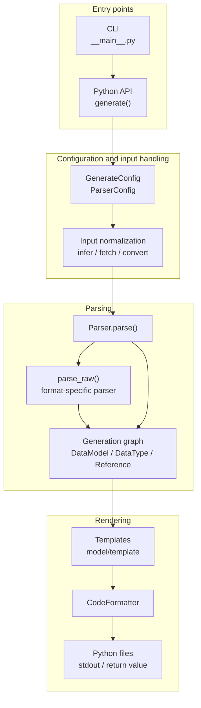
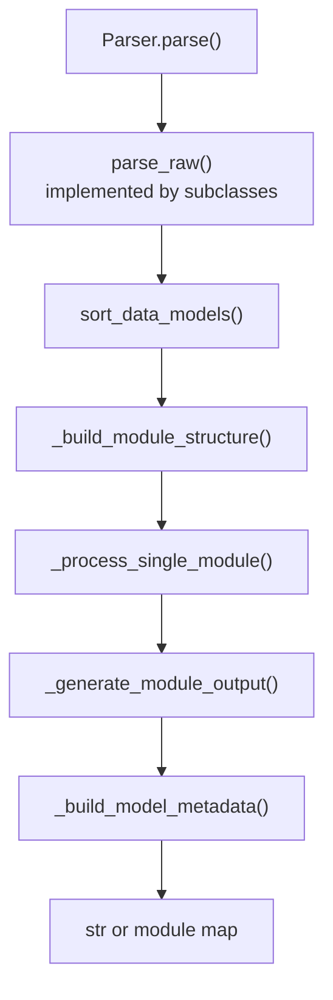
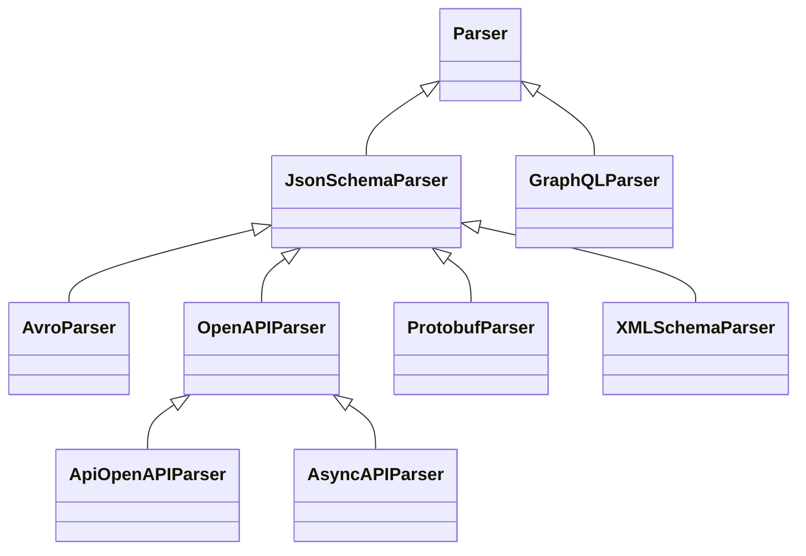
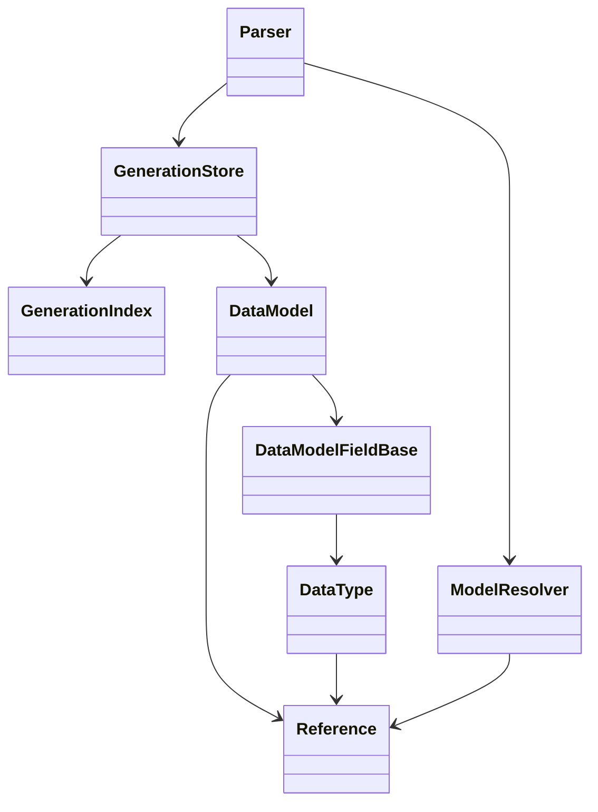

# Architecture

`datamodel-code-generator` is organized around one central idea: many input formats are normalized into a shared
generation graph, then rendered through output-model-specific backends.

This page is partly generated from source code. The generated inventory is intentionally small so the narrative can stay
hand-written while release-time details such as parser routes and output backends stay synchronized.

## Generation Pipeline



The CLI builds a `Config` from command-line arguments, `pyproject.toml`, and presets. It then calls the same
`generate()` API that library users can call directly. `generate()` selects the parser, runs it, and either returns code
or writes files. [Model Processing Passes](#model-processing-passes) lists the passes inside `Parser.parse()`.

## Entry Points

The executable entry point is defined in `pyproject.toml`:

```toml
datamodel-codegen = "datamodel_code_generator.__main__:main"
```

`src/datamodel_code_generator/__main__.py` owns CLI-only behavior:

- fast paths for `--version`, `--help`, prompt helpers, and JSON Schema output
- argument parsing and shell completion
- `pyproject.toml` profile loading and inheritance
- `--check` diff generation
- `--watch` regeneration
- structured JSON command output
- `--input-model` loading before normal generation

`src/datamodel_code_generator/__init__.py` owns the public generation API:

- `generate()`
- input type inference
- raw JSON/YAML/CSV/Dict conversion through genson
- MCP tool schema conversion
- parser construction
- generated headers and output file writing
- optional model metadata emission

## Parser Model

Each parser turns its input into `DataModel` objects. The parser-specific part is `parse_raw()`. The shared part is
`Parser.parse()`, which handles sorting, module layout, imports, rendering, exports, formatting, and optional metadata.



JSON Schema is the main reusable parser surface. OpenAPI and AsyncAPI extend it. Avro, XML Schema, Protocol Buffers,
raw data, and MCP tools convert to a JSON Schema-shaped document before using the same model-building machinery.
GraphQL is the main parser that builds models directly from its own schema API.

Ordering and module splitting use small graph helpers. `parser/_scc.py` finds strongly connected components with an
iterative Tarjan traversal so large graphs do not hit Python recursion limits. `parser/_graph.py` provides stable
topological ordering. Together they keep `sort_data_models()` deterministic and let `_build_module_structure()` move
circular module SCCs into `_internal.py` forwarder modules when imports would otherwise cycle.

## Generated Inventory

<!-- BEGIN AUTO-GENERATED ARCHITECTURE INVENTORY -->
!!! note "Generated inventory"
    This section is generated by `scripts/build_architecture_docs.py` from the current source tree.
    Edit the surrounding prose by hand, then run the script before release.

### Parser Inheritance



### Input Routes

| Input file type | Parser route | Notes |
| --- | --- | --- |
| `auto` | `pre-parser inference` | Resolved before parser selection by content inference. |
| `openapi` | `OpenAPIParser` | Routed directly by `_build_parser()`. |
| `asyncapi` | `AsyncAPIParser` | Routed directly by `_build_parser()`. |
| `jsonschema` | `JsonSchemaParser` | Routed directly by `_build_parser()`. |
| `mcp-tools` | `JsonSchemaParser after conversion` | MCP tool input/output schemas are hoisted into JSON Schema definitions first. |
| `xmlschema` | `XMLSchemaParser` | Routed directly by `_build_parser()`. |
| `protobuf` | `ProtobufParser` | Routed directly by `_build_parser()`. |
| `avro` | `AvroParser` | Routed directly by `_build_parser()`. |
| `json` | `JsonSchemaParser after conversion` | Sample data is converted to JSON Schema with genson first. |
| `yaml` | `JsonSchemaParser after conversion` | Sample data is converted to JSON Schema with genson first. |
| `dict` | `JsonSchemaParser after conversion` | In-memory mapping is converted to JSON Schema with genson first. |
| `csv` | `JsonSchemaParser after conversion` | The header and first data row are converted to JSON Schema with genson first. |
| `graphql` | `GraphQLParser` | Routed directly by `_build_parser()`. |

### Output Backends

| Output model type | Data model | Root model | Field model | Type manager |
| --- | --- | --- | --- | --- |
| `pydantic_v2.BaseModel` | `model.pydantic_v2.base_model.BaseModel` | `model.pydantic_v2.root_model.RootModel` | `model.pydantic_v2.base_model.DataModelField` | `model.pydantic_v2.types.DataTypeManager` |
| `pydantic_v2.dataclass` | `model.pydantic_v2.dataclass.DataClass` | `model.type_alias.TypeAliasTypeBackport` | `model.pydantic_v2.dataclass.DataModelField` | `model.pydantic_v2.types.DataTypeManager` |
| `dataclasses.dataclass` | `model.dataclass.DataClass` | `model.type_alias.TypeAlias` | `model.dataclass.DataModelField` | `model.dataclass.DataTypeManager` |
| `typing.TypedDict` | `model.typed_dict.TypedDict` | `model.type_alias.TypeAlias` | `model.typed_dict.DataModelFieldBackport` | `model.types.DataTypeManager` |
| `msgspec.Struct` | `model.msgspec.Struct` | `model.type_alias.TypeAlias` | `model.msgspec.DataModelField` | `model.msgspec.DataTypeManager` |

### Configuration Surface

| Config model | Field count | Purpose |
| --- | ---: | --- |
| `BaseGenerateConfig` | 181 | Shared generation options. |
| `GenerateConfig` | 196 | Public `generate()` configuration. |
| `ParserConfig` | 147 | Base parser dependency injection and parser options. |
| `JSONSchemaParserConfig` | 149 | JSON Schema parser options. |
| `OpenAPIParserConfig` | 155 | OpenAPI-specific parser options. |
| `AsyncAPIParserConfig` | 156 | AsyncAPI-specific parser options. |
| `XMLSchemaParserConfig` | 150 | XML Schema-specific parser options. |
| `ProtobufParserConfig` | 150 | Protocol Buffers-specific parser options. |
| `AvroParserConfig` | 149 | Avro-specific parser options. |
| `GraphQLParserConfig` | 150 | GraphQL-specific parser options. |

### Formatter Names

| Formatter | Default when unspecified |
| --- | --- |
| `builtin` | no |
| `black` | yes |
| `isort` | yes |
| `ruff-check` | no |
| `ruff-format` | no |
<!-- END AUTO-GENERATED ARCHITECTURE INVENTORY -->

## Intermediate Model Graph

The generation graph is built from a small set of core objects:

- `DataModel`: a generated class, root model, type alias, enum, scalar alias, or union alias.
- `DataModelFieldBase`: one field on a generated model, including defaults, aliases, constraints, and metadata.
- `DataType`: a Python type annotation tree, including containers, unions, literals, generated-model references, and
  imports.
- `Reference`: a schema reference path and generated Python name.
- `GenerationStore`: the parser-owned model list plus a query index over model and type dependencies.



`GenerationStore` is the preferred mutation boundary for parser-side changes that affect dependency facts. Parser code
should register models and update references, fields, bases, names, and paths through store methods instead of mutating
the live objects directly. `GenerationIndex` keeps stable facts about the model list and gives later phases efficient
queries such as "which data types point at this reference?". A refresh records only the models that were appended or
that store mutations changed, and rebuilds every fact only when the model list changes otherwise or
`discard_derived_facts()` drops them.

## Model Processing Passes

`Parser.parse()` runs a fixed sequence of passes between `parse_raw()` and rendering. Most of them change models,
fields and data types in place, so a fact that one pass reads may still be changed by a later pass. This section lists
the passes in execution order, says when each fact becomes final, and shows where a new decision belongs. Paths are
relative to `src/datamodel_code_generator/`; names are given as `file:function` so they can be found with `git grep`.

### Layers

| Layer | Entry point | Purpose |
| --- | --- | --- |
| L0 input loading | `parser/jsonschema.py:JsonSchemaParser.parse_raw`, `parser/openapi.py:OpenAPIParser.parse_raw` | Load sources and normalize the raw document before any schema object exists. |
| L1 parsing | `parser/jsonschema.py:JsonSchemaParser.parse_obj`, `parser/graphql.py:GraphQLParser.parse_raw` | Build `Reference`, `DataModel` and `DataType` objects and register models in the store. |
| L2 settle | `parser/base.py:Parser.__prepare_parse` | Settle yielding names, report diagnostics, sort models and base classes. |
| L3 module structure | `parser/base.py:Parser._build_module_structure` | Group models into output modules, remove duplicates, reuse across modules, merge circular imports. |
| L4 cross-module pre-pass | head of `parser/base.py:Parser.__process_modules` | Facts every module reads before any module is processed. |
| L5 per-module processing | `parser/base.py:Parser._process_single_module` | Prepare, process and finalize the models of one module; runs once per module. |
| L6 cross-module finalization | tail of `parser/base.py:Parser.__process_modules`, `parser/base.py:Parser._finalize_modules` | First point where every module has been processed: tags of tagged bases, import repairs, generic base class, imports, final renames. |
| L7 rendering | `parser/base.py:Parser.__render_modules`, `parser/base.py:Parser._generate_module_output`, `model/base.py:DataModel.render` | Module code, templates or compiled renderers, exports. |
| L8 formatting and output | `format.py:CodeFormatter`, `__init__.py:_format_deferred_output`, `__init__.py:generate` | Format module bodies and write or return the result. |

`__init__.py:_parse_generation` may run L0–L8 again with a fresh parser (root-model collapse recursion retry, yielding
names that class-keyed options name, untyped nullable maps, invalid dotted stdout modules). These are retries around
the whole pipeline, not passes inside it.

**L0.** `_load_source_dict` calls `_read_document`, which keeps the document as written and, under
`--use-single-value-enum-as-const`, rewrites one-value `enum` to `const` copy-on-write (`_single_value_enum_as_const`,
which skips instance-data keywords and extension keys other than `x-propertyNames` through `_document_child_entries`).
`_parse_file` then calls `_prepare_schema_resources`, which indexes `$id` and anchors and rewrites `$ref`s that resolve
through an embedded `$id`. Referenced documents go through the same two steps when `resolve_ref` loads them. OpenAPI
parses its main document in `_parse_specification` (merging path-level parameters into shallow copies of operations in
`_process_path_items`) instead of `_parse_file`. Converted inputs (Avro, XML Schema, Protocol Buffers) build a JSON
Schema dict and call `_parse_file` without `_read_document`, so document rewrites do not apply to them.

**L1.** `_parse_schema_obj` dispatches each schema object: a `$ref` with sibling keywords is merged
(`_merge_ref_with_schema`), then `parse_array`, `parse_all_of`, `parse_one_of` or `parse_any_of` (both through
`parse_combined_schema`), `parse_object`, `parse_enum` or `parse_root_type`. A oneOf/anyOf of constants can become a
synthetic enum (`_extract_const_enum_from_combined`). Names come from `ModelResolver.add`. Every use of a reference gets
a new `DataType` that points to the one shared `Reference`. allOf `$ref` items become base classes; inherited fields
whose parent is not parsed yet stay as placeholders that L5 resolves. Discriminators are only captured here
(`field.extras["discriminator"]`). Field construction already decides const handling: `DataModelFieldBase.__init__`
calls `process_const()`.

**L2–L4.**

| Pass (`parser/base.py`) | Reads | Changes |
| --- | --- | --- |
| `ModelResolver.settle_yielding_names` (`reference.py`) | names that yield to `--model-name-map` | `Reference.name` of yielding models |
| `sort_data_models` | references through the store index | model order, models that need forward-reference updates |
| `sort_base_classes_for_mro` | base classes | base order (before L3 and L5 reuse add bases) |
| L3 `_union_tags` snapshot | discriminator mappings | union tags that reuse compares, taken before any merge |
| L3 `__delete_duplicate_models` | rendered model text (`DataModel.get_dedup_key`) | redirects users, edits base lists, removes models |
| L3 `__replace_duplicate_name_in_module` | class names | `class_name` |
| L3 `__reuse_model_tree_scope` | rendered model text across modules | moves canonicals to a shared module, replaces duplicates by empty subclasses or removes them |
| L3 `__resolve_circular_imports` | module dependency graph | merges cyclic modules into `_internal` modules, relocates models |
| L4 `__flatten_conflicting_base_layouts` (msgspec) | bases, fields, possible tags (`__find_possible_tag_names`) and reuse duplicates (`__find_possible_reuse_duplicates`) | copies base fields into Structs whose generated bases have conflicting layouts and drops those bases |
| L4 `unconstrain_union_members` (msgspec) | union members | field types |
| L4 `__set_circular_root_model_paths` | root-model reference graph | circular root-model paths that every module's collapse reads |

Module order is not dependency order: `_internal` modules of import cycles come first, then the tree-scope shared
module, then `_group_models_by_module`'s sort (longest module path first, reverse lexical).
Single-file output has one module, so "per module" then means the whole graph.

**L5**, per module, in this order:

| Step | Pass (`parser/base.py`) | Reads | Changes |
| --- | --- | --- | --- |
| prepare | `__alias_shadowed_imports` | field names vs imported names | import aliases |
| prepare | `__override_required_field` | inherited placeholders, base models (any module) | replaces placeholders by copies of inherited fields, required, defaults |
| prepare | `__replace_unique_list_to_set` | `uniqueItems`, defaults | list to set (`_create_set_from_list`), set defaults |
| prepare | `__change_from_import` | references to other modules | module imports, `data_type.alias` |
| prepare | `__extract_inherited_enum` | field-less models with Enum bases | replaces the model by a new Enum with the same `Reference` |
| process | `__set_reference_default_value_to_field` | defaults of referenced models | field defaults |
| process | `__reuse_model` | rendered model text and union tags of this module's models | replaces duplicates by empty subclasses (users in this module redirected) or removes them (Enums, `--collapse-reuse-models`: users in every module redirected) |
| process | `__collapse_root_models` | root models referenced from this module (any module), circular paths from L4 | inlines root types, merges constraints, calls `process_const()` again, renames, marks unused roots |
| process | `__set_default_enum_member` | defaults vs Enum members | defaults |
| process | `__sort_models` | `--keep-model-order` | model order |
| process | `__change_field_name` | field names vs type names | field names, class names of referenced types (any module) |
| process | `__restore_inherited_field_names_for_unique_aliases` | inherited field names | field names |
| process | `__apply_discriminator_type` | captured discriminators, variant models (any module) | tag field types, required and defaults on variants, appended tag fields, msgspec struct tags (possibly deferred to a later module) |
| process | `__set_one_literal_on_default` | required one-literal fields | default, required, nullable |
| process | `refresh_field_config` (model) | field state | backend field config |
| process | `__rename_fields_hiding_types` | same-named fields and types of the model family | field names or type names |
| process | `__fix_constructor_field_ordering` | required and default state, inherited fields | field order, constructor adjustments |
| process | `__remove_overridden_models` | model-level `--type-overrides` | removes overridden models |
| finalize | `__apply_type_overrides` | `--type-overrides` | field types; model-level overrides edit nodes on fields and base classes in place |
| finalize | `unbind_fields` (model) | hidden type names | field binding |
| finalize | `__update_type_aliases` | model order, forward references | quotes forward references in place (`data_type.alias`), union operator along one `.parent` chain |
| finalize | `__set_validate_default_on_fields` | live models, defaults | deserialized defaults, default validation |
| finalize | `__assign_forward_reference_fields` | `--use-annotated` with deferred annotations | assignment form, may reorder fields |
| finalize | `__warn_required_assignments_after_defaults` | field order | warnings |

**L6**, after the module loop:

| Pass (`parser/base.py`) | Changes |
| --- | --- |
| `_tag_fields_of_tagged_bases`, `__fix_tag_opt_out_field_ordering` (msgspec) | tags structs that inherit a tagged base (the tag field becomes a ClassVar) or opts them out; keyword-only order |
| `__import_removed_reuse_canonicals` | imports of models that a later module's reuse removed |
| `__import_renamed_types` | imports of types that a later module renamed |
| `__import_enum_member_literal_classes` | imports for enum member literals |
| `_finalize_modules`: `__apply_generic_base_class` | inserts the generated base model and rewrites base classes |
| `__prepare_type_alias_fields`, `finalize_type_alias_users` (backend) | type-alias field form, backend config |
| `__mark_set_item_models_hashable` | identity hash for set item models |
| `_finalize_structured_imports`, model imports snapshot, unused-model removal | imports, module model lists |
| `remove_unused`, `resolve_module_import_conflicts` (backend), `_bind_module_field_names` | module imports, field binding |
| `__change_imported_model_name` | renames models that collide with imports (the last class-name change) |
| `_check_model_inheritance`, warnings, `_set_nested_model_default_factory_metadata` | errors, warnings, default-factory metadata |

Three L6 passes repair results that L5 built from facts that changed afterwards: `__import_removed_reuse_canonicals`
and `__import_renamed_types` (reuse and renames in a later module) and `__fix_tag_opt_out_field_ordering` (the tag
opt-out decided in L6).

**L7.** `_generate_module_output` builds the import block, calls the backend's `render_module_code`, renders each
model and formats the body. `DataModel.render` uses the compiled renderer in `model/_compiled_templates/` for built-in
templates and Jinja2 when a custom template directory is set. Type-alias styles are chosen when the parser is built
(`model/__init__.py:get_data_model_types`). Rendering is not read-only: `DataType.type_hint` sets `is_optional` on a
reference to a nullable model (`types.py:DataType._apply_nullable_from_reference`), and L3 deduplication renders
models, so this write can happen before L5.

### Hidden Couplings

**Per-module passes that change models in other modules.** L5 receives only the current module's models, but reaches
other modules through references. A model in another module may already be processed (its ordering, defaults and
quoting are done) or not yet (its overrides, collapse and reuse have not run).

| Pass | Crosses modules by | Consequence |
| --- | --- | --- |
| `__override_required_field` | copying fields of bases in any module | reads base fields at whatever stage that module is in |
| `__reuse_model` | removing duplicates (Enums, `--collapse-reuse-models`) and redirecting their users in every module | earlier modules imported the removed duplicate; repaired by `__import_removed_reuse_canonicals` |
| `__collapse_root_models` | inlining root models of any module | the root's own module may collapse its members later |
| `__change_field_name`, `__rename_fields_hiding_types` | renaming types of any module | earlier modules imported the old name; repaired by `__import_renamed_types` |
| `__apply_discriminator_type` | rewriting tag fields of variants in any module | variants in earlier modules were ordered, validated and quoted without the tag; msgspec tags are final only in L6 |

**Nodes with more than one holder.** A `DataType` normally has one owner (`parent`). These create more holders, and
an in-place write to such a node changes every holder:

- Same-module root-model collapse inlines `root_type_field.data_type.model_copy()`, a shallow copy that shares the
  root type's `data_types` list and `dict_key` with the root model and with every other site that inlined it.
  Cross-module collapse uses `_copy_data_type`, a tree copy. The shared members keep `parent` in the root model's
  tree, so a later collapse that replaces one (`replace_nested_data_type`, then `set_nested_data_types` on that
  `parent`) rebinds only the root model's list and detaches the old member, which the other holders still contain.
- `_create_set_from_list` returns a `model_copy()` that shares its members with the list node, and for nested lists
  `DataType.swap_with` rebinds the parent's `data_types` to a new list outside the store.
- `__apply_generic_base_class` puts one `BaseClassDataType` object into the base list of every target model.
- `__extract_inherited_enum` builds the merged Enum from the base enums' field objects and gives it the original
  model's `Reference`.
- Reuse, collapse-reuse redirects and `Reference` objects are shared by design: a rename or an edit of a canonical
  model is seen by every user.

Known in-place writers on such nodes: forward-reference quoting in `__update_type_aliases`, model-level type overrides
(`_apply_override_to_data_type`), import aliases (`__change_from_import` and the L6 import repairs), and root-model
collapse replacing a member of a shared list.

### Fact Finality

"Final after" names the last pass that can still change the fact. A decision that reads the fact belongs after it.

| Fact | Final after |
| --- | --- |
| which models exist | L6 unused-model removal in `_finalize_modules` |
| model kind (Enum, root model, class) | the model's own L5 `__extract_inherited_enum` and `__reuse_model` (tree scope: L3) |
| bases | L6 `__apply_generic_base_class`; base order is sorted in L2 before reuse adds bases |
| instance field set | end of the L5 loop; msgspec: L6 `_tag_fields_of_tagged_bases` |
| field order | end of the L5 loop (discriminator tags append fields to variants of any module); msgspec keyword-only: L6 `__fix_tag_opt_out_field_ordering` |
| field names | the model's own L5 `__rename_fields_hiding_types` |
| field types | end of the L5 loop (collapse, overrides and discriminator tags reach every module); pydantic v2 type-alias bodies: L6 `__prepare_type_alias_fields` |
| set vs list containers | end of the L5 loop (collapse and overrides can still replace item types) |
| required, nullable | end of the L5 loop (discriminator tags, one-literal defaults, collapse `process_const()`); msgspec: L6 |
| default values | the model's own L5 `__set_validate_default_on_fields`, unless another module's discriminator pass changes it; default-factory metadata: L6 `_set_nested_model_default_factory_metadata` |
| discriminator tags | pydantic: end of the L5 loop; msgspec: L6 `_tag_fields_of_tagged_bases` |
| applied type overrides | end of the L5 loop |
| root-model collapse | end of the L5 loop (circular paths: the L4 snapshot, not recomputed) |
| class names and reference paths | L6 `__change_imported_model_name` |
| module membership | L6 unused-model removal |
| field aliases | the model's own L5 `__rename_fields_hiding_types`; validated in L6 |
| names written in annotations, module imports except future imports | end of `_finalize_modules` |
| `from __future__` imports (msgspec deferred annotations, forward references) | L7 rendering (`_get_module_future_imports`) |
| set item identity hash | L6 `__mark_set_item_models_hashable` |

In practice, the fields, types, defaults, tags and bases of every model are final once `__apply_generic_base_class`
has run in `_finalize_modules`, except pydantic v2 type-alias bodies (`__prepare_type_alias_fields`). Models that
collapse left unused stay in the module lists until unused-model removal, so a pass placed there skips
`unused_models`. Later passes change presentation or derive from those facts. The code does not enforce this
boundary.

### Generation Store

`GenerationStore` (`parser/generation.py`) owns `Parser.results` and indexes, per model, its reference and paths and,
per `DataType` occurrence, its owner model, field index and role (field, base, nested, dict key). It also records
`DataType` objects that occur in more than one place (`shared_data_type_fact_ids`), models by path and by reference,
and reverse edges from a reference to its users. Queries refresh the facts when a mutation marked them dirty, either
incrementally for appended and changed models or with a full rebuild.

The mutation APIs are the `GenerationStore` methods listed in `GENERATION_STORE_MUTATION_METHODS`, for example
`replace_field_type`, `replace_nested_data_type`, `set_fields`, `set_base_classes`, `update_model_reference` and
`redirect_reference_users`. `scripts/check_generation_store_usage.py` (with
`tests/parser/test_generation_store_usage.py`) rejects direct writes to `.data_type`, `.fields`, `.base_classes` and
`.reference` and list mutators on model collections, in `parser/` only.

Current behaviour that a decision reading the index must allow for:

- Only parsers call `register_model`. Models created after parsing (reuse subclasses, the merged inherited Enum, the
  generated base model) are not registered, and models removed from module lists stay in the store. The index covers
  the parsed models plus redirected edges, not the module lists that L3–L6 edit.
- `note_changed_models` records models for the next refresh but does not mark the facts dirty, so they stay as they
  were until another mutation. msgspec `unconstrain_union_members` (slice assignment on `data_types`), the unhashable
  default path of `__replace_unique_list_to_set` (`swap_with`), `process_const()` during collapse and
  `__assign_forward_reference_fields` change models this way.
- Renames through the `class_name` setter (`__change_field_name`, `__rename_named_type`,
  `__replace_duplicate_name_in_module`) do not go through `rename_model`.
- Writes to `data_types` and `dict_key`, and writes in `model/` and `types.py`, are outside the checker's scope.
- Dedup keys (`DataModel.get_dedup_key`), model shapes and imports caches are separate caches, not store facts.

### Placement Guide

Procedure for a new decision:

1. List every fact the decision reads, including facts of models reached through references, bases, variants and
   root models.
2. Look up each fact in the finality table. Put the decision after the pass where the last of them becomes final. If
   that point is in L6, the decision is a cross-module pass, not a per-module one.
3. If a pass that runs earlier needs the decision's result, move the pass that sets the fact earlier (for example,
   split it into a plan computed from facts that are final at that point and an apply step), or move the consumer
   after the decision. Never predict what a later pass will do.
4. Before changing a node, check whether it can have more than one holder. Replace it in its owner through the store's
   mutation APIs instead of writing to it.

| The decision reads | Earliest correct place |
| --- | --- |
| raw keywords of one schema object (`const`, `enum`, `nullable`, `uniqueItems`, extension keys) | L1 at that object, or record them on the field for a later pass |
| names settled by `--model-name-map` or yielding names | after L2 `settle_yielding_names` |
| field set, required or nullable of a model in the same module, without discriminator tags | after that module's `__set_one_literal_on_default` (before `__fix_constructor_field_ordering` if ordering must see the result) |
| a fact of a model in another module that the module loop can still change | L6, after the module loop (facts that settle earlier, such as mapped names, follow their own row) |
| discriminator tags or msgspec ClassVars | L6, after `_tag_fields_of_tagged_bases` |
| type overrides | after the module loop |
| bases including the generic base class | L6, after `__apply_generic_base_class` |
| class names | L6, after `__change_imported_model_name` |
| imports or names written in annotations | end of `_finalize_modules`, or at render |

A decision that changes field order, defaults or required state must also run before constructor ordering reads them
(L5 `__fix_constructor_field_ordering`, L6 `__fix_tag_opt_out_field_ordering`); when that conflicts with a row above,
step 3 applies.

**Scope on schema objects, not parse paths.** When an option applies to part of a document, the walk that defines the
part marks the schema objects in scope where the document is rewritten (L0), and L1 checks the mark on the object it
parses. Parse paths are not document locations: legacy OpenAPI `paths` and `parameters` scopes, `$ref` merged with
sibling keywords, `$ref` targets inside extension keys and properties whose names start with `x-` all produce paths
that a path-based test misreads. The mark has to survive every step that builds a new object from a marked one:
copy-on-write rewrites (`_single_value_enum_as_const`, `_rewrite_schema_resource_refs`), `_validate_schema_object`,
`_merge_ref_with_schema`, synthetic enums, allOf and combined-schema merges, OpenAPI operation copies, and
`_resolve_unparsed_json_pointer`, which loads the source again as a fresh dict. No such marker exists today.

### Case Notes

- **[#4834](https://github.com/datamodel-code-generator/datamodel-code-generator/issues/4834)** (set and list models
  merged): L3 deduplication (`__delete_duplicate_models` with `--collapse-reuse-models`, `__reuse_model_tree_scope`)
  compares renderings in which unique-items arrays still read `list`, because `__replace_unique_list_to_set` runs later
  in L5. Dedup should compare a fact that is final at L1, the field's own unique-items intent, instead of the container.
  A container rule that also reads item hashability (item models, their fields, ClassVars and bases) can only be exact
  in L6, after `__apply_generic_base_class` and before `__mark_set_item_models_hashable`.
- **[#4828](https://github.com/datamodel-code-generator/datamodel-code-generator/issues/4828)** (`default: {}` that
  leaves out required fields): today `__set_validate_default_on_fields` decides per module in L5 that such a default is
  validated. The referenced model's required fields depend on discriminator tags (required literals, msgspec ClassVars),
  model-level type overrides and models of other modules, which are final only after the module loop. The decision is
  one L6 pass after `__apply_generic_base_class` that skips `unused_models`; constructor ordering then has to run again
  for the models whose defaults it drops, as `__fix_tag_opt_out_field_ordering` does for msgspec.
- **[#4874](https://github.com/datamodel-code-generator/datamodel-code-generator/issues/4874)** (scope of
  `--use-single-value-enum-as-const`): the L0 rewrite defines the scope, and the L1 decision in `_parse_schema_obj`
  (`_extract_const_enum_from_combined` turning a oneOf/anyOf of rewritten consts into a synthetic enum) needs it. The
  correct point is a mark on schema objects set by the L0 walk, not a test of the parse path.
- **[#4822](https://github.com/datamodel-code-generator/datamodel-code-generator/issues/4822)** (missing `Any` import
  after collapse): same-module collapse shares the root type's `data_types` list between the root model and every site
  that inlined it. A later collapse that replaces a member calls `set_nested_data_types` on the member's `parent` (the
  root model's node), which rebinds only that node's list and detaches the old member; the other holders keep the
  emptied node. The index records shared nodes (`shared_data_type_fact_ids`) but not shared lists, so a pass that
  replaces such a node must find all its holders and replace it in each owner.
- **[#4877](https://github.com/datamodel-code-generator/datamodel-code-generator/issues/4877)** (msgspec layout
  conflicts): `__flatten_conflicting_base_layouts` flattens conflicting Structs in L4, because flattening changes field
  sets and bases that L5 reads (constructor ordering, discriminator tags, reuse). Whether to flatten depends on tags and
  reuse results that L5 and L6 produce, so it predicts them (`__find_possible_tag_names`, and
  `__find_possible_reuse_duplicates`, which compares type, bases and field names instead of renderings). A conflict that
  remains is rejected when the module is rendered (`model/msgspec.py:Struct._validate_base_layouts` through
  `render_module_code`, first in L6 `_check_model_inheritance`). Making those facts final earlier, as a discriminator
  tag plan and reuse groups computed before L5, lets flattening read plans instead of predictions.

## References And Names

`ModelResolver` is the naming and reference authority. It tracks the current root, base path, base URL, root IDs, and
known references while parsers traverse documents. It also applies naming options such as aliases, `model_name_map`,
prefixes, suffixes, duplicate suffixes, enum member normalization, and field name safety.

`Reference.children` still links references back to users, but newer parser post-processing should prefer
`GenerationIndex` when it needs dependency facts. The index records live models and avoids depending on legacy side
effects alone.

## Output Backends

Parsers do not hard-code Pydantic, dataclass, TypedDict, or msgspec classes. `get_data_model_types()` returns a
`DataModelSet` for the selected `DataModelType`. That set injects:

- the model class
- the root model or type alias class
- the field class
- the type manager
- optional reference dumping behavior
- GraphQL scalar and union model classes

The same parser output can therefore render into different Python model styles while sharing the same reference and
module-generation pipeline.

## Layer Dependency Rules

The pipeline is also a dependency boundary. Configuration and entry points select behavior, parsers normalize source
formats, and output models own rendering-framework behavior. Keep these rules when adding features or optimizing hot
paths:

- Parser modules may depend on neutral `DataModel`, `DataModelFieldBase`, and declared capability hooks. They must not
  import or identify concrete Pydantic, dataclass, TypedDict, or msgspec output implementations.
- Output-specific constructor, forward-reference, runtime-validation, import-conflict, and rendering behavior belongs
  to the output model that implements it. The parser calls the neutral capability without switching on backend names.
  This includes annotation representation, TypedDict provider selection, configuration assembly, and access to
  prepared output metadata. Existing custom-template keys and extension capabilities remain compatibility contracts;
  moving their preparation between layers must preserve generated code, insertion order, and option precedence.
- Output models inject reserved-field and generated-import conflict handling through `FIELD_NAME_RESOLVER_CLASS`;
  `ModelResolver` owns only neutral normalization and lazily creates the selected resolver.
  Legacy resolver imports and default `ModelResolver` policies resolve those output-owned providers lazily.
- Reusable graph, detection, enum, cache, JSON Schema reference rewriting, and parser retry-signal helpers belong in
  neutral package modules. Code outside `parser/` must not import private parser modules or private symbols from public
  parser modules, such as `parser.mcp._rewrite_schema_refs`.
- Input-model conversion reads output-family compatibility from the output selection registry. It must not maintain a
  second `DataModelType`-to-backend mapping.
- Input-model build tokens must resolve to neutral `input_model_result` schema annotations before parser construction.
  Parsers consume that IR and must not import the private input-model transport. The former token table and parser
  factory remain lazy private compatibility paths and are not allocated by normal generation.
- Configuration must not acquire new parser or concrete output-backend dependencies. Historical concrete defaults are
  narrowly allowlisted until they can be migrated without changing the public `ParserConfig` surface.
- Entry points project source and reference settings into a frozen `ParserSourceContext` attached to their lightweight,
  already-validated config; direct parser APIs retain typed configuration and validation.

Run `python scripts/check_architecture_boundaries.py` to validate these rules. The checker parses imports and semantic
backend inspection with the Python AST, including lazy and dynamic imports. Entrypoint, parser, configuration,
input-model, reference, model-composition, output-model, and shared-model files are classified explicitly. The
composition root may select concrete backends, while shared-model modules must remain neutral: they cannot import a
concrete backend or resolve one through `sys.modules`, including module-name constants and aliases. This keeps
backend-specific lifecycle and cache ownership with the backend or composition root, without blocking neutral module
registry access such as `sys.modules[model_type.__module__]`. Private parser lifecycle access and reference-owned
backend policy therefore cannot hide in the shared layer. Its legacy allowlist is keyed by file, enclosing symbol, rule,
and target; extra occurrences fail, and removed dependencies make stale entries fail so the exception cannot silently
become permanent. The same check runs in pre-commit and pytest with actionable diagnostics.

## Rendering And Formatting

Every `DataModel` renders through a Jinja2 template. Built-in templates live in
`src/datamodel_code_generator/model/template`. A custom template directory can override a built-in template by path.

Imports are collected separately from rendering through `Import` and `Imports`. The import layer handles grouping,
aliases, reference-bound imports, future imports, unused import removal, and `__all__` generation.

`CodeFormatter` then applies the configured formatter pipeline. The formatter layer supports the built-in formatter,
black, isort, ruff check, ruff format, and user-supplied custom formatters.

## Metadata Output

When `--emit-model-metadata` is enabled, `Parser.parse()` records source-reference information while producing models.
`generate()` then serializes the resulting payload through `model_metadata.py`. The JSON Schema for that payload is
stored in `src/datamodel_code_generator/resources/model_metadata.schema.json` and exposed through
`--output-format-json-schema model-metadata`.

## Runtime Dynamic Models

`generate_dynamic_models()` uses the normal `generate()` API to produce code, executes that code in temporary modules,
and returns real Pydantic v2 model classes. Multi-module output is topologically sorted by relative imports before
execution. The result is cached by schema and config hash when caching is enabled.

## Performance-Sensitive Paths

Recent work has focused on reducing work without changing the generation model:

- fast CLI paths avoid importing heavy modules
- `format.py` keeps format-related types in a lighter helper module
- local schema sources are reused during `$ref` resolution
- YAML unsupported-tag scanning is skipped when no unsupported tag marker is present
- JSON Schema constraint extraction avoids dumping whole schema objects when only selected constraint keys are needed
- simple field import collection avoids rendering a full type hint when `DataType` facts are sufficient

These optimizations keep the architecture stable: parsers still build the same graph, and renderers still produce the
same code, but hot paths do less incidental work.

## Keeping This Page Synchronized

Run this before release or whenever parser routes, output backends, config models, or formatter names change:

```bash
python scripts/build_architecture_docs.py
```

CI can validate the generated section without rewriting files:

```bash
python scripts/build_architecture_docs.py --check
```

The repository test suite includes this check through `tests/test_build_architecture_docs_script.py`, so pull requests
fail when the generated inventory is stale. The `generated-docs` tox environment also runs this script before
`build_llms_txt.py`, which keeps the architecture page and LLM documentation in the same release-time sync flow.
