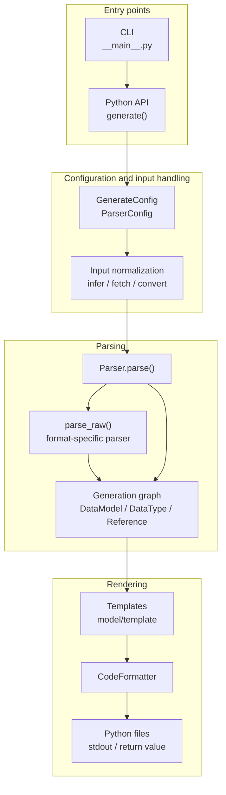
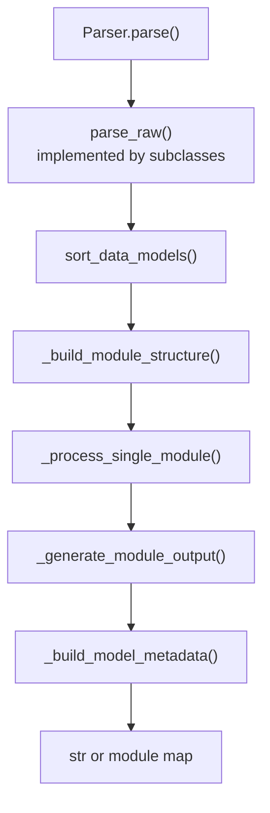
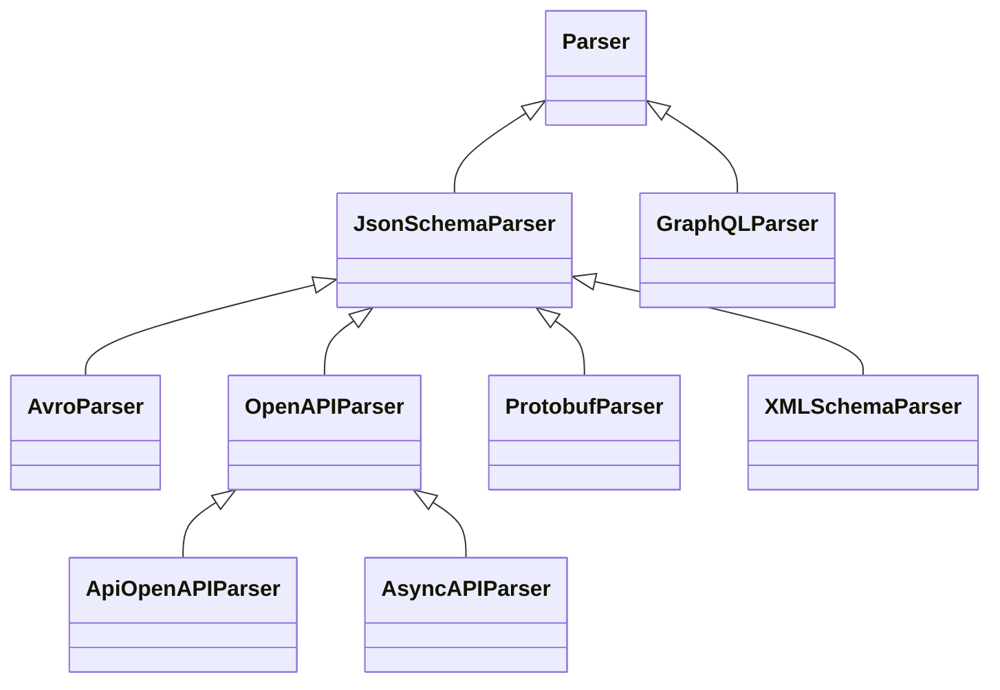
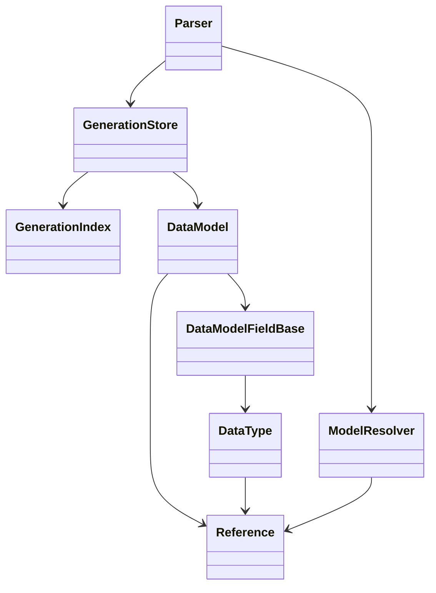

# Architecture

`datamodel-code-generator` is organized around one central idea: many input formats are normalized into a shared
generation graph, then rendered through output-model-specific backends.

This page is partly generated from source code. The generated inventory is intentionally small so the narrative can stay
hand-written while release-time details such as parser routes and output backends stay synchronized.

## Generation Pipeline



The CLI builds a `Config` from command-line arguments, `pyproject.toml`, and presets. It then calls the same
`generate()` API that library users can call directly. `generate()` selects the parser, runs it, and either returns code
or writes files. [Model Processing Passes](#model-processing-passes) lists the passes inside `Parser.parse()`.

## Entry Points

The executable entry point is defined in `pyproject.toml`:

```toml
datamodel-codegen = "datamodel_code_generator.__main__:main"
```

`src/datamodel_code_generator/__main__.py` owns CLI-only behavior:

- fast paths for `--version`, `--help`, prompt helpers, and JSON Schema output
- argument parsing and shell completion
- `pyproject.toml` profile loading and inheritance
- `--check` diff generation
- `--watch` regeneration
- structured JSON command output
- `--input-model` loading before normal generation

`src/datamodel_code_generator/__init__.py` owns the public generation API:

- `generate()`
- input type inference
- raw JSON/YAML/CSV/Dict conversion through genson
- MCP tool schema conversion
- parser construction
- generated headers and output file writing
- optional model metadata emission

## Parser Model

Each parser turns its input into `DataModel` objects. The parser-specific part is `parse_raw()`. The shared part is
`Parser.parse()`, which handles sorting, module layout, imports, rendering, exports, formatting, and optional metadata.



JSON Schema is the main reusable parser surface. OpenAPI and AsyncAPI extend it. Avro, XML Schema, Protocol Buffers,
raw data, and MCP tools convert to a JSON Schema-shaped document before using the same model-building machinery.
GraphQL is the main parser that builds models directly from its own schema API.

Ordering and module splitting use small graph helpers. `parser/_scc.py` finds strongly connected components with an
iterative Tarjan traversal so large graphs do not hit Python recursion limits. `parser/_graph.py` provides stable
topological ordering. Together they keep `sort_data_models()` deterministic and let `_build_module_structure()` move
circular module SCCs into `_internal.py` forwarder modules when imports would otherwise cycle.

## Generated Inventory

<!-- BEGIN AUTO-GENERATED ARCHITECTURE INVENTORY -->
!!! note "Generated inventory"
    This section is generated by `scripts/build_architecture_docs.py` from the current source tree.
    Edit the surrounding prose by hand, then run the script before release.

### Parser Inheritance



### Input Routes

| Input file type | Parser route | Notes |
| --- | --- | --- |
| `auto` | `pre-parser inference` | Resolved before parser selection by content inference. |
| `openapi` | `OpenAPIParser` | Routed directly by `_build_parser()`. |
| `asyncapi` | `AsyncAPIParser` | Routed directly by `_build_parser()`. |
| `jsonschema` | `JsonSchemaParser` | Routed directly by `_build_parser()`. |
| `mcp-tools` | `JsonSchemaParser after conversion` | MCP tool input/output schemas are hoisted into JSON Schema definitions first. |
| `xmlschema` | `XMLSchemaParser` | Routed directly by `_build_parser()`. |
| `protobuf` | `ProtobufParser` | Routed directly by `_build_parser()`. |
| `avro` | `AvroParser` | Routed directly by `_build_parser()`. |
| `json` | `JsonSchemaParser after conversion` | Sample data is converted to JSON Schema with genson first. |
| `yaml` | `JsonSchemaParser after conversion` | Sample data is converted to JSON Schema with genson first. |
| `dict` | `JsonSchemaParser after conversion` | In-memory mapping is converted to JSON Schema with genson first. |
| `csv` | `JsonSchemaParser after conversion` | The header and first data row are converted to JSON Schema with genson first. |
| `graphql` | `GraphQLParser` | Routed directly by `_build_parser()`. |

### Output Backends

| Output model type | Data model | Root model | Field model | Type manager |
| --- | --- | --- | --- | --- |
| `pydantic_v2.BaseModel` | `model.pydantic_v2.base_model.BaseModel` | `model.pydantic_v2.root_model.RootModel` | `model.pydantic_v2.base_model.DataModelField` | `model.pydantic_v2.types.DataTypeManager` |
| `pydantic_v2.dataclass` | `model.pydantic_v2.dataclass.DataClass` | `model.type_alias.TypeAliasTypeBackport` | `model.pydantic_v2.dataclass.DataModelField` | `model.pydantic_v2.types.DataTypeManager` |
| `dataclasses.dataclass` | `model.dataclass.DataClass` | `model.type_alias.TypeAlias` | `model.dataclass.DataModelField` | `model.dataclass.DataTypeManager` |
| `typing.TypedDict` | `model.typed_dict.TypedDict` | `model.type_alias.TypeAlias` | `model.typed_dict.DataModelFieldBackport` | `model.types.DataTypeManager` |
| `msgspec.Struct` | `model.msgspec.Struct` | `model.type_alias.TypeAlias` | `model.msgspec.DataModelField` | `model.msgspec.DataTypeManager` |

### Configuration Surface

| Config model | Field count | Purpose |
| --- | ---: | --- |
| `BaseGenerateConfig` | 181 | Shared generation options. |
| `GenerateConfig` | 196 | Public `generate()` configuration. |
| `ParserConfig` | 147 | Base parser dependency injection and parser options. |
| `JSONSchemaParserConfig` | 149 | JSON Schema parser options. |
| `OpenAPIParserConfig` | 155 | OpenAPI-specific parser options. |
| `AsyncAPIParserConfig` | 156 | AsyncAPI-specific parser options. |
| `XMLSchemaParserConfig` | 150 | XML Schema-specific parser options. |
| `ProtobufParserConfig` | 150 | Protocol Buffers-specific parser options. |
| `AvroParserConfig` | 149 | Avro-specific parser options. |
| `GraphQLParserConfig` | 150 | GraphQL-specific parser options. |

### Formatter Names

| Formatter | Default when unspecified |
| --- | --- |
| `builtin` | no |
| `black` | yes |
| `isort` | yes |
| `ruff-check` | no |
| `ruff-format` | no |
<!-- END AUTO-GENERATED ARCHITECTURE INVENTORY -->

## Intermediate Model Graph

The generation graph is built from a small set of core objects:

- `DataModel`: a generated class, root model, type alias, enum, scalar alias, or union alias.
- `DataModelFieldBase`: one field on a generated model, including defaults, aliases, constraints, and metadata.
- `DataType`: a Python type annotation tree, including containers, unions, literals, generated-model references, and
  imports.
- `Reference`: a schema reference path and generated Python name.
- `GenerationStore`: the parser-owned model list plus a query index over model and type dependencies.



`GenerationStore` is the preferred mutation boundary for parser-side changes that affect dependency facts. Parser code
should register models and update references, fields, bases, names, and paths through store methods instead of mutating
the live objects directly. `GenerationIndex` keeps stable facts about the model list and gives later phases efficient
queries such as "which data types point at this reference?". A refresh records only the models that were appended or
that store mutations changed, and rebuilds every fact only when the model list changes otherwise or
`discard_derived_facts()` drops them.

## Model Processing Passes

`Parser.parse()` runs a fixed sequence of passes between `parse_raw()` and rendering. Most of them change models,
fields and data types in place, so a fact that one pass reads may still be changed by a later pass. This section lists
the passes in execution order, says when each fact becomes final, and shows where a new decision belongs. Paths are
relative to `src/datamodel_code_generator/`; names are given as `file:function` so they can be found with `git grep`.

### Layers

| Layer | Entry point | Purpose |
| --- | --- | --- |
| L0 input loading | `parser/jsonschema.py:JsonSchemaParser.parse_raw`, `parser/openapi.py:OpenAPIParser.parse_raw` | Load sources and normalize the raw document before any schema object exists. |
| L1 parsing | `parser/jsonschema.py:JsonSchemaParser.parse_obj`, `parser/graphql.py:GraphQLParser.parse_raw` | Build `Reference`, `DataModel` and `DataType` objects and register models in the store. |
| L2 settle | `parser/base.py:Parser.__prepare_parse` | Settle yielding names, report diagnostics, sort models and base classes. |
| L3 module structure | `parser/base.py:Parser._build_module_structure` | Group models into output modules, remove duplicates, reuse across modules, merge circular imports. |
| L4 cross-module pre-pass | head of `parser/base.py:Parser.__process_modules` | Facts every module reads before any module is processed. |
| L5 per-module processing | `parser/base.py:Parser._process_single_module` | Prepare, process and finalize the models of one module; runs once per module. |
| L6 cross-module finalization | tail of `parser/base.py:Parser.__process_modules`, `parser/base.py:Parser._finalize_modules` | First point where every module has been processed: tags of tagged bases, import repairs, generic base class, imports, final renames. |
| L7 rendering | `parser/base.py:Parser.__render_modules`, `parser/base.py:Parser._generate_module_output`, `model/base.py:DataModel.render` | Module code, templates or compiled renderers, exports. |
| L8 formatting and output | `format.py:CodeFormatter`, `__init__.py:_format_deferred_output`, `__init__.py:generate` | Format module bodies and write or return the result. |

`__init__.py:_parse_generation` may run L0–L8 again with a fresh parser (root-model collapse that stops before a
data type cycle, yielding names that class-keyed options name, untyped nullable maps, invalid dotted stdout
modules). These are retries around the whole pipeline, not passes inside it.

**L0.** `_load_source_dict` calls `_read_document`, which keeps the document as written and, under
`--use-single-value-enum-as-const`, rewrites one-value `enum` to `const` copy-on-write, except beside `nullable: true`
when the value is not null (`_single_value_enum_as_const`, which skips instance-data keywords and extension keys other
than `x-propertyNames` through `_document_child_entries`). `_parse_file` then calls `_prepare_schema_resources`, which
adds the document to the schema graph (`parser/_schema_graph.py`): `walk_schema_resources` finds which absolute URI
names which schema of it (the root, `$id` or draft-04 `id` resources, the implicit component resources of OpenAPI,
`$anchor` and `$dynamicAnchor`) and returns one frozen `DocumentResources` record, from which
`ResourceRegistry.register` fills the registry dicts L1 resolves references through; then `$ref`s that resolve through
an embedded `$id` are rewritten copy-on-write (`_rewrite_schema_resource_refs`), and the location of every object of
the prepared document is indexed (`SchemaGraphBuilder.index_document`, see [Metadata Output](#metadata-output)).
Referenced documents go through the same steps when `resolve_ref` loads them: documents enter the graph in the order
L1 asks for them, and the graph never loads one by itself. With `DATAMODEL_CODE_GENERATOR_CHECK_SCHEMA_GRAPH=1`, which
`tests/conftest.py` sets for the test suite, each registration is compared with the registry that the walk the graph
replaced (`_register_schema_resources`) leaves for the same document.
OpenAPI parses its main document in `_parse_specification` (merging path-level parameters into shallow copies of
operations in `_process_path_items`) instead of `_parse_file`. Converted inputs (Avro, XML Schema, Protocol Buffers)
build a JSON Schema dict and call `_parse_file` without `_read_document`, so document rewrites do not apply to them.

**L1.** `_parse_schema_obj` dispatches each schema object: a `$ref` with sibling keywords is merged
(`_merge_ref_with_schema`), then `parse_array`, `parse_all_of`, `parse_one_of` or `parse_any_of` (both through
`parse_combined_schema`), `parse_object`, `parse_enum` or `parse_root_type`. A oneOf/anyOf of constants can become a
synthetic enum (`_extract_const_enum_from_combined`). An enum class takes a value base (`IntEnum`, `StrEnum`,
`--use-subclass-enum`'s `(T, Enum)`) only when that base keeps every member value (`T(v) == v`, NaN equal to itself),
and is a plain `Enum` otherwise (`model/_decisions/enum_kind.py:decide_enum_kind`). Names come from `ModelResolver.add`.
Each model records the location of the schema object it is built from on its `Reference` (`_record_schema_object`).
Every use of a reference gets a new `DataType` that points to the one shared `Reference`. allOf `$ref` items become base
classes; inherited fields whose parent is not parsed yet stay as placeholders that L5 resolves. Discriminators are only
captured here (`field.extras["discriminator"]`). Field construction already decides const handling:
`DataModelFieldBase.__init__` calls `process_const()`. Dataclass-like models (`dataclasses`, Pydantic dataclasses,
msgspec Structs) sort their fields when they are built, by `DataModel.FIELD_CONSTRUCTION_ORDER_KEY`. The key reads only
facts known then: on a Pydantic dataclass, a `None` default that `--strip-default-none` may keep counts as no default,
while a msgspec Struct counts every optional field as having one, as it never strips its defaults. L5
`__fix_constructor_field_ordering` decides with the output model's `FIELD_ASSIGNMENT_CHECKER`, which states what the
template writes, and moves fields whose default the template keeps after the fields without one.

**L2–L4.**

| Pass (`parser/base.py`) | Reads | Changes |
| --- | --- | --- |
| `ModelResolver.settle_yielding_names` (`reference.py`) | names that yield to `--model-name-map` | `Reference.name` of yielding models |
| `sort_data_models` | references through the store index | model order, models that need forward-reference updates |
| `sort_base_classes_for_mro` | base classes | base order (before L3 and L5 reuse add bases) |
| L3 `_union_tags` snapshot | discriminator mappings | union tags that reuse compares, taken before any merge |
| L3 `__delete_duplicate_models` | rendered model text (`DataModel.get_dedup_key`) | redirects users, edits base lists, removes models |
| L3 `__replace_duplicate_name_in_module` | class names | `class_name` |
| L3 `__reuse_model_tree_scope` | rendered model text across modules | moves canonicals to a shared module, replaces duplicates by empty subclasses or removes them |
| L3 `__resolve_circular_imports` | module dependency graph, class names | merges cyclic modules into `_internal` modules, relocates models; a model whose class name an earlier model of the merge holds takes `<name>_<n>` with the smallest `n` no merged model holds (`_merged_class_names`) |
| L4 `__flatten_conflicting_base_layouts` (msgspec) | bases, fields, possible tags (`__find_possible_tag_names`) and reuse duplicates (`__find_possible_reuse_duplicates`) | copies base fields into Structs whose generated bases have conflicting layouts, sorted by the construction key (`DataModel.FIELD_CONSTRUCTION_ORDER_KEY`), and drops those bases |
| L4 `unconstrain_union_members` (msgspec) | union members | field types |
| L4 `__set_circular_root_model_paths` | root-model reference graph | circular root-model paths that every module's collapse reads |

Module order is not dependency order: `_internal` modules of import cycles come first, then the tree-scope shared
module, then `_group_models_by_module`'s sort (longest module path first, reverse lexical).
Single-file output has one module, so "per module" then means the whole graph.

**L5**, per module, in this order:

| Step | Pass (`parser/base.py`) | Reads | Changes |
| --- | --- | --- | --- |
| prepare | `__alias_shadowed_imports` | field names vs imported names | import aliases |
| prepare | `__override_required_field` | inherited placeholders, base models (any module) | replaces placeholders by copies of inherited fields, required, defaults |
| prepare | `__replace_unique_list_to_set` | `uniqueItems`, defaults | list to set (`_create_set_from_list`), set defaults |
| prepare | `__change_from_import` | references to other modules | module imports, `data_type.alias` |
| prepare | `__extract_inherited_enum` | field-less models with Enum bases | replaces the model by a new Enum with the same `Reference`, of the class of its first Enum base (`decide_enum_kind`) |
| process | `__set_reference_default_value_to_field` | defaults of referenced models | field defaults |
| process | `__reuse_model` | rendered model text and union tags of this module's models | replaces duplicates by empty subclasses (users in this module redirected) or removes them (Enums, `--collapse-reuse-models`: users in every module redirected) |
| process | `__collapse_root_models` | root models referenced from this module (any module), circular paths from L4, the module of each inner model (found by identity in the live module lists) | inlines root types, merges constraints, calls `process_const()` again, redirects references to a root model's inner model and imports it where this module does not emit it, renames (the `parent` strategy names the inner model of any module after the root it replaces, decided at the root's first holder; from then on the root is no member of its module for `__change_from_import` and `__import_renamed_types`), marks unused roots; inlining a root's tree under a data type that the tree reaches would make that data type contain itself, so collapse raises `_CollapseRootModelsRecursionError` before it and `_parse_generation` parses again with every circular root model kept named (a `RecursionError` in collapse takes the same retry and is a `MODEL_GRAPH` check violation) |
| process | `__set_default_enum_member` | defaults vs Enum members | defaults |
| process | `__sort_models` | `--keep-model-order` | model order |
| process | `__change_field_name` | field names vs type names | field names, class names of referenced types (any module) |
| process | `__restore_inherited_field_names_for_unique_aliases` | inherited field names | field names |
| process | `__apply_discriminator_type` | captured discriminators, variant models (any module); tag values from `model/_decisions/tag_value.py` | tag field types, required and defaults on variants, appended tag fields, msgspec struct tags (possibly deferred to a later module) |
| process | `__set_one_literal_on_default` | required one-literal fields | default, required, nullable |
| process | `refresh_field_config` (model) | field state | backend field config |
| process | `__rename_fields_hiding_types` | same-named fields and types of the model family | field names or type names |
| process | `__remove_overridden_models` | model-level `--type-overrides` | removes overridden models from the module's list (constructor ordering still runs on them) |
| process | `__apply_field_type_overrides` | `--type-overrides`, field names | field types of the kept models; model-level overrides edit nodes on fields in place |
| process | `__fix_constructor_field_ordering` | required and default state, inherited fields, rendered nullability (`types.py:DataType.admits_none`), field types after overrides (a base in a module processed later is read before its own overrides), bases before base-class overrides | field order, constructor adjustments |
| finalize | `__apply_base_class_type_overrides` | model-level `--type-overrides` | base classes; edits base-class nodes in place |
| finalize | `unbind_fields` (model) | hidden type names | field binding |
| finalize | `__update_type_aliases` | model order, forward references | quotes forward references in place (`data_type.alias`), union operator along one `.parent` chain |
| finalize | `__set_validate_default_on_fields` | live models, defaults | deserialized defaults, default validation |
| finalize | `__assign_forward_reference_fields` | `--use-annotated` with deferred annotations | assignment form, may reorder fields |
| finalize | `__warn_required_assignments_after_defaults` | field order | warnings |

**L6**, after the module loop:

| Pass (`parser/base.py`) | Changes |
| --- | --- |
| `_tag_fields_of_tagged_bases`, `__fix_tag_opt_out_field_ordering` (msgspec) | tags structs that inherit a tagged base (the tag field becomes a ClassVar) or opts them out; keyword-only order |
| `__import_removed_reuse_canonicals` | imports of models that a later module's reuse removed |
| `__import_renamed_types` | imports of types that a later module renamed |
| `__import_enum_member_literal_classes` | imports for enum member literals |
| `_finalize_modules`: `__apply_generic_base_class` | inserts the generated base model and rewrites base classes |
| `__prepare_type_alias_fields`, `finalize_type_alias_users` (backend) | type-alias field form, backend config |
| `__mark_set_item_models_hashable` | identity hash for set item models |
| `_finalize_structured_imports`, model imports snapshot, unused-model removal | imports, module model lists |
| `remove_unused`, `resolve_module_import_conflicts` (backend), `_bind_module_field_names` | module imports, field binding |
| `__change_imported_model_name` | renames models that collide with imports (the last class-name change) |
| `_check_model_inheritance`, warnings, `_set_nested_model_default_factory_metadata` | errors, warnings, default-factory metadata |

Three L6 passes repair results that L5 built from facts that changed afterwards: `__import_removed_reuse_canonicals`
and `__import_renamed_types` (reuse and renames in a later module, including the `parent` collapse rename) and
`__fix_tag_opt_out_field_ordering` (the tag opt-out decided in L6).

**Module imports.** The passes from L1 to L7 write the imports of a module (`ModuleContext.imports`) and the imports
all modules share (`Parser.imports`) only through `parser/_imports_plan.py:ModuleImportLedger`, which applies each write to
the live `Imports` at once and keeps it as an entry with its producer: the pass (`ImportPass`), and the model and
field it wrote for. The live `Imports` is the replay of its entries (`replay`). The import block that
`_generate_module_output` writes is `ModuleImportLedger.rendered`: a copy of the live `Imports` minus what the entries
wrote of their models' unrendered imports (`DataModel._unrendered_imports`), counted as the difference between the
replay of the entries and their replay without those imports, so the module lines keep their order and imports
written outside the ledger stay. The named row `legacy.enum-member-import-bindings` uses it: an Enum's `imports` keep
the imports of its member declarations (pydantic's `Field` for described members), so the module binds their names
for class names and reuse keys as in 0.86.0, while the import block leaves them out. The output model's `resolve_module_import_conflicts` gets the live
`Imports`; `ModuleImportLedger.external` records what it changed. `DATAMODEL_CODE_GENERATOR_CHECK_MODULE_IMPORTS`
compares each module's imports with the replay of their entries when the import text is written, so a write that
bypasses the ledger fails the check, which the test suite turns on.

**L7.** `_generate_module_output` builds the import block, calls the backend's `render_module_code`, renders each
model and formats the body. `DataModel.render` uses the compiled renderer in `model/_compiled_templates/` for built-in
templates and Jinja2 when a custom template directory is set. Type-alias styles are chosen when the parser is built
(`model/__init__.py:get_data_model_types`). Rendering is not read-only. Rendering a type hint or collecting a field's
imports writes `is_optional` on shared nodes through `types.py:DataType._materialize_render_state` (msgspec's
`_strip_null` writes it on its own copies): `type_hint` adds the None
of a nullable model that the type names; `types.py:DataType._render_union_type_hint` makes a union optional when a
member's hint includes None; `model/base.py:DataModelFieldBase._normalize_data_type_import_state`, which import
collection runs, applies the first write and makes a union optional for a `null` member; and
`parser/base.py:_flatten_union_members` (L5 finalize) moves member nullability onto the union. Import collection
already runs in L3 deduplication, so `is_optional` read before L7 depends on what ran first. A decision before L7
reads `types.py:DataType.admits_none`, which computes the rendered nullability with
`model/_decisions/nullability.py:rendered_nullability` without writing it. A RootModel decides its config items, and
adds or drops its `ConfigDict` import, when it renders (`model/pydantic_v2/root_model.py:RootModel._sync_config_items`),
after the module's import block is built: the named row `legacy.rootmodel-config-late-import` of the import ledger.

### Hidden Couplings

**Per-module passes that change models in other modules.** L5 receives only the current module's models, but reaches
other modules through references. A model in another module may already be processed (its ordering, defaults and
quoting are done) or not yet (its overrides, collapse and reuse have not run).

| Pass | Crosses modules by | Consequence |
| --- | --- | --- |
| `__override_required_field` | copying fields of bases in any module | reads base fields at whatever stage that module is in |
| `__reuse_model` | removing duplicates (Enums, `--collapse-reuse-models`) and redirecting their users in every module | earlier modules imported the removed duplicate; repaired by `__import_removed_reuse_canonicals` |
| `__collapse_root_models` | inlining root models of any module; under the `parent` strategy, giving the inner model of any module the root's class name and path | the root's own module may collapse its members later; earlier modules imported the inner model's old name under its old path, repaired by `__import_renamed_types` |
| `__change_field_name`, `__rename_fields_hiding_types` | renaming types of any module | earlier modules imported the old name; repaired by `__import_renamed_types` |
| `__apply_discriminator_type` | rewriting tag fields of variants in any module | variants in earlier modules were ordered, validated and quoted without the tag; msgspec tags are final only in L6 |

**Nodes with more than one holder.** A `DataType` normally has one owner (`parent`). These create more holders, and
an in-place write to such a node changes every holder:

- Same-module root-model collapse inlines `root_type_field.data_type.model_copy()`, a shallow copy that shares the
  root type's `data_types` list and `dict_key` with the root model and with every other site that inlined it.
  Cross-module collapse uses `_copy_data_type`, a tree copy. The shared members keep `parent` in the root model's
  tree, so a later collapse that replaces one (`replace_nested_data_type`, then `set_nested_data_types` on that
  `parent`) rebinds only the root model's list and detaches the old member, which the other holders still contain.
- `_create_set_from_list` returns a `model_copy()` that shares its members with the list node, and for nested lists
  `DataType.swap_with` rebinds the parent's `data_types` to a new list outside the store.
- `__apply_generic_base_class` puts one `BaseClassDataType` object into the base list of every target model.
- `__extract_inherited_enum` builds the merged Enum from the base enums' field objects and gives it the original
  model's `Reference`.
- Reuse, collapse-reuse redirects and `Reference` objects are shared by design: a rename or an edit of a canonical
  model is seen by every user.

Known in-place writers on such nodes: forward-reference quoting in `__update_type_aliases`, model-level type overrides
(`_apply_override_to_data_type`), import aliases (`__change_from_import` and the L6 import repairs), and root-model
collapse replacing a member of a shared list.

### Fact Finality

"Final after" names the last pass that can still change the fact. A decision that reads the fact belongs after it.
`parser/_facts.py` holds the same information per attribute (`final_after`, `frozen_at`) for the checkers.

| Fact | Final after |
| --- | --- |
| which models exist | L6 unused-model removal in `_finalize_modules` |
| model kind (Enum, root model, class) | the model's own L5 `__extract_inherited_enum` and `__reuse_model` (tree scope: L3) |
| bases | L6 `__apply_generic_base_class`; base order is sorted in L2 before reuse adds bases |
| instance field set | end of the L5 loop; msgspec: L6 `_tag_fields_of_tagged_bases` |
| field order | end of the L5 loop (discriminator tags append fields to variants of any module); initial order: L1 construction key (`DataModel.FIELD_CONSTRUCTION_ORDER_KEY`); msgspec keyword-only: L6 `__fix_tag_opt_out_field_ordering` |
| field names | the model's own L5 `__rename_fields_hiding_types` |
| field types | end of the L5 loop (collapse, overrides and discriminator tags reach every module; overrides replace the module's own field types in its L5 `__apply_field_type_overrides`, before constructor ordering); pydantic v2 type-alias bodies: L6 `__prepare_type_alias_fields` |
| rendered nullability of a type | end of the L5 loop, like the field types it is computed from with `types.py:DataType.admits_none`; L7 writes it into `is_optional` (see L7) |
| set vs list containers | end of the L5 loop (collapse and overrides can still replace item types) |
| required, nullable | end of the L5 loop (discriminator tags, one-literal defaults, collapse `process_const()`); msgspec: L6 |
| default values | the model's own L5 `__set_validate_default_on_fields`, unless another module's discriminator pass changes it; default-factory metadata: L6 `_set_nested_model_default_factory_metadata` |
| discriminator tags | pydantic: end of the L5 loop; msgspec: L6 `_tag_fields_of_tagged_bases` |
| applied type overrides | field types: the module's own L5 `__apply_field_type_overrides`; base classes: the model's own L5 `__apply_base_class_type_overrides` |
| root-model collapse | end of the L5 loop (circular paths: the L4 snapshot, not recomputed) |
| class names and reference paths | L6 `__change_imported_model_name` |
| schema resources and anchors of a document (`parser/_schema_graph.py:DocumentResources`, the registry dicts) | the document's load in L0; loading the document again replaces its entries |
| schema location of a model (`reference.py:location_of`, kept on the `Reference` object, not keyed by its path) | end of L1 |
| module membership | L6 unused-model removal |
| field aliases | the model's own L5 `__rename_fields_hiding_types`; validated in L6 |
| names written in annotations, module imports except future imports | end of `_finalize_modules` |
| `from __future__` imports (msgspec deferred annotations, forward references) | L7 rendering (`_get_module_future_imports`) |
| set item identity hash | L6 `__mark_set_item_models_hashable` |

In practice, the fields, types, defaults, tags and bases of every model are final once `__apply_generic_base_class`
has run in `_finalize_modules`, except pydantic v2 type-alias bodies (`__prepare_type_alias_fields`). Models that
collapse left unused stay in the module lists until unused-model removal, so a pass placed there skips
`unused_models`. Removal finds a model through the module index built before L3 merges import cycles, so it does not
reach a merged `_internal` module, except for a root model that the `parent` strategy replaced by its inner model,
which is removed from the module that holds it: unused roots of other collapses stay in merged modules. Later passes
change presentation or derive from those facts. The code does not enforce this boundary.

### Generation Store

`GenerationStore` (`parser/generation.py`) owns `Parser.results` and indexes, per model, its reference and paths and,
per `DataType` occurrence, its owner model, field index and role (field, base, nested, dict key). It also records
`DataType` objects that occur in more than one place (`shared_data_type_fact_ids`), models by path and by reference,
and reverse edges from a reference to its users. Queries refresh the facts when a mutation marked them dirty, either
incrementally for appended and changed models or with a full rebuild.

The mutation APIs are the `GenerationStore` methods listed in `GENERATION_STORE_MUTATION_METHODS`, for example
`replace_field_type`, `replace_nested_data_type`, `set_fields`, `set_base_classes`, `update_model_reference` and
`redirect_reference_users`.

`parser/_facts.py` says which attribute holds which fact. `ATTRIBUTE_FACTS` has one row per owner class and attribute,
`__dict__` key, dict entry (`extras["kw_only"]`) or cached property, with its kind (`fact`, `presentation`, `cache` or
`bookkeeping`), the `Fact` and `RenderFact` members a write changes, the store operations allowed to write it, the
`Phase` whose passes write it last today and its freeze point: the latest freeze point among its facts (every `Fact`
at B1, every `RenderFact` at its `RENDER_FACT_FREEZE_POINTS` entry), after which nothing may write it once the pass
pipeline is in place. The finality checks still check each `Fact` at B1 unless a pass declares an exception.
Bookkeeping rows name no fact and no store operation. The module docstring lists the three allowed exceptions to the
kind rules (plan rows, rendered nullability, the schema-validator plan cache). The module imports only the standard
library and `typing_extensions` (`scripts/check_architecture_boundaries.py` registers it as the `facts` leaf layer), so
the checkers can read it without importing the package.

`scripts/check_generation_store_usage.py` (with `tests/parser/test_generation_store_usage.py`) reads that table and
`GENERATION_STORE_MUTATION_METHODS` with `ast` and reports every write that does not go through a store operation:

- in `parser/`: writes of fact and presentation attributes of model-graph classes (assignment, `del`, augmented
  assignment, `setattr` and `object.__setattr__` with a literal name, item writes and list, dict and set mutators,
  also through a local alias), `__dict__` writes, the direct `.data_type`, `.fields`, `.base_classes` and
  `.reference` writes, list mutators on model collections and `Reference.children` reads. A `setattr` with a
  computed name is reported too. Writes to the parser itself (`self`) and to schema objects (parameters annotated
  `JsonSchemaObject`, and the copies and `SCHEMA_OBJECT_TYPE.model_validate` results made from them) are not model
  writes;
- in `model/` and `types.py`: the same writes inside the parser-facing hooks (`PARSER_HOOK_METHODS`), the private
  helpers that write rendered state when a pass reads `type_hint` or collects imports (`RENDER_STATE_WRITERS`), and
  every model function these reach through calls on any receiver, at any depth, including writes to `self`. The
  closure stops at construction (`CONSTRUCTION_METHODS`), reference bookkeeping (`REFERENCE_METHODS`) and render
  entry points (`RENDER_ENTRY_POINTS`, each with its reason);
- in all three: caches kept on model objects: `__dict__` entries, cache attributes and `cached_property`.

Every finding is keyed by path, function and target, without line numbers, and
`scripts/generation_store_allowlist.toml` holds the findings that existed when the checker learned them, with a count
each. A new finding fails, and so does an entry that no longer matches, so the list only shrinks: a change that routes
a write through the store removes its entry. The checker also fails when a model-graph class sets an attribute (in
any method) without a row, when a row names nothing the sources declare or write, when a model method that parser
code calls (directly, or by name through `getattr`/`hasattr`) reaches a fact write that no hook covers, and when a
hook, construction or render-entry list names a function that no model module defines.

The checker does not follow these forms, so they must not be used for model writes: `obj.__setattr__("name", value)`,
`obj.extras.__setitem__(key, value)` and other dunder calls, unbound method calls such as `list.append(obj.fields,
field)`, and `functools.partial(setattr, obj)`.

The runtime write guard (`parser/_finality.py`, `DATAMODEL_CODE_GENERATOR_CHECK_STORE_WRITES`) checks the same rule
while the generator runs, for writes the scan cannot follow. `Parser.parse` arms it at the end of L1: `DataType`,
`DataModelFieldBase` and `DataModel` get a `__setattr__` guard for the fact and presentation attributes of
`ATTRIBUTE_FACTS`, the lists those attributes hold become guarded copies (shared where the originals were shared; they
are not `list` exactly and outlive the parse, acting as plain lists afterwards), each store operation named in a row's
`store_ops` runs in a write scope, and the drivers of `parser/base.py` open pass scopes (`pass_scope(name, phase)`:
`_build_module_structure` in STRUCTURE, the head of `__process_modules` in PLAN, each `_process_single_module` in
MODULES, the tail up to `_finalize_modules` in CROSS_MODULE, the warnings and factory metadata after it in IMPORTS and
`__render_modules` in RENDER; before them, SETTLE; inert without an armed guard). A write outside every store
operation is reported once per line and parse with the line that wrote it, the parser method running and the pass
scope and phase; the construction of an object (its `__init__` and what that calls) writes freely. Any store operation
accepts any guarded write, and the phase is not checked: which operation and phase may write which attribute is left
to the finality checks. With the area off nothing is installed. The guard does
not see writes through `object.__setattr__`, through `__dict__`, into dict attributes, or into a list an object got
outside a store operation after L1.

The test suite runs the guard in every test (`tests/conftest.py:StoreWritesCheck`): it reports into a file of the test
process, and after each test the checker names each write of the package by the function that contains the reported
line and by the target the scan gives that write (`runtime_writes`), and the test fails for a write the allowlist
does not list. Most writes the guard sees are findings of the scan. A write only the guard sees (a method the hook
closure does not reach, a write made inside a helper the scan stops at) has an entry whose value is its witness, the
`datamodel-codegen` arguments of one run that makes it; `python scripts/check_generation_store_usage.py --witnesses`
(and the test suite) run them, and an entry whose witness no longer writes it is stale. The entries only shrink, like
the counted ones. When the scan learns to find a write a witness covers, the witness becomes a count entry
(`--write-allowlist` makes that move); it is the only move that may raise the counted total.

Current behaviour that a decision reading the index must allow for:

- Only parsers call `register_model`. Models created after parsing (reuse subclasses, the merged inherited Enum, the
  generated base model) are not registered, and models removed from module lists stay in the store. The index covers
  the parsed models plus redirected edges, not the module lists that L3–L6 edit.
- `note_changed_models` records models for the next refresh but does not mark the facts dirty, so they stay as they
  were until another mutation. msgspec `unconstrain_union_members` (slice assignment on `data_types`), the unhashable
  default path of `__replace_unique_list_to_set` (`swap_with`), `process_const()` during collapse and
  `__assign_forward_reference_fields` change models this way.
- Renames through the `class_name` setter (`__change_field_name`, `__rename_named_type`,
  `__replace_duplicate_name_in_module`) do not go through `rename_model`.
- Most fact writes after parsing still bypass the store; `scripts/generation_store_allowlist.toml` lists them by
  function. The checker cannot see writes through a model-list variable (`models.sort()` on a module's list), writes
  to module imports (`ModuleContext.imports`, which go through the import ledger and its runtime check instead, see
  L6 above), or writes in model methods that the hook closure does not reach; the runtime guard sees the last kind, and
  the allowlist lists them with a witness.
- Dedup keys (`DataModel.get_dedup_key`), model shapes and imports caches are separate caches, not store facts.

### Placement Guide

Procedure for a new decision:

1. List every fact the decision reads, including facts of models reached through references, bases, variants and
   root models.
2. Look up each fact in the finality table. Put the decision after the pass where the last of them becomes final. If
   that point is in L6, the decision is a cross-module pass, not a per-module one.
3. If a pass that runs earlier needs the decision's result, move the pass that sets the fact earlier (for example,
   split it into a plan computed from facts that are final at that point and an apply step), or move the consumer
   after the decision. Never predict what a later pass will do.
4. Before changing a node, check whether it can have more than one holder. Replace it in its owner through the store's
   mutation APIs instead of writing to it.

| The decision reads | Earliest correct place |
| --- | --- |
| raw keywords of one schema object (`const`, `enum`, `nullable`, `uniqueItems`, extension keys) | L1 at that object, or record them on the field for a later pass |
| names settled by `--model-name-map` or yielding names | after L2 `settle_yielding_names` |
| field set, required or nullable of a model in the same module, without discriminator tags | after that module's `__set_one_literal_on_default` (before `__fix_constructor_field_ordering` if ordering must see the result) |
| a fact of a model in another module that the module loop can still change | L6, after the module loop (facts that settle earlier, such as mapped names, follow their own row) |
| discriminator tags or msgspec ClassVars | L6, after `_tag_fields_of_tagged_bases` |
| type overrides | field types of a model in the same module: after that module's `__apply_field_type_overrides`; of a model in another module: after the module loop; base classes: after the model's `__apply_base_class_type_overrides` |
| bases including the generic base class | L6, after `__apply_generic_base_class` |
| class names | L6, after `__change_imported_model_name` |
| where a model comes from in its document | after L1, through `location_of(model.reference)`, never from `Reference.path` or a parse path |
| imports or names written in annotations | end of `_finalize_modules`, or at render |
| the target Python or Pydantic version a generated construct needs | any pass: read its row in `_requirements.py` (`python_target_meets`, `pydantic_target_meets`, or `model_target_meets` for the target recorded on a Pydantic model); a new construct gets a row instead of a version comparison |

A decision that changes field order, defaults or required state must also run before constructor ordering reads them
(L5 `__fix_constructor_field_ordering`, L6 `__fix_tag_opt_out_field_ordering`); when that conflicts with a row above,
step 3 applies.

**One home per decision.** A decision that several passes or backends need is one pure function in
`model/_decisions/` over the immutable facts it reads, passed by keyword (or as a frozen record); the adapter that
reads those facts is the only code that reads the live objects, and callers are to go through it (readers of the
stored `is_optional` move in a later step). `scripts/check_architecture_boundaries.py` keeps the package free of
concrete backends. A table that `types.py` reads while it is imported is a top-level leaf instead, as the model package
imports `types.py`: `_requirements.py` and `_constraint_applicability.py`.

| Decision | Pure core | Adapters |
| --- | --- | --- |
| whether a type's rendered hint, or the annotation a field writes around it, includes None | `model/_decisions/nullability.py`: `rendered_nullability`, `takes_member_null`, `member_null`, `field_renders_none` | `types.py:DataType.admits_none`; `model/base.py:DataModelFieldBase._field_null_source`; writes: `types.py:DataType._materialize_render_state` (see L7) |
| which class an enum is written as: a value base (`IntEnum`, `StrEnum`, `(T, Enum)`) only when it keeps every member value, else `Enum`; merged enums keep today's kinds as named `legacy-*` rows, and msgspec keeps the 0.86.0 base where it could not decode that `Enum` (`legacy-msgspec-decodable-value-base`, until G16 decides msgspec Enums; capability `DataModel._DECODES_MIXED_ENUM_VALUES` through `model/output.py:OutputModelContext.decodes_mixed_enum_values`) | `model/_decisions/enum_kind.py`: `decide_enum_kind` | `parser/jsonschema.py:JsonSchemaParser._get_enum_model_class` (schema enums, also those merged from `const` branches and those of the converted formats); `parser/graphql.py:GraphQLParser.parse_enum_as_enum_class`; `parser/base.py:Parser.__extract_inherited_enum` (L5); classes: `model/enum.py:_enum_class` |
| whether an enum is written as a `Literal` | `model/_decisions/enum_kind.py`: `enum_as_literal` | `should_parse_enum_as_literal` of `parser/jsonschema.py:JsonSchemaParser` and `parser/graphql.py:GraphQLParser`; legacy bypass: the enum branch of `parser/jsonschema.py:JsonSchemaParser.parse_array_fields` (a `type` list holding `array`) writes an Enum class without asking, so `--enum-field-as-literal all` leaves it a class |
| which constraint keywords each emitted type takes in each output model, which keywords a declared schema type holds (a string reads `minItems`/`maxItems` as its lengths), which JSON kind each keyword applies to, the `con*` and `msgspec.Meta` arguments, the classes that enforce a zero bound and the bytes that carry their lengths; rows `legacy-declared-string-keywords-kept`, `legacy-consumed-at-object-property`, `legacy-all-of-root-format-kinds` keep today's disagreeing sites | `_constraint_applicability.py`: the `OutputKeywords` rows `BASE_OUTPUT`, `PYDANTIC_OUTPUT`, `MSGSPEC_OUTPUT`; `listed_type_keywords`, `unlisted_type_keywords`, `shape_keywords`, `member_keywords`, `literal_number_keywords`, `declared_keywords`, `number_keywords_taken`, `keyword_kinds`, `all_of_root_keyword_kinds`, `constrained_type_keyword_order`, `shape_meta_keywords`, `meta_keywords`, `resplit_overridden_constraints`, `untaken_minimums` | `types.py:DataTypeManager.constraint_keywords` and `type_constraint_keywords` (its `CONSTRAINT_KEYWORDS`, `NUMBER_VALUE_TYPES`, `TARGET_NUMBER_KEYWORDS`, `CONSTRAINED_TYPE_CONSUMED_KEYS` and the flags, the keyword groups of `types.py` and the `con*` filters of `model/pydantic_v2/types.py` read the rows); `parser/jsonschema.py:JsonSchemaParser`: `_get_constraint_values`, `_declared_constraint_keywords`, `_untaken_number_constraints`, `_drop_incompatible_inherited_constraints`, the format step of `_handle_allof_root_model_with_constraints`; `parser/base.py:Parser._decide_overridden_constraints` and `_mark_untaken_constraints`, the tag keyword of `_discriminator_tag_constraints`; `model/msgspec.py:DataModelField._meta_keywords`; capability `DataTypeManager._WRITES_CONSTRAINED_TYPES` through `model/output.py:OutputModelContext.writes_constrained_types`; not yet: the zero-bound step of `JsonSchemaParser._get_data_type` and the render-time drops (`DataModelFieldBase._can_apply_constraints`, the AnyUrl and `None` drops of `model/pydantic_base.py`) |
| how the constraints of two fields overlay (the overriding values win): the class of the result comes from the first given argument (inherited field copies) or the first `ConstraintsBase` (collapsing root models, `ConstraintsBase.merge_constraints`) | `model/base.py:_overlay_constraints`, rows `first-given` and `first-constraints` | `parser/base.py:_copy_resolved_inherited_field`; `parser/base.py:Parser.__collapse_root_models_in_scope` through `ConstraintsBase.merge_constraints` |
| the kind of a const or enum value, and whether a `Literal` or a msgspec tag holds it | `model/_decisions/enum_kind.py`: `literal_value_kind`, `is_literal_kind`, `is_tag_kind` | `parser/jsonschema.py`: `_partition_enum_values`, `_get_const_data_type`, `_extract_const_enum_from_combined`; `parser/base.py`: `_msgspec_enum_clashes`, `_msgspec_null_enum_message`; discriminator tags through `model/_decisions/tag_value.py` (`field_tag`, `enum_tag_literal`, `union_tag_values`); not yet: `model/base.py:DataModelFieldBase._process_const_as_literal`, which moves with the decision on const defaults and nullability |
| discriminator tags: which value tags a union variant (L1 branch literals, L5 tag fields, L6 redeclared tag fields), which field holds the tag property, which schemas a mapping path names, how tags are told apart, and the `tag` and `tag_field` of a msgspec Struct; today's disagreements are named `legacy-*` rows, each deleted by its fix: a `const` or one-member Enum value of any kind as a tag (`legacy-value-of-any-kind`), the L6 redeclared tag field read only as a one-value `Literal` (`legacy-literal-only`), `1 == True` at L5 and L6 but not at L1 (`legacy-python-equality`), the redeclared tag field picked in string-hash order when both its names are tag fields (`legacy-hash-order`), msgspec `tag_field` by Python name without `--use-msgspec-tagged-unions` (`legacy-python-name`), the L1 tag property replacing a declared one (`legacy-literal-property-replaces-declared`), a mapping key compared as written (`legacy-raw-mapping-key`), and the wider mapping-path keys of the msgspec layout prediction (`legacy-any-key`) | `model/_decisions/tag_value.py`: `field_tag`, `variant_tags`, `tag_field_matches`, `redeclared_tag_field`, `mapped_tags` (`mapping_path_keys`, `schema_path_keys`), `tag_key` (`same_tag`, `same_tags`, `distinct_tags`), `union_tag_values`, `tagged_union_discriminator`, `struct_tag_field`, `struct_tag_conflicts`, `struct_tag_clash`, `struct_tag_options`, `struct_discriminator_tag`, `enum_tag_literal` | `parser/base.py`: `_get_discriminator_field_value` with `_FieldTagFacts`, `_variant_tags` with `_VariantTagFacts` (`_get_discriminator_values`, `_get_union_discriminator_values`), `_tag_field_matches`, `_get_mapping_discriminator_values`, `Parser._get_enum_discriminator_literal`, read by L3 `_union_tags`, L4 `Parser.__find_possible_tag_names`, L5 `Parser.__apply_discriminator_type`, `_discriminator_variants_are_valid` and L6 `_tag_discriminator_unions`, `_tag_fields_of_tagged_bases`, `_msgspec_refused_structs`; `parser/jsonschema.py:JsonSchemaParser._get_single_literal_value` with `_SchemaTagFacts`, `_get_union_variant_literal_values`, `_get_tagged_union_field_values`, `_set_tagged_union_discriminator` (L1); `model/msgspec.py:Struct._tag_options`, `Struct.discriminator_tag`; not here: tag defaults and nullability (`Parser.__set_force_optional_discriminator_literal_default`, `_get_single_discriminator_default`) and tag patterns (`_drop_discriminator_tag_patterns`) |

**Scope on schema objects, not parse paths.** When an option applies to part of a document, the walk that defines the
part marks the schema objects in scope where the document is rewritten (L0), and L1 checks the mark on the object it
parses. Parse paths are not document locations: legacy OpenAPI `paths` and `parameters` scopes, `$ref` merged with
sibling keywords, `$ref` targets inside extension keys and properties whose names start with `x-` all produce paths
that a path-based test misreads. The mark has to survive every step that builds a new object from a marked one:
copy-on-write rewrites (`_single_value_enum_as_const`, `_rewrite_schema_resource_refs`), `_validate_schema_object`,
`_merge_ref_with_schema`, synthetic enums, allOf and combined-schema merges, OpenAPI operation copies, and
`_resolve_unparsed_json_pointer`, which loads the source again as a fresh dict. `--use-single-value-enum-as-const` has
such a mark: its L0 walk marks every schema object that holds a `const` after the rewrite, written or rewritten, with
`x-datamodel-code-generator-read-as-const`, and L1 `_extract_const_enum_from_combined` reads it as `read_as_const`. That
it survives each of these steps is not verified. The schema location of [Metadata Output](#metadata-output) is a mark
of the same kind that each of these steps carries; the test suite checks with
`DATAMODEL_CODE_GENERATOR_CHECK_SCHEMA_LOCATIONS=1` only that every model has one at the end of L1, not that it is the
right one.

### Case Notes

- **[#4834](https://github.com/datamodel-code-generator/datamodel-code-generator/issues/4834)** (set and list models
  merged): L3 deduplication (`__delete_duplicate_models` with `--collapse-reuse-models`, `__reuse_model_tree_scope`)
  compares renderings in which unique-items arrays still read `list`, because `__replace_unique_list_to_set` runs later
  in L5. Dedup should compare a fact that is final at L1, the field's own unique-items intent, instead of the container.
  A container rule that also reads item hashability (item models, their fields, ClassVars and bases) can only be exact
  in L6, after `__apply_generic_base_class` and before `__mark_set_item_models_hashable`.
- **[#4828](https://github.com/datamodel-code-generator/datamodel-code-generator/issues/4828)** (`default: {}` that
  leaves out required fields): today `__set_validate_default_on_fields` decides per module in L5 that such a default is
  validated. The referenced model's required fields depend on discriminator tags (required literals, msgspec ClassVars),
  model-level type overrides and models of other modules, which are final only after the module loop. The decision is
  one L6 pass after `__apply_generic_base_class` that skips `unused_models`; constructor ordering then has to run again
  for the models whose defaults it drops, as `__fix_tag_opt_out_field_ordering` does for msgspec.
- **[#4874](https://github.com/datamodel-code-generator/datamodel-code-generator/issues/4874)** (scope of
  `--use-single-value-enum-as-const`): the L0 rewrite defined the scope, and the L1 decision in `_parse_schema_obj`
  (`_extract_const_enum_from_combined` turning a oneOf/anyOf of rewritten consts into a synthetic enum) needed it. The
  fix (#4926, #4927) put a mark on schema objects set by the L0 walk instead of testing the parse path.
- **[#4873](https://github.com/datamodel-code-generator/datamodel-code-generator/issues/4873)** (nullable one-value
  enums under `--use-single-value-enum-as-const`): the L1 const path does not carry `nullable`. `_get_data_type` returns
  `_get_const_data_type` before the `strict_nullable and obj.nullable` step, and `process_const` in
  `DataModelFieldBase.__init__` decides nullability while the field is built. Until one pass after the L5 loop decides
  the nullability of const fields from where null comes from (`nullable`, type list, enum member, merging site), the L0
  rewrite keeps a schema with `nullable: true` and a value other than null as an enum. Known limits until then:
  - `_merge_ref_with_schema` types a `$ref` with sibling keywords as a const when the site or the target was rewritten,
    and drops `nullable` from the other side: `{$ref: P, nullable: true, maxLength: 5}` and
    `{$ref: P, nullable: true, enum: [p]}` with `P` an enum of one value, and `{$ref: N, enum: [n]}` with `N` nullable,
    are typed `Literal[...]` without `None`, as a written `const` beside `nullable` is.
  - A nullable discriminator tag is typed as without the option (`Literal['dog'] | None` under `--strict-nullable`):
    pydantic models and pydantic dataclasses fail at import under `--strict-nullable` or `--use-missing-sentinel`, and
    msgspec leaves that variant untagged, so the union cannot decode it.
  - The rewrite reads only `nullable: true`; other values that `JsonSchemaObject` reads as true, such as `"true"`, are
    rewritten and lose null.
  - `_extract_const_enum_from_combined` merges no branch of a oneOf/anyOf in which one branch keeps its enum, so the
    other one-value branches stay `Literal[...]` beside it (`A | Literal['b']`); msgspec cannot decode that union, nor
    the `A | A1` it gets without the option.
- **[#4822](https://github.com/datamodel-code-generator/datamodel-code-generator/issues/4822)** (missing `Any` import
  after collapse): same-module collapse shares the root type's `data_types` list between the root model and every site
  that inlined it. A later collapse that replaces a member calls `set_nested_data_types` on the member's `parent` (the
  root model's node), which rebinds only that node's list and detaches the old member; the other holders keep the
  emptied node. The index records shared nodes (`shared_data_type_fact_ids`) but not shared lists, so a pass that
  replaces such a node must find all its holders and replace it in each owner.
- **[#4877](https://github.com/datamodel-code-generator/datamodel-code-generator/issues/4877)** (msgspec layout
  conflicts): `__flatten_conflicting_base_layouts` flattens conflicting Structs in L4, because flattening changes field
  sets and bases that L5 reads (constructor ordering, discriminator tags, reuse). Whether to flatten depends on tags and
  reuse results that L5 and L6 produce, so it predicts them (`__find_possible_tag_names`, and
  `__find_possible_reuse_duplicates`, which compares type, bases and field names instead of renderings). A conflict that
  remains is rejected when the module is rendered (`model/msgspec.py:Struct._validate_base_layouts` through
  `render_module_code`, first in L6 `_check_model_inheritance`). Making those facts final earlier, as a discriminator
  tag plan and reuse groups computed before L5, lets flattening read plans instead of predictions.
- **`--strip-default-none` constructor order** (Pydantic dataclasses, msgspec Structs): two readers answered "does the
  class body give this field a default?" differently. The Pydantic dataclass template keeps `= None` when the rendered
  type admits None, and msgspec Structs write `UNSET` or `None` for every optional field, while the constructor
  classifiers treated every stripped `None` default as no default, so a field without a default could follow one with
  a default. The L1 construction key reads only facts known when the model is built, and a `None` default that the
  option may keep counts as no default there, because rendered nullability is final only at L7. L5
  `__fix_constructor_field_ordering` decides with the template rule (`FIELD_ASSIGNMENT_CHECKER`, through
  `DataType.admits_none`) and moves a kept `None` after the fields without a default, where the output stays valid whichever
  way the `= None` resolves at render. msgspec reads one predicate in both places, as a Struct never strips its
  defaults. Ordering decides from the field types and `Field()` arguments the class body renders, so a module applies
  `--type-overrides` to the field types of the models it keeps before `__fix_constructor_field_ordering`
  ([#4949](https://github.com/datamodel-code-generator/datamodel-code-generator/issues/4949),
  [#4955](https://github.com/datamodel-code-generator/datamodel-code-generator/issues/4955)). A base in a module
  processed later is still read before its own field-type overrides. That can add a redundant `kw_only` to a
  subclass field, for example `n: Decimal | None = Field(kw_only=True)` where the base's override already removed the
  inherited default it reacts to, or, when the base's override gains a `Field()` argument, leave out a `kw_only` the
  subclass needs, so the module fails at import as it does in 0.84.0–0.86.0; constructor ordering after the module loop
  (refactor P1, [#4914](https://github.com/datamodel-code-generator/datamodel-code-generator/issues/4914) step 3)
  removes both. A base
  class that an override replaces stays the generated model for ordering, as the generator cannot see the replacing
  class's fields, so base-class overrides are applied after ordering.

## References And Names

`ModelResolver` is the naming and reference authority. It tracks the current root, base path, base URL, root IDs, and
known references while parsers traverse documents. It also applies naming options such as aliases, `model_name_map`,
prefixes, suffixes, duplicate suffixes, enum member normalization, and field name safety.

`Reference.children` still links references back to users, but newer parser post-processing should prefer
`GenerationIndex` when it needs dependency facts. The index records live models and avoids depending on legacy side
effects alone.

## Output Backends

Parsers do not hard-code Pydantic, dataclass, TypedDict, or msgspec classes. `get_data_model_types()` returns a
`DataModelSet` for the selected `DataModelType`. That set injects:

- the model class
- the root model or type alias class
- the field class
- the type manager
- optional reference dumping behavior
- GraphQL scalar and union model classes

The same parser output can therefore render into different Python model styles while sharing the same reference and
module-generation pipeline.

## Layer Dependency Rules

The pipeline is also a dependency boundary. Configuration and entry points select behavior, parsers normalize source
formats, and output models own rendering-framework behavior. Keep these rules when adding features or optimizing hot
paths:

- Parser modules may depend on neutral `DataModel`, `DataModelFieldBase`, and declared capability hooks. They must not
  import or identify concrete Pydantic, dataclass, TypedDict, or msgspec output implementations.
- Output-specific constructor, forward-reference, runtime-validation, import-conflict, and rendering behavior belongs
  to the output model that implements it. The parser calls the neutral capability without switching on backend names.
  This includes annotation representation, TypedDict provider selection, configuration assembly, and access to
  prepared output metadata. Existing custom-template keys and extension capabilities remain compatibility contracts;
  moving their preparation between layers must preserve generated code, insertion order, and option precedence.
- Output models inject reserved-field and generated-import conflict handling through `FIELD_NAME_RESOLVER_CLASS`;
  `ModelResolver` owns only neutral normalization and lazily creates the selected resolver.
  Legacy resolver imports and default `ModelResolver` policies resolve those output-owned providers lazily.
- Reusable graph, detection, enum, cache, JSON Schema reference rewriting, and parser retry-signal helpers belong in
  neutral package modules. Code outside `parser/` must not import private parser modules or private symbols from public
  parser modules, such as `parser.mcp._rewrite_schema_refs`.
- Input-model conversion reads output-family compatibility from the output selection registry. It must not maintain a
  second `DataModelType`-to-backend mapping.
- Input-model build tokens must resolve to neutral `input_model_result` schema annotations before parser construction.
  Parsers consume that IR and must not import the private input-model transport. The former token table and parser
  factory remain lazy private compatibility paths and are not allocated by normal generation.
- Configuration must not acquire new parser or concrete output-backend dependencies. Historical concrete defaults are
  narrowly allowlisted until they can be migrated without changing the public `ParserConfig` surface.
- Entry points project source and reference settings into a frozen `ParserSourceContext` attached to their lightweight,
  already-validated config; direct parser APIs retain typed configuration and validation.
- What generated code requires of its target is one frozen table in `_requirements.py`: each construct's library and
  minimum version, what an unset Pydantic target means for it, and the `typing_extensions` backport an older Python
  target imports. The version gates of the parsers and the model backends, `PythonVersion.has_*`, the StrEnum gates of
  presets and the CLI, the Pydantic checks of server and client targets, and the backport import constants read it
  instead of comparing versions. Not yet rows: the Pydantic target that `base_config.implied_target_settings` implies
  for server and client targets, the Python minimum of `_api_generation`, the PEP 695 placeholder check of the
  built-in formatter, and the per-version type backports of `_python_type_import_registry`.
- Which constraint keywords each type takes is one static table in `_constraint_applicability.py` (see One home per
  decision): the public tables of `DataTypeManager` and its Pydantic and msgspec subclasses, and the keyword groups
  `types.py` exports, are views of its rows.

Run `python scripts/check_architecture_boundaries.py` to validate these rules. The checker parses imports and semantic
backend inspection with the Python AST, including lazy and dynamic imports. Entrypoint, parser, configuration,
input-model, reference, model-composition, output-model, shared-model, schema graph, requirement-table,
constraint-table, and debug check flag files are classified explicitly. The composition root may select concrete
backends, while shared-model modules must remain neutral: they cannot import a concrete backend or resolve one through
`sys.modules`, including module-name constants and aliases. The requirement table may import only the standard library,
`typing_extensions` and `enums`, the constraint table only those and the requirement table, `_checks.py`, which every
layer reads for the debug check flags, only the standard library and `typing_extensions`, and the schema graph
(`parser/_schema_graph.py`, L0) only those and `reference`: the parsers pass it their rules. This keeps
backend-specific lifecycle and cache ownership with the backend or composition root, without blocking neutral module
registry access such as `sys.modules[model_type.__module__]`. Private parser lifecycle access and reference-owned
backend policy therefore cannot hide in the shared layer. Its legacy allowlist is keyed by file, enclosing symbol, rule,
and target; extra occurrences fail, and removed dependencies make stale entries fail so the exception cannot silently
become permanent. The same check runs in pre-commit and pytest with actionable diagnostics.

## Rendering And Formatting

Every `DataModel` renders through a Jinja2 template. Built-in templates live in
`src/datamodel_code_generator/model/template`. A custom template directory can override a built-in template by path.

Imports are collected separately from rendering through `Import` and `Imports`. The import layer handles grouping,
aliases, reference-bound imports, future imports, unused import removal, and `__all__` generation.

`CodeFormatter` then applies the configured formatter pipeline. The formatter layer supports the built-in formatter,
black, isort, ruff check, ruff format, and user-supplied custom formatters.

## Metadata Output

When `--emit-model-metadata` is enabled, `Parser.parse()` describes each generated model by the location of the schema
object it is built from. `generate()` then serializes the resulting payload through `model_metadata.py`. The JSON Schema
for that payload is stored in `src/datamodel_code_generator/resources/model_metadata.schema.json` and exposed through
`--output-format-json-schema model-metadata`.

`source_ref` is the document as reference paths name it, `#`, and the RFC 6901 JSON Pointer of the schema object from
that document's root (`~` as `~0`, `/` as `~1`, no percent-encoding): a JSON Pointer string, not a URI fragment, never
relative to an `$id` and never a parse path. `source_path` holds the decoded tokens. Several models can share one
location (read and write variants of one schema, models copied through a `$ref`, a combined class and its branch), so
`module` and `class_name` identify a model. Converted inputs (Avro, XML Schema, Protocol Buffers, payloads AsyncAPI
converts) point into the converted JSON Schema; a converted AsyncAPI payload is located at the payload it comes from.
GraphQL has no JSON document, so its models keep their reference paths, as does a model that a custom parser builds
from a copy of a schema object.

The location is a fact recorded in L0 and L1:

- **L0.** `_index_document` makes each loaded document a tree and indexes every JSON container of it by identity in the
  location table of the schema graph (`parser/_schema_graph.py:SchemaGraphBuilder.index_document`). A container met at a
  second position (a PyYAML alias, an object an API dict input shares, a mirror file served for several URLs) is copied
  for that position and its holders copy on write, so the location does not depend on the YAML loader or the caller; a
  container that is its own ancestor keeps a back edge to its copy. AsyncAPI indexes its document at load, and a
  converted payload schema is mounted at the payload's location (`_mount_converted_schema`).
- **Carrier.** `JsonSchemaObject.schema_location` lives in the object's `__dict__`, not in its fields. The object
  takes it from the document object or located dump (`_LocatedDict`) it is validated from, through the schema graph
  that `Parser.parse` publishes in a `ContextVar` (`SCHEMA_GRAPH`): `_located_model_schema` (the model's `__get_pydantic_core_schema__`)
  wraps the field validation inside the model schema, so every validation of the model locates it, in any field, a
  subclass's own included, and through `TypeAdapter`. `MediaObject` takes its location the same way. A model validator
  in wrap mode would rename the model in pydantic's error locations (`function-wrap[...]` instead of
  `JsonSchemaObject`). During a parse, `model_dump` returns located dumps whose schema children remember their own
  sources. An object a copy step builds stands for one source object by rule: the use site of a `$ref` with siblings,
  the union branch, the allOf holder, the holder of a synthetic enum or of an `itemSchema` array, or the member
  property it normalizes. A dict a merge helper builds from two sources takes the location of the side the helper lets
  win. A boolean schema, which cannot carry a location, takes it from its holder.
- **Copy steps** the location survives, besides those under "Scope on schema objects": L0 unsharing,
  `openapi.py:RawMediaObject` (the media object's own `schema` value is used), lists joined and dicts merged in
  `_deep_merge`, `_merge_all_of_schema`, `_merge_property_schemas` and `_merge_inherited_type_shape_dict`, combined
  classes in `_parse_object_common_part`, inherited normalizations in `_merge_properties_with_parent_constraints`,
  array type-union branches, OpenAPI operation copies for path-level parameters and global `security` (the operation's
  location is passed as an argument), the dangling-reference fallback (located at the missing target), and converted
  AsyncAPI payloads.
- **L1.** `_record_schema_object(reference, obj)` stores the location and the frames of the models being built on the
  `Reference` object, so later changes of `Reference.path` (L3 `_internal` modules, L5 collapse renames) do not lose
  it. The operation parameters model takes the operation's location; read and write variants take the base schema's.
  `location_of(reference)` reads it. When two different schema objects reach one Reference because their parse paths
  collide (the anyOf branches of several allOf members, #4853), either location could disagree with the model's
  content, so the Reference keeps none and is marked as conflicting, and so does the class built for an allOf union
  member from such a Reference; their metadata keeps the reference path, as a model without a location does.

With `DATAMODEL_CODE_GENERATOR_CHECK_SCHEMA_LOCATIONS=1`, which `tests/conftest.py` sets for the test suite, a parse of
a JSON document raises at the end of L1 when a model has no location and is not marked as conflicting, so a copy step
that loses a location fails in CI. The check sees only whether a location is present, not whether it is right. The
recommender (`_recommend/_metrics.py`) matches classes by their internal identity paths, passed beside the metadata and
never written, and describes their locations from the JSON Pointer tokens.

Messages name the same location, as `document#pointer` with the document URL redacted: the `SchemaParseError` that
`_validate_schema_object` raises for a schema value it cannot read, the unsatisfiable-schema errors
(`_raise_unsatisfiable_schema` takes the schema whose `allOf` or `anyOf` leaves no value), the `Schema path:` warnings
of `--schema-version-mode strict`, and "A Parser can not resolve classes" (`location_of` of each model). A value that
is not a JSON object (a boolean schema, or a scalar where a schema belongs) takes the location of its holder from the
code that reads it there (`_validate_member`, `_parse_raw_at`). Where no location is known (a copy a custom parser
validates, a GraphQL model), a message keeps the parse path or reference it printed before.

## Runtime Dynamic Models

`generate_dynamic_models()` uses the normal `generate()` API to produce code, executes that code in temporary modules,
and returns real Pydantic v2 model classes. Multi-module output is topologically sorted by relative imports before
execution. The result is cached by schema and config hash when caching is enabled.

## Performance-Sensitive Paths

Recent work has focused on reducing work without changing the generation model:

- fast CLI paths avoid importing heavy modules
- `format.py` keeps format-related types in a lighter helper module
- local schema sources are reused during `$ref` resolution
- YAML unsupported-tag scanning is skipped when no unsupported tag marker is present
- JSON Schema constraint extraction avoids dumping whole schema objects when only selected constraint keys are needed
- simple field import collection avoids rendering a full type hint when `DataType` facts are sufficient

These optimizations keep the architecture stable: parsers still build the same graph, and renderers still produce the
same code, but hot paths do less incidental work.

## Keeping This Page Synchronized

Run this before release or whenever parser routes, output backends, config models, or formatter names change:

```bash
python scripts/build_architecture_docs.py
```

CI can validate the generated section without rewriting files:

```bash
python scripts/build_architecture_docs.py --check
```

The repository test suite includes this check through `tests/test_build_architecture_docs_script.py`, so pull requests
fail when the generated inventory is stale. The `generated-docs` tox environment also runs this script before
`build_llms_txt.py`, which keeps the architecture page and LLM documentation in the same release-time sync flow.
