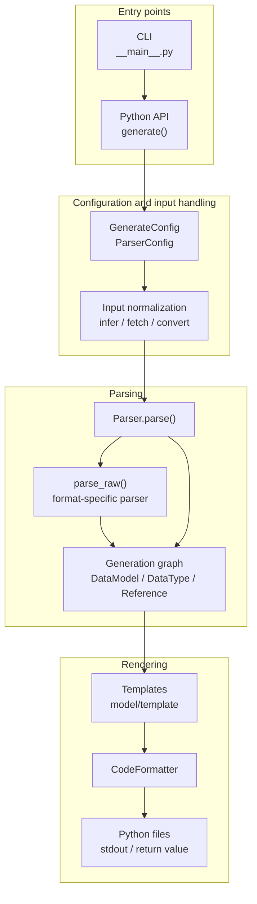
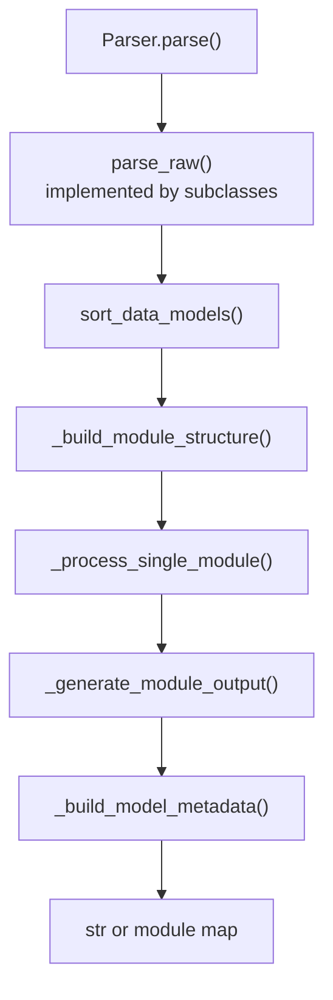
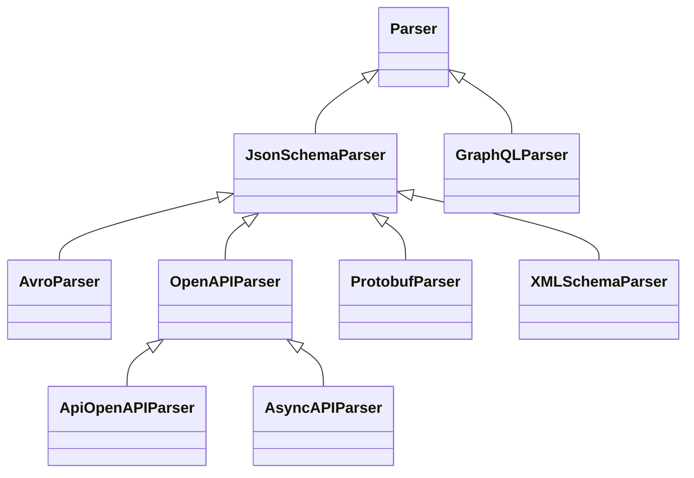
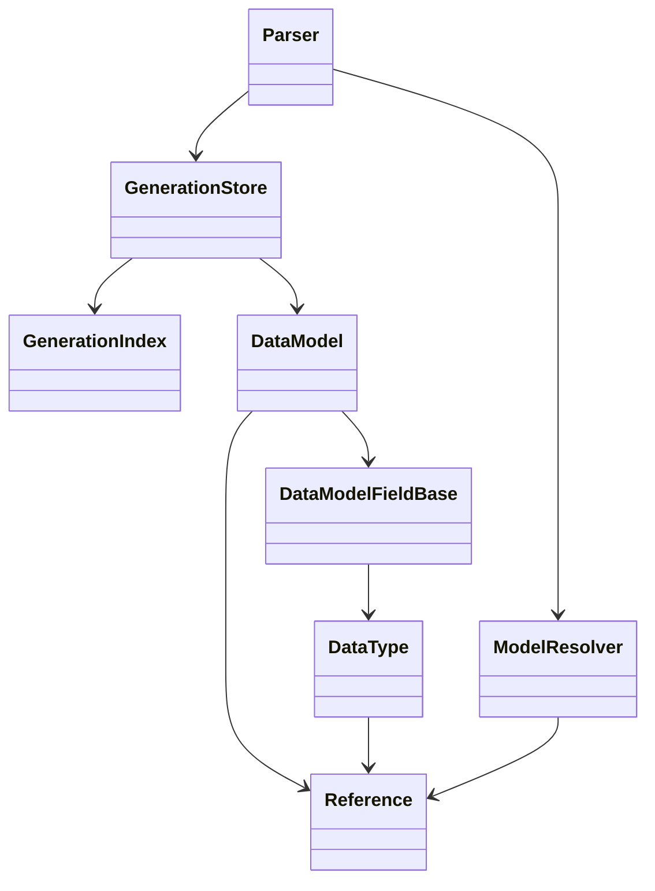

# Architecture

`datamodel-code-generator` is organized around one central idea: many input formats are normalized into a shared
generation graph, then rendered through output-model-specific backends.

This page is partly generated from source code. The generated inventory is intentionally small so the narrative can stay
hand-written while release-time details such as parser routes and output backends stay synchronized.

## Generation Pipeline



The CLI builds a `Config` from command-line arguments, `pyproject.toml`, and presets. It then calls the same
`generate()` API that library users can call directly. `generate()` selects the parser, runs it, and either returns code
or writes files. [Model Processing Passes](#model-processing-passes) lists the passes inside `Parser.parse()`.

## Entry Points

The executable entry point is defined in `pyproject.toml`:

```toml
datamodel-codegen = "datamodel_code_generator.__main__:main"
```

`src/datamodel_code_generator/__main__.py` owns CLI-only behavior:

- fast paths for `--version`, `--help`, prompt helpers, and JSON Schema output
- argument parsing and shell completion
- `pyproject.toml` profile loading and inheritance
- `--check` diff generation
- `--watch` regeneration
- structured JSON command output
- `--input-model` loading before normal generation

`src/datamodel_code_generator/__init__.py` owns the public generation API:

- `generate()`
- input type inference
- raw JSON/YAML/CSV/Dict conversion through genson
- MCP tool schema conversion
- parser construction
- generated headers and output file writing
- optional model metadata emission

## Parser Model

Each parser turns its input into `DataModel` objects. The parser-specific part is `parse_raw()`. The shared part is
`Parser.parse()`, which handles sorting, module layout, imports, rendering, exports, formatting, and optional metadata.



JSON Schema is the main reusable parser surface. OpenAPI and AsyncAPI extend it. Avro, XML Schema, Protocol Buffers,
raw data, and MCP tools convert to a JSON Schema-shaped document before using the same model-building machinery.
GraphQL is the main parser that builds models directly from its own schema API.

Ordering and module splitting use small graph helpers. `_scc.py` finds strongly connected components with an
iterative Tarjan traversal so large graphs do not hit Python recursion limits. `parser/_graph.py` provides stable
topological ordering. Together they keep `sort_data_models()` deterministic and let `_build_module_structure()` move
circular module SCCs into `_internal.py` forwarder modules when imports would otherwise cycle. The passes that read
cycles or an order among models (module dependencies, class body order, circular root models, keep model order, alias
cycles, nested model default factories) each take a snapshot of one reference graph, `_reference_graph.py`:
the models by model key and the edges between them by kind, which answers their components and orders. The
predicates that models answer on demand by walking base classes, root types or mapping defaults (inherited fields,
ancestors, cyclic ancestry, the C3 order of bases, msgspec struct tags, pydantic protected namespaces, preservable root
constraints, recursive dataclass mapping defaults) take a snapshot of the models they reach when asked and answer
from it, each model once. Under the `MODEL_GRAPH` check, each answer is compared with the computation it replaced.

## Generated Inventory

<!-- BEGIN AUTO-GENERATED ARCHITECTURE INVENTORY -->
!!! note "Generated inventory"
    This section is generated by `scripts/build_architecture_docs.py` from the current source tree.
    Edit the surrounding prose by hand, then run the script before release.

### Parser Inheritance



### Input Routes

| Input file type | Parser route | Notes |
| --- | --- | --- |
| `auto` | `pre-parser inference` | Resolved before parser selection by content inference. |
| `openapi` | `OpenAPIParser` | Routed directly by `_build_parser()`. |
| `asyncapi` | `AsyncAPIParser` | Routed directly by `_build_parser()`. |
| `jsonschema` | `JsonSchemaParser` | Routed directly by `_build_parser()`. |
| `mcp-tools` | `JsonSchemaParser after conversion` | MCP tool input/output schemas are hoisted into JSON Schema definitions first. |
| `xmlschema` | `XMLSchemaParser` | Routed directly by `_build_parser()`. |
| `protobuf` | `ProtobufParser` | Routed directly by `_build_parser()`. |
| `avro` | `AvroParser` | Routed directly by `_build_parser()`. |
| `json` | `JsonSchemaParser after conversion` | Sample data is converted to JSON Schema with genson first. |
| `yaml` | `JsonSchemaParser after conversion` | Sample data is converted to JSON Schema with genson first. |
| `dict` | `JsonSchemaParser after conversion` | In-memory mapping is converted to JSON Schema with genson first. |
| `csv` | `JsonSchemaParser after conversion` | The header and first data row are converted to JSON Schema with genson first. |
| `graphql` | `GraphQLParser` | Routed directly by `_build_parser()`. |

### Output Backends

| Output model type | Data model | Root model | Field model | Type manager |
| --- | --- | --- | --- | --- |
| `pydantic_v2.BaseModel` | `model.pydantic_v2.base_model.BaseModel` | `model.pydantic_v2.root_model.RootModel` | `model.pydantic_v2.base_model.DataModelField` | `model.pydantic_v2.types.DataTypeManager` |
| `pydantic_v2.dataclass` | `model.pydantic_v2.dataclass.DataClass` | `model.type_alias.TypeAliasTypeBackport` | `model.pydantic_v2.dataclass.DataModelField` | `model.pydantic_v2.types.DataTypeManager` |
| `dataclasses.dataclass` | `model.dataclass.DataClass` | `model.type_alias.TypeAlias` | `model.dataclass.DataModelField` | `model.dataclass.DataTypeManager` |
| `typing.TypedDict` | `model.typed_dict.TypedDict` | `model.type_alias.TypeAlias` | `model.typed_dict.DataModelFieldBackport` | `model.types.DataTypeManager` |
| `msgspec.Struct` | `model.msgspec.Struct` | `model.type_alias.TypeAlias` | `model.msgspec.DataModelField` | `model.msgspec.DataTypeManager` |

### Configuration Surface

| Config model | Field count | Purpose |
| --- | ---: | --- |
| `BaseGenerateConfig` | 200 | Shared generation options. |
| `GenerateConfig` | 215 | Public `generate()` configuration. |
| `ParserConfig` | 165 | Base parser dependency injection and parser options. |
| `JSONSchemaParserConfig` | 167 | JSON Schema parser options. |
| `OpenAPIParserConfig` | 174 | OpenAPI-specific parser options. |
| `AsyncAPIParserConfig` | 175 | AsyncAPI-specific parser options. |
| `XMLSchemaParserConfig` | 168 | XML Schema-specific parser options. |
| `ProtobufParserConfig` | 168 | Protocol Buffers-specific parser options. |
| `AvroParserConfig` | 167 | Avro-specific parser options. |
| `GraphQLParserConfig` | 168 | GraphQL-specific parser options. |

### Formatter Names

| Formatter | Default when unspecified |
| --- | --- |
| `builtin` | no |
| `black` | yes |
| `isort` | yes |
| `ruff-check` | no |
| `ruff-format` | no |
<!-- END AUTO-GENERATED ARCHITECTURE INVENTORY -->

## Intermediate Model Graph

The generation graph is built from a small set of core objects:

- `DataModel`: a generated class, root model, type alias, enum, scalar alias, or union alias.
- `DataModelFieldBase`: one field on a generated model, including defaults, aliases, constraints, and metadata.
- `DataType`: a Python type annotation tree, including containers, unions, literals, generated-model references, and
  imports.
- `Reference`: a schema reference path and generated Python name.
- `GenerationStore`: the parser-owned model list plus a query index over model and type dependencies.



`GenerationStore` is the preferred mutation boundary for parser-side changes that affect dependency facts. Parser code
should register models and update references, fields, bases, names, and paths through store methods instead of mutating
the live objects directly. `GenerationIndex` keeps stable facts about the model list and gives later phases efficient
queries such as "which data types point at this reference?". A refresh records only the models that were appended or
that store mutations changed, and rebuilds every fact only when the model list changes otherwise or
`discard_derived_facts()` drops them.

## Model Processing Passes

`Parser.parse()` runs a fixed sequence of passes between `parse_raw()` and rendering. Most of them change models,
fields and data types in place, so a fact that one pass reads may still be changed by a later pass. This section lists
the passes in execution order, says when each fact becomes final, and shows where a new decision belongs. Paths are
relative to `src/datamodel_code_generator/`; names are given as `file:function` so they can be found with `git grep`.

### Layers

| Layer | Entry point | Purpose |
| --- | --- | --- |
| L0 input loading | `parser/jsonschema.py:JsonSchemaParser.parse_raw`, `parser/openapi.py:OpenAPIParser.parse_raw` | Load sources and normalize the raw document before any schema object exists. |
| L1 parsing | `parser/jsonschema.py:JsonSchemaParser.parse_obj`, `parser/graphql.py:GraphQLParser.parse_raw` | Build `Reference`, `DataModel` and `DataType` objects and register models in the store. |
| L2 settle | segment `settle` of `parser/_passes/_tables.py:PIPELINE` | Settle yielding names, report diagnostics, sort models and base classes. |
| L3 module structure | `parser/base.py:Parser._build_module_structure` | Group models into output modules, remove duplicates, reuse across modules, merge circular imports. |
| L4 cross-module pre-pass | segment `plan` of `parser/_passes/_tables.py:PIPELINE` | Facts every module reads before any module is processed. |
| L5 per-module processing | `parser/base.py:Parser._process_single_module` | Prepare and process the models of one module; runs once per module and hands the module over to its render preparation. |
| L6 cross-module finalization | segments `cross_module`, `generic_base_class`, `decide`, `render_preparation` and `finish` of `parser/_passes/_tables.py:PIPELINE`, `parser/base.py:Parser._finalize_modules` | First point where every module has been processed: tags of tagged bases, import repairs, generic base class, decisions, constructor order and render preparation of each module, imports, final renames. |
| L7 rendering | `parser/_passes/imports.py:render_modules`, `parser/base.py:Parser._generate_module_output`, `model/base.py:DataModel.render` | Module code, templates or compiled renderers, exports. |
| L8 formatting and output | `format.py:CodeFormatter`, `__init__.py:_format_deferred_output`, `__init__.py:generate` | Format module bodies and write or return the result. |

`__init__.py:_parse_generation` may run L0–L8 again with a fresh parser (root-model collapse that stops before a
data type cycle, yielding names that class-keyed options name, untyped nullable maps, invalid dotted stdout
modules). These are retries around the whole pipeline, not passes inside it.

**L0.** `_load_source_dict` calls `_read_document`, which keeps the document as written and, under
`--use-single-value-enum-as-const`, rewrites one-value `enum` to `const` copy-on-write, except beside `nullable: true`
when the value is not null (`_single_value_enum_as_const`, which skips instance-data keywords and extension keys other
than `x-propertyNames` through `_document_child_entries`). `_parse_file` then calls `_prepare_schema_resources`, which
adds the document to the schema graph (`parser/_schema_graph.py`): `walk_schema_resources` finds which absolute URI
names which schema of it (the root, `$id` or draft-04 `id` resources, the implicit component resources of OpenAPI,
`$anchor` and `$dynamicAnchor`) and returns one frozen `DocumentResources` record, from which
`ResourceRegistry.register` fills the registry dicts L1 resolves references through; then `$ref`s that resolve through
an embedded `$id` are rewritten copy-on-write (`_rewrite_schema_resource_refs`), each `$ref` and `$dynamicRef` keyword
becomes a `ResolvedRef` (a `str` equal to the value, carrying its `RefEdge`: the holder's location and document;
`SchemaGraphBuilder.with_ref_edges`, copy-on-write, only at the keywords that hold schemas, never inside instance data,
examples, extensions, OAuth scopes, discriminator mappings or unknown keywords; `JsonSchemaObject` and the OpenAPI
`ReferenceObject` keep the edge through a wrap validator), and the location of every object of the prepared document is
indexed (`SchemaGraphBuilder.index_document`, see [Metadata Output](#metadata-output)).
Referenced documents go through the same steps when `resolve_ref` loads them: documents enter the graph in the order
L1 asks for them, and the graph never loads one by itself. With `DATAMODEL_CODE_GENERATOR_CHECK_SCHEMA_GRAPH=1`, which
`tests/conftest.py` sets for the test suite, each edge is compared with its resolution at the sites: the key `get_ref_data_type` and `resolve_ref` would compute in their own context equals the edge's key, unless that
context raises or names no value of a loaded document (a reference resolved outside its own document, recorded as
`fixed-context`), and the object `_load_ref_schema_object`, `get_ref_model`, `_resolve_asyncapi_ref` and the `api`
scope load is the registered target the edge names, except a pointer the parser splits at another `/` and references
of documents that resolve references against themselves (`_resolve_lenient_resource_ref`). Every reference whose target is static carries an
edge: a rewrite of a reference to name its target (canonicalized, lenient or normalized) keeps it
(`keep_resolved_ref`); an object a reference names is read as a schema once (`SchemaGraphBuilder.read_as_schema`), so a
`$ref` the walk read as data or names there (a nested definitions container) gets one too; schemas converted from
another format are mounted with edges to the locations their targets are mounted at (an AsyncAPI payload converted from
Protocol Buffers or XML Schema under the internal container of a root the graph owns for its document,
`SchemaGraphBuilder.mount_root` and `mount_in`, so the loaded document is never written); and a reference the parser derives
gets the edge of the reference it stands for, with its `RefOrigin` (`_derived_ref`: discriminator mappings and subtypes,
`x-python-type` names, a merged `$recursiveRef` with a fixed target, an `itemSchema` projection, an AsyncAPI Reference
Object). Only the references of the dynamic-scope rule (`_dynamic_scope_target`: a `$recursiveRef`, and a plain-name
`$dynamicRef` bound in the dynamic scope or named by the first `$dynamicAnchor` of its name in the document being
parsed) stay plain strings: they resolve against the dynamic scope of the model being parsed, not their own document.
With `report:<path>`, one line per site and origin counts the references that reached it with their edge and as plain
strings. Every L1 site takes the key of a reference from its edge (`_ref_key`, `_ref_path`): the edge's spelling
resolved once, at its first consumption, in the document that holds it (`_home_context`: its location, root `$id`
and, for an OpenAPI input document or under the `api` scope, its `$self`; a schema the parser keeps in a document of its
own, an Avro schema of an AsyncAPI document, names that document as its edges' `home`) through the external mapping, the embedded
resource, the normalized spelling and `ModelResolver.resolve_ref`; a new model is named after that spelling
(`ModelResolver._add_ref_at`). A plain string has no edge and resolves in the context its caller set. A schema copied
into another (a merged `$ref` target, an inherited property) keeps its references as written: a site that asks whether
a reference is a fragment of the document parsed now reads its edge (`_is_local_ref`), and only a merged `$recursiveRef`
with a fixed target is rewritten, to a `$ref` (`_pin_recursive_refs`).
OpenAPI and AsyncAPI register a schema that declares a discriminator, and a component schema whose `allOf` names one,
under the key of the reference that names the schema from its own document (`_schema_key`), the key the references to
it get, whatever document is being parsed when the discriminators are collected.
A JSON object of a loaded document is validated once per parse (`SchemaGraphBuilder.schema`): the targets
`_load_ref_schema_object`, `_load_inherited_schema_object` and OpenAPI's `resolve_object` load, the response and request
body targets of `get_ref_model`, and the `if`, `then`, `else` and `not` branches `_get_conditional_schema` reads share
one object per located value and its type, which no reader writes; the schema graph check compares each shared object
at the end of L1 with the fingerprint taken when it was validated (`kind="shared-schema"`).
The walks that follow references from a schema (field flags, literal and null checks, inherited properties and
overrides, validation sources, `uniqueItems` rules, merged `allOf` values) visit each schema graph node once
(`SchemaNodeId`, the location of the object a reference names: `_key_node`), and a `$ref` target merged with its sibling
keywords is dumped once per node and document being parsed (`_ref_target_dump`).
A local reference whose model a document has not parsed yet is reserved for that document (`reserved_refs`).
`_parse_file`, `_resolve_unparsed_json_pointer` and AsyncAPI's `_resolve_asyncapi_unparsed_json_pointer` take the
targets from one worklist (`_reserved_targets`: a `ReservedTarget` with the document, the key and the node the key names
in the document's prepared tree), in key order, repeating while a round reserves more keys (`_parse_file`) or adds
models (the others), and parse each target from the prepared tree; the schema graph check loads the source again and
compares the value at each target (`kind="reserved-target"`).
`walk_schema_resources` also keeps the anchor tables of each document: its `$dynamicAnchor` names (the first in walk
order wins) and its `$recursiveAnchor: true` schemas (`ResourceRegistry.anchor_tables`). The `$dynamicRef` analysis
(`_dynamic_anchors_used`, `_dynamic_ref_edges`) and the models specialized for a dynamic scope are keyed by the schema
graph node a reference names, so references that spell one schema differently share its analysis and its specialized
model. The fallbacks of the dynamic-scope rule still read the anchors L1 has registered so far (`_build_anchor_indexes`
and `_parse_file`: the root, the definitions and each schema parsed through `_parse_raw_or_validated_obj`):
`_resolve_dynamic_ref`, `_resolve_recursive_ref` and `_recursive_ref_target`. The schema graph check compares each of
their answers with the one of the document's anchor tables and records a difference (`kind="anchor-answer"`): a
`$recursiveAnchor` below `properties` is never registered, and an OpenAPI component's `$dynamicRef` parsed before the
component that declares its anchor resolves through its edge instead.
OpenAPI parses its main document in `_parse_specification` (merging path-level parameters into shallow copies of
operations in `_process_path_items`) instead of `_parse_file`. Converted inputs (Avro, XML Schema, Protocol Buffers)
build a JSON Schema dict and call `_parse_file` without `_read_document`, so document rewrites do not apply to them.

**L1.** Each place where the parser meets a schema object chooses its parse method from one table of
`parser/_schema_dispatch.py`: `_DEFINITION_TABLE` in `_parse_schema_obj` (definitions, roots, reserved targets,
AsyncAPI payloads and the `api` scope), `_FIELD_TABLE` in `parse_item` (fields, items and map values) and
`_OPENAPI_OPERATION_TABLE` in `OpenAPIParser.parse_schema` (the bodies, responses and parameters of the legacy scopes). A table
holds, in order, the steps that rewrite the site (a `$ref` with sibling keywords merged with its target,
`_merge_ref_with_schema`) and the rows whose predicates choose `parse_array`, `parse_all_of`, `parse_one_of` or
`parse_any_of` (both through `parse_combined_schema`), `parse_object`, `parse_enum`, `parse_root_type` and the other
builders; the rows of an object-kind schema (`_OBJECT_KIND_ROWS`) are shared by the definition table and
`_parse_object_kind_schema`. Rows call the public hooks through the parser, so overriding subclasses keep working; a
change of what a position parses is a row edit. `DispatchTable.choose` returns the chosen row as a `Choice` and the position's method
builds it in its own frame, so a nested schema costs no more stack frames per level than the parse methods it reaches
(`test_main_nesting_within_recursion_limit` fails when it does). A definition written as a `$ref` whose sibling keywords cannot merge into its circular target gets no model outside a definitions container (the `ref` row; `--openapi-as-definitions ref-components` counts the components of an OpenAPI specification as one, `OpenAPIParser._definition_entry_prefixes`); once every schema is parsed (`_end_schema_parsing`), the users of its reference move to the reference that `$ref` names (`_type_references_to_definitions_without_model`), so a reference to it is typed by its target, as such a `$ref` is at a field. Then a schema that an allOf base names, that got no model and that a field naming it would be typed by an import, the class `--external-ref-mapping` imports for a schema of a mapped document or the class `x-python-import` names (not a type expression in its place), is parsed into a stand-in (`_parse_base_stand_ins`): its model, parsed in its own document under the reference the base names (`parse_json_pointer`, past the `x-python-import` shortcut, and the targets that parse reserves there), in the module of the first model that names it, with the import kept by model key (`Parser._base_stand_in_imports`). Only that schema is a stand-in: the other models the parse adds are written, as a generated base gives them. A stand-in may name further such bases and definitions parsed as their `$ref` alone, so the parse and the redirect repeat until no new stand-in appears. Then the import types every other user of a stand-in, one that a reference its document does not map names, as it types a mapped `$ref`, and the parse adds nothing to the imports every module shares: a stand-in is never written, and the models the parse writes import what their types name. A stand-in never splits into read/write variants (`_get_separate_model_fields`, `_register_root_model_as`), takes part in no reuse (`_ReuseOptimizationContext`), name uniqueness, module dependency or import (L3, L5 `change_from_import`), and leaves its module where model-level type overrides remove models; a stand-in of `x-python-import` is never dropped as a generated root model is (L3 `delete_duplicate_models`), as the class it declares is the base whatever its schema describes. Once every module is processed, the import replaces the bases that name a stand-in (`apply_base_stand_in_imports`), so every pass before reads it as a generated base, in every module whatever their order. Then a model that uses a `$ref` that `--external-ref-mapping` maps and whose fragment names no schema stops with an error (`_reject_mapped_references_without_schema`), and the late hook `_generate_forced_base_models` runs. That merge, the inherited `$ref` property
merge (`_resolve_inherited_parent_property`) and a property that overrides an inherited one
(`_merge_properties_with_parent_constraints`, unless `--allof-merge-mode none`) stand for the intersection of their
parts: the earlier merge (`_deep_merge`, `_merge_property_schemas`) stays wherever it enforces what the intersection
enforces, and `parser/_intersection.py:intersect_keywords` writes the tightest bounds, the least common `multipleOf`,
the common `type` and `enum` values, the union of `required` and a `false` that a part sets where the merge does not;
nested schemas follow the same rule. Where the document's dialect (draft 7 or earlier, OpenAPI 3.0) does not read
`$ref` siblings as parts, a sibling `enum` that the document writes does not narrow the referenced schema (the legacy
sibling enum row; an inherited property override is a part in every dialect). Null comes from the site's own `nullable`, `type` list or `null` value, else only
if every part admits it. A keyword whose parts have no value in common keeps the earlier value and warns
(`warn_unsatisfiable`); `pattern`, `format`, tuple positions, combinators and allOf members are not intersected there
yet. A oneOf/anyOf of constants can become a
synthetic enum (`_extract_const_enum_from_combined`). An enum class takes a value base (`IntEnum`, `StrEnum`,
`--use-subclass-enum`'s `(T, Enum)`) only when that base keeps every member value (`T(v) == v`, NaN equal to itself),
and is a plain `Enum` otherwise (`model/_decisions/enum_kind.py:decide_enum_kind`). A `const` that admits some but not
all values of the `enum` beside it leaves every enum class as written; `parse_enum` records the const for the model it
builds (`_note_const_narrowing`), the end of L1 marks every value that names that model, and L5
`type_const_narrowed_values` types those values. A Literal enum route (`_enum_value_type`), a `propertyNames` key and
a Literal root type keep only the admitted values (`_const_narrowed_enum`); a const equal to none of the values only
warns. Under `--read-const-beside-enum` and `--use-single-value-enum-as-const` each enum route reads an enum that admits
the const beside it as that const, without an enum class (`_reads_enum_as_const`); like the L0 rewrite, it keeps an enum beside `nullable: true` and
a const other than null, and a model built for the schema object itself then holds only the admitted values
(`_definition_enum`). An object map, an object without `properties` whose keys and values `patternProperties`,
`propertyNames` or `additionalProperties` type, is built by one builder at every position (`_parse_object_map`): one
dict whose value type is the union of the value types of its key classes, never a union of dicts. The dict itself admits
the null of a type array of object and null, or of `nullable: true` under `--strict-nullable` as `_get_data_type` does
for other types, so property counts stay on it, and the other types of a type array join it in a union. A `nullable`
that `parse_combined_schema` copies from an anyOf or oneOf parent into a branch is marked on the branch, and the dict of
that branch leaves it to the union. Names come from `ModelResolver.add`.
Each model records the location of the schema object it is built from on its `Reference` (`_record_schema_object`).
Every use of a reference gets a new `DataType` that points to the one shared `Reference`. allOf `$ref` items become base
classes; inherited fields whose parent is not parsed yet stay as placeholders that L5 resolves. Discriminators are only
captured here (`field.extras["discriminator"]`). Field construction already decides const handling:
`DataModelFieldBase.__init__` calls `process_const()`, which types the const and decides its default and nullability
(`model/_decisions/literal_default.py`). Dataclass-like models (`dataclasses`, Pydantic dataclasses,
msgspec Structs) sort their fields when they are built, by `DataModel.FIELD_CONSTRUCTION_ORDER_KEY`. The key reads only
facts known then: on a Pydantic dataclass, a `None` default that `--strip-default-none` may keep counts as no default,
while a msgspec Struct counts every optional field as having one, as it never strips its defaults.
`fix_constructor_field_ordering` (`parser/_passes/render_prep.py`), after the decision phase, decides with the output
model's assignment facts
(`DataModel._field_assignment_facts`, the row `FIELD_ASSIGNMENT_CHECKER` is a view of), which state what the template
writes, and moves fields whose default the template keeps after the fields without one. An inherited field that two
bases put after a default, which `dataclasses` rejects while creating the class, gets a keyword-only copy in the class
(`get_constructor_ordering_conflicts` of `parser/_passes/_shared.py`), whose types name their models from its module.

**L2–L4.**

| Pass (`parser/_passes/`) | Reads | Changes |
| --- | --- | --- |
| `ModelResolver.settle_yielding_names` (`reference.py`) | names that yield to `--model-name-map` | `Reference.name` of yielding models |
| `sort_data_models` (`parser/_passes/settle.py`) | references through the store index | model order, models that need forward-reference updates |
| `sort_base_classes_for_mro` (`parser/_passes/settle.py`) | base classes | base order (before L3 and L5 reuse add bases) |
| L3 `_union_tags` snapshot (`parser/_passes/structure.py`) | discriminator mappings | union tags that reuse compares, taken before any merge |
| L3 `delete_duplicate_models` (`parser/_passes/structure.py`) | rendered model text (`ModelShapes.key` of `parser/_model_shapes.py`) | redirects users, edits base lists (drops root-model bases, not the stand-ins of `x-python-import`), removes models (a root model that names itself is removed from the bases of its children, which keep their other bases, and is recorded in `_self_named_root_models`, as the fields that use it keep its name) |
| L3 `replace_duplicate_name_in_module` (`parser/_passes/structure.py`) | class names, the imports stand-ins stand for (bound in each module that inherits one) | `class_name` (not of stand-ins) |
| L3 `reuse_model_tree_scope` (`parser/_passes/structure.py`) | rendered model text across modules | moves canonicals to a shared module, replaces duplicates by empty subclasses or removes them |
| L3 `resolve_circular_imports` (`parser/_passes/structure.py`) | module dependency graph (the references of field and base types and of the types that schema validator rules name, those of an alias written as a class for its rules included; without stand-ins), module paths, class names, the `--all-exports-scope` scope | merges cyclic modules into `_internal` modules, and with them the modules and merges of each import cycle through an `_internal` module that would fail (a module it imports below a package of the merge runs that forwarder while `_internal` is half built, unless the cycle is that package and modules below it, which runs first; a module it imports that uses a merged model imports it back; with `--all-exports-scope` the `__init__` module of a package that is no merged module imports the modules below it that have a name to export, so the cycles through it fail too), relocates models; a model whose class name an earlier model of the merge holds takes `<name>_<n>` with the smallest `n` no merged model holds (`_merged_class_names`); a stand-in moves along without taking part in the names or the re-exports |
| L4 `flatten_conflicting_base_layouts` (`parser/_passes/plans.py`, msgspec) | bases, fields, possible tags (`find_possible_tag_names`) and reuse duplicates (`find_possible_reuse_duplicates`) | copies base fields into Structs whose generated bases have conflicting layouts, sorted by the construction key (`DataModel.FIELD_CONSTRUCTION_ORDER_KEY`), and drops those bases |
| L4 `unconstrain_union_members_in_modules` (`parser/_passes/plans.py`, msgspec) | union members | field types |
| L4 `set_circular_root_model_paths` (`parser/_passes/plans.py`) | root-model reference graph | the circular root models (`RecursionFacts` by model key) that every module's collapse reads |

Module order is not dependency order: `_internal` modules of import cycles come first, then the tree-scope shared
module, then `_group_models_by_module`'s sort (longest module path first, reverse lexical).
Single-file output has one module, so "per module" then means the whole graph.

**L5**, per module, in this order:

| Step | Pass (`parser/_passes/`) | Reads | Changes |
| --- | --- | --- | --- |
| prepare | `alias_shadowed_imports` (`parser/_passes/_shared.py`) | field names vs imported names | import aliases |
| prepare | `override_required_field` (`parser/_passes/_shared.py`) | inherited placeholders, base models (any module) | replaces placeholders by copies of inherited fields, required, defaults |
| prepare | `replace_unique_list_to_set` (`parser/_passes/modules.py`) | `uniqueItems`, defaults | list to set (`_create_set_from_list`), set defaults |
| prepare | `change_from_import` (`parser/_passes/modules.py`) | references to other modules, in field and base types, in the types of schema validator rules and in backend settings (TypedDict `extra_items`); not of stand-ins, nor of the bases that name them, nor of a root that names itself, which deduplication dropped (`_self_named_root_models`) | module imports, `data_type.alias` |
| prepare | `extract_inherited_enum` (`parser/_passes/modules.py`) | field-less models with Enum bases | replaces the model by a new Enum with the same `Reference`, of the class of its first Enum base (`decide_enum_kind`), without the members of the other Enums that class cannot hold (`holds_inherited_member_value`: a value `int()` refuses in an `IntEnum`, as `None` or `'bad'`; a value that is no str in a `StrEnum`) when that class is an `IntEnum` or a `StrEnum` |
| process | `set_reference_default_value_to_field` (`parser/_passes/modules.py`) | defaults of referenced models | field defaults |
| process | `reuse_model` (`parser/_passes/modules.py`) | rendered model text and union tags of this module's models | replaces duplicates by empty subclasses (users in this module redirected) or removes them (Enums, `--collapse-reuse-models`: users in every module redirected) |
| process | `collapse_root_models` (`parser/_passes/modules.py`) | root models referenced from this module (any module), circular paths from L4, the module of each inner model (found by identity in the live module lists) | inlines root types, merges constraints, calls `process_const()` again, redirects references to a root model's inner model and imports it where this module does not emit it, renames (the `parent` strategy names the inner model of any module after the root it replaces, decided at the root's first holder; from then on the root is no member of its module for `change_from_import` and `import_renamed_types`), marks unused roots (not a root that a schema validator rule names); inlining a root's tree under a data type that the tree reaches would make that data type contain itself, so collapse raises `_CollapseRootModelsRecursionError` before it and `_parse_generation` parses again with every circular root model kept named (a `RecursionError` in collapse takes the same retry and is a `MODEL_GRAPH` check violation) |
| process | `set_default_enum_member` (`parser/_passes/modules.py`) | defaults vs Enum members | defaults |
| process | `sort_models` (`parser/_passes/modules.py`) | `--keep-model-order` | model order |
| process | `change_field_name` (`parser/_passes/modules.py`) | field names vs type names | field names, class names of referenced types (any module) |
| process | `restore_inherited_field_names_for_unique_aliases` (`parser/_passes/modules.py`) | inherited field names | field names |
| process | `apply_discriminator_type` (`parser/_passes/modules.py`) | captured discriminators, variant models (any module); tag values from `model/_decisions/tag_value.py`, tag defaults from `model/_decisions/literal_default.py` | tag field types, required and defaults on variants, appended tag fields, msgspec struct tags (possibly deferred to a later module) |
| process | `type_const_narrowed_values` (`parser/_passes/modules.py`) | values marked at the end of L1 with the const that narrows the enum they name, the enum now named (after reuse and collapse), its members | types each value `Literal[<Enum>.<member>]` when the members equal their values and the output's Literal holds members, None for a null const; otherwise keeps the enum and warns once per schema location |
| process | `set_one_literal_on_default` (`parser/_passes/modules.py`) | required one-literal fields; decision from `model/_decisions/literal_default.py` | default, required, nullable |
| process | `refresh_field_config` (model) | field state | backend field config |
| process | `rename_fields_hiding_types` (`parser/_passes/modules.py`) | same-named fields and types of the model family | field names or type names |
| process | `remove_overridden_models` (`parser/_passes/modules.py`) | model-level `--type-overrides`, stand-ins | removes overridden models and stand-ins from the module's list (constructor ordering still runs on them) |
| process | `apply_field_type_overrides` (`parser/_passes/modules.py`) | `--type-overrides`, field names | field types of the kept models; model-level overrides edit nodes on fields in place |
| process | `type_dict_keys_by_root_types` (`parser/_passes/modules.py`) | dict keys that name a RootModel whose instances cannot be dict keys (`DataModel._keys_take_root_type`: not frozen, no validators, methods or custom root template), its root type and `Field()` constraints (any module) | types the key by the root type, the constraints written into a string type; follows root models inside that type, not union members of a key; refreshes the backend config |
| finalize | `apply_base_class_type_overrides` (`parser/_passes/modules.py`) | model-level `--type-overrides` (not of the bases that name stand-ins) | base classes; edits base-class nodes in place and keeps the generated model each replaced base stood for, which constructor ordering reads |

Once every module is processed, `write_rule_aliases_as_classes` (`parser/_passes/modules.py`, `--generate-schema-validators`) writes each type
alias that holds schema validator rules and that collapse left written as the RootModel class, under its model key:
an alias has no class body for the rules, and whether collapse inlines it into all its holders is final only then.
The class imports the models of other modules that its rules name, as `change_from_import` does for a class.
Last, `apply_base_stand_in_imports` (`parser/_passes/modules.py`) replaces the bases that name a stand-in (L1) by the
import of the class it stands for, as `apply_base_class_type_overrides` replaces bases: until then the passes of every
module read the stand-in as a generated base when they walk the bases of a model of another module, whatever the
order of the modules.
Then `settle_discriminated_unions` (`parser/_passes/modules.py`, Pydantic models and dataclasses) writes no
`discriminator=` for the union of a lone `$ref` variant that no tag reaches: `apply_discriminator_type` writes the
tags of the variants a union lists, not of one it names alone, and a union of any module may still tag that variant, so
a variant without a tag is final only once every module is processed. It writes none either for a lone variant that is
no model (a scalar, `Any` or None, as `--collapse-root-models` leaves a scalar alias in its holder, or as an inline
schema is), which Pydantic rejects as a variant, nor for a union that takes a root model, or a type alias, with a
default as a variant (`--force-optional` gives a root one), as Pydantic reads the root as a `default` schema, which no
tagged union holds; the default is what the root writes (`Field(None, ...)`, the assignment after its annotation, a
default factory), not what its facts hold. A type alias that holds the default of its schema writes it only once
`set_validate_default_on_fields` adds `validate_default=True` to the `Field()` call, so the check reads the facts that
pass reads (`validates_structured_default`: required state, default, type); under `--use-annotated` the call holds no
default, so the alias writes none.

**L6**, after the module loop:

| Pass (`parser/_passes/`) | Changes |
| --- | --- |
| `_tag_fields_of_tagged_bases` (`parser/_passes/cross_module.py`, msgspec) | tags structs that inherit a tagged base (the tag field becomes a ClassVar) or opts them out, and opts out the structs whose tag field a base keeps as a field (their tag field is a typed field again) |
| `write_enum_member_tags_as_values` (`parser/_passes/cross_module.py`, msgspec) | types the tag field of a variant by the values of its enum members, as msgspec's `Literal` holds no member, once the structs are tagged |
| `import_removed_reuse_canonicals` (`parser/_passes/cross_module.py`) | imports of models that a later module's reuse removed |
| `import_renamed_types` (`parser/_passes/cross_module.py`) | imports of types that a later module renamed |
| `import_enum_member_literal_classes` (`parser/_passes/cross_module.py`) | imports for enum member literals |
| `apply_generic_base_class` (`parser/_passes/cross_module.py`) | inserts the generated base model and rewrites base classes |
| decision phase: the decisions of `Parser._DECISION_PASSES` (`omit_held_null` behind `--omit-redundant-reference-null`) | the facts each declares, read from `FinalFacts` ([Decision Phase](#decision-phase)) |

Render preparation, for the models each module had at the end of L5:

| Pass (`parser/_passes/render_prep.py`) | Runs | Reads | Changes |
| --- | --- | --- | --- |
| `assign_module_forward_reference_fields` | module by module | `--use-annotated` with deferred annotations | assignment form, may reorder fields |
| `fix_constructor_field_ordering` | over every model, each after the models it inherits from | required and default state, assignment form, inherited fields (a base a model-level override replaced as the generated model it stood for), rendered nullability (`types.py:DataType.admits_none`), field types after overrides | field order, constructor adjustments, keyword-only copies of inherited fields and the imports of their types |
| `unbind_fields` (model) | module by module | hidden type names | field binding |
| `update_type_aliases` | module by module | model order, forward references, fields a statement evaluates as it runs (functional TypedDict) | quotes forward references in place (`data_type.alias`), also with deferred annotations in the fields a statement evaluates as it runs, which a functional TypedDict takes from its bases too; a later `type` statement only where the runtime evaluates its name as the model is defined (no deferred annotations, a typed extra before Python 3.14, a functional TypedDict); union operator along one `.parent` chain; schema validator rules get quoted copies of the types that name the model or a later one |
| `set_validate_default_on_fields` | module by module | live models, defaults | deserialized defaults, default validation |
| `warn_required_assignments_after_defaults` | module by module | field order | warnings |

Then, over every model:

| Pass (`parser/_passes/render_prep.py`, `parser/_passes/imports.py`) | Changes |
| --- | --- |
| `fix_tag_opt_out_field_ordering` (msgspec) | keyword-only order of the structs that opted out of a tag, and of those inheriting from them |
| `_finalize_modules`: `prepare_type_alias_fields`, `finalize_type_alias_users` (backend) | type-alias field form, backend config |
| `mark_set_item_models_hashable` | identity hash for set item models |
| `_finalize_structured_imports` | imports |
| `decide_nested_model_default_factories`, `freeze_field_render_plans` | the nested models' default factories (row `legacy.L-NF`), one frozen render plan per field of the built-in output models (B2) |
| model imports snapshot, unused-model removal | imports, module model lists |
| `remove_unused`, `resolve_module_import_conflicts` (backend), `_bind_module_field_names` | module imports, field binding |
| `change_imported_model_name` | renames models that collide with imports (the last class-name change) |
| `model._name_final_classes` (model hook) | renders TypedDict `extra_items` again from the data type it was built from, so that it names the final class, and a class of another module through its import |
| `_check_model_inheritance`, `reject_alias_cycles_without_schema` (output that Pydantic builds or msgspec decodes), warnings, `_set_nested_model_default_factory_metadata` | errors, warnings, publishes the nested-factory decision for the models that render without frozen plans |

Three L6 passes repair results built from facts that changed afterwards: `import_removed_reuse_canonicals`
and `import_renamed_types` (reuse and renames in a later module, including the `parent` collapse rename) and
`fix_tag_opt_out_field_ordering` (constructor ordering counts an opted-out struct's own field named like the tag at
the place of the base's tag class variable).

Constructor ordering and render preparation run once, after the decision phase, for every model: ordering reads the
facts every module and decision left, and the assignment form of every module, and orders each model after the models
it inherits from, so a model's constructor no longer depends on whether the module of its base is processed before or
after its own (since 0.87.0). Code that overrides `_process_single_module` and runs after
`super()` sees the module before its constructor order and render preparation; the generic base class, the decision
phase and that render preparation run in the pipeline before `_finalize_modules`, so an override of
`_finalize_modules` that does not call `super()` no longer skips them, and a direct call of `_finalize_modules` no
longer applies the generic base class.

**Module imports.** The passes from L1 to L7 write the imports of a module (`ModuleContext.imports`) and the imports
all modules share (`Parser.imports`) only through `parser/_imports_plan.py:ModuleImportLedger`, which applies each write to
the live `Imports` at once and keeps it as an entry with its producer: the pass (`ImportPass`), and the model and
field it wrote for. The live `Imports` is the replay of its entries (`replay`). The import block that
`_generate_module_output` writes is `ModuleImportLedger.rendered`: a copy of the live `Imports` minus what the entries
wrote of their models' unrendered imports (`DataModel._unrendered_imports`), counted as the difference between the
replay of the entries and their replay without those imports, so the module lines keep their order and imports
written outside the ledger stay. The named row `legacy.enum-member-import-bindings` uses it: an Enum's `imports` keep
the imports of its member declarations (pydantic's `Field` for described members), so the module binds their names
for class names and reuse keys as in 0.86.0, while the import block leaves them out. The output model's `resolve_module_import_conflicts` gets the live
`Imports`; `ModuleImportLedger.external` records what it changed. `DATAMODEL_CODE_GENERATOR_CHECK_MODULE_IMPORTS`
compares each module's imports with the replay of their entries when the import text is written, so a write that
bypasses the ledger fails the check, which the test suite turns on. The names the module's `ModelResolver` gives its
imports are asked for through the ledger too (`NameLog`). After the last rename, `parser/_passes/imports.py:plan_module_imports` plans
the models each module names from the final names (`NameTable`): `ModuleImportPlan` holds the imports of other modules'
models, named by `allocate_bindings` in the order the module asked for them (row `legacy.alias-order`), and what the
module writes for each model. Nothing is written from the plan yet; under the same check, the module must write what
the plan writes and its imports must bind every planned import.

**L7.** `_generate_module_output` builds the import block, calls the backend's `render_module_code`, renders each
model and formats the body. `DataModel.render` uses the compiled renderer in `model/_compiled_templates/` for built-in
templates and Jinja2 when a custom template directory is set. Type-alias styles are chosen when the parser is built
(`model/__init__.py:get_data_model_types`). Rendering a type hint and collecting a field's imports write no
nullability: `type_hint` renders the None of the type, of the nullable model it names and, for a union, of the members
whose hints strip it (`types.py:DataType._hint_null_source`), and import collection reads
`types.py:DataType.admits_none`. Render preparation writes rendered nullability once, in its first pass
(`parser/_passes/render_prep.py:finalize_rendered_nullability`, after the module bodies, whose type-alias updates write the
union operators and quotes the members' hints read), through `types.py:DataType._materialize_render_state`, which marks
the None it adds; msgspec's top-level None and the `Field()` default plan read the value without it
(`legacy-msgspec-top-level-null-as-written`, `legacy-strip-keeps-written-null-only`). Before it, only
`parser/_passes/render_prep.py:_flatten_union_members` (render preparation), which moves member nullability onto the union, and L3's
`DataModel._write_pre_render_nullability` (`legacy-l3-import-nullability`, which overrides and constructor ordering
read; `DataModel._prepare_dedup_key` writes it for every field whose hint renders its own type before a dedup key
renders, so such a type keeps the None of the nullable model it named when duplicate deletion points it at a model
without one) write it; msgspec's `_strip_null` writes it on its own copies at L7. A decision before render preparation reads
`types.py:DataType.admits_none`, which computes the rendered nullability with
`model/_decisions/nullability.py:rendered_nullability` without writing it. A field of every built-in output model
(Pydantic `BaseModel`, `RootModel` and dataclass, msgspec `Struct`, stdlib dataclass, `TypedDict`, enum, type alias)
renders from one frozen render plan (`model/_render_plan.py:FieldRenderPlan`): its annotation form, its calls
(`Field()`, `field()`, msgspec `Meta()`) with each argument and the declared items it writes, its default, the imports
the calls need and every declared item it does not write (`Omitted`, with its reason), each with a `Why`. The field's
backend builds it: `model/pydantic_base.py:DataModelField` (a Pydantic dataclass field adds the `Field(...)` of a
forced assignment and the plain annotation of a call the dataclass must see, `model/pydantic_v2/dataclass.py`),
`model/msgspec.py:DataModelField` (`Meta(...)` inside `Annotated`, then `field(...)` or the default alone),
`model/dataclass.py:DataModelField` (`field(...)` or the default alone) and `model/typed_dict.py:DataModelField` (the
`ReadOnly[`, `Required[` and `NotRequired[` qualifiers of the key); an enum member is a field of the output's backend,
whose plan gives the member's imports. The last render preparation pass freezes one per field in the parse's
`RenderReady` (B2), and `field`, `annotated`, `type_hint`, `represented_default`, `has_default_factory_in_field`, the
import collection and the dropped-constraints warnings read the frozen plan; before B2 they read the plan the parse's
memo keeps for the field (`model/base.py:live_render_plan`), which B2 freezes. Each frozen plan keeps the revisions of
its field (`ParseMemo.revision`), or, for a field, model or parser class outside the package or under custom templates,
what it read from its field (`DataModelFieldBase._render_inputs`: the field's attributes, and inside its types,
constraints and containers), and when the model renders (`DataModel._template_fields`) the plan of a field whose
revisions moved or where any of what it read changed, replaced or edited in place, is rebuilt (`RenderReady.refreshed`),
so a model whose `render` changes its fields first writes the change, as a pass that changes a field after render
preparation does. The plan holds
values and writes its text when it is read, so the names it holds are the final ones. Custom templates get the raw
fields, which answer from the same plan. `DATAMODEL_CODE_GENERATOR_CHECK_RENDER_PLANS` checks that each frozen or
rebuilt plan writes or omits every item its field declares and that it renders as the plan rebuilt when the modules are
written, and that the type expression of the field's type hint frozen with it renders as the type hint then. Row `legacy.L-NF`: the nested models' default factories are decided when render preparation ends, but the
import snapshot reads each field as if the factory were written (a second plan, `RenderReady.import_view`), and the
models that render without frozen plans (GraphQL unions, custom output models) read the decision only once
`_set_nested_model_default_factory_metadata` publishes it after the warnings. A RootModel's config items (its regex
engine and freezing, the literal values it validates and the neutral `extra` of the validator helpers) are decided by
pass `decide_config_items` once the helpers are planned (`model/pydantic_v2/root_model.py:RootModel._decide_config_items`);
the `ConfigDict` import comes with the writer of each item's source, so the module imports collect it. A RootModel
rendered outside a parse decides them, and its `ConfigDict` import, when it renders.

### Pass Declarations

Every pass is declared in `parser/_pass_decls.py` as a `PassDecl`: its name, phase, scope (once over every model, or
once per output module over that module's models), kind (`transform`, `plan`, `repair`, `check`, `setup`,
`bookkeeping`), the `Fact` and `RenderFact` members of `parser/_facts.py` it reads and writes, explicit order edges
(`after`), the change that removes a repair (`removed_by`) and the phase it moves to (`target`).
`scripts/check_fact_finality.py` (run by the test suite) checks that names are unique, phases never go back in
execution order, a repair names what removes it, and setup, check and bookkeeping passes write no fact (a check pass
may write the pseudo-fact `STDERR`, the warnings it emits, so that two passes that warn are ordered).

`Parser.parse()` runs the passes from the tables of `parser/_passes/_tables.py` (`PIPELINE`, with the bodies
`STRUCTURE_BODY`, `MODULE_BODY` and `FINALIZE_SEGMENTS` of the overridable hooks `_build_module_structure`,
`_process_single_module` and `_finalize_modules`), built from the steps
of `parser/_pipeline.py`: a `PassSpec` runs one declared pass, when its condition holds; a `ForEachModule` runs passes
module by module; a `HookCall` calls an overridable method whose default runs a sub-table; a `Segment` enters a phase
on the store (`GenerationStore.enter_phase`, read as `GenerationStore.phase`) and the boundary before it (`PARSED`, B1,
`DECIDED`, B2), then runs its steps. The `Runner` is the only caller of a pass, inside `fact_pass(DECL)`
(`parser/_finality.py`) with the models the finality check compares; steps call passes through the parser instance, so
overrides and `--debug` tracing apply as to any method. The two diagnostics warnings that name the code calling
`parse()` find that frame however deep the pipeline is (`stacklevel_at_parse_caller`).

The order rule (`parser/_pipeline.py:check_order`): two passes of one segment conflict when one writes what the other
reads or both write the same fact. Where only the earlier writes what the later reads, a derived edge orders them; every
other conflicting pair needs explicit `after` edges, with their reasons, that connect it directly or through other
edges. An explicit edge replaces the derived edge of its pair; one that runs a reader before a writer of what it reads
is a provisional read, listed below the table. `scripts/check_pass_pipeline.py` (run by the test suite) checks that the
tables run every declaration once in `PASS_DECLS` order, in the phase of its segment and with its scope, that the
segments enter the boundaries in order and satisfy the order rule, that the repair set only shrinks, that every
decision registry follows the rules of the [Decision Phase](#decision-phase), that only `GenerationStore.seal_facts`
builds `FinalFacts`, that no code outside `Parser` reaches its name-mangled members, and lists the warnings whose
`stacklevel` reaches past their caller. A pass trace (`scripts/check_pass_pipeline.py --trace`) records each pass that runs; the test suite keeps the
traces of a few inputs and checks that some input runs every declared pass. The finality check
([Fact Finality](#fact-finality)) compares the writes of `fact` rows with the declarations while the generator runs;
reads and the writes of presentation rows are declared from the code. A new pass gets a declaration and a table entry.

<!-- BEGIN AUTO-GENERATED PASS DECLARATIONS -->
!!! note "Generated pass table"
    Generated by `scripts/build_architecture_docs.py` from `parser/_pass_decls.py`, in execution order.

| Phase | Pass | Scope | Kind | Writes | Reads | Notes |
| --- | --- | --- | --- | --- | --- | --- |
| PARSE | `refresh_custom_template_paths` | global | setup | - | - | Clears the template lookups of the custom template directory. Runs when: custom_template_dir. |
| PARSE | `set_typed_extra_annotation_mode` | global | setup | - | - | Chooses how typed extra items are annotated. |
| PARSE | `parse_raw` | global | transform | every Fact, CLASS_NAMES, MODEL_ORDER | - | L0 and L1, the parser subclass hook: builds and registers every model. |
| PARSE | `index_const_narrowed_values` | global | bookkeeping | - | FIELD_TYPES | Indexes the data types whose value a const narrows, by data type. |
| SETTLE | `settle_yielding_names` | global | transform | CLASS_NAMES | CLASS_NAMES | Gives the names that yield to --model-name-map their final form. |
| SETTLE | `report_parse_diagnostics` | global | check | STDERR | - | Reports dangling references and other parse diagnostics (parser hook). |
| SETTLE | `warn_about_unmatched_model_name_keys` | global | check | STDERR | CLASS_NAMES | Runs when: not a retry that suppresses parse warnings. After `report_parse_diagnostics`: parse diagnostics are reported first. |
| SETTLE | `prepare_parse_config` | global | setup | - | - |  |
| SETTLE | `sort_data_models` | global | plan | MODEL_ORDER | BASES, FIELD_TYPES, MODEL_ORDER | Orders models by dependency and lists those that need forward-reference updates. |
| SETTLE | `record_source_reference_paths` | global | bookkeeping | - | MODEL_ORDER | Runs when: collect_model_metadata. |
| SETTLE | `sort_base_classes_for_mro` | global | transform | BASES | BASES, MODEL_ORDER | After `sort_data_models`: the model order reads the bases as parsed; the MRO order of bases follows it. |
| STRUCTURE | `group_models_by_module` | global | plan | MODULE_MEMBERSHIP | MODEL_ORDER |  |
| STRUCTURE | `reset_collapsed_reuse_state` | global | bookkeeping | - | - |  |
| STRUCTURE | `snapshot_union_tags` | global | plan | PLANS | DISCRIMINATOR_TAGS | Records the tags of discriminated unions before any model is merged. Runs when: reuse_model. |
| STRUCTURE | `delete_duplicate_models` | module | transform | BASES, CLASS_NAMES, FIELD_TYPES, MODELS_EXIST, NULLABLE | every Fact, CLASS_NAMES, FIELD_ORDER, MODULE_MEMBERSHIP | Removes models of the module that render the same as another and redirects their users. |
| STRUCTURE | `replace_duplicate_name_in_module` | module | transform | CLASS_NAMES, NULLABLE | CLASS_NAMES, MODULE_IMPORTS | Makes class names unique within a module; row legacy-l3-import-nullability writes nullability first. After `delete_duplicate_models`: renames the duplicates that deletion keeps. |
| STRUCTURE | `apply_forced_invalid_dotted_stdout_repair` | global | transform | CLASS_NAMES, MODULE_MEMBERSHIP | CLASS_NAMES, MODULE_MEMBERSHIP | Flattens the modules of dotted stdout output that a retry found invalid, then regroups. After `replace_duplicate_name_in_module`: flattens invalid roots under the names deduplication gave. |
| STRUCTURE | `reuse_model_tree_scope` | global | transform | BASES, FIELD_SET, FIELD_TYPES, MODELS_EXIST, MODULE_MEMBERSHIP, NULLABLE | every Fact, FIELD_ORDER, MODULE_MEMBERSHIP, PLANS | Moves models duplicated across modules into a shared module. Runs when: reuse_model with the tree scope. After `apply_forced_invalid_dotted_stdout_repair`: shares the duplicates of the repaired module layout. |
| STRUCTURE | `resolve_circular_imports` | global | transform | CLASS_NAMES, MODULE_MEMBERSHIP | BASES, FIELD_TYPES, MODULE_MEMBERSHIP | Merges modules that import each other into _internal modules. After `reuse_model_tree_scope`: breaks the cycles of the modules tree-scope reuse leaves, its shared module included. |
| STRUCTURE | `configure_code_formatter` | global | setup | - | MODULE_MEMBERSHIP | Runs when: format_. |
| STRUCTURE | `detect_standard_generation_templates` | global | setup | - | - |  |
| PLAN | `reset_per_run_state` | global | bookkeeping | - | - |  |
| PLAN | `flatten_conflicting_base_layouts` | global | transform | BASES, FIELD_ORDER, FIELD_SET | BASES, DISCRIMINATOR_TAGS, FIELD_SET, FIELD_TYPES | Copies base fields into msgspec Structs whose generated bases have conflicting layouts. Runs when: msgspec. |
| PLAN | `unconstrain_union_members` | global | transform | CONSTRAINTS, FIELD_TYPES | FIELD_TYPES | Runs when: msgspec. After `flatten_conflicting_base_layouts`: layouts are flattened with the union members as parsed. |
| PLAN | `set_circular_root_model_paths` | global | plan | PLANS | FIELD_TYPES, MODULE_MEMBERSHIP | Runs when: collapse_root_models. |
| PLAN | `record_emitting_modules` | global | bookkeeping | - | MODULE_MEMBERSHIP | Records the module that writes each model, for the names --collapse-root-models-name-strategy gives. |
| MODULES | `record_decimal_alias_models` | module | bookkeeping | - | FIELD_NAMES | Runs when: a field of the module is named Decimal. |
| MODULES | `alias_shadowed_imports` | module | transform | DEFAULT_EXPRESSION, IMPORT_ALIASES | FIELD_NAMES, MODULE_IMPORTS | Aliases imports that field names shadow, in types and in runtime expressions of defaults. |
| MODULES | `override_required_field` | module | transform | DEFAULTS, FIELD_SET, REQUIRED | BASES, DEFAULTS, FIELD_SET, REQUIRED | Replaces inherited placeholders by copies of the inherited fields. |
| MODULES | `replace_unique_list_to_set` | module | transform | CONTAINERS, DEFAULTS, FIELD_TYPES | CONSTRAINTS, DEFAULTS, FIELD_TYPES | After `override_required_field`: converts the defaults that inherited required fields bring. |
| MODULES | `change_from_import` | module | transform | IMPORT_ALIASES, MODULE_IMPORTS, NULLABLE | CLASS_NAMES, FIELD_TYPES, MODULE_MEMBERSHIP | After `alias_shadowed_imports`: imports referenced models after shadowed imports took their aliases. |
| MODULES | `extract_inherited_enum` | module | transform | MODELS_EXIST, MODEL_KIND | BASES, FIELD_SET, MODEL_KIND, MODULE_IMPORTS |  |
| MODULES | `mark_unused_models_start` | module | bookkeeping | - | - |  |
| MODULES | `set_reference_default_value_to_field` | module | transform | DEFAULTS | DEFAULTS, FIELD_TYPES | After `replace_unique_list_to_set`: turns defaults into references after unique lists became sets. |
| MODULES | `reuse_model` | module | transform | BASES, FIELD_SET, FIELD_TYPES, MODELS_EXIST, NULLABLE | every Fact, FIELD_ORDER, PLANS | Replaces duplicates of the module by empty subclasses, or removes them and redirects their users. After `set_reference_default_value_to_field`: compares models with their final defaults. After `extract_inherited_enum`: compares models after inherited enums became models of their own. |
| MODULES | `collapse_root_models` | module | transform | CLASS_NAMES, CONSTRAINTS, DEFAULTS, DISCRIMINATOR_TAGS, FIELD_TYPES, METADATA, MODELS_EXIST, MODULE_IMPORTS, NULLABLE, REQUIRED | CONSTRAINTS, FIELD_TYPES, MODEL_KIND, PLANS | Inlines the root models the module references. Runs when: collapse_root_models. After `reuse_model`: inlines the root models that reuse keeps. |
| MODULES | `set_default_enum_member` | module | transform | DEFAULTS | DEFAULTS, FIELD_TYPES | After `collapse_root_models`: writes enum members as defaults of the types collapse inlined. |
| MODULES | `sort_models` | module | transform | MODEL_ORDER | BASES, FIELD_TYPES, MODEL_ORDER |  |
| MODULES | `change_field_name` | module | transform | CLASS_NAMES, FIELD_ALIASES, FIELD_NAMES | CLASS_NAMES, FIELD_NAMES | After `collapse_root_models`: renames fields against the class names collapse settled. After `record_decimal_alias_models`: the Decimal check reads the field names as parsed. |
| MODULES | `restore_inherited_field_names_for_unique_aliases` | module | transform | FIELD_ALIASES, FIELD_NAMES | BASES, FIELD_ALIASES, FIELD_NAMES | After `change_field_name`: restores the inherited names that renaming changed. |
| MODULES | `apply_discriminator_type` | module | transform | CONSTRAINTS, DEFAULTS, DISCRIMINATOR_TAGS, FIELD_SET, FIELD_TYPES, MODULE_IMPORTS, NULLABLE, REQUIRED | DISCRIMINATOR_TAGS, FIELD_SET, FIELD_TYPES | Writes the tag of each discriminated union into its variants, in any module. After `sort_models`: models are ordered by their types before tags rewrite the variant types. After `set_default_enum_member`: enum defaults read the types before tags rewrite them. |
| MODULES | `type_const_narrowed_values` | module | transform | FIELD_TYPES, MODULE_IMPORTS | FIELD_TYPES | Types each value by the const that narrows the enum it names. After `apply_discriminator_type`: narrows the types that tags wrote. |
| MODULES | `set_one_literal_on_default` | module | transform | DEFAULTS, NULLABLE, REQUIRED | FIELD_TYPES, REQUIRED | Runs when: use_one_literal_as_default. |
| MODULES | `refresh_field_config` | module | transform | BACKEND_CONFIG | CONSTRAINTS, DEFAULTS, FIELD_ALIASES, NULLABLE, REQUIRED | Lets each model refresh its backend field configuration (model hook). |
| MODULES | `rename_fields_hiding_types` | module | transform | CLASS_NAMES, FIELD_ALIASES, FIELD_NAMES | BASES, CLASS_NAMES, DEFAULTS, FIELD_NAMES, FIELD_SET, FORCED_ASSIGNMENT, KEYWORD_ONLY, NULLABLE, REQUIRED | After `refresh_field_config`: the field config is refreshed with the aliases before renaming. |
| MODULES | `remove_overridden_models` | module | transform | MODELS_EXIST | CLASS_NAMES, TYPE_OVERRIDES | Keeps the models that a model-level --type-overrides replaces out of the module. |
| MODULES | `apply_field_type_overrides` | module | transform | CONSTRAINTS, FIELD_TYPES, MODULE_IMPORTS, TYPE_OVERRIDES | FIELD_NAMES, TYPE_OVERRIDES | After `remove_overridden_models`: overrides apply to the models kept after model-level overrides (#4958). |
| MODULES | `type_dict_keys_by_root_types` | module | transform | BACKEND_CONFIG, FIELD_TYPES, IMPORT_ALIASES, MODULE_IMPORTS | CONSTRAINTS, FIELD_TYPES, METADATA, MODEL_KIND, MODULE_MEMBERSHIP | Types each dict key that names a root model whose instances cannot be dict keys by its root type. After `apply_field_type_overrides`: types dict keys after field types are overridden. |
| MODULES | `fix_constructor_field_ordering_early` | module | transform | FIELD_ORDER, FORCED_ASSIGNMENT, KEYWORD_ONLY, REQUIRED | BACKEND_CONFIG, DEFAULTS, FIELD_NAMES, FIELD_ORDER, FIELD_SET, FIELD_TYPES, FORCED_ASSIGNMENT, KEYWORD_ONLY, NULLABLE, REQUIRED | Orders constructor fields while the modules are processed, before every field has its final name. Runs when: without --order-constructor-fields-by final-names. |
| MODULES | `snapshot_module_unused_models` | module | bookkeeping | - | - |  |
| MODULES | `apply_base_class_type_overrides` | module | transform | BASES, MODULE_IMPORTS, TYPE_OVERRIDES | TYPE_OVERRIDES | After `type_dict_keys_by_root_types`: both add module imports; base overrides come after field types are final. |
| MODULES | `write_rule_aliases_as_classes` | global | transform | IMPORT_ALIASES, MODEL_KIND, MODULE_IMPORTS | CLASS_NAMES, MODELS_EXIST, MODEL_KIND, MODULE_MEMBERSHIP | After every module is processed: writes each type alias that holds schema validator rules and that `collapse_root_models` left written as the RootModel class, under its model key, and imports the models of other modules that its rules name. Runs when: --generate-schema-validators. After `type_dict_keys_by_root_types`: the aliases written as classes are object maps, which no dict key names. After `apply_base_class_type_overrides`: imports what the rules of the new classes name once every module has written its imports. |
| MODULES | `name_inner_models_in_rules` | global | transform | FIELD_TYPES, IMPORT_ALIASES, MODULE_IMPORTS | CLASS_NAMES, MODELS_EXIST, MODULE_MEMBERSHIP | After every module is processed: makes the schema validator rules that name a root model the `parent` strategy of `collapse_root_models` replaced name its inner model, and imports it in their modules. Runs when: --generate-schema-validators --collapse-root-models-name-strategy parent. After `write_rule_aliases_as_classes`: the aliases written as classes import what their rules name, which this pass then redirects. After `fix_constructor_field_ordering_early`: the types of rules are no constructor fields. |
| MODULES | `apply_base_stand_in_imports` | global | transform | BASES, MODULE_IMPORTS | BASES | After every module is processed: replaces the bases that name a stand-in (a schema that a base names and the output types by an import) by that import, so that the passes of every module read the stand-in as a generated base whatever the module order. Runs when: a base names a stand-in. After `apply_base_class_type_overrides`: every module reads the stand-ins as the bases of models of other modules before imports replace them. After `name_inner_models_in_rules`: both add module imports once every module is processed. |
| MODULES | `settle_discriminated_unions` | global | transform | DISCRIMINATOR_TAGS | DEFAULTS, DISCRIMINATOR_TAGS, FIELD_SET, FIELD_TYPES, NULLABLE, REQUIRED | After every module is processed: writes no `discriminator=` for the union of a lone `$ref` variant that has no tag, which a union of any module may still write into it, nor for a lone variant that is no model (a scalar, `Any` or None, as a collapsed alias or an inline schema leaves it), nor for a union that takes a root model, or a type alias, with a default as a variant, also where `--collapse-root-models` inlines the union into the items of a list. Runs when: the output fields write `discriminator=`. |
| CROSS_MODULE | `tag_fields_of_tagged_bases` | global | transform | BASES, DISCRIMINATOR_TAGS, FIELD_SET, FIELD_TYPES, IMPORT_ALIASES, MODULE_IMPORTS | BASES, DISCRIMINATOR_TAGS, FIELD_SET, MODULE_IMPORTS, MODULE_MEMBERSHIP | Tags the structs that declare the tag field of a tagged base, or opts them out of the tag, and opts out the structs whose tag field a base keeps as a field, typing their tag field by its const again; a struct that reuse made an empty subclass of that base declares the fields of its base instead and keeps its tag, importing the models of other modules that those fields name. Runs when: msgspec. |
| CROSS_MODULE | `write_enum_member_tags_as_values` | global | transform | FIELD_TYPES | DISCRIMINATOR_TAGS, FIELD_TYPES | Writes the values of the enum members that tag a variant, where the output's Literal holds no member. Runs when: an output whose Literal holds no enum member (msgspec). After `tag_fields_of_tagged_bases`: the tags read a member literal as no literal until the structs are tagged. |
| CROSS_MODULE | `warn_enums_admitting_other_values` | global | check | STDERR | DISCRIMINATOR_TAGS, FIELD_TYPES |  |
| CROSS_MODULE | `import_removed_reuse_canonicals` | global | repair | IMPORT_ALIASES, MODULE_IMPORTS | MODELS_EXIST, MODULE_IMPORTS, MODULE_MEMBERSHIP | Removed by RP15b. After `tag_fields_of_tagged_bases`: repairs the imports of every module once the fields reused structs copy from their bases import theirs. |
| CROSS_MODULE | `import_renamed_types` | global | repair | IMPORT_ALIASES, MODULE_IMPORTS | CLASS_NAMES, MODULE_IMPORTS | Removed by RP15b. After `tag_fields_of_tagged_bases`: imports renamed types once the fields reused structs copy from their bases import theirs. After `import_removed_reuse_canonicals`: imports renamed types next to the canonicals of removed reuse duplicates. |
| CROSS_MODULE | `import_enum_member_literal_classes` | global | repair | FIELD_TYPES, IMPORT_ALIASES, MODULE_IMPORTS | DEFAULTS, FIELD_TYPES, MODULE_IMPORTS | Removed by RP15b. After `import_renamed_types`: imports literal classes next to the renamed types. After `warn_enums_admitting_other_values`: the warning reads the enum types before literal classes replace them. |
| CROSS_MODULE | `apply_generic_base_class` | global | transform | BASES, MODELS_EXIST | BASES | Inserts the generated base model and rewrites the base classes; B1 follows. |
| RENDER_PREPARATION | `assign_forward_reference_fields` | module | transform | ASSIGNMENT_FORM, FIELD_ORDER | DEFAULTS, FIELD_ORDER, FIELD_TYPES, MODEL_ORDER | Runs when: use_annotated with deferred annotations. |
| RENDER_PREPARATION | `fix_constructor_field_ordering` | global | transform | FIELD_ORDER, FIELD_SET, FORCED_ASSIGNMENT, IMPORT_ALIASES, KEYWORD_ONLY, MODULE_IMPORTS, REQUIRED | ASSIGNMENT_FORM, BACKEND_CONFIG, CLASS_NAMES, DEFAULTS, FIELD_NAMES, FIELD_ORDER, FIELD_SET, FIELD_TYPES, FORCED_ASSIGNMENT, KEYWORD_ONLY, MODULE_IMPORTS, NULLABLE, REQUIRED | Orders constructor fields so that fields without a default come first, reading the fields of bases, each model after its bases; an inherited field that bases put after a default gets a keyword-only copy. After `assign_forward_reference_fields`: a field written by assignment is a dataclass default, which ordering reads from the bases of every module. |
| RENDER_PREPARATION | `unbind_hidden_type_fields` | module | transform | UNBOUND_FIELDS | CLASS_NAMES, FIELD_NAMES | Leaves fields unbound that hide a type their class names (model hook). |
| RENDER_PREPARATION | `update_type_aliases` | module | transform | FIELD_TYPES, NULLABLE, QUOTING, TYPE_ALIAS_BODY | BASES, CLASS_NAMES, FIELD_NAMES, FIELD_SET, FIELD_TYPES, MODEL_ORDER, UNBOUND_FIELDS | Quotes forward references and defers recursive containers. Removed by RP16b. After `fix_constructor_field_ordering`: ordering reads the field types before aliases quote them. After `assign_forward_reference_fields`: the forward-reference assignment reads the field types unquoted. |
| RENDER_PREPARATION | `collect_live_models` | module | bookkeeping | - | - |  |
| RENDER_PREPARATION | `set_validate_default_on_fields` | module | transform | CONSTRAINTS, DEFAULTS, DEFAULT_EXPRESSION, DEFAULT_VALIDATION, IMPORT_ALIASES | DEFAULTS, FIELD_TYPES, MODELS_EXIST | After `assign_forward_reference_fields`: the forward-reference assignment reads which fields have a default, which deserializing it keeps. |
| RENDER_PREPARATION | `warn_required_assignments_after_defaults` | module | check | STDERR | DEFAULTS, FIELD_ORDER, FORCED_ASSIGNMENT, KEYWORD_ONLY, REQUIRED |  |
| RENDER_PREPARATION | `fix_tag_opt_out_field_ordering` | global | repair | KEYWORD_ONLY | BASES, DEFAULTS, FIELD_SET, KEYWORD_ONLY, REQUIRED | Runs when: msgspec. Removed by G08. After `warn_required_assignments_after_defaults`: the pydantic warning and this msgspec repair never read or write the same models. |
| RENDER_PREPARATION | `finalize_rendered_nullability` | global | transform | FIELD_TYPES, NULLABLE | FIELD_TYPES, NULLABLE, QUOTING | Writes the None each type hint renders, once, after the module bodies set union operators and quotes; rendering and import collection write none. Rendering the members' hints writes the import of the Any an empty union renders as. |
| RENDER_PREPARATION | `collect_all_models` | global | bookkeeping | - | - |  |
| RENDER_PREPARATION | `prepare_type_alias_fields` | global | transform | METADATA, MODULE_IMPORTS, TYPE_ALIAS_BODY | FIELD_TYPES, MODELS_EXIST, MODEL_KIND | Rewrites the bodies of type aliases (alias bodies are not part of FIELD_TYPES) and compiles patterns. |
| RENDER_PREPARATION | `finalize_type_alias_users` | global | transform | BACKEND_CONFIG | FIELD_TYPES, MODEL_KIND | Lets the backend configure the models that use type aliases (model hook). |
| RENDER_PREPARATION | `mark_set_item_models_hashable` | global | transform | SET_ITEM_HASH | CONTAINERS, FIELD_TYPES |  |
| RENDER_PREPARATION | `finalize_structured_imports` | global | transform | DEFAULT_EXPRESSION, IMPORT_ALIASES, MODULE_IMPORTS | CONSTRAINTS, DEFAULTS, FIELD_NAMES, MODULE_IMPORTS | Aliases imports that runtime default expressions shadow (Avro also aligns shared defaults). Moves to IMPORTS. After `prepare_type_alias_fields`: aliases imports after alias bodies dropped their con* imports. |
| RENDER_PREPARATION | `finalize_sequence_interface` | global | transform | BACKEND_CONFIG | CLASS_NAMES, FIELD_TYPES, MODEL_KIND | Runs when: use_root_model_sequence_interface. After `finalize_type_alias_users`: both write backend config; the sequence interface is decided last. |
| RENDER_PREPARATION | `decide_nested_model_default_factories` | global | plan | - | DEFAULTS, FIELD_TYPES, MODELS_EXIST, MODEL_ORDER | Decides, from the final model order and reference cycles, the default factories of optional nested models that the render plans read (row legacy.L-NF). Runs when: use_default_factory_for_optional_nested_models. |
| RENDER_PREPARATION | `order_constructor_fields_by_decided_nested_factories` | global | transform | FIELD_ORDER, FORCED_ASSIGNMENT, KEYWORD_ONLY, REQUIRED | BACKEND_CONFIG, DEFAULTS, FIELD_NAMES, FIELD_ORDER, FIELD_SET, FIELD_TYPES, FORCED_ASSIGNMENT, KEYWORD_ONLY, NULLABLE, REQUIRED | Orders constructor fields again by the decided nested factories, which the orderings before leave out under --order-constructor-fields-by written-defaults. Runs when: use_default_factory_for_optional_nested_models and order_constructor_fields_by_written_defaults. |
| RENDER_PREPARATION | `freeze_field_render_plans` | global | plan | - | every Fact, BACKEND_CONFIG, DEFAULT_EXPRESSION, DEFAULT_VALIDATION, FIELD_ORDER, FORCED_ASSIGNMENT, KEYWORD_ONLY | Freezes one render plan per field of the built-in output models, which rendering reads; B2 follows. |
| IMPORTS | `snapshot_model_imports` | global | plan | - | every Fact, BACKEND_CONFIG, DEFAULT_EXPRESSION, IMPORT_ALIASES, QUOTING, TYPE_ALIAS_BODY | Collects the imports of every model once; B2 precedes it. |
| IMPORTS | `append_model_imports` | global | transform | MODULE_IMPORTS | - |  |
| IMPORTS | `remove_unused_models` | global | transform | MODELS_EXIST, MODULE_IMPORTS, MODULE_MEMBERSHIP | MODELS_EXIST | Removes the models that collapse left unused from their modules. After `append_model_imports`: removes the imports of unused models after every model added its imports. After `snapshot_model_imports`: the snapshot holds the imports of unused models, which leave with them. |
| IMPORTS | `validate_explicit_field_aliases` | global | check | - | FIELD_ALIASES, FIELD_NAMES | Runs when: aliases. |
| IMPORTS | `prepare_schema_runtime_validation_module_code` | global | transform | MODULE_CODE, MODULE_IMPORTS | CLASS_NAMES, FIELD_NAMES | Runs when: generate_schema_validators. After `remove_unused_models`: plans validator helpers for the kept models. |
| IMPORTS | `sync_schema_runtime_validation_module_imports` | global | transform | MODULE_IMPORTS | MODULE_CODE | Runs when: generate_schema_validators. After `prepare_schema_runtime_validation_module_code`: adds the imports of the planned helpers. |
| IMPORTS | `merge_runtime_expression_imports` | global | transform | MODULE_IMPORTS | DEFAULT_EXPRESSION | Runs when: runtime expressions. After `sync_schema_runtime_validation_module_imports`: both add module imports; runtime expressions come after validator helpers. |
| IMPORTS | `remove_unused_imports` | global | repair | MODULE_IMPORTS | CLASS_NAMES, FIELD_TYPES, MODULE_CODE, MODULE_IMPORTS | Drops the imports no rendered name uses; becomes a check. Removed by RP15b. After `merge_runtime_expression_imports`: removes unused imports once every producer added its imports. |
| IMPORTS | `resolve_module_import_conflicts` | global | transform | IMPORT_ALIASES, MODULE_IMPORTS | FIELD_NAMES, MODULE_IMPORTS | Lets the backend alias imports that clash with names of the module (model hook). After `remove_unused_imports`: resolves the conflicts of the imports that are used. |
| IMPORTS | `bind_module_field_names` | global | repair | IMPORT_ALIASES, UNBOUND_FIELDS | FIELD_NAMES, MODULE_IMPORTS | Removed by RP15b. After `resolve_module_import_conflicts`: binds field names against the final import names. |
| IMPORTS | `change_imported_model_name` | global | transform | CLASS_NAMES | CLASS_NAMES, MODULE_IMPORTS | Renames models that collide with imports, the last class-name change. |
| IMPORTS | `name_final_classes_of_additional_properties` | global | transform | BACKEND_CONFIG | CLASS_NAMES, IMPORT_ALIASES | Renders backend settings that name the classes of additional properties (TypedDict extra_items) from their final names, a class of another module through its import (model hook). Runs when: additional properties reference classes. |
| IMPORTS | `refresh_sequence_interface_after_renames` | global | repair | BACKEND_CONFIG | CLASS_NAMES | Runs when: use_root_model_sequence_interface and a model was renamed. Removed by RP15b. After `name_final_classes_of_additional_properties`: both write backend config; the sequence interface is decided last. |
| IMPORTS | `replan_schema_validators_after_renames` | global | repair | MODULE_CODE, MODULE_IMPORTS | CLASS_NAMES | Runs when: generate_schema_validators and a model was renamed. Removed by RP15b. After `change_imported_model_name`: plans the validator helpers again for the renamed models. After `bind_module_field_names`: binding reads the module imports before the helpers are planned again. |
| IMPORTS | `decide_config_items` | global | plan | BACKEND_CONFIG, MODULE_CODE | BACKEND_CONFIG, CONSTRAINTS, MODULE_CODE | Decides the config items each model's class writes (model hook). After `name_final_classes_of_additional_properties`: both write backend config; config items are decided last. After `refresh_sequence_interface_after_renames`: both write backend config; config items are decided last. After `replan_schema_validators_after_renames`: reads the neutral extra config that planning the validator helpers sets on root models. |
| IMPORTS | `remap_import_overrides` | global | transform | MODULE_IMPORTS | MODULE_IMPORTS | Runs when: import_overrides. After `replan_schema_validators_after_renames`: import overrides move the final imports. |
| IMPORTS | `reject_unavailable_imports` | global | check | - | MODULE_IMPORTS | Runs when: a configured type is unavailable on the target Python. |
| IMPORTS | `record_generated_class_names` | global | bookkeeping | - | CLASS_NAMES | Runs when: class names are collected. |
| IMPORTS | `record_model_placement` | global | bookkeeping | - | CLASS_NAMES, MODULE_MEMBERSHIP | Runs when: typed or untyped nullable maps. |
| IMPORTS | `check_model_inheritance` | global | check | - | BASES, FIELD_SET, MODULE_MEMBERSHIP |  |
| IMPORTS | `reject_alias_cycles_without_schema` | global | check | - | CONSTRAINTS, FIELD_TYPES, MODELS_EXIST, MODEL_KIND, MODULE_MEMBERSHIP, NULLABLE, TYPE_ALIAS_BODY | Runs when: output that Pydantic builds or msgspec decodes. |
| IMPORTS | `warn_about_dropped_constraints` | global | check | STDERR | CONSTRAINTS |  |
| IMPORTS | `warn_about_decimal_defaults` | global | check | STDERR | DEFAULTS | After `warn_about_dropped_constraints`: warnings keep their order. |
| IMPORTS | `warn_about_variant_discriminator_tags` | global | check | STDERR | DISCRIMINATOR_TAGS | After `warn_about_decimal_defaults`: warnings keep their order. |
| IMPORTS | `warn_about_msgspec_decoding` | global | check | STDERR | FIELD_TYPES | After `warn_about_variant_discriminator_tags`: warnings keep their order. |
| IMPORTS | `set_nested_model_default_factory_metadata` | global | transform | DEFAULT_EXPRESSION | - | Publishes the nested-factory decision on the models, for the models that render without frozen plans (GraphQL unions, custom output models; row legacy.L-NF). Runs when: use_default_factory_for_optional_nested_models. |
| IMPORTS | `record_pydantic_floor` | global | check | - | BACKEND_CONFIG, CONSTRAINTS, FIELD_ALIASES, FIELD_TYPES, MODEL_KIND, TYPE_ALIAS_BODY | Runs when: an explicit target Pydantic version. |
| IMPORTS | `add_root_init_result` | global | bookkeeping | - | MODULE_MEMBERSHIP |  |
| RENDER | `render_modules` | global | transform | FIELD_TYPES | every Fact, ASSIGNMENT_FORM, BACKEND_CONFIG, CLASS_NAMES, DEFAULT_EXPRESSION, DEFAULT_VALIDATION, FIELD_ORDER, FORCED_ASSIGNMENT, IMPORT_ALIASES, KEYWORD_ONLY, MODEL_ORDER, MODULE_CODE, MODULE_IMPORTS, MODULE_MEMBERSHIP, PLANS, QUOTING, SET_ITEM_HASH, STDERR, TYPE_ALIAS_BODY, UNBOUND_FIELDS | L7: renders every module; writes the import of the Any an empty union renders as. |

Provisional reads, from the explicit edges:

- `sort_data_models` reads BASES before `sort_base_classes_for_mro` writes it: the model order reads the bases as parsed; the MRO order of bases follows it.
- `delete_duplicate_models` reads CLASS_NAMES, NULLABLE before `replace_duplicate_name_in_module` writes it: renames the duplicates that deletion keeps.
- `replace_duplicate_name_in_module` reads CLASS_NAMES before `apply_forced_invalid_dotted_stdout_repair` writes it: flattens invalid roots under the names deduplication gave.
- `apply_forced_invalid_dotted_stdout_repair` reads MODULE_MEMBERSHIP before `reuse_model_tree_scope` writes it: shares the duplicates of the repaired module layout.
- `reuse_model_tree_scope` reads MODULE_MEMBERSHIP before `resolve_circular_imports` writes it: breaks the cycles of the modules tree-scope reuse leaves, its shared module included.
- `flatten_conflicting_base_layouts` reads FIELD_TYPES before `unconstrain_union_members` writes it: layouts are flattened with the union members as parsed.
- `override_required_field` reads DEFAULTS before `replace_unique_list_to_set` writes it: converts the defaults that inherited required fields bring.
- `alias_shadowed_imports` reads MODULE_IMPORTS before `change_from_import` writes it: imports referenced models after shadowed imports took their aliases.
- `replace_unique_list_to_set` reads DEFAULTS before `set_reference_default_value_to_field` writes it: turns defaults into references after unique lists became sets.
- `set_reference_default_value_to_field` reads FIELD_TYPES before `reuse_model` writes it: compares models with their final defaults.
- `extract_inherited_enum` reads BASES, FIELD_SET before `reuse_model` writes it: compares models after inherited enums became models of their own.
- `reuse_model` reads CONSTRAINTS, DEFAULTS, DISCRIMINATOR_TAGS, FIELD_TYPES, METADATA, MODELS_EXIST, NULLABLE, REQUIRED before `collapse_root_models` writes it: inlines the root models that reuse keeps.
- `record_decimal_alias_models` reads FIELD_NAMES before `change_field_name` writes it: the Decimal check reads the field names as parsed.
- `change_field_name` reads FIELD_NAMES before `restore_inherited_field_names_for_unique_aliases` writes it: restores the inherited names that renaming changed.
- `sort_models` reads FIELD_TYPES before `apply_discriminator_type` writes it: models are ordered by their types before tags rewrite the variant types.
- `set_default_enum_member` reads DEFAULTS, FIELD_TYPES before `apply_discriminator_type` writes it: enum defaults read the types before tags rewrite them.
- `apply_discriminator_type` reads FIELD_TYPES before `type_const_narrowed_values` writes it: narrows the types that tags wrote.
- `refresh_field_config` reads FIELD_ALIASES before `rename_fields_hiding_types` writes it: the field config is refreshed with the aliases before renaming.
- `remove_overridden_models` reads TYPE_OVERRIDES before `apply_field_type_overrides` writes it: overrides apply to the models kept after model-level overrides (#4958).
- `type_dict_keys_by_root_types` reads MODEL_KIND before `write_rule_aliases_as_classes` writes it: the aliases written as classes are object maps, which no dict key names.
- `fix_constructor_field_ordering_early` reads FIELD_TYPES before `name_inner_models_in_rules` writes it: the types of rules are no constructor fields.
- `tag_fields_of_tagged_bases` reads MODULE_IMPORTS before `import_removed_reuse_canonicals` writes it: repairs the imports of every module once the fields reused structs copy from their bases import theirs.
- `tag_fields_of_tagged_bases` reads MODULE_IMPORTS before `import_renamed_types` writes it: imports renamed types once the fields reused structs copy from their bases import theirs.
- `import_removed_reuse_canonicals` reads MODULE_IMPORTS before `import_renamed_types` writes it: imports renamed types next to the canonicals of removed reuse duplicates.
- `import_renamed_types` reads MODULE_IMPORTS before `import_enum_member_literal_classes` writes it: imports literal classes next to the renamed types.
- `warn_enums_admitting_other_values` reads FIELD_TYPES before `import_enum_member_literal_classes` writes it: the warning reads the enum types before literal classes replace them.
- `assign_forward_reference_fields` reads FIELD_ORDER before `fix_constructor_field_ordering` writes it: a field written by assignment is a dataclass default, which ordering reads from the bases of every module.
- `fix_constructor_field_ordering` reads FIELD_TYPES, NULLABLE before `update_type_aliases` writes it: ordering reads the field types before aliases quote them.
- `assign_forward_reference_fields` reads FIELD_TYPES before `update_type_aliases` writes it: the forward-reference assignment reads the field types unquoted.
- `assign_forward_reference_fields` reads DEFAULTS before `set_validate_default_on_fields` writes it: the forward-reference assignment reads which fields have a default, which deserializing it keeps.
- `warn_required_assignments_after_defaults` reads KEYWORD_ONLY before `fix_tag_opt_out_field_ordering` writes it: the pydantic warning and this msgspec repair never read or write the same models.
- `snapshot_model_imports` reads MODELS_EXIST before `remove_unused_models` writes it: the snapshot holds the imports of unused models, which leave with them.
- `remove_unused_imports` reads MODULE_IMPORTS before `resolve_module_import_conflicts` writes it: resolves the conflicts of the imports that are used.
- `change_imported_model_name` reads MODULE_IMPORTS before `replan_schema_validators_after_renames` writes it: plans the validator helpers again for the renamed models.
- `bind_module_field_names` reads MODULE_IMPORTS before `replan_schema_validators_after_renames` writes it: binding reads the module imports before the helpers are planned again.
<!-- END AUTO-GENERATED PASS DECLARATIONS -->

### Decision Phase

The `decide` segment (`DECIDE`, entered at B1 right after `apply_generic_base_class`) runs the decisions of the
parser's registry, `Parser._DECISION_PASSES` (`parser/_phases.py`). The registry holds one decision, `omit_held_null`
(`parser/_held_null.py`, `--omit-redundant-reference-null`, #5081): a type that names a model holding null itself (a
root model or type alias whose type admits None, or an enum with a None member) drops the None it restates of that
model; the None it writes itself stays. A decision is a `DecisionPass`: a `DecisionSpec` (its `PassDecl`, a global
transform of `DECIDE` that reads and writes `Fact` members only, and the issue it fixes), the writer protocol of its
writes (a `DecisionWriter`), `run(facts, writer)` and, for a decision behind an option, `when(parser)`. When a decision
runs, `GenerationStore.seal_facts` builds the one `FinalFacts` of the parse: per output module, the models that render
(unused models, which leave their modules later, are left out), as the read-only views of `model/_views.py`
(`ModelView`, `FieldView`, `DataTypeView`, `ReferenceView`). The views list the facts final at B1 and rendered
nullability through `admits_none`, never the `is_optional` that render preparation writes; presentation attributes are
not part of them, and type checking rejects writes through a view. Every decision writes through `_DecisionWriter`, the
one implementation of the writer protocols over the store, which records the models it changes (`DecisionOutcome`). A
writer never changes a data type node that other fields share: it replaces the node in the one field with a copy
first.

The decisions run in the order the order rule computes from their declarations (`decision_order`): a decision that
reads what another writes runs after it, every other conflicting pair needs an `After` edge in `decl.after` (the only
explicit edges a decision has), and the registration order breaks ties. Each runs inside `fact_pass` with its
declaration, so the finality check holds its writes to the facts it declares. With the finality check on, `FinalFacts`
holds guarded views that report each read of a render fact as `render-read` ([Fact Finality](#fact-finality)).
`scripts/check_pass_pipeline.py` checks every registry: unique names that no table pass has, global transforms of
`DECIDE` that read and write facts only, an issue each, writer protocols that `_DecisionWriter` implements, and the
order rule.

### Hidden Couplings

**Per-module passes that change models in other modules.** L5 receives only the current module's models, but reaches
other modules through references. A model in another module may already be processed (its ordering, defaults and
quoting are done) or not yet (its overrides, collapse and reuse have not run).

| Pass | Crosses modules by | Consequence |
| --- | --- | --- |
| `override_required_field` | copying fields of bases in any module | reads base fields at whatever stage that module is in |
| `reuse_model` | removing duplicates (Enums, `--collapse-reuse-models`) and redirecting their users in every module | earlier modules imported the removed duplicate; repaired by `import_removed_reuse_canonicals` |
| `collapse_root_models` | inlining root models of any module; under the `parent` strategy, giving the inner model of any module the root's class name and path | the root's own module may collapse its members later; earlier modules imported the inner model's old name under its old path, repaired by `import_renamed_types` |
| `change_field_name`, `rename_fields_hiding_types` | renaming types of any module | earlier modules imported the old name; repaired by `import_renamed_types` |
| `apply_discriminator_type` | rewriting tag fields of variants in any module | variants in earlier modules were ordered, validated and quoted without the tag; msgspec tags are final only in L6 |

**Nodes with more than one holder.** A `DataType` normally has one owner (`parent`). These create more holders, and
an in-place write to such a node changes every holder:

- Same-module root-model collapse inlines `root_type_field.data_type.model_copy()`, a shallow copy that shares the
  root type's `data_types` list and `dict_key` with the root model and with every other site that inlined it.
  Cross-module collapse uses `_copy_data_type`, a tree copy. The shared members keep `parent` in the root model's
  tree, so a later collapse that replaces one (`replace_nested_data_type`, then `set_nested_data_types` on that
  `parent`) rebinds only the root model's list and detaches the old member, which the other holders still contain.
- `_create_set_from_list` returns a `model_copy()` that shares its members with the list node, and for nested lists
  the store's `swap_data_type` rebinds the parent's `data_types` to a new list.
- `apply_generic_base_class` puts one `BaseClassDataType` object into the base list of every target model.
- `extract_inherited_enum` builds the merged Enum from the base enums' field objects and gives it the original
  model's `Reference`.
- Reuse, collapse-reuse redirects and `Reference` objects are shared by design: a rename or an edit of a canonical
  model is seen by every user.

Known in-place writers on such nodes: forward-reference quoting in `update_type_aliases`, model-level type overrides
(`_apply_override_to_data_type`), import aliases (`change_from_import` and the L6 import repairs), and root-model
collapse replacing a member of a shared list.

### Fact Finality

"Final after" names the last pass that can still change the fact. A decision that reads the fact belongs after it.
`parser/_facts.py` holds the same information per attribute (`final_after`, `frozen_at`) for the checkers.

| Fact | Final after |
| --- | --- |
| which models exist | L6 unused-model removal in `_finalize_modules` |
| model kind (Enum, root model, class) | the model's own L5 `extract_inherited_enum` and `reuse_model` (tree scope: L3) |
| bases | L6 `apply_generic_base_class`; base order is sorted in L2 before reuse adds bases |
| instance field set | end of the L5 loop; msgspec: L6 `_tag_fields_of_tagged_bases`; keyword-only copies of inherited fields that the ordering pass adds (L6 `fix_constructor_field_ordering`); the effective field set is unchanged |
| field order | end of the L5 loop (discriminator tags append fields to variants of any module); initial order: L1 construction key (`DataModel.FIELD_CONSTRUCTION_ORDER_KEY`); msgspec keyword-only: L6 `fix_tag_opt_out_field_ordering` |
| field names | the model's own L5 `rename_fields_hiding_types` |
| field types | end of the L5 loop (collapse, overrides and discriminator tags reach every module; overrides replace the module's own field types in its L5 `apply_field_type_overrides`, before constructor ordering); pydantic v2 type-alias bodies: L6 `prepare_type_alias_fields`; msgspec tag fields of structs that opt out of their tag: L6 `_tag_fields_of_tagged_bases`; msgspec tag fields typed by enum members: L6 `write_enum_member_tags_as_values` |
| rendered nullability of a type | end of the L5 loop, like the field types it is computed from with `types.py:DataType.admits_none`; render preparation writes it into `is_optional` once (see L7) |
| set vs list containers | end of the L5 loop (collapse and overrides can still replace item types) |
| required, nullable | end of the L5 loop (discriminator tags, one-literal defaults, collapse `process_const()`); msgspec: L6 |
| default values | the model's own L5 `set_validate_default_on_fields`, unless another module's discriminator pass changes it; default-factory metadata: decided at the end of render preparation (`decide_nested_model_default_factories`), published at L6 (`_set_nested_model_default_factory_metadata`) |
| discriminator tags | pydantic: end of the L5 loop, but for `settle_discriminated_unions` after it; msgspec: L6 `_tag_fields_of_tagged_bases` |
| applied type overrides | field types: the module's own L5 `apply_field_type_overrides`; base classes: the model's own L5 `apply_base_class_type_overrides` |
| root-model collapse | end of the L5 loop (circular paths: the L4 snapshot, not recomputed) |
| class names and reference paths | L6 `change_imported_model_name` |
| schema resources and anchors of a document (`parser/_schema_graph.py:DocumentResources`, the registry dicts) | the document's load in L0; loading the document again replaces its entries |
| schema location of a model (`reference.py:location_of`, kept on the `Reference` object, not keyed by its path) | end of L1 |
| read/write facts of a schema key (`--read-only-write-only-model-type`: whether the documents it reaches declare a readOnly or writeOnly property, `parser/jsonschema.py:_get_ref_schema_rw_model_reference_facts`, `_get_ref_schema_rw_model_field_facts`) | the L0 load of the documents it reaches; never read from parsed fields. A model at a special path records its split in L1 before a reference reads it |
| module membership | L6 unused-model removal |
| field aliases | the model's own L5 `rename_fields_hiding_types`; validated in L6 |
| names written in annotations, module imports except future imports | end of `_finalize_modules` |
| `from __future__` imports (msgspec deferred annotations, forward references) | L7 rendering (`_get_module_future_imports`) |
| set item identity hash | L6 `mark_set_item_models_hashable` |

In practice, the fields, types, defaults, tags and bases of every model are final once `apply_generic_base_class`
has run in `_finalize_modules`, except pydantic v2 type-alias bodies (`prepare_type_alias_fields`). Models that
collapse left unused stay in the module lists until unused-model removal, so a pass placed there skips
`unused_models`. Removal finds a model through the module index built before L3 merges import cycles, so it does not
reach a merged `_internal` module, except for a root model that the `parent` strategy replaced by its inner model,
which is removed from the module that holds it: unused roots of other collapses stay in merged modules. Later passes
change presentation or derive from those facts.

The finality check (`parser/_finality.py`, `DATAMODEL_CODE_GENERATOR_CHECK_FACT_FINALITY`, on in every test) checks
this table and the pass declarations while the generator runs. It keeps a fingerprint per model: the values of the
`fact` rows of `parser/_facts.py` on the model, its fields and the data types of their types and of its bases, holding
the objects it keys. When a pass ends, it compares the models the pass touched (the models of its module and the models
they reference, for a module pass; the models that guarded writes and store operations reached; the models the pass
reported changed with `GenerationStore.note_changed_models` or a field's `invalidate_semantic_caches`) and reports a
changed row as

- `undeclared` when the pass declares none of the row's facts,
- `other-module` when a module pass changed a model of another module (whether that module is done is in the report),
- `frozen` when every declared fact of the row is final at a freeze point the pipeline has passed: B1 (entering
  `DECIDE`, right after `apply_generic_base_class`) for facts, B2 (entering `IMPORTS`) for the rendered nullability
  rows and the render facts that `RENDER_FACT_FREEZE_POINTS` freezes there,
- `after-final` when the phase is later than the row's `final_after`; a decision writes the facts it declares until
  `DECIDE` ends, whatever the row's `final_after`.

A change that no pass covers is `unattributed`, found at the next comparison of its model: when a pass touches it, when
the next pass starts (for a guarded write outside every pass), at the start and the end of each module and when the
pipeline leaves a phase: entering a phase (`GenerationStore.enter_phase`, which includes B1 and B2) compares every
model. With `DATAMODEL_CODE_GENERATOR_CHECK_FACT_FINALITY_SWEEP` on as well (the test suite on the newest Python), a
global pass that transforms or repairs compares every model too. A pass that runs in another phase than it declares is `wrong-phase`. At B2 the ordering-input
check compares the fields of bases that constructor ordering read after the decision phase
(`get_inherited_constructor_info` of `parser/_passes/_shared.py`), with the facts `fix_constructor_field_ordering` declares as reads, with those
fields at B2 (`ordering-input`): render preparation of a later module must not change what an earlier module's
ordering read. `KNOWN_WRITES` in
`parser/_finality.py` lists the violations of today's pipeline, each with the roadmap item that removes it and a
witness, the `datamodel-codegen` arguments of one run that makes it; they are reported with `report:<path>` and never
raise. `python scripts/check_fact_finality.py --witnesses` (and the test suite) run the witnesses and report the entries
whose witness no longer makes them, so the list only shrinks. Presentation rows, parser state, module imports and
computed rows (a property of the model class) are not fingerprinted, and only type aliases hold `TYPE_ALIAS_BODY` in
their rows. A row is judged by the freeze points of the facts the pass declares, so a pass that declares only
`IMPORT_ALIASES` (final at render) can change `DataType.type`, `python_type`, `kwargs` or `extras` after B1 without a
report, and one that declares only `TYPE_ALIAS_BODY` (final at B2) can change a type alias's `data_type` or
`data_types` after B1, although `FIELD_TYPES` of those rows is final at B1. A decision of the decision phase reads
`FinalFacts` through guarded views: reading a render fact, an attribute (or a key of `extras` or `__dict__`) whose row
holds facts none of which is a `Fact` final at B1, is `render-read`, named after the running decision. The views give
the graph objects they reach as views and their lists as tuples, and see only what a decision reads on them, not what
the methods and properties of the classes read inside.

The check also seals the graph at the freeze points: once the pipeline has passed B1, each guarded write to an object
that a fingerprint holds (an attribute assignment of a fact or presentation row, or a mutation of a guarded list such as
`fields`, `base_classes` or `data_types`) is judged when it is made, inside store operations as well, with the same
`frozen` rule: the facts the running pass declares among the row's facts, or all of the row's facts outside every pass.
A write that changes no value is not judged, and it covers presentation rows, which no fingerprint holds.

### Generation Store

`GenerationStore` (`parser/generation.py`) owns `Parser.results` and indexes, per model, its reference and paths and,
per `DataType` occurrence, its owner model, field index and role (field, base, nested, dict key). It also records
`DataType` objects that occur in more than one place (`shared_data_type_fact_ids`), models by path and by model key,
and every reference occurrence of a type tree as a site (`parser/_sites.py:RefSite`): its owner model, field, position
in the tree, node, target model key, kind (`type`, `base`, `alias_body`) and provenance, keyed by the id of its
occurrence and listed per target (`sites_by_target`). Queries refresh the facts when a mutation marked them dirty,
either incrementally for appended and changed models or with a full rebuild. Every store mutation states what it does
to the sites (`SITE_EFFECTS`, `NO_SITE_EFFECT`): a new site takes the provenance of the mutation that made it
(`redirected` with the model it named before and the site at its place, `collapsed` with the root model and its site,
`overridden`, `copied`), the sites of the parsed models are `parsed`, and a site whose occurrence a refresh keeps keeps
its provenance; renames touch no site, since sites store no names.

Every mutation goes through the store's `GraphBuilder`, the capability that `GenerationStore.builder()` returns
(`Parser._graph_builder` in the parser): one method per mutation of `GENERATION_STORE_MUTATION_METHODS`, each calling
the store's operation of the same name, so that a store subclass that overrides an operation and the debug checks that
wrap the operations on the store keep seeing every call. The operations on `GenerationStore` itself are deprecated for
every other caller (`@deprecated(category=None)`: ty lists the callers, and no warning is raised at run time).

A `Reference` takes a `ModelKey` when it is built: `Reference.model_post_init` stores the next value of a process-wide
counter in its `__dict__`, beside its schema location, and `parser/_graph_ids.py:model_key_of` reads it
(`identity_of` returns the `ModelIdentity` record: the key, the schema location and the owner). The owner
(`owner_of`) is the model whose builder built this one: each model builder of `JsonSchemaParser` runs in a frame whose
cell takes the model it built when it returns, and a model records the frames open when it is recorded. A read or
write variant stands for its base model in those frames, so it takes the base's owner; a document parse (`_parse_file`,
also for a `$ref` target) starts with no frame open, so its models are roots. The store keys `model_by_ref_id`,
`sites_by_target` and the reference counts of root collapse by it, through
`GenerationStore.model_key`, instead of `id(reference)`, which Python reuses once a Reference is freed. Copies of a
Reference (`deepcopy`, `model_copy`, pickling) keep the key of their original, so the store would take a copy for
the model it was copied from. `DATAMODEL_CODE_GENERATOR_CHECK_MODEL_GRAPH` reports a Reference object that the store
records or is asked about when another one took its key first, and, at the end of L1, a model parsed from a JSON
document that has no owner and is not a root. Because the key sits in `__dict__`, two distinct
References with equal fields compare unequal under pydantic before 2.6, whose `==` compares `__dict__`; no parser
comparison depends on that (GR5 turns the remaining `==` sites into `is`). Other parser maps still identify models by
path, class name or `id()`.

The store owns the parse's memos (`_parse_memo.py:ParseMemo`), which `Parser.parse` makes current while it runs. The
model layer keeps there what it derives from the mutable models instead of on them: the dedup keys of a model, the
member indexes of an enum (by model key), whether a field's type names its model (by field key) and the members a union
node joined when it rendered (by node key). A value is kept with the epoch its owner has in its table; the methods that
cleared the caches these memos replace (`invalidate_render_caches`, `invalidate_semantic_caches`) bump the epoch, so the
memos return what those caches returned. Outside a parse values are computed at each read. The render plan of a field
(`FIELD_RENDER_PLAN`, `model/base.py:live_render_plan`) and its imports (`FIELD_IMPORTS`, `field_imports`, by the plan
they read) are derived values: the memo keeps each with the revisions it read, the field's own, its model's own and,
for every model its type references, that model's own and its fields' (`ParseMemo.derived`). The store's mutations
bump what they write (`bump_field`, `bump_node`, `bump_model`, and the invalidation methods above); a node bump reaches
every field whose value read the node or its member list and the field that holds it. `rename_model` and
`update_model_reference` bump the model, so the fields that reference it compute again. `DataModel.imports` joins the
fields' kept imports with the model's own (`_additional_imports`) at each read; the snapshot of the IMPORTS phase is
where they become final. Fields and models of classes outside the package, and every field of a parse by a parser
class outside it, compute both at each read (`DataModel.clear_imports_cache` is a deprecated no-op).
`DATAMODEL_CODE_GENERATOR_CHECK_RENDER_MEMOS` computes every returned value anew and fails on a difference, except for
the dedup keys and self references whose stale values today's output keeps (`legacy-stale-dedup-keys`,
`legacy-stale-self-reference`), which it records with a report file.

The mutation APIs are the `GenerationStore` methods listed in `GENERATION_STORE_MUTATION_METHODS`, for example
`replace_field_type`, `replace_nested_data_type`, `set_fields`, `set_base_classes`, `update_model_reference` and
`redirect_reference_users`. `rename_model` is the writer of class and reference names after the L2 settle; its callers apply six schemes (module,
flattened module, field type, imported name, internal module and collapsed root), each with its own universe for
uniqueness.

`parser/_facts.py` says which attribute holds which fact. `ATTRIBUTE_FACTS` has one row per owner class and attribute,
`__dict__` key, dict entry (`extras["kw_only"]`) or cached property, with its kind (`fact`, `presentation`, `cache` or
`bookkeeping`), the `Fact` and `RenderFact` members a write changes, the store operations allowed to write it, the
`Phase` whose passes write it last today and its freeze point: the latest freeze point among its facts (every `Fact`
at B1, every `RenderFact` at its `RENDER_FACT_FREEZE_POINTS` entry), after which nothing may write it once the pass
pipeline is in place. The finality checks still check each `Fact` at B1 unless a pass declares an exception.
Bookkeeping rows name no fact and no store operation. The module docstring lists the three allowed exceptions to the
kind rules (plan rows, rendered nullability, the schema-validator plan cache). The module imports only the standard
library and `typing_extensions` (`scripts/check_architecture_boundaries.py` registers it as the `facts` leaf layer), so
the checkers can read it without importing the package.

`scripts/check_generation_store_usage.py` (with `tests/parser/test_generation_store_usage.py`) reads that table and
`GENERATION_STORE_MUTATION_METHODS` with `ast` and reports every write that does not go through a store operation:

- in `parser/`: writes of fact and presentation attributes of model-graph classes (assignment, `del`, augmented
  assignment, `setattr` and `object.__setattr__` with a literal name, item writes and list, dict and set mutators,
  also through a local alias), `__dict__` writes, the direct `.data_type`, `.fields`, `.base_classes` and
  `.reference` writes, list mutators on model collections and `Reference.children` reads. A `setattr` with a
  computed name is reported too. Writes to the parser itself (`self`) and to schema objects (parameters annotated
  `JsonSchemaObject`, and the copies and `SCHEMA_OBJECT_TYPE.model_validate` results made from them) are not model
  writes;
- in `model/` and `types.py`: the same writes inside the parser-facing hooks (`PARSER_HOOK_METHODS`), the private
  helpers that write rendered state when a pass reads `type_hint` or collects imports (`RENDER_STATE_WRITERS`), and
  every model function these reach through calls on any receiver, at any depth, including writes to `self`. The
  closure stops at construction (`CONSTRUCTION_METHODS`), reference bookkeeping (`REFERENCE_METHODS`) and render
  entry points (`RENDER_ENTRY_POINTS`, each with its reason);
- in all three: caches kept on model objects: `__dict__` entries, cache attributes and `cached_property`.

Every finding is keyed by path, function and target, without line numbers, and
`scripts/generation_store_allowlist.toml` holds the findings that existed when the checker learned them, with a count
each. A new finding fails, and so does an entry that no longer matches, so the list only shrinks: a change that routes
a write through the store removes its entry. The checker also fails when a model-graph class sets an attribute (in
any method) without a row, when a row names nothing the sources declare or write, when a model method that parser
code calls (directly, or by name through `getattr`/`hasattr`) reaches a fact write that no hook covers, and when a
hook, construction or render-entry list names a function that no model module defines.

The checker does not follow these forms, so they must not be used for model writes: `obj.__setattr__("name", value)`,
`obj.extras.__setitem__(key, value)` and other dunder calls, unbound method calls such as `list.append(obj.fields,
field)`, and `functools.partial(setattr, obj)`.

The runtime write guard (`parser/_finality.py`, `DATAMODEL_CODE_GENERATOR_CHECK_STORE_WRITES`) checks the same rule
while the generator runs, for writes the scan cannot follow. `Parser.parse` arms it at the end of L1: `DataType`,
`DataModelFieldBase` and `DataModel` get a `__setattr__` guard for the fact and presentation attributes of
`ATTRIBUTE_FACTS`, the lists those attributes hold become guarded copies (shared where the originals were shared; they
are not `list` exactly and outlive the parse, acting as plain lists afterwards), each store operation named in a row's
`store_ops` runs in a write scope, and the pipeline of `parser/_passes/_tables.py` opens pass scopes (`pass_scope(name, phase)`:
`_build_module_structure` in STRUCTURE, the `plan` segment in PLAN, each `_process_single_module` in MODULES, the
`cross_module` and `generic_base_class` segments in CROSS_MODULE, the `decide` segment in DECIDE, the
`render_preparation` segment, `_finalize_modules` included, in RENDER_PREPARATION, the `finish` segment in IMPORTS and the
`render` segment in RENDER; before them, SETTLE; inert without an armed guard). A write outside every store
operation is reported once per line and parse with the line that wrote it, the parser method running and the pass
scope and phase; the construction of an object (its `__init__` and what that calls) writes freely. Any store operation
accepts any guarded write, and the phase is not checked: which operation and phase may write which attribute is left
to the finality checks. With the area off nothing is installed. The guard does
not see writes through `object.__setattr__`, through `__dict__`, into dict attributes, or into a list an object got
outside a store operation after L1. The guards, the guarded lists and the store-operation scopes belong to the checks
of one parse (`parse_checks`, armed by `arm_parse_checks`), which the finality check shares: they are installed when
either area is on, and the guard reports writes only when `STORE_WRITES` is on, while the finality check uses them to
learn which models a pass touched.

The test suite runs the guard in every test (`tests/conftest.py:StoreWritesCheck`): it reports into a file of the test
process, and after each test the checker names each write of the package by the function that contains the reported
line and by the target the scan gives that write (`runtime_writes`), and the test fails for a write the allowlist
does not list. Most writes the guard sees are findings of the scan. A write only the guard sees (a method the hook
closure does not reach, a write made inside a helper the scan stops at) has an entry whose value is its witness, the
`datamodel-codegen` arguments of one run that makes it; `python scripts/check_generation_store_usage.py --witnesses`
(and the test suite) run them, and an entry whose witness no longer writes it is stale. The entries only shrink, like
the counted ones. When the scan learns to find a write a witness covers, the witness becomes a count entry
(`--write-allowlist` makes that move); it is the only move that may raise the counted total.

Current behaviour that a decision reading the index must allow for:

- Index queries answer over the parsed universe by default: the models parsers registered (`Parser.results`) plus
  redirected edges, removed ones included, not the module lists that L3–L6 edit. A model a later pass builds (a reuse
  subclass, the merged inherited Enum, the generic base class) is registered in the emitted universe only, and
  `retire_model` (`replace_model` for a model built in another's place) records each model that leaves the output
  (duplicates, reused and overridden models, unused models leaving their written module list). `universe="emitted"`
  answers over the models the output writes. Under `DATAMODEL_CODE_GENERATOR_CHECK_MODEL_GRAPH`, the written models
  must equal the emitted universe after render preparation, and with a report file each root-collapse decision on
  remaining references records when its answer over the emitted models differs (`kind: universe-differs`), the
  evidence for switching the default.
- A store operation called with `refresh="deferred"` notes the models it changes for the next refresh but does not
  mark the facts dirty, so they stay as they were until another mutation. `drop_union_member_constraints` (msgspec
  `unconstrain_union_members`, slice assignment on `data_types`), `swap_data_type` for the nested lists of
  `replace_unique_list_to_set` (which stay sets when an unhashable default keeps the field a list), `apply_const`
  (`process_const()` during collapse) and `use_assignment_for_forward_references` change models this way. Under
  `DATAMODEL_CODE_GENERATOR_CHECK_MODEL_GRAPH`, every refresh that records only the noted models compares its facts
  with a full rebuild.
- The operations that write values the facts do not record neither note models nor mark the facts dirty: a field's
  default (`set_field_default`), `required` (`require_field`), constraints (`set_field_constraints`), extras
  (`set_field_extras`, `set_field_extra`, `drop_field_discriminator`), and the import of a model-level
  `--type-overrides` entry (`override_type_import`, `add_model_import`), and the `Union` or `Optional` that a quoted
  name asks of the types joining it (`drop_union_operator`). An entry written into a field's extras, a discriminator
  dropped from a field's type, an override's import and a dropped union operator are seen by every holder of the dict
  or type.
  Writes on a copy that is not installed yet (`_copy_resolved_inherited_field`, `_apply_override_to_field`) stay
  outside the store.
- Most fact writes after parsing still bypass the store; `scripts/generation_store_allowlist.toml` lists them by
  function. The checker cannot see writes through a model-list variable (`models.sort()` on a module's list), writes
  to module imports (`ModuleContext.imports`, which go through the import ledger and its runtime check instead, see
  L6 above), or writes in model methods that the hook closure does not reach; the runtime guard sees the last kind, and
  the allowlist lists them with a witness.
- Dedup keys (cached on the model, read through `ModelShapes.key`) and model shapes are separate caches, not store facts.

### Placement Guide

Procedure for a new decision:

1. List every fact the decision reads, including facts of models reached through references, bases, variants and
   root models.
2. Look up each fact in the finality table. Put the decision after the pass where the last of them becomes final. If
   that point is in L6, the decision is a cross-module pass, not a per-module one.
3. If a pass that runs earlier needs the decision's result, move the pass that sets the fact earlier (for example,
   split it into a plan computed from facts that are final at that point and an apply step), or move the consumer
   after the decision. Never predict what a later pass will do.
4. Before changing a node, check whether it can have more than one holder. Replace it in its owner through the store's
   mutation APIs instead of writing to it.

| The decision reads | Earliest correct place |
| --- | --- |
| raw keywords of one schema object (`const`, `enum`, `nullable`, `uniqueItems`, extension keys) | L1 at that object, or record them on the field for a later pass |
| names settled by `--model-name-map` or yielding names | after L2 `settle_yielding_names` |
| field set, required or nullable of a model in the same module, without discriminator tags | after that module's `set_one_literal_on_default` |
| a fact of a model in another module that the module loop can still change | L6, after the module loop (facts that settle earlier, such as mapped names, follow their own row) |
| discriminator tags or msgspec ClassVars | L6, after `_tag_fields_of_tagged_bases` |
| type overrides | field types of a model in the same module: after that module's `apply_field_type_overrides`; of a model in another module: after the module loop; base classes: after the model's `apply_base_class_type_overrides` |
| bases including the generic base class | L6, after `apply_generic_base_class` |
| class names | L6, after `change_imported_model_name` |
| where a model comes from in its document | after L1, through `location_of(model.reference)`, never from `Reference.path` or a parse path |
| imports or names written in annotations | end of `_finalize_modules`, or at render |
| the target Python or Pydantic version a generated construct needs | any pass: read its row in `_requirements.py` (`python_target_meets`, `pydantic_target_meets`, or `model_target_meets` for the target recorded on a Pydantic model); a new construct gets a row instead of a version comparison |

A decision that changes field order, defaults or required state must also run before constructor ordering reads them
(`fix_constructor_field_ordering` and `fix_tag_opt_out_field_ordering`, after the decision phase); when that conflicts with a row above,
step 3 applies.

**One home per decision.** A decision that several passes or backends need is one pure function in
`model/_decisions/` over the immutable facts it reads, passed by keyword (or as a frozen record), or, for a decision
over dumped schemas or frozen schema facts, in a pure parser core (`parser/_intersection.py`,
`parser/_null_facts.py`, `parser/_model_shapes.py`); the adapter that reads those facts is the only
code that reads the live objects, and callers are to go through it (readers of the stored `is_optional` move in a later
step). `scripts/check_architecture_boundaries.py` keeps the package free of concrete backends and the parser cores free
of everything but the standard library. A table that `types.py` reads while it is imported is a top-level leaf instead,
as the model package imports `types.py`: `_requirements.py` and `_constraint_applicability.py`.

| Decision | Pure core | Adapters |
| --- | --- | --- |
| the schema a `$ref` with sibling keywords or an inherited property override stands for: the intersection of its parts, keyword by keyword, keeping the earlier merge wherever it enforces the same (JSON value equality, enum intersection and tightest bounds included) | `parser/_intersection.py`: `intersect_keywords`, `warn_unsatisfiable`, `json_values_equal`, `intersect_enum_values`, `intersect_constraint`, `enum_metadata` | `parser/jsonschema.py`: `JsonSchemaParser._intersect_ref_siblings` (for `_merge_ref_with_schema` and `_resolve_inherited_parent_property`), `_merge_properties_with_parent_constraints`; the allOf merges read its helpers (`_intersect_all_of_enum`, `_align_all_of_enum_metadata`, `_intersect_constraint`) |
| where a schema object's null comes from (a `type` of null or a `type` list holding null, an `anyOf`/`oneOf` member typed null, `nullable`, a null `enum` value) and what each L1 site reads from it; OpenAPI passes `nullable` under `--strict-nullable` as a fact (a marker the first `_get_data_type` call sets) instead of rewriting `type`; today's disagreeing sites are named `legacy-*` rows, each deleted by its fix (G12, G01 decision 3): root models ignore `nullable` (`legacy-root-model-type-only`), references read only a `type` of null (`legacy-ref-target-null-type-only`), root and array sites read `nullable` without `--strict-nullable` (`legacy-root-type-nullable-ungated`, `legacy-array-nullable-ungated`; `allOf` sites read it so by G01 decision 3, `all-of-own-null`), a copied `nullable` leaves a map without null (`legacy-map-copied-nullable`), a `Literal` enum reads its null value alone (`legacy-enum-literal-value-only`), and OpenAPI's `nullable` counts as a type list only after the type is first built (`legacy-nullable-as-type-list`); RP13 deletes the three use-site rows (`legacy-nullable-as-type-list`, `legacy-root-model-type-only`, `legacy-ref-target-null-type-only`) | `parser/_null_facts.py`: `resolve_null_facts` (`NullSources`, `NullMode`, `NullFacts`) | `parser/jsonschema.py`: `_null_sources` and `_read_type` (the facts), `JsonSchemaParser._null_mode` (overridden by `parser/openapi.py:OpenAPIParser._null_mode`) and `JsonSchemaParser._null_facts`; sites `JsonSchemaObject.type_has_null`, `_excluded_null_members` (for `JsonSchemaParser.parse_combined_schema`), `_enum_entries_skip_null`, `JsonSchemaParser`: `get_object_field`, `_get_data_type`, `_get_python_type_override`, `_object_nullable`, `_create_registered_root_model`, `get_ref_data_type` and `_cache_ref_data_type_facts`, `_parse_ref_nullable_only_item`, `_parse_constrained_type_union`, `parse_array_fields`, `_object_map_admits_null`, `_merge_all_of_root_schema`, `_all_of_root_value_schema`, `_parse_root_type_with_context`, `_parse_multiple_types_with_properties`, `_resolve_array_field_required_nullable`, `parse_enum`, `_literal_values_type`, `_add_nullable_combined_schema_branches`, `_merge_inherited_type_shape_dict`, `_mark_partial_inherited_fields`; not yet: the converters (avro, xmlschema `nillable`, protobuf wrappers), `parse_field` of `parser/graphql.py`, `_extract_const_enum_from_combined`, and the `nullable` reads of `_enforced_value_keywords`, `_get_inherited_schema_types` and the const-as-enum check |
| whether a type's rendered hint, or the annotation a field writes around it, includes None | `model/_decisions/nullability.py`: `rendered_nullability`, `takes_member_null`, `member_null`, `field_renders_none` | `types.py:DataType.admits_none`; `model/base.py:DataModelFieldBase._field_null_source`; writes: `types.py:DataType._materialize_render_state` (see L7) |
| how a data type writes its type hint, and the base hint of RootModel generics: one expression of its tree (`TypeExpr`: `TypeLeaf`, `RefLeaf`, `TypeApply`) that one renderer writes through the backend hooks of its nodes (`_get_wrapped_reference_type_hint`, `_wrap_discriminator_type_hint`, `_CONSTRAINED_TYPE_TO_BASE`, the container orders, the `type_hint` of a class that writes its own); names, quotes and None are read when it is written | `types.py`: `type_expr_of`, `render_type_expr` | `types.py:DataType.type_hint` and `base_type_hint`; the expression frozen with each field render plan is checked against the type hint when the modules are written (`DATAMODEL_CODE_GENERATOR_CHECK_RENDER_PLANS`) |
| which class an enum is written as: under `--keep-enum-member-values` a value base (`IntEnum`, `StrEnum`, `(T, Enum)`) only when it keeps every member value, else `Enum`; without it the 0.86.0 base of the schema type unless that base refuses a member (`legacy-value-base-changing-a-member`); merged enums keep today's kinds as named `legacy-*` rows, and msgspec keeps the 0.86.0 base where it could not decode that `Enum` (`legacy-msgspec-decodable-value-base`, until G16 decides msgspec Enums; capability `DataModel._DECODES_MIXED_ENUM_VALUES` through `model/output.py:OutputModelContext.decodes_mixed_enum_values`) | `model/_decisions/enum_kind.py`: `decide_enum_kind` | `parser/jsonschema.py:JsonSchemaParser._get_enum_model_class` (schema enums, also those merged from `const` branches and those of the converted formats); `parser/graphql.py:GraphQLParser.parse_enum_as_enum_class`; `parser/_passes/modules.py:extract_inherited_enum` (L5); classes: `model/enum.py:_enum_class` |
| whether an enum is written as a `Literal` | `model/_decisions/enum_kind.py`: `enum_as_literal` | `should_parse_enum_as_literal` of `parser/jsonschema.py:JsonSchemaParser` and `parser/graphql.py:GraphQLParser`; legacy bypass: the enum branch of `parser/jsonschema.py:JsonSchemaParser.parse_array_fields` (a `type` list holding `array`) writes an Enum class without asking, so `--enum-field-as-literal all` leaves it a class |
| which constraint keywords each emitted type takes in each output model, which keywords a declared schema type holds (a string reads `minItems`/`maxItems` as its lengths), which JSON kind each keyword applies to, the `con*` and `msgspec.Meta` arguments, the classes that enforce a zero bound and the bytes that carry their lengths; which declared keywords a field writes (a number keyword when a number value of the emitted type meets it, a string keyword when the type takes it) and which it leaves out with a warning; rows `legacy-consumed-at-object-property`, `legacy-all-of-root-format-kinds`, `legacy-undeclared-keywords-off-literal`, `legacy-override-keeps-string-keywords`, `legacy-anyurl-keeps-string-keywords` keep today's disagreeing sites | `_constraint_applicability.py`: the `OutputKeywords` rows `BASE_OUTPUT`, `PYDANTIC_OUTPUT`, `MSGSPEC_OUTPUT`; `listed_type_keywords`, `unlisted_type_keywords`, `shape_keywords`, `member_keywords`, `literal_number_keywords`, `DeclaredKinds`, `declared_keywords`, `split_declared_keywords`, `declared_string_keywords_taken`, `length_reading`, `untaken_values`, `undeclared_keywords_taken`, `property_consumed_keywords`, `keyword_kinds`, `all_of_root_keyword_kinds`, `constrained_type_keyword_order`, `shape_meta_keywords`, `meta_keywords`, `overridden_declared_constraints`, `resplit_overridden_constraints`, `untaken_minimums` | `types.py:DataTypeManager.constraint_keywords` and `type_constraint_keywords` (its `CONSTRAINT_KEYWORDS`, `NUMBER_VALUE_TYPES`, `TARGET_NUMBER_KEYWORDS`, `CONSTRAINED_TYPE_CONSUMED_KEYS` and the flags, the keyword groups of `types.py` and the `con*` filters of `model/pydantic_v2/types.py` read the rows); `parser/jsonschema.py:JsonSchemaParser`: `_split_constraint_values`, `_keywords_taken`, `_declared_kinds`, the zero-bound keywords of `get_object_field`, `_drop_incompatible_inherited_constraints`, the format step of `_handle_allof_root_model_with_constraints`; `parser/base.py:Parser._decide_overridden_constraints` and `_mark_untaken_constraints`, the tag keyword of `_discriminator_tag_constraints`; `model/msgspec.py:DataModelField._meta_keywords`; capability `DataTypeManager._WRITES_CONSTRAINED_TYPES` through `model/output.py:OutputModelContext.writes_constrained_types`; not yet: the zero-bound step of `JsonSchemaParser._get_data_type` and the render-time drops (`DataModelFieldBase._can_apply_constraints`, the AnyUrl and `None` drops of `model/pydantic_base.py`) |
| the keys deduplication and reuse compare models by (the rendered model and its imports, the rendering with referenced names masked, the union tags taken before any merge, the referenced models compared pairwise, the reuse candidate key and the stdout fingerprint); rendering for a key writes nothing, as `model/base.py:DataModel._prepare_dedup_key` first decides a root model's sequence interface and writes the nullability the field types render; today's disagreeing users are named `legacy-*` rows, replaced by keys over model facts (G06, G07): same-name deduplication leaves union tags out, renders models under their own class name, redirects root models that name the model of their own name and tells bases apart by type hint (`legacy-same-name-dedup`), collapse-reuse skips root models, renders each round anew and tells bases apart by reference (`legacy-collapse-reuse`), tree scope compares root models (`legacy-tree-scope`), and `--reuse-model` skips root models only under `--collapse-root-models` (`legacy-reuse-model`); every user but collapse-reuse compares the key the parse's memo kept for a model in an earlier pass, which only render-cache invalidation drops (`legacy-stale-dedup-keys`) | `parser/_model_shapes.py`: `ModelShapes` (`ShapeRow`, `ShapeSource`), `skips_root_model`, `reuse_candidate_key`, `stdout_fingerprint`, `STALE_DEDUP_KEYS` | `parser/base.py`: `_ModelShapeSource` (the facts); user `Parser._stdout_model_fingerprint`; `parser/_passes/modules.py`: user `reuse_model`; `parser/_passes/plans.py`: user `find_possible_reuse_duplicates`; `parser/_passes/structure.py`: `_distinct_bases`, users `delete_duplicate_models` (`renders_as_duplicate`), `find_duplicate_models_across_modules` |
| which values of a `const` or an `enum` meet the length, bound and `multipleOf` keywords beside them that the field does not write (the `Literal` of a Pydantic field or root that writes a keyword keeps its values), and which keywords the values decide, so msgspec leaves them out silently; no value left keeps them as written with the unsatisfiable warning | `_constraint_applicability.py`: `literal_check`, `LITERAL_DECIDABLE_KEYWORDS` | `parser/jsonschema.py:JsonSchemaParser`: `_literal_view` (`parse_enum`, `parse_enum_as_literal`), `_check_literal_const` (`_get_const_data_type`), `_combined_values_admitted` (`_extract_const_enum_from_combined`), `_literal_written` (the const of `_get_data_type`, the enum and const of `_parse_root_type_with_context`); warning `_admitted_or_warn`, `parser/_intersection.py:warn_unsatisfiable`; `model/msgspec.py:DataModelField._literal_decided_meta_keywords`; not yet: `pattern` (G01's static pattern scanner) and the literals of `_build_lightweight_type` |
| how the constraints of two fields overlay (the overriding values win): the class of the result comes from the first given argument (inherited field copies) or the first `ConstraintsBase` (collapsing root models, `ConstraintsBase.merge_constraints`) | `model/base.py:_overlay_constraints`, rows `first-given` and `first-constraints` | `parser/base.py:_copy_resolved_inherited_field`; `parser/_passes/modules.py:collapse_root_models_in_scope` through `ConstraintsBase.merge_constraints` |
| the kind of a const or enum value, and whether a `Literal` or a msgspec tag holds it | `model/_decisions/enum_kind.py`: `literal_value_kind`, `is_literal_kind`, `is_tag_kind` | `parser/jsonschema.py`: `_partition_enum_values`, `_get_const_data_type`, `_extract_const_enum_from_combined`; `parser/_passes/imports.py`: `_msgspec_enum_clashes`, `_msgspec_null_enum_message`; discriminator tags through `model/_decisions/tag_value.py` (`field_tag`, `enum_tag_literal`, `union_tag_values`); the type of a const through `model/_decisions/literal_default.py:const_type` |
| discriminator tags: which value tags a union variant (L1 branch literals, L5 tag fields, L6 redeclared tag fields), which field holds the tag property, which schemas a mapping path names, how tags are told apart, and the `tag` and `tag_field` of a msgspec Struct; today's disagreements are named `legacy-*` rows, each deleted by its fix: a `const` or one-member Enum value of any kind as a tag (`legacy-value-of-any-kind`), the L6 redeclared tag field read only as a one-value `Literal` (`legacy-literal-only`), `1 == True` at L5 and L6 but not at L1 (`legacy-python-equality`), the redeclared tag field picked in string-hash order when both its names are tag fields (`legacy-hash-order`), msgspec `tag_field` by Python name without `--use-msgspec-tagged-unions` (`legacy-python-name`), the L1 tag property replacing a declared one (`legacy-literal-property-replaces-declared`), a mapping key compared as written (`legacy-raw-mapping-key`), and the wider mapping-path keys of the msgspec layout prediction (`legacy-any-key`) | `model/_decisions/tag_value.py`: `field_tag`, `variant_tags`, `tag_field_matches`, `tag_field_kept`, `redeclared_tag_field`, `mapped_tags` (`mapping_path_keys`, `schema_path_keys`), `tag_key` (`same_tag`, `same_tags`, `distinct_tags`), `union_tag_values`, `tagged_union_discriminator`, `struct_tag_field`, `struct_tag_conflicts`, `struct_tag_clash`, `struct_tag_options`, `struct_discriminator_tag`, `enum_tag_literal`, `enum_tag_members`, `enum_tag_as_values` | `parser/_passes/_shared.py`: `_get_discriminator_field_value` with `_FieldTagFacts`, `_tag_field_matches`, `_keeps_instance_field`, `_get_mapping_discriminator_values`, `enum_discriminator_literal` (also as `parser/base.py:Parser._get_enum_discriminator_literal`), `enum_discriminator_members` (read with `enum_tag_as_values` by L6 `write_enum_member_tags_as_values` in `parser/_passes/cross_module.py`); `parser/_passes/modules.py`: `_variant_tags` with `_VariantTagFacts` (`_get_discriminator_values`, `_get_union_discriminator_values`); read by L3 `_union_tags` (`parser/_passes/structure.py`), L4 `find_possible_tag_names` (`parser/_passes/plans.py`), L5 `apply_discriminator_type`, `_discriminator_variants_are_valid` and L6 `_tag_discriminator_unions` (`parser/_passes/modules.py`), `_tag_fields_of_tagged_bases` (`parser/_passes/cross_module.py`), `parser/_passes/imports.py:_msgspec_refused_structs`; `parser/jsonschema.py:JsonSchemaParser._get_single_literal_value` with `_SchemaTagFacts`, `_get_union_variant_literal_values`, `_get_tagged_union_field_values`, `_set_tagged_union_discriminator` (L1); `model/msgspec.py:Struct._tag_options`, `Struct.discriminator_tag`; not here: tag defaults and nullability (next row) and tag patterns (`_drop_discriminator_tag_patterns`) |
| the type a const takes, and the default, required and nullability of a field fixed to one value: by its `const`, by one `Literal` under `--use-one-literal-as-default`, or as a discriminator tag (an optional tag is its field's default where Pydantic rejects one, a tag whose type L5 writes is required); today's disagreements are named `legacy-*` rows, each deleted by its fix: a required or defaulted const drops the null its schema admits (`legacy-const-drops-null`, #4873), an optional const that no `Literal` holds is not nullable either (`legacy-const-without-literal-not-null`), a msgspec const is never nullable and takes no default (`legacy-msgspec-const-not-null`), and a one-literal default drops the null of a `type` list that a tag keeps (`legacy-one-literal-drops-type-null`) | `model/_decisions/literal_default.py`: `decide_literal_default`, `const_type` | `model/base.py:DataModelFieldBase._process_const_as_literal` (the `process_const` hook of the Pydantic, dataclass and TypedDict fields: L1, and L5 `collapse_root_models` again), `model/msgspec.py:DataModelField.process_const`; `parser/_passes/modules.py` (L5): `set_one_literal_on_default`, and `set_tag_literal_default` for the tags fields hold (also those nested choices give a union) and those `apply_discriminator_type` writes (also the Enum tags of nested choices where `discriminator=` is written; default from `_get_single_discriminator_default`); `parser/jsonschema.py:JsonSchemaParser._get_const_data_type` (L1, which returns the const type before the null a `type` list or `nullable` adds); writes: `model/base.py:_apply_literal_default`; not routed: the tag field `apply_discriminator_type` appends is built required and takes no default under `--force-optional`, where a tag whose type it writes does |
| which members a union holds, in which order, whether it writes None itself, and how it writes them: each builder passes its row (`declared` for the jsonschema and OpenAPI builders, `ordered` for msgspec field hints with None and `UNSET` as members), every `DataType` drops a member that admits any value and null beside another member and takes its None (`constructed`), and rendering keeps each written member once and takes over the None of its members; today's disagreements are named `legacy-*` rows, each deleted by its fix: the branches beside `array` of a type array go before it (`legacy-non-array-first`), the member collapse replaces goes last (`legacy-replacement-last`), the GraphQL union template writes `Union[...]` whatever the union operator (`legacy-graphql-template`), rendering compares a member's text before stripping its None (`legacy-dedup-before-strip`), and Pydantic writes `MISSING` after the rendered hint, keeping a union in it nested (`legacy-missing-appended`) | `model/_decisions/union_assembly.py`: `assemble_union` (`MemberFacts`, `UnionPolicy`, `UnionPlan`), `merge_members`, `join_union` | `types.py:build_union` (with the builder's `self.data_type`) for `parser/jsonschema.py` and `parser/openapi.py`, `model/msgspec.py:DataModelField._ordered_union_data_type`; `types.py:DataType.__init__`; `parser/generation.py:GenerationStore.replace_nested_data_type` (L5 collapse); `parser/graphql.py:GraphQLParser.parse_union`; `types.py:render_type_expr` (`_render_union`); `_target_binding.py` (`_ordered_union`, the structural projection); `model/pydantic_v2/base_model.py:DataModelField._type_hint_with_missing_sentinel`; `types.py:union_members` gives the members of a type that is a union at its top level (msgspec's plain-union checks); not yet: `parser/_passes/render_prep.py:_flatten_union_members` and the other nested-union checks of the parser passes |
| the type of an object map: one dict with the key type of its patterns or `propertyNames` and the union of the value types of its key classes, the null and the other types of its type array (an L1 builder over raw keywords of the map object, not a pure core); an `additionalProperties` schema that asserts something admits the keys outside the patterns, which makes the keys those of `propertyNames` or `str`, except for msgspec, which keeps its 0.86.0 type until G16 decides msgspec union fallbacks (capability `DataModel._DECODES_VALUE_UNIONS` through `model/output.py:OutputModelContext.decodes_value_unions`) | `parser/jsonschema.py:JsonSchemaParser._parse_object_map` | the map positions of `parser/jsonschema.py`: the object and typed nullable map rows of the field table (`parse_item`), the map branches of `_parse_root_type_with_context`, the dict root of `parse_object` (`_get_additional_properties_root_field`, whose counts read the object's own keywords; where schema validators check the patterns its dict is `dict[<propertyNames key or str>, Any]`); the dict is built by the public hooks `parse_pattern_properties` and `parse_property_names`, `_parse_additional_properties_map` and `_parse_nullable_map`; a dict that is the only member of a type array of object and null, built by `_get_data_type`, is the type itself (`_get_type_array_data_type`) |
| what the class body writes after a field's annotation (its call, its default, or nothing) and what that gives the model's constructor (a default value or factory, whether the field takes part), per output row (`model`, `dataclass`, `pydantic-dataclass`, `msgspec`), classified when a pass reads it; row `legacy-stdlib-annotated` (a stdlib dataclass `field(...)` under `--use-annotated` counts as unassigned); the written assignment is read with the nested-model default factories it has then, before L6 records the recursive paths that drop them (`legacy-nested-factory-at-read`) | `model/_decisions/assignment.py`: `classify_assignment`, `participates_in_constructor`, `struct_assigned`, `written_data`; the record `model/_render_plan.py:AssignmentFacts` | `model/base.py:DataModel._field_assignment_facts` (the row of the class, or its own hooks when it replaces them without naming a row) over `_assignment_inputs` and the field hook `DataModelFieldBase._written_assignment` (overridden by the dataclass, Pydantic dataclass and msgspec fields); readers: the L1 construction key, `parser/_passes/render_prep.py`: `fix_constructor_field_ordering` and `fix_tag_opt_out_field_ordering` (after the decision phase), `DataModel.field_binds_class_attribute` (L5 `hides_named_type` of `parser/_passes/modules.py`, `_is_hidden_by_earlier_field`), `warn_required_assignments_after_defaults` (`parser/_passes/render_prep.py`); views: `FIELD_ASSIGNMENT_CHECKER`, `FIELD_DEFAULT_CLASSIFIER`, `FIELD_PARTICIPATES_IN_CONSTRUCTOR`, `FIELD_CONSTRUCTION_ORDER_KEY` of the built-in outputs and `DataModelFieldBase._get_constructor_default_info`; not routed: `model/dataclass.py:_has_constructor_default` (nested mapping defaults, which skips rendering structured values) and the nested-factory metadata (`_set_nested_model_default_factory_metadata`) |
| the Pydantic release that generated models need above an explicit target, which a generation states once, as a `UserWarning`, for the output it keeps | `_requirements.py`: `pydantic_floor`, `pydantic_floor_message` over the rows (`label`, `config_key`; `CONFIG_KEY_REQUIREMENTS` is a view of them) | constructs: `_pydantic_constructs` of `model/base.py:DataModel` and `DataModelFieldBase`, `model/type_alias.py`, and `model/pydantic_v2/base_model.py` (`DataModelField`, `BaseModel`) and `dataclass.py:DataClass`, whose config keys come from `_rendered_config_items` (`BaseModel`, `RootModel`, `DataClass`), the items the renderer, the imports and the alias decisions read too; record: `parser/_passes/imports.py:record_pydantic_floor` at the end of L6, into `pydantic_floors_recorded`; statement: `__init__.py:_parse_generation`, for the parse it keeps |

**Scope on schema objects, not parse paths.** When an option applies to part of a document, the walk that defines the
part marks the schema objects in scope where the document is rewritten (L0), and L1 checks the mark on the object it
parses. Parse paths are not document locations: legacy OpenAPI `paths` and `parameters` scopes, `$ref` merged with
sibling keywords, `$ref` targets inside extension keys and properties whose names start with `x-` all produce paths
that a path-based test misreads. The mark has to survive every step that builds a new object from a marked one:
copy-on-write rewrites (`_single_value_enum_as_const`, `_rewrite_schema_resource_refs`), `_validate_schema_object`,
`_merge_ref_with_schema`, synthetic enums, allOf and combined-schema merges, and OpenAPI operation copies.
`--use-single-value-enum-as-const` has
such a mark: its L0 walk marks every schema object that holds a `const` after the rewrite, written or rewritten, with
`x-datamodel-code-generator-read-as-const`, and L1 `_extract_const_enum_from_combined` reads it as `read_as_const`. That
it survives each of these steps is not verified. The schema location of [Metadata Output](#metadata-output) is a mark
of the same kind that each of these steps carries; the test suite checks with
`DATAMODEL_CODE_GENERATOR_CHECK_SCHEMA_LOCATIONS=1` only that every model has one at the end of L1, not that it is the
right one.

### Case Notes

- **[#4834](https://github.com/datamodel-code-generator/datamodel-code-generator/issues/4834)** (set and list models
  merged): L3 deduplication (`delete_duplicate_models` with `--collapse-reuse-models`, `reuse_model_tree_scope`)
  compares renderings in which unique-items arrays still read `list`, because `replace_unique_list_to_set` runs later
  in L5. Dedup should compare a fact that is final at L1, the field's own unique-items intent, instead of the container.
  A container rule that also reads item hashability (item models, their fields, ClassVars and bases) can only be exact
  in L6, after `apply_generic_base_class` and before `mark_set_item_models_hashable`.
- **[#4828](https://github.com/datamodel-code-generator/datamodel-code-generator/issues/4828)** (`default: {}` that
  leaves out required fields): today `set_validate_default_on_fields` decides per module in L5 that such a default is
  validated. The referenced model's required fields depend on discriminator tags (required literals, msgspec ClassVars),
  model-level type overrides and models of other modules, which are final only after the module loop. The decision is
  one L6 pass after `apply_generic_base_class` that skips `unused_models`; constructor ordering then has to run again
  for the models whose defaults it drops, as `fix_tag_opt_out_field_ordering` does for msgspec.
- **[#4874](https://github.com/datamodel-code-generator/datamodel-code-generator/issues/4874)** (scope of
  `--use-single-value-enum-as-const`): the L0 rewrite defined the scope, and the L1 decision in `_parse_schema_obj`
  (`_extract_const_enum_from_combined` turning a oneOf/anyOf of rewritten consts into a synthetic enum) needed it. The
  fix (#4926, #4927) put a mark on schema objects set by the L0 walk instead of testing the parse path.
- **[#4873](https://github.com/datamodel-code-generator/datamodel-code-generator/issues/4873)** (nullable one-value
  enums under `--use-single-value-enum-as-const`): the L1 const path does not carry `nullable`. `_get_data_type` returns
  `_get_const_data_type` before the `strict_nullable and obj.nullable` step, and `process_const` in
  `DataModelFieldBase.__init__` decides nullability while the field is built (`decide_literal_default`, row
  `legacy-const-drops-null`). Until one pass after the L5 loop decides the nullability of const fields from where null
  comes from (`nullable`, type list, enum member, merging site), the L0 rewrite keeps a schema with `nullable: true` and
  a value other than null as an enum. Known limits until then:
  - `_merge_ref_with_schema` types a `$ref` with sibling keywords as a const when the site or the target was rewritten,
    and drops `nullable` from the other side: `{$ref: P, nullable: true, maxLength: 5}` and
    `{$ref: P, nullable: true, enum: [p]}` with `P` an enum of one value, and `{$ref: N, enum: [n]}` with `N` nullable,
    are typed `Literal[...]` without `None`, as a written `const` beside `nullable` is.
  - A nullable discriminator tag is typed as without the option (`Literal['dog'] | None` under `--strict-nullable`):
    pydantic models and pydantic dataclasses fail at import under `--strict-nullable` or `--use-missing-sentinel`, and
    msgspec leaves that variant untagged, so the union cannot decode it.
  - The rewrite reads only `nullable: true`; other values that `JsonSchemaObject` reads as true, such as `"true"`, are
    rewritten and lose null.
  - `_extract_const_enum_from_combined` merges no branch of a oneOf/anyOf in which one branch keeps its enum, so the
    other one-value branches stay `Literal[...]` beside it (`A | Literal['b']`); msgspec cannot decode that union, nor
    the `A | A1` it gets without the option.
- **[#4496](https://github.com/datamodel-code-generator/datamodel-code-generator/issues/4496)** (object maps):
  `parse_pattern_properties` grouped the patterns by the rendered hint of their value types (`type_hint`) at L1, before
  names, reuse and collapse are final, and returned a union of one dict per group, which rejects every object that
  mixes the groups and which msgspec cannot decode at all. Each map position built its dict on its own, so a type array
  lost its null at the root, in array items and in map values and lost its other types, and `_get_data_type` and
  `_parse_nullable_map` wrapped the dict of a type array of object and null in a union, where the property counts of a
  field no longer reach it. One builder (`_parse_object_map`) now builds every map from raw keywords of the map
  object, which are final at L1, and composes the value types without reading their renderings. One dict cannot give
  different keys different value types: where the patterns declare different value schemas, or the object admits keys
  that match no pattern, the builder warns once per schema location.
- **[#4931](https://github.com/datamodel-code-generator/datamodel-code-generator/issues/4931)** (property counts of
  validated pattern maps): `parse_object` built the root field of a dict root model from a copy of the object
  without `patternProperties`, so `_get_property_count_constraints` saw a closed object without patterns
  (`max_length=0`: every non-empty object rejected), and typed its keys `str` although `propertyNames` constrains
  them. Under `--check-pattern-maps-strictly` the field of a validated pattern map reads every keyword that counts
  keys from the object itself and takes its keys from `propertyNames`, the object models of the validators join the
  other types of a type array, and a pattern checks every declared key whose schema does not imply its own
  (`_pattern_checks_declared_key`); without it the 0.86.0 field, the object models without the other types and the
  0.86.0 proof of a pattern that checks a declared key (`_pattern_rejects_declared_value`) are kept. The builder's
  key and null rules reach the field under `--use-single-dict-for-object-maps`.
- **[#4835](https://github.com/datamodel-code-generator/datamodel-code-generator/issues/4835)** (keys outside the
  patterns): `parse_pattern_properties` took no `additionalProperties`, so an open pattern map typed only the keys of
  its patterns and rejected every other key, although the schema types them by `additionalProperties`. The builder
  now hands it the keyword; a schema that asserts something admits the other keys and joins the value union, and an
  absent, `true` or empty one keeps the keys of the patterns.
- **[#4803](https://github.com/datamodel-code-generator/datamodel-code-generator/issues/4803)** (a `const` beside an
  `enum`): the L1 enum route was taken before the const was read, and only fields that write a const as `Literal`
  (`process_const` in `DataModelFieldBase.__init__`) narrowed the enum, so items, map values, union branches, msgspec
  fields and definitions kept every value. Both keywords are raw facts, final when the schema object reaches its route,
  so each route decides there: a value is typed as the const, and its enum class is still built as written, because
  users import it; a model built for the schema object itself is built from a copy that keeps the admitted values. A
  narrowed definition no longer deduplicates in L3 with an inline enum that lists every value, which then keeps a name
  of its own.
- **[#4822](https://github.com/datamodel-code-generator/datamodel-code-generator/issues/4822)** (missing `Any` import
  after collapse): same-module collapse shares the root type's `data_types` list between the root model and every site
  that inlined it. A later collapse that replaces a member calls `set_nested_data_types` on the member's `parent` (the
  root model's node), which rebinds only that node's list and detaches the old member; the other holders keep the
  emptied node. The index records shared nodes (`shared_data_type_fact_ids`) but not shared lists, so a pass that
  replaces such a node must find all its holders and replace it in each owner.
- **[#4877](https://github.com/datamodel-code-generator/datamodel-code-generator/issues/4877)** (msgspec layout
  conflicts): `flatten_conflicting_base_layouts` flattens conflicting Structs in L4, because flattening changes field
  sets and bases that L5 reads (constructor ordering, discriminator tags, reuse). Whether to flatten depends on tags and
  reuse results that L5 and L6 produce, so it predicts them (`find_possible_tag_names`, and
  `find_possible_reuse_duplicates`, which compares type, bases and field names instead of renderings). A conflict that
  remains is rejected when the module is rendered (`model/msgspec.py:Struct._validate_base_layouts` through
  `render_module_code`, first in L6 `_check_model_inheritance`). Making those facts final earlier, as a discriminator
  tag plan and reuse groups computed before L5, lets flattening read plans instead of predictions.
- **`--strip-default-none` constructor order** (Pydantic dataclasses, msgspec Structs): two readers answered "does the
  class body give this field a default?" differently. The Pydantic dataclass template keeps `= None` when the rendered
  type admits None, and msgspec Structs write `UNSET` or `None` for every optional field, while the constructor
  classifiers treated every stripped `None` default as no default, so a field without a default could follow one with
  a default. The L1 construction key reads only facts known when the model is built, and a `None` default that the
  option may keep counts as no default there, because rendered nullability is final only at L7. L5
  `fix_constructor_field_ordering` decides with the template rule (the assignment facts, through
  `DataType.admits_none`) and moves a kept `None` after the fields without a default, where the output stays valid whichever
  way the `= None` resolves at render. msgspec reads one predicate in both places, as a Struct never strips its
  defaults. Ordering decides from the field types and `Field()` arguments the class body renders, so a module applies
  `--type-overrides` to the field types of the models it keeps before `fix_constructor_field_ordering`
  ([#4949](https://github.com/datamodel-code-generator/datamodel-code-generator/issues/4949),
  [#4955](https://github.com/datamodel-code-generator/datamodel-code-generator/issues/4955)). Ordering runs after
  the decision phase for every module, so it reads a base in a module processed later with that module's overrides
  applied, too ([#4914](https://github.com/datamodel-code-generator/datamodel-code-generator/issues/4914) step 3). A
  base class that an override replaces stays the generated model for ordering, as the generator cannot see the
  replacing class's fields: `apply_base_class_type_overrides` keeps the generated model each replaced base stood
  for, and ordering reads it. A base that names a stand-in (L1) is replaced the same way, by the import the stand-in
  stands for, once every module is processed (`apply_base_stand_in_imports`).

## References And Names

`ModelResolver` is the naming and reference authority. It tracks the current root, base path, base URL, root IDs, and
known references while parsers traverse documents. It also applies naming options such as aliases, `model_name_map`,
prefixes, suffixes, duplicate suffixes, enum member normalization, and field name safety.

`Reference.children` still links references back to users, but newer parser post-processing should prefer
`GenerationIndex` when it needs dependency facts. The index records live models and avoids depending on legacy side
effects alone.

## Output Backends

Parsers do not hard-code Pydantic, dataclass, TypedDict, or msgspec classes. `get_data_model_types()` returns a
`DataModelSet` for the selected `DataModelType`. That set injects:

- the model class
- the root model or type alias class
- the field class
- the type manager
- optional reference dumping behavior
- GraphQL scalar and union model classes

The same parser output can therefore render into different Python model styles while sharing the same reference and
module-generation pipeline.

## Layer Dependency Rules

The pipeline is also a dependency boundary. Configuration and entry points select behavior, parsers normalize source
formats, and output models own rendering-framework behavior. Keep these rules when adding features or optimizing hot
paths:

- Parser modules may depend on neutral `DataModel`, `DataModelFieldBase`, and declared capability hooks. They must not
  import or identify concrete Pydantic, dataclass, TypedDict, or msgspec output implementations.
- Output-specific constructor, forward-reference, runtime-validation, import-conflict, and rendering behavior belongs
  to the output model that implements it. The parser calls the neutral capability without switching on backend names.
  This includes annotation representation, TypedDict provider selection, configuration assembly, and access to
  prepared output metadata. Existing custom-template keys and extension capabilities remain compatibility contracts;
  moving their preparation between layers must preserve generated code, insertion order, and option precedence.
- Output models inject reserved-field and generated-import conflict handling through `FIELD_NAME_RESOLVER_CLASS`;
  `ModelResolver` owns only neutral normalization and lazily creates the selected resolver.
  Legacy resolver imports and default `ModelResolver` policies resolve those output-owned providers lazily.
- Reusable graph, detection, enum, cache, JSON Schema reference rewriting, and parser retry-signal helpers belong in
  neutral package modules. Code outside `parser/` must not import private parser modules or private symbols from public
  parser modules, such as `parser.mcp._rewrite_schema_refs`.
- Input-model conversion reads output-family compatibility from the output selection registry. It must not maintain a
  second `DataModelType`-to-backend mapping.
- Input-model build tokens must resolve to neutral `input_model_result` schema annotations before parser construction.
  Parsers consume that IR and must not import the private input-model transport. The former token table and parser
  factory remain lazy private compatibility paths and are not allocated by normal generation.
- Configuration must not acquire new parser or concrete output-backend dependencies. Historical concrete defaults are
  narrowly allowlisted until they can be migrated without changing the public `ParserConfig` surface.
- Entry points project source and reference settings into a frozen `ParserSourceContext` attached to their lightweight,
  already-validated config; direct parser APIs retain typed configuration and validation.
- What generated code requires of its target is one frozen table in `_requirements.py`: each construct's library and
  minimum version, what an unset Pydantic target means for it, and the `typing_extensions` backport an older Python
  target imports. The version gates of the parsers and the model backends, `PythonVersion.has_*`, the StrEnum gates of
  presets and the CLI, the Pydantic checks of server and client targets, and the backport import constants read it
  instead of comparing versions. Not yet rows: the Pydantic target that `base_config.implied_target_settings` implies
  for server and client targets, the Python minimum of `_api_generation`, the PEP 695 placeholder check of the
  built-in formatter, and the per-version type backports of `_python_type_import_registry`.
- Which constraint keywords each type takes is one static table in `_constraint_applicability.py` (see One home per
  decision): the public tables of `DataTypeManager` and its Pydantic and msgspec subclasses, and the keyword groups
  `types.py` exports, are views of its rows.

Run `python scripts/check_architecture_boundaries.py` to validate these rules. The checker parses imports and semantic
backend inspection with the Python AST, including lazy and dynamic imports. Entrypoint, parser, configuration,
input-model, reference, model-composition, output-model, shared-model, schema graph, parser pass, requirement-table,
constraint-table, and debug check flag files are classified explicitly. The composition root may select concrete
backends, while shared-model modules must remain neutral: they cannot import a concrete backend or resolve one through
`sys.modules`, including module-name constants and aliases. The requirement table may import only the standard library,
`typing_extensions` and `enums`, the constraint table only those and the requirement table, `_checks.py`, which every
layer reads for the debug check flags, only the standard library and `typing_extensions`, and the schema graph
(`parser/_schema_graph.py`, L0) only those and `reference`: the parsers pass it their rules. Pass modules
(`parser/_passes/`) follow the parser rules and import no parser module but the generation store, the import ledger,
`_python_type_imports`, the leaf modules `_graph_ids` and `_model_shapes`, the finality checks of `_finality`, the
pipeline steps of `_pipeline` with the declarations of `_pass_decls`, `_facts` and `_phases`, and each other, not even
for typing: a pass of one layer is a function in that layer's module (`settle.py`, `structure.py`, `plans.py`,
`modules.py`, `cross_module.py`, `decide.py`, `render_prep.py`, `imports.py`) that takes the parser through the layer's
`Protocol` (`SettleHost`, `StructureHost`, `PlansHost`, `ModulesHost`, `CrossModuleHost`, `DecideHost`,
`RenderPrepHost`, `ImportsHost`; the parse segment takes `ParseHost`, in `modules.py` importing other modules' models,
reuse, collapse, discriminator tags, the module loop and the rule aliases take the narrower `ImportFromHost`,
`ReuseHost`, `CollapseHost`, `DiscriminatorHost`, `ModuleLoopHost` and `RuleAliasHost`, and in `imports.py` the finish
passes and the rendering take `FinishHost` and `RenderHost`), the tables of `parser/_passes/_tables.py` take it through
`PipelineHost`, which joins those, a warning whose `stacklevel` names a frame in a pass module keeps `parser.base` as
the module that warning filters match and names the frame past the wrappers that `--debug` puts around the pass
functions (`parser/_passes/_warnings.py`), a helper that passes of more than one layer call
is a function in `parser/_passes/_shared.py` that takes parser state as arguments or through a narrow `Protocol`, and
the run state they share lives in `parser/_passes/_state.py` (with `ParseConfig`, `ModuleContext` and `Result`, whose
module is public, as type parameters), so no pass imports `parser/base.py`. This keeps
backend-specific lifecycle and cache ownership with the backend or composition root, without blocking neutral module
registry access such as `sys.modules[model_type.__module__]`. Private parser lifecycle access and reference-owned
backend policy therefore cannot hide in the shared layer. Its legacy allowlist is keyed by file, enclosing symbol, rule,
and target; extra occurrences fail, and removed dependencies make stale entries fail so the exception cannot silently
become permanent. The same check runs in pre-commit and pytest with actionable diagnostics.

## Rendering And Formatting

Every `DataModel` renders through a Jinja2 template. Built-in templates live in
`src/datamodel_code_generator/model/template`. A custom template directory can override a built-in template by path.

Imports are collected separately from rendering through `Import` and `Imports`. The import layer handles grouping,
aliases, reference-bound imports, future imports, unused import removal, and `__all__` generation.

`CodeFormatter` then applies the configured formatter pipeline. The formatter layer supports the built-in formatter,
black, isort, ruff check, ruff format, and user-supplied custom formatters.

## Metadata Output

When `--emit-model-metadata` is enabled, `Parser.parse()` describes each generated model by the location of the schema
object it is built from. `generate()` then serializes the resulting payload through `model_metadata.py`. The JSON Schema
for that payload is stored in `src/datamodel_code_generator/resources/model_metadata.schema.json` and exposed through
`--output-format-json-schema model-metadata`.

`source_ref` is the document as reference paths name it, `#`, and the RFC 6901 JSON Pointer of the schema object from
that document's root (`~` as `~0`, `/` as `~1`, no percent-encoding): a JSON Pointer string, not a URI fragment, never
relative to an `$id` and never a parse path. `source_path` holds the decoded tokens. Several models can share one
location (read and write variants of one schema, models copied through a `$ref`, a combined class and its branch), so
`module` and `class_name` identify a model. Converted inputs (Avro, XML Schema, Protocol Buffers, payloads AsyncAPI
converts) point into the converted JSON Schema; a converted AsyncAPI payload is located at the payload it comes from.
GraphQL has no JSON document, so its models keep their reference paths, as does a model that a custom parser builds
from a copy of a schema object.

The location is a fact recorded in L0 and L1:

- **L0.** `_index_document` makes each loaded document a tree and indexes every JSON container of it by identity in the
  location table of the schema graph (`parser/_schema_graph.py:SchemaGraphBuilder.index_document`). A container met at a
  second position (a PyYAML alias, an object an API dict input shares, a mirror file served for several URLs) is copied
  for that position and its holders copy on write, so the location does not depend on the YAML loader or the caller; a
  container that is its own ancestor keeps a back edge to its copy. AsyncAPI indexes its document at load, and a
  converted payload schema is mounted at the payload's location (`_mount_converted_schema`).
- **Carrier.** `JsonSchemaObject.schema_location` lives in the object's `__dict__`, not in its fields. The object
  takes it from the document object or located dump (`_LocatedDict`) it is validated from, through the schema graph
  that `Parser.parse` publishes in a `ContextVar` (`SCHEMA_GRAPH`): `_located_model_schema` (the model's `__get_pydantic_core_schema__`)
  wraps the field validation inside the model schema, so every validation of the model locates it, in any field, a
  subclass's own included, and through `TypeAdapter`. `MediaObject` takes its location the same way. A model validator
  in wrap mode would rename the model in pydantic's error locations (`function-wrap[...]` instead of
  `JsonSchemaObject`). During a parse, `model_dump` returns located dumps whose schema children remember their own
  sources. An object a copy step builds stands for one source object by rule: the use site of a `$ref` with siblings,
  the union branch, the allOf holder, the holder of a synthetic enum or of an `itemSchema` array, or the member
  property it normalizes. A dict a merge helper builds from two sources takes the location of the side the helper lets
  win. A boolean schema, which cannot carry a location, takes it from its holder.
- **Copy steps** the location survives, besides those under "Scope on schema objects": L0 unsharing,
  `openapi.py:RawMediaObject` (the media object's own `schema` value is used), lists joined and dicts merged in
  `_deep_merge`, `_merge_all_of_schema`, `_merge_property_schemas` and `_merge_inherited_type_shape_dict` (and the
  nested schemas `intersect_keywords` rewrites in their result, copied with the location they had there), combined
  classes in `_parse_object_common_part`, inherited normalizations in `_merge_properties_with_parent_constraints`,
  array type-union branches, OpenAPI operation copies for path-level parameters and global `security` (the operation's
  location is passed as an argument), the dangling-reference fallback (located at the missing target), and converted
  AsyncAPI payloads.
- **L1.** `_record_schema_object(reference, obj)` stores the location and the frames of the models being built on the
  `Reference` object, so later changes of `Reference.path` (L3 `_internal` modules, L5 collapse renames) do not lose
  it. The operation parameters model takes the operation's location; read and write variants take the base schema's.
  `location_of(reference)` reads it. When two different schema objects reach one Reference because their parse paths
  collide (the anyOf branches of several allOf members, #4853), either location could disagree with the model's
  content, so the Reference keeps none and is marked as conflicting, and so does the class built for an allOf union
  member from such a Reference; their metadata keeps the reference path, as a model without a location does.

With `DATAMODEL_CODE_GENERATOR_CHECK_SCHEMA_LOCATIONS=1`, which `tests/conftest.py` sets for the test suite, a parse of
a JSON document raises at the end of L1 when a model has no location and is not marked as conflicting, so a copy step
that loses a location fails in CI. The check sees only whether a location is present, not whether it is right. The
recommender (`_recommend/_metrics.py`) matches classes by their internal identity paths, passed beside the metadata and
never written, and describes their locations from the JSON Pointer tokens.

Messages name the same location, as `document#pointer` with the document URL redacted: the `SchemaParseError` that
`_validate_schema_object` raises for a schema value it cannot read, the unsatisfiable-schema errors
(`_raise_unsatisfiable_schema` takes the schema whose `allOf` or `anyOf` leaves no value), the `Schema path:` warnings
of `--schema-version-mode strict`, and "A Parser can not resolve classes" (`location_of` of each model). A value that
is not a JSON object (a boolean schema, or a scalar where a schema belongs) takes the location of its holder from the
code that reads it there (`_validate_member`, `_parse_raw_at`). Where no location is known (a copy a custom parser
validates, a GraphQL model), a message keeps the parse path or reference it printed before.

## Runtime Dynamic Models

`generate_dynamic_models()` uses the normal `generate()` API to produce code, executes that code in temporary modules,
and returns real Pydantic v2 model classes. Multi-module output is topologically sorted by relative imports before
execution. The result is cached by schema and config hash when caching is enabled.

## Performance-Sensitive Paths

Recent work has focused on reducing work without changing the generation model:

- fast CLI paths avoid importing heavy modules
- `format.py` keeps format-related types in a lighter helper module
- local schema sources are reused during `$ref` resolution
- YAML unsupported-tag scanning is skipped when no unsupported tag marker is present
- JSON Schema constraint extraction avoids dumping whole schema objects when only selected constraint keys are needed
- simple field import collection avoids rendering a full type hint when `DataType` facts are sufficient

These optimizations keep the architecture stable: parsers still build the same graph, and renderers still produce the
same code, but hot paths do less incidental work.

## Keeping This Page Synchronized

Run this before release or whenever parser routes, output backends, config models, or formatter names change:

```bash
python scripts/build_architecture_docs.py
```

CI can validate the generated section without rewriting files:

```bash
python scripts/build_architecture_docs.py --check
```

The repository test suite includes this check through `tests/test_build_architecture_docs_script.py`, so pull requests
fail when the generated inventory is stale. The `generated-docs` tox environment also runs this script before
`build_llms_txt.py`, which keeps the architecture page and LLM documentation in the same release-time sync flow.
