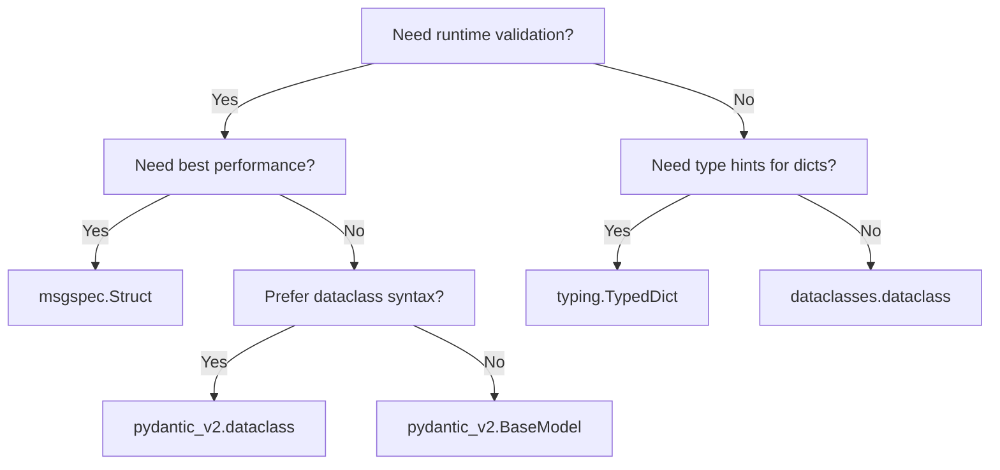

<!-- related-cli-options: --output-model-type, --frozen-dataclasses, --keyword-only, --dataclass-arguments, --target-python-version -->

# Output Model Types

datamodel-code-generator supports multiple output model types. This page compares them to help you choose the right one for your project.

## Quick Comparison

| Model Type | Validation | Serialization | Performance | Use Case |
|------------|------------|---------------|-------------|----------|
| **Pydantic v2** | Runtime | Built-in | Fast | New projects, APIs, data validation |
| **Pydantic v2 dataclass** | Runtime | Built-in | Fast | Pydantic validation with dataclass syntax |
| **dataclasses** | None | Manual | Fastest | Simple data containers, no validation needed |
| **TypedDict** | Static only | Dict-compatible | N/A | Type hints for dicts, JSON APIs |
| **msgspec** | Runtime | Built-in | Fastest | High-performance serialization |

---

## Pydantic v2 (Recommended)

**Use `--output-model-type pydantic_v2.BaseModel`**

Pydantic v2 is recommended for new projects. It offers better performance and a modern API.

```bash
datamodel-codegen --input schema.json --output-model-type pydantic_v2.BaseModel --output model.py
```

```python
from pydantic import BaseModel, Field, RootModel


class Pet(BaseModel):
    id: int = Field(..., ge=0)
    name: str = Field(..., max_length=256)
    tag: str | None = None


class Pets(RootModel[list[Pet]]):
    root: list[Pet]
```

### When to use

- New projects requiring data validation
- APIs requiring data validation
- Projects needing JSON Schema generation from models

---

## Pydantic v2 dataclass

**Use `--output-model-type pydantic_v2.dataclass`**

Pydantic v2 dataclass combines the familiar dataclass syntax with Pydantic's validation capabilities.

```bash
datamodel-codegen --input schema.json --output-model-type pydantic_v2.dataclass --output model.py
```

```python
from pydantic.dataclasses import dataclass
from typing import Optional


@dataclass
class Pet:
    id: int
    name: str
    tag: Optional[str] = None
```

### When to use

- Want to use dataclass syntax with Pydantic validation
- Migrating from dataclasses but need validation
- Prefer decorator-based class definition

---

## Targeting a Pydantic version

Pydantic output depends only on the inputs and options, never on the Pydantic version installed next to
`datamodel-codegen`. Use `--target-pydantic-version` to choose the oldest Pydantic release the generated code must
run on. Pass `--target-pydantic-version 2` when the generated code must also run on older Pydantic 2 releases.

When the target is unset:

- **Feature forms** use the newest supported forms, the same as `2.12`.
- **Config key naming** is unchanged: `--allow-population-by-field-name` emits `populate_by_name=True`, as with `2`.
  Only an explicit `2.11`, `2.12` or `2.14` emits `validate_by_name=True`.
- **`--use-missing-sentinel`** keeps the experimental `pydantic.experimental.missing_sentinel` import, as with `2.12`.

| Generated form | `2` (Pydantic 2.0+) | Unset, `2.11`, `2.12`, `2.14` |
| --- | --- | --- |
| Constrained strings with `--use-annotated` (2.1+) | `Annotated[str, Field(...)]` | `Annotated[str, StringConstraints(...)]` |
| `pydantic_v2.dataclass` aliases that are not identifiers (2.4+) | `Field(validation_alias=..., serialization_alias=...)` assignment | `Field(alias=...)` |
| Deprecated fields (2.7+) | `Field(json_schema_extra={'deprecated': True})` | `Field(deprecated=True)` |
| Models used as dictionary keys (2.8+) | Defined before the models that use them as keys | Schema order |
| `--alias-generator` field aliases (2.8+) | `alias=` on every `BaseModel` field | `alias=` only where the generated alias differs |
| Type alias patterns that need Python's regex engine (2.8+) | String pattern; every model that reaches the alias, directly or through other models, sets `regex_engine="python-re"` | Compiled `re.compile(...)` pattern |
| `pydantic_v2.dataclass` aliases of other models (2.10+) | `Alias: TypeAlias = Model` | `Alias = TypeAliasType("Alias", Model)` |
| Explicit aliases naming a `BaseModel` attribute (2.10+) | Rejected when the attribute starts with `model_` | Rejected only when it starts with `model_validate` or `model_dump` |
| `--use-annotated` fields whose type is defined later in the module (2.11+) | `name: Type = Field(...)` assignment | `name: Annotated[Type, Field(...)]` |

| Config key naming | Unset, `2` | `2.11`, `2.12`, `2.14` |
| --- | --- | --- |
| `--allow-population-by-field-name` | `populate_by_name=True` | `validate_by_name=True` |

`2.12` also enables options that need Pydantic 2.12, such as `--use-missing-sentinel`.

| `--use-missing-sentinel` import | Unset, `2.12` | `2.14` |
| --- | --- | --- |
| `MISSING` (2.14 deprecates the experimental path) | `from pydantic.experimental.missing_sentinel import MISSING` | `from pydantic import MISSING` |

| `bytes` patterns the Rust regex engine rejects | Unset, `2`, `2.11`, `2.12` | `2.14` |
| --- | --- | --- |
| Model regex engine (2.14 compiles the patterns of plain and optional `bytes` fields, 2.11 to 2.13 ignore them) | Default engine | `regex_engine="python-re"` |

The `bytes` rule is not applied to an unset target, because `python-re` changes how the other patterns of the model
match on every Pydantic release. A `bytes` pattern with syntax such as a backreference then fails at import on
Pydantic 2.14 unless `--target-pydantic-version 2.14` is passed, and on Pydantic 2.12 for a `bytes | MISSING` field
(`--use-missing-sentinel`), whose pattern 2.12 compiles as well. Pydantic 2.0 to 2.10 rejects any rendered `bytes`
pattern at import. See [Regular Expression Patterns](jsonschema.md#regular-expression-patterns).

| `pydantic_v2.dataclass` required fields written as `= Field(...)` | Unset, `2`, `2.11`, `2.12` | `2.14` |
| --- | --- | --- |
| Position when the schema lists them after a field with a default of the same class (2.13+ rejects that order in `inspect.signature`) | Schema order | Before the fields with defaults |

A required `pydantic_v2.dataclass` field that needs `Field(...)`, for an alias, a description or a constraint, is
written as an assignment, so it can follow a field with a default:

```python
@dataclass
class Pet:
    plain: str
    nick: str | None = "x"
    first_name: str = Field(..., alias="first-name")
```

With the target unset or older than `2.14`, such a class keeps the order of datamodel-code-generator 0.83.0. It
validates and constructs on Pydantic 2.4 and later, the first release that accepts the non-identifier alias, but on
Pydantic 2.13 and later its signature cannot be read: `inspect.signature(Pet)` raises
`ValueError: non-default argument follows default argument`, which affects tools that read the signature. On Python
3.10 with Pydantic 2.13 and later, a dataclass that inherits from such a class fails at import with the same error,
because Python 3.10 reads the signature while it creates the subclass. Pass `--target-pydantic-version 2.14` in either
case: `first_name` is then written before `nick`. The generator warns about each class that keeps such an order, in its
own fields or through its bases.

The order is not changed for an unset or older target, because positional arguments follow the field order:
`Pet("p", "a", "b")` sets `nick="a"` in schema order and `first_name="a"` with `2.14`. Keyword arguments work with both
orders.

With `--use-annotated` a required field keeps its metadata in `Annotated` and comes before the fields with defaults on
every target. A non-identifier alias of such a field is written as an assignment with `2` (see the 2.4 row above); the
field then stays with the required fields, after those without an assignment. A required field that a subclass adds
after an inherited field with a default is written with `kw_only=True` for every target.

Patterns that need Python's regex engine, such as lookaround assertions (see
[Regular Expression Patterns](jsonschema.md#regular-expression-patterns)), rely on `regex_engine="python-re"`, which
Pydantic added in 2.5. With every target, a model that has such a pattern fails at import on Pydantic 2.0 to 2.4. A type
alias (`--use-type-alias`, and the root schemas of `pydantic_v2.dataclass` output) has no config of its own:

- With `2` its pattern stays a string, and every generated `BaseModel` or `pydantic_v2.dataclass` that reaches the
  alias, directly or through other models and their base classes, sets `regex_engine="python-re"`, so the generated
  models validate on Pydantic 2.5 and later. A `RootModel` that reaches the alias is written as `RootModel[Any]` and
  keeps the alias in its `root` annotation, because Pydantic builds the generic before the config applies.
- With `2`, nothing selects the engine outside the generated models. A hand-written model that embeds a generated model
  or alias must set `regex_engine="python-re"` itself, and an alias validated on its own needs
  `TypeAdapter(Alias, config=ConfigDict(regex_engine="python-re"))`. On Pydantic 2.8 to 2.10 this is a difference from
  an unset target, because no target lies between `2` and `2.11`.
- Unset, or with `2.11` and later, the alias carries a compiled `re.compile(...)` pattern, which needs Pydantic 2.8 and
  validates on its own.

The combined `pattern` constraints of XML Schema input stay compiled for every target, `2` included, and need Pydantic
2.8; see [XML Schema limitations](xmlschema.md#limitations).

With `2` and `--use-annotated`, a `BaseModel`, `RootModel` or `pydantic_v2.dataclass` field whose type names a model
defined later in the same module is written as an assignment, as it is without `--use-annotated`. Pydantic before 2.11
cannot evaluate such an annotation while it creates the class, and then mishandles the `Field()` inside
`Annotated[...]`: depending on the release it drops the alias and the description, ignores `validate_default`, or fails
on a constraint. Required dataclass fields written this way move after the other required fields. Fields that reference
only their own model or earlier models, and output without deferred annotations (`--disable-future-imports`), keep the
`Annotated` form.

For a field written this way, type checkers that read `Field()` assignments, such as pyright, take the alias as the
constructor argument name and treat a positional default such as `Field(None, alias=...)` as a required argument. Add
`--use-default-kwarg` to emit `Field(default=None, ...)` instead.

With `2`, `--alias-generator` output names every alias in `Field(alias=...)`. Type checkers that read the alias as the
constructor argument name, such as pyright, then expect the alias instead of the field name; at runtime
`populate_by_name=True` still accepts both.

---

## dataclasses

**Use `--output-model-type dataclasses.dataclass`**

Python's built-in dataclasses for simple data containers without runtime validation.

```bash
datamodel-codegen --input schema.json --output-model-type dataclasses.dataclass --output model.py
```

```python
from dataclasses import dataclass
from typing import Optional


@dataclass
class Pet:
    id: int
    name: str
    tag: Optional[str] = None
```

### Options for dataclasses

| Option | Description |
|--------|-------------|
| `--frozen-dataclasses` | Generate immutable dataclasses (`frozen=True`) |
| `--keyword-only` | Require keyword arguments (`kw_only=True`, Python 3.10+) |
| `--dataclass-arguments` | Custom decorator arguments as JSON |

```bash
# Frozen, keyword-only dataclasses
datamodel-codegen --input schema.json --output-model-type dataclasses.dataclass \
  --frozen-dataclasses --keyword-only --target-python-version 3.10
```

### When to use

- Simple data structures without validation needs
- Performance-critical code where validation overhead matters
- Interoperability with code expecting dataclasses

---

## TypedDict

**Use `--output-model-type typing.TypedDict`**

TypedDict provides static type checking for dictionary structures.

```bash
datamodel-codegen --input schema.json --output-model-type typing.TypedDict --output model.py
```

```python
from typing import TypedDict, NotRequired


class Pet(TypedDict):
    id: int
    name: str
    tag: NotRequired[str]
```

### When to use

- Working with JSON APIs where data remains as dicts
- Static type checking without runtime overhead
- Gradual typing of existing dict-based code

### Boundary payloads and partial updates

TypedDict is a good fit for data at an HTTP boundary. A PATCH payload can
distinguish three cases:

- the key is missing, so the existing value should stay unchanged
- the key is present with `null`, so the value should be cleared
- the key is present with a value, so the value should be replaced

Use `--strict-nullable` when the difference between a missing key and a
nullable value matters:

```bash
datamodel-codegen --input user-patch.schema.json \
  --output-model-type typing.TypedDict \
  --strict-nullable \
  --target-python-version 3.13 \
  --output model.py
```

```json
{
  "$schema": "https://json-schema.org/draft/2020-12/schema",
  "title": "UserPatch",
  "type": "object",
  "required": ["id"],
  "properties": {
    "id": {"type": "string", "readOnly": true},
    "nickname": {"type": ["string", "null"]},
    "bio": {"type": "string"}
  },
  "additionalProperties": false
}
```

```python
from typing import NotRequired
from typing_extensions import TypedDict


class UserPatch(TypedDict, closed=True):
    id: str
    nickname: NotRequired[str | None]
    bio: NotRequired[str]
```

Here `nickname: NotRequired[str | None]` means the key may be omitted, and
`None` is still a real value when the key is present. This follows
[PEP 655](https://peps.python.org/pep-0655/), which added `Required` and
`NotRequired` for per-key presence in TypedDict.

If the schema marks response-only fields with `readOnly`, combine this with
`--use-frozen-field` to generate `ReadOnly` for TypedDict output:

```bash
datamodel-codegen --input user-patch.schema.json \
  --output-model-type typing.TypedDict \
  --strict-nullable \
  --use-frozen-field \
  --target-python-version 3.13 \
  --output model.py
```

```python
from typing import NotRequired, ReadOnly
from typing_extensions import TypedDict


class UserPatch(TypedDict, closed=True):
    id: ReadOnly[str]
    nickname: NotRequired[str | None]
    bio: NotRequired[str]
```

`ReadOnly` comes from [PEP 705](https://peps.python.org/pep-0705/). The
`closed=True` output comes from [PEP 728](https://peps.python.org/pep-0728/)
and represents `additionalProperties: false` for type checkers that understand
closed TypedDicts.

!!! note "Background"
    The distinction between missing keys, `None`, and unset update arguments is
    covered in Koudai Aono's PyCon US 2026 talk
    [Beyond Optional in Real-World Projects](https://github.com/koxudaxi/pyconus_2026/blob/main/slides.md).
    In datamodel-code-generator today, TypedDict and msgspec preserve that
    boundary shape most directly. Pydantic models and dataclasses are usually a
    better fit after the boundary has been normalized into application data.

---

## msgspec

**Use `--output-model-type msgspec.Struct`**

[msgspec](https://github.com/jcrist/msgspec) offers high-performance serialization with validation.

```bash
pip install msgspec
datamodel-codegen --input schema.json --output-model-type msgspec.Struct --output model.py
```

```python
from msgspec import Struct, UNSET, UnsetType


class Pet(Struct):
    id: int
    name: str
    tag: str | UnsetType = UNSET
```

### Discriminated unions

msgspec only decodes a union of structs when every struct is tagged, and a tagged struct cannot also have a field
named like its `tag_field`. By default the output keeps the 0.83.0 form, in which a variant whose discriminator
value comes from the discriminator `mapping`, an `enum` or the schema name keeps the discriminator as a field:

```python
class Cat(Struct):
    petType: Literal["cat"]
    meow: str | UnsetType = UNSET
```

`Cat(petType='cat')`, `cat.petType` and decoding `Cat` on its own work, but decoding the union `Cat | Dog` raises
msgspec's `TypeError`. That form only tags a variant whose discriminator property is a single literal such as a
`const`, or one that a second discriminated union uses, and its `tag_field` is the generated field name, which
differs from the property name when the field is renamed.

[`--use-msgspec-tagged-unions`](cli-reference/model-customization.md#use-msgspec-tagged-unions) writes a union as
tagged structs as a whole instead, with the property name of the document as `tag_field`:

```python
class Cat(Struct, tag_field="petType", tag="cat"):
    meow: str | UnsetType = UNSET
```

The union then decodes, while `petType` is no longer a constructor argument or an attribute, and `Cat` decoded on
its own accepts a payload without `petType`. When a variant cannot take exactly one tag for the union, or a base
or derived struct of a variant keeps the property as a field, the union tags none of its variants, the ones with
a `const` included, and a warning names the reason. A variant that another union tags keeps that tag.

### Enums that list null

msgspec only decodes an `Enum` whose members are all `str` or all `int` values. By default the output keeps the
0.83.0 form of an enum that lists `null` without `type: string` or `nullable: true`, such as
`type: [integer, "null"]` with `enum: [1, 2, null]`, which is an Enum with a `None` member:

```python
class Size(Enum):
    int_1 = 1
    int_2 = 2
    NoneType_None = None
```

`Size.int_1` works, but decoding a struct with a `Size` field raises msgspec's `TypeError`, and the `IntEnum` that a
`type: integer` enum is written as fails at import.
[`--use-msgspec-nullable-enum-alias`](cli-reference/model-customization.md#use-msgspec-nullable-enum-alias) writes
it as a `type: string` or `nullable` enum is written instead, an Enum without the `None` member and an alias that
adds `None`:

```python
class SizeEnum(Enum):
    int_1 = 1
    int_2 = 2


Size: TypeAlias = SizeEnum | None
```

msgspec then decodes the members and `null`, while code that used `Size.int_1` or `Size.NoneType_None` uses
`SizeEnum.int_1` and `None`. The default of a field of such an enum is then its raw value, also with
`--set-default-enum-member`, and an enum that lists only `null` becomes `None`.

### When to use

- High-performance JSON/MessagePack serialization
- Memory-efficient data structures
- APIs with strict performance requirements

---

## Choosing the Right Type



### Decision Guide

1. **API with validation** → Pydantic v2
2. **Validation with dataclass syntax** → Pydantic v2 dataclass
3. **High-performance serialization** → msgspec
4. **Simple data containers** → dataclasses
5. **Dict-based JSON handling** → TypedDict

---

## See Also

- [CLI Reference: `--output-model-type`](cli-reference/model-customization.md#output-model-type)
- [CLI Reference: `--strict-nullable`](cli-reference/model-customization.md#strict-nullable)
- [CLI Reference: `--use-frozen-field`](cli-reference/model-customization.md#use-frozen-field)
- [CLI Reference: Model Customization](cli-reference/model-customization.md)
- [Pydantic Documentation](https://docs.pydantic.dev/)
- [msgspec Documentation](https://jcristharif.com/msgspec/)
